# Project 2 Presentation Storyboard

Topic: **Why Sparse MoE Routers Collapse Before They Specialize**  
Subtitle: **A mechanism audit of common-logit bias and early top-1 amplification**  
Target length: **~12 minutes**  
Format: copy-ready slide text + figure placement notes.  

## Quick Framing

Chinese definitions for delivery:

- 稀疏混合专家模型 (sparse Mixture-of-Experts, sparse MoE): 每个 token 只激活少数专家，从而增加参数量但控制计算量。
- 路由器 (router/gate): 决定 token 进入哪个 expert 的模块。
- 路由坍缩或负载集中 (route collapse / route concentration): 大量 token 被分到少数 expert。
- 共同成分 (common component): 所有被审计 token 的 hidden state 共享的平均方向，记为 $c$。
- 共同分数 (common-logit / common score): $w_e^T c$，即 expert $e$ 的 router weight 对共同成分的投影。
- 归一化互信息 (normalized mutual information, NMI): 衡量 route assignment 与 slot/feature label 是否对齐。
- 最大负载 (max load): 单个 expert 接收的 token 占比；越高表示负载越集中。

Design rule:
Use **claim-style titles**, **2-3 bullets per slide**, and **one main proof object per slide**. Avoid presenting this as a finished method paper; frame it as a mechanism audit that motivates the next gating initialization.

New literature integration:

- Wang et al. (2026), *The Myth of Expert Specialization in MoEs*, supports a strict claim boundary: routing patterns mainly reflect hidden-state geometry, not necessarily human-interpretable domain expertise.
- Ahrac et al. (2026), *Routers Learn the Geometry of Their Experts*, supports the next-mechanism direction: routers and selected experts co-evolve through shared routed-token geometry, so a useful initialization should preserve router-expert coupling, not only balance load.
- Our updated framing: this project audits **which hidden-state geometry top-1 routing amplifies before useful specialization can form**.

---

## Slide 01. Title

Time: 0:00-0:35

On-slide title:

```text
Why Sparse MoE Routers Collapse Before They Specialize
```

Subtitle:

```text
A mechanism audit of common-logit bias and early top-1 amplification
```

Small footer:

```text
Academic Writing Project 2 | 12-min research update
```

Placement:
Use a clean title slide. Optional small visual on the right: `figures/s02_background_gap_diagram.png`, cropped to the three top boxes only.

Speaker logic:
这页只交代主题：我不是展示一个完整新方法，而是在做机制解释，回答为什么 sparse top-1 MoE 还没形成 specialization 就先进入 route concentration。

---

## Slide 02. MoE scaling depends on routing, not only expert count

Time: 0:35-1:30

On-slide title:

```text
MoE scaling depends on routing, not only expert count
```

On-slide bullets:

```text
- Sparse MoE increases parameter count by activating only a few experts per token.
- The router decides which experts receive data and gradient.
- Recent work suggests expert usage reflects hidden-state geometry, not necessarily domain expertise.
```

Figure:

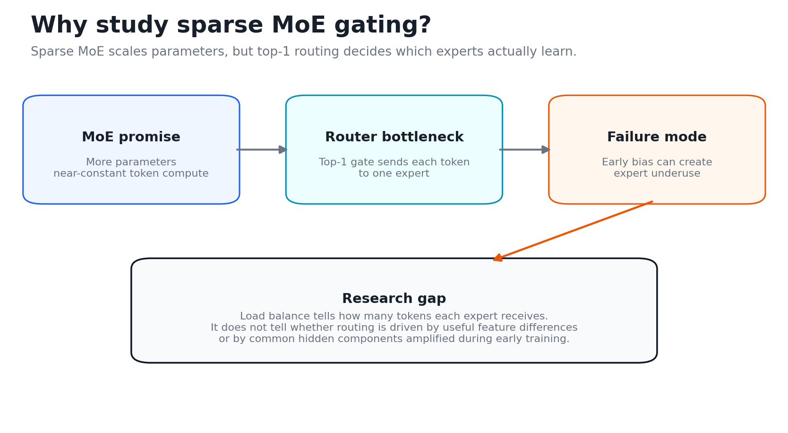

Placement:
Put the figure full width below the title. Keep bullets in a narrow left column or as a short caption under the title.

Speaker logic:
背景调研的重点是：MoE 文献一直知道负载不均衡是问题，所以有 load-balancing loss、balanced assignment、expert choice 等方法。新近两篇 geometry paper 把问题进一步收紧：routing pattern 不能直接解释成 domain expertise，它首先反映 hidden-state geometry。我的问题更细：router 到底放大的是 useful residual geometry，还是 common direction？

---

## Slide 03. Research question: missing features or bad early routing?

Time: 1:30-2:20

On-slide title:

```text
Research question: missing features or bad early routing?
```

On-slide bullets:

```text
Working thesis:
Hidden states can contain useful feature information, but a common component can create expert-specific routing bias.

Core question:
Which hidden-state geometry does top-1 training amplify before useful specialization can form?
```

Figure:

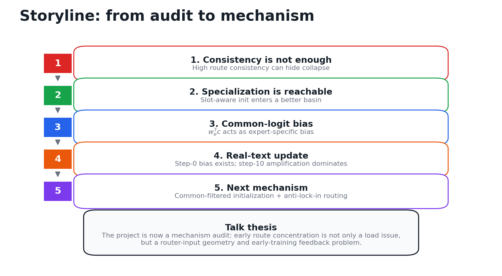

Placement:
Use the figure full slide width. If the template has a sidebar, put the two bullets in that sidebar and the ladder in the main body.

Speaker logic:
这里把 7 天 meeting brief 串成一条故事线：先发现 consistency 不够，再证明 specialization 可达，然后定位 common-logit bias，最后真实文本把 claim 修正成 early-training amplification。这里用 Wang et al. (2026) 的观点收边界：我们讨论的是 routing geometry，不直接声称 domain expertise。

---

## Slide 04. Route consistency can be a false positive

Time: 2:20-3:10

On-slide title:

```text
High route consistency can hide collapse
```

On-slide bullets:

```text
- Early audits showed very high feature-key route consistency.
- But final route heatmaps revealed many slots captured by one expert.
- Therefore accuracy and consistency are not sufficient evidence for specialization.
```

Figure:

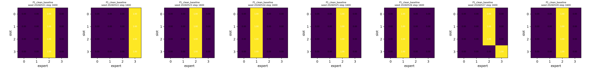

Placement:
Use the heatmap strip as a wide figure across the bottom 55-60% of the slide. Add a small callout: `same slot-to-expert consistency, but collapsed expert usage`.

Speaker logic:
这一页讲“为什么研究这个问题”。如果只看同一个 feature 是否稳定进入同一个 expert，会被 collapse 误导。真正应该看 slot NMI、max load、heatmap 形态，以及干预后是否改善。

---

## Slide 05. Specialization is reachable, but random top-1 often misses the basin

Time: 3:10-4:05

On-slide title:

```text
Specialization is reachable, but random top-1 often misses the basin
```

On-slide bullets:

```text
- Slot-aware initialization produces stable slot-to-expert structure.
- Oracle-to-trainable release preserves specialization after the router is placed in a good basin.
- The bottleneck is basin entry, not the impossibility of specialization.
```

Figures:

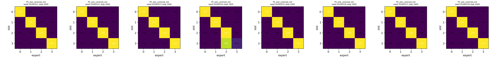

Optional secondary figure:

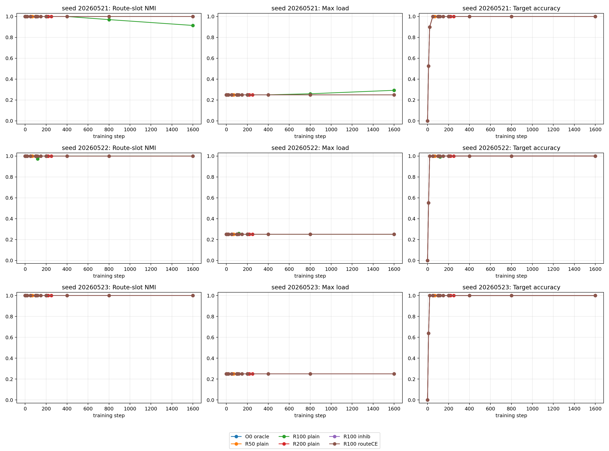

Placement:
Primary version: use the heatmap strip full width.  
If there is space, place the oracle release trajectory as a small inset on the right; otherwise mention it verbally and keep only the heatmap.

Speaker logic:
这页的关键是排除 rival explanation：不是模型根本学不了，也不是 hidden state 中没有 slot 信息。只要初始化进入合适 basin，后续训练可以维持 specialization。

---

## Slide 06. Common-logit bias is the mechanism candidate

Time: 4:05-5:00

On-slide title:

```text
Common-logit bias is an expert-specific effective bias
```

On-slide bullets:

```text
Router input:  h_i = c + r_i
Gate score:    z_{i,e} = w_e^T c + w_e^T r_i

w_e^T c is feature-independent, but it differs across experts.
```

Figure:

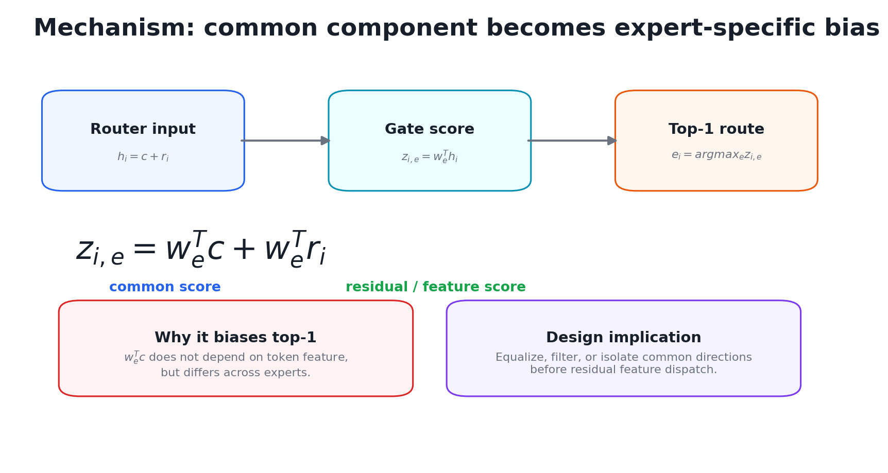

Placement:
Use the diagram full width. Put the formula in the center; highlight $w_e^T c$ in the template color if editing manually.

Speaker logic:
共同成分不是坏东西本身；问题在于点积 router 会把同一个 $c$ 投影成不同 expert 的固定分数。这个分数和 feature 无关，却影响所有 token 的 argmax，所以像一个 expert-specific bias。Wang et al. (2026) 的线性 router 几何观点给这页提供外部支撑：routing similarity 首先来自 hidden-state similarity。

---

## Slide 07. In controlled toy settings, common-logit is early and causal

Time: 5:00-6:15

On-slide title:

```text
Controlled evidence: common-logit is early and intervention-relevant
```

On-slide bullets:

```text
- Common margin rises before slot margin becomes decisive.
- Common-logit cancellation improves slot NMI while preserving accuracy.
- This supports common-logit as a causal contributor in the controlled setting.
```

Figures:

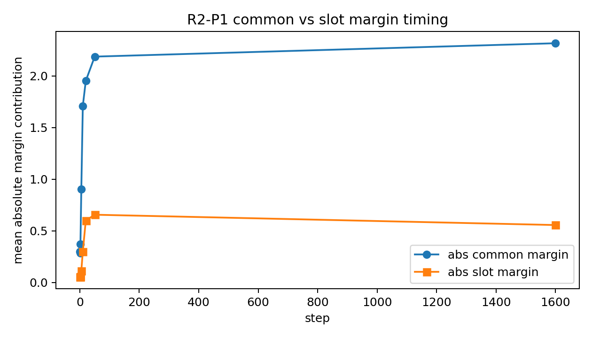

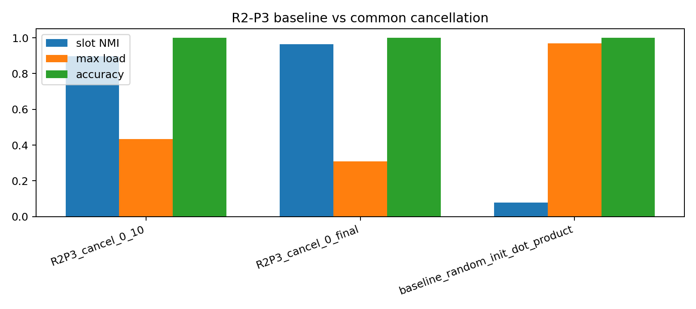

Placement:
Two-column layout:
Left: `s07_common_vs_slot_margin_timing.png`  
Right: `s07_common_cancellation_metrics.png`  
Add one bottom caption: `slot NMI: 0.080 -> 0.896/0.963; accuracy remains 1.000`.

Speaker logic:
这页是 toy causality 的核心证据：不是只做解释，而是做了 intervention。common cancellation 不是单纯让负载好看，而是 slot NMI 大幅提高，同时 accuracy 不掉。

---

## Slide 08. Common offset is useful, but not a complete solution

Time: 6:15-7:10

On-slide title:

```text
The common source can be localized, but removing it is not sufficient
```

On-slide bullets:

```text
- Fixed routed position / template structure is a major source of step-0 common offset.
- Zeroing routed position reduces common ratio and step-0 max load.
- But lower max load does not automatically imply stable slot-level specialization.
```

Figure:

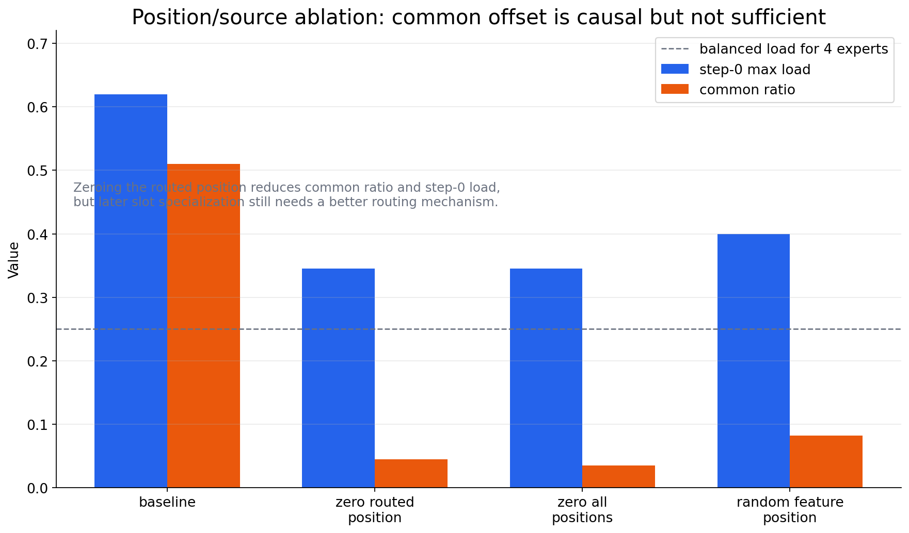

Placement:
Use figure full width. Keep a small text box on the right or bottom:
`Boundary: offset control improves early geometry, but final specialization still needs a routing mechanism.`

Speaker logic:
这里收边界：common-offset 是一个关键解释，但不是完整解决方案。避免把“去 common”讲成最后方法。它告诉我们下一步要做的是 common-aware + anti-lock-in 的初始化/机制，而不是只做 centering。

---

## Slide 09. Real text weakens the strong step-0 dominance claim

Time: 7:10-8:15

On-slide title:

```text
Real text weakens the strong step-0 dominance claim
```

On-slide bullets:

```text
DCLM step 0:
common_margin = 0.1237, residual_margin = 0.2364
dominance_ratio = 0.5251; common-dominant cases = 1 / 18

But centering reduces max load:
0.2781 -> 0.1561
```

Figures:

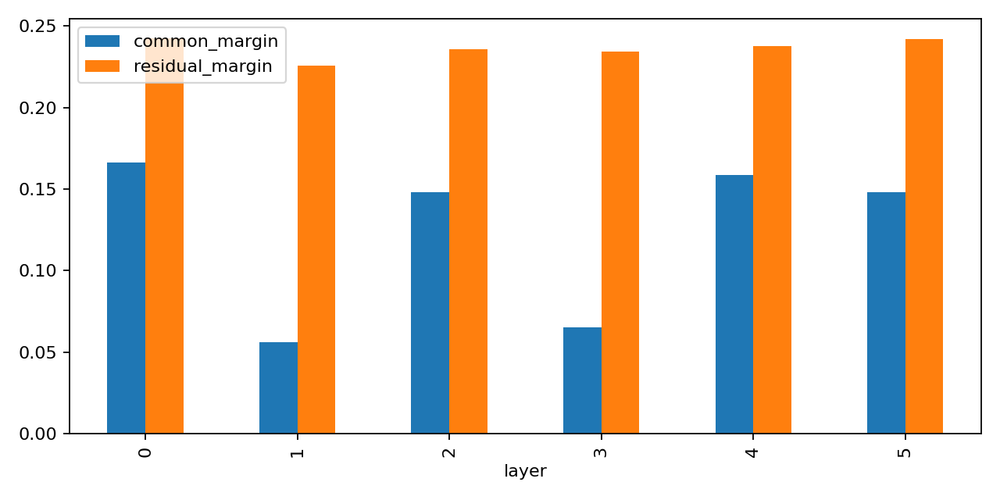

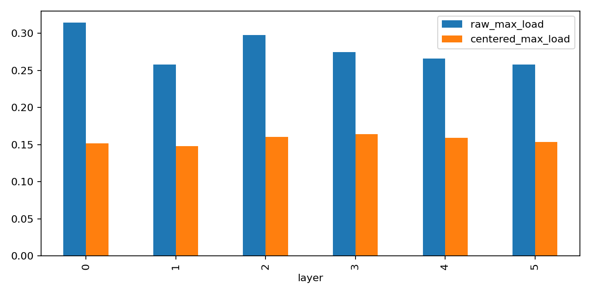

Placement:
Two-column layout:
Left: common vs residual margin.  
Right: raw vs centered max load.  
Put the numeric takeaway in a top-right callout.

Speaker logic:
这页要诚实更新假设：真实文本下不能说 step 0 已经由 common component 主导；残差 margin 更大。但是 common 仍然是负载偏置源，因为 centering 后 max load 明显下降。

---

## Slide 10. The real-text problem shifts to early-training amplification

Time: 8:15-9:15

On-slide title:

```text
Real-text route concentration is rapidly amplified during early training
```

On-slide bullets:

```text
- Step-0 raw max load is already biased: 0.2781.
- By step 10, raw max load reaches 0.8507 and dominance_ratio reaches 21.8.
- The issue is severe concentration, not immediate death of all other experts.
```

Figure:

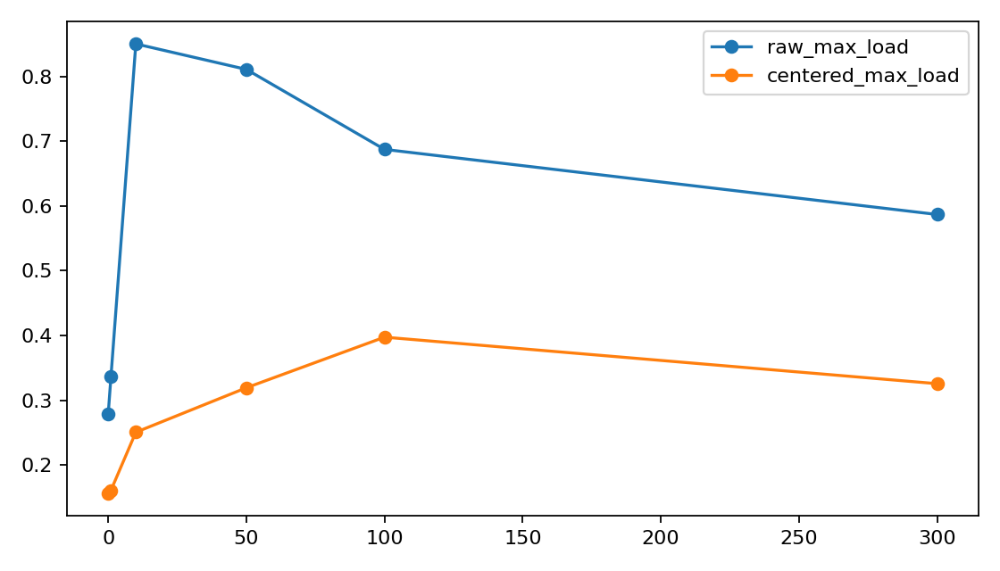

Optional secondary figure:

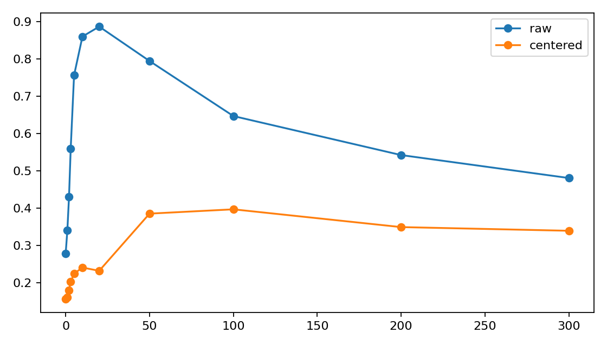

Placement:
Use `s10_realtext_early_load_amplification.png` as the main figure. If the template supports an inset, use the normal trajectory as a small validation inset; otherwise omit it.

Speaker logic:
这一页是故事转折：从“初始化几何问题”转成“初始化偏置 + early training feedback”。真实文本中 step 10 放大非常快，所以机制解释必须包含训练路径，而不只是 $W_0$ 和 $H_0$。

---

## Slide 11. Freeze split separates raw concentration from common-margin spike

Time: 9:15-10:35

On-slide title:

```text
Raw concentration and common-margin amplification are related, not identical
```

On-slide bullets:

```text
Layer 5, step 0 -> 10:
normal common-margin delta = 1.2760; raw max-load delta = 0.7334

freeze_gate_all keeps raw load concentration, but reduces common-margin spike.
freeze_prefix_before_layer5 suppresses both effects.

Interpretation:
selected-token history and hidden/gate interaction matter, not gate-only geometry.
```

Figure:

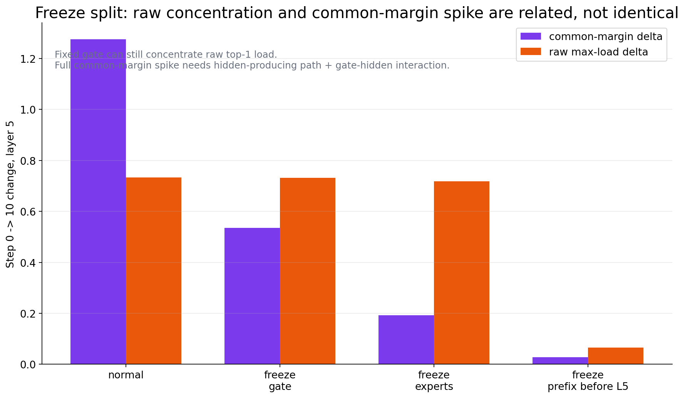

Optional secondary figure:

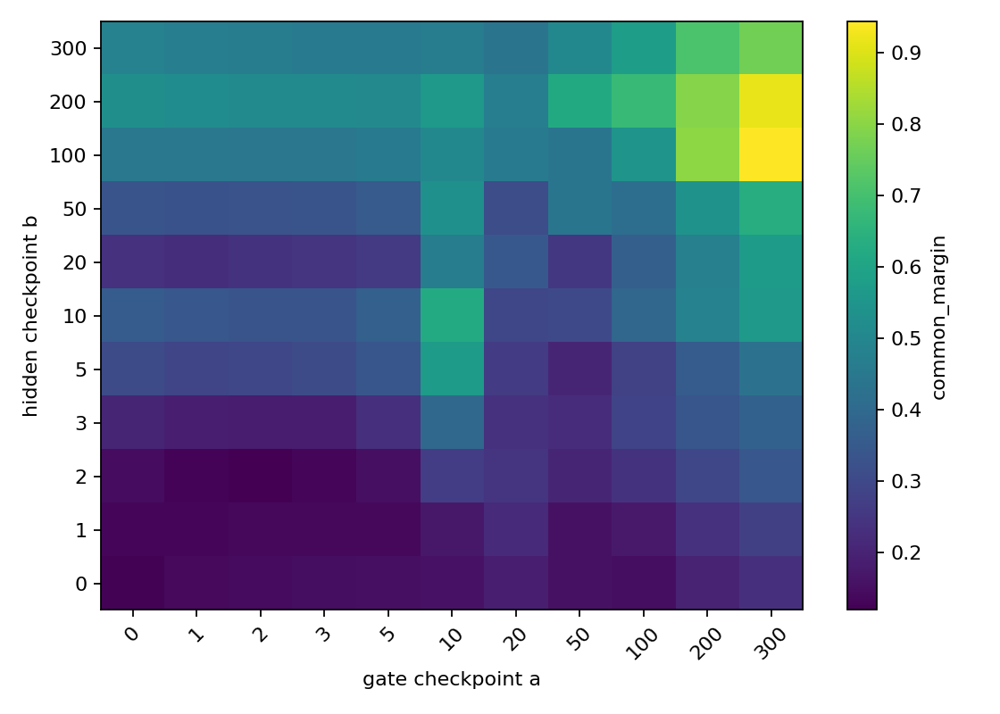

Placement:
Use the bar chart as the main proof object. If you need one extra visual, place the replay heatmap as a small appendix-style inset, but do not let it dominate the slide.

Speaker logic:
这页是最新结果。结论不要讲成 gate-only：固定 gate 也能产生 raw load concentration；完整 common-margin spike 需要 hidden-producing path 和 gate-hidden interaction。Ahrac et al. (2026) 的 router-expert geometric coupling 让这个结果更有解释力：selected tokens 会同时塑造 router direction 和 expert input geometry，所以后续方法需要保护有用 coupling，同时抑制 common direction 的坏 coupling。

---

## Slide 12. 0615 stress test and current claim

Time: 10:35-12:00

On-slide title:

```text
0615 update: common-filtered spectrum init improves step 0, but fails by step 10
```

On-slide bullets:

```text
What worked:
common-filtered expert-spectrum initialization makes step-0 routing closer to uniform.

What failed:
it does not reduce step-10 common-margin amplification or top-1 load concentration.

Current claim:
the bottleneck is early-training amplification, not just initial geometric balance.
```

Figure:

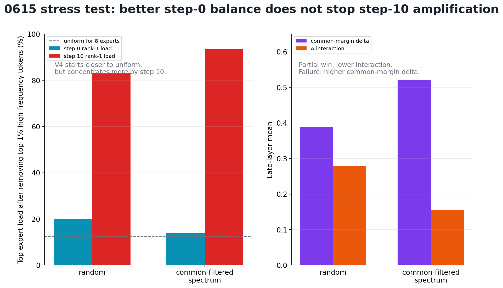

Placement:
Use the stress-test figure full width. Put a red callout near the left plot:
`V4: 13.97% at step 0 -> 93.51% at step 10`.
Put a small gray boundary line at the bottom:
`Negative-but-informative: not a successful method yet; still useful for identifying the failure bridge.`

Speaker logic:
结尾要像 research update：讲清楚 0615 的结果改变了什么。我们不能再把 common-filtered expert-spectrum linear init 当作 proposal 来讲，而要讲成一个 stress test：它确实改善第 0 步，但没有改善第 10 步。因此当前故事更强地指向 early-training amplification，需要后续审计 common-aligned winner 是否被 router update / hidden drift / gate-hidden interaction 继续放大。

Key numbers to say:

```text
After removing top-1% high-frequency token ids:
V0 random rank-1 load: 19.98% at step 0 -> 83.16% at step 10.
V4 common-filtered spectrum: 13.97% at step 0 -> 93.51% at step 10.

Late-layer average:
V4 lowers A_interaction: 0.2795 -> 0.1543.
But V4 worsens common-margin delta: 0.3878 -> 0.5203.
```

---

## Backup Slide A. References

Use small font, 2 columns.

```text
New geometry framing:
- Wang et al., 2026. The Myth of Expert Specialization in MoEs: Why Routing Reflects Geometry, Not Necessarily Domain Expertise.
- Ahrac et al., 2026. Routers Learn the Geometry of Their Experts: Geometric Coupling in Sparse Mixture-of-Experts.

Foundational sparse MoE:
- Shazeer et al., 2017. Outrageously Large Neural Networks: The Sparsely-Gated Mixture-of-Experts Layer.
- Lepikhin et al., 2020. GShard: Scaling Giant Models with Conditional Computation and Automatic Sharding.
- Fedus et al., 2021/2022. Switch Transformers: Scaling to Trillion Parameter Models with Simple and Efficient Sparsity.

Routing and load-balance alternatives:
- Lewis et al., 2021. BASE Layers: Simplifying Training of Large, Sparse Models.
- Zhou et al., 2022. Mixture-of-Experts with Expert Choice Routing.
- Zoph et al., 2022. ST-MoE: Designing Stable and Transferable Sparse Expert Models.

Modern MoE motivation:
- Du et al., 2021. GLaM: Efficient Scaling of Language Models with Mixture-of-Experts.
- Jiang et al., 2024. Mixtral of Experts.
- Dai et al., 2024. DeepSeekMoE: Towards Ultimate Expert Specialization.

Representation common-component context:
- Mu and Viswanath, 2018. All-but-the-Top.
- Ethayarajh, 2019. How Contextual are Contextualized Word Representations?
```

Links:

- [Routers Learn the Geometry of Their Experts](https://arxiv.org/abs/2605.12476)
- [The Myth of Expert Specialization in MoEs](https://arxiv.org/abs/2604.09780)
- [Shazeer et al. 2017](https://arxiv.org/abs/1701.06538)
- [GShard](https://arxiv.org/abs/2006.16668)
- [Switch Transformers](https://arxiv.org/abs/2101.03961)
- [BASE Layers](https://arxiv.org/abs/2103.16716)
- [Expert Choice Routing](https://arxiv.org/abs/2202.09368)
- [ST-MoE](https://arxiv.org/abs/2202.08906)
- [GLaM](https://arxiv.org/abs/2112.06905)
- [Mixtral](https://arxiv.org/abs/2401.04088)
- [DeepSeekMoE](https://arxiv.org/abs/2401.06066)
- [All-but-the-Top](https://arxiv.org/abs/1702.01417)
- [Contextual Representation Geometry](https://arxiv.org/abs/1909.00512)

---

## Backup Slide B. How the two new papers update this project

Use only if asked why this is not just another MoE specialization talk.

```text
The Myth of Expert Specialization:
Routing patterns reflect hidden-state geometry; do not equate route clusters with domain expertise.

Routers Learn the Geometry of Their Experts:
Selected tokens jointly shape router directions and expert input geometry; useful routing may require preserving this coupling.

Our update:
Common-logit bias is a concrete bad geometry.
The next gating initialization should filter common directions while preserving residual router-expert coupling.
```

Speaker logic:
这页回答“你的工作和新文献的区别是什么”。我们的贡献不是重复“routing is geometry”，而是给出一个具体 mechanism：共同方向 $c$ 如何变成 $w_e^T c$ 的 expert-specific top-1 bias，并在真实文本早期训练中被放大。

---

## Backup Slide C. Next decision after the 0615 stress test

Use this only if asked what to do next.

```text
Do not promote V4 as a successful method.

Next diagnostic:
Does the initially common-aligned router winner receive reinforcing updates during steps 0-10?

Measure:
c_t = mean router input
s_e(t) = w_e(t)^T c_t
load_e(t) = top-1 load
delta_w_e(t)^T c_t = router update along the common direction

Decision:
If winner projection grows with load, test router self-reinforcement.
If not, shift to hidden drift / residual anisotropy / expert-output feedback.
```

Figure:

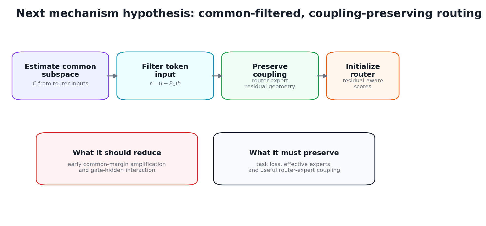

Speaker logic:
这页是问答用。正式汇报最后不主动把它讲成方法，只说下一步是最小 post-hoc audit。这里的关键是把“失败”转成下一步的最小 causal bridge：第 0 步 common-aligned winner 是否被前 10 步训练进一步放大。

---

## Figure Manifest

| Slide | File | Role |
|---:|---|---|
| 02 | `figures/s02_background_gap_diagram.png` | Motivation and research gap |
| 03 | `figures/s03_storyline_ladder.png` | Seven-day storyline |
| 04 | `figures/s04_baseline_collapse_heatmaps.png` | Baseline collapse heatmap |
| 05 | `figures/s05_slot_init_positive_control_heatmaps.png` | Specialization reachable |
| 05 | `figures/s05_oracle_release_trajectory.png` | Optional basin-preservation evidence |
| 06 | `figures/s06_common_logit_model.png` | Mechanism model |
| 07 | `figures/s07_common_vs_slot_margin_timing.png` | Common vs slot timing |
| 07 | `figures/s07_common_cancellation_metrics.png` | Common-cancel intervention |
| 08 | `figures/s08_position_source_simplified.png` | Common-source ablation summary |
| 09 | `figures/s09_realtext_step0_common_vs_residual.png` | Real-text step-0 margin update |
| 09 | `figures/s09_realtext_raw_vs_centered_load.png` | Centering reduces load bias |
| 10 | `figures/s10_realtext_early_load_amplification.png` | Early-training load amplification |
| 10 | `figures/s10_normal_max_load_trajectory.png` | Optional normal trajectory validation |
| 11 | `figures/s11_freeze_split_key_numbers.png` | Latest freeze-split causal summary |
| 11 | `figures/s11_replay_heatmap_common_margin.png` | Optional replay evidence |
| 12 | `figures/s12_0615_spectrum_init_stress_test.png` | Latest 0615 stress-test result |
| Backup | `figures/s12_0615_step10_common_margin_by_variant.png` | Optional detailed 0615 common-margin figure |
| Backup | `figures/s12_0615_step10_raw_max_load_by_variant.png` | Optional detailed 0615 load figure |
| Backup | `figures/s12_0615_replay_A_interaction_by_variant.png` | Optional detailed 0615 interaction figure |
| Backup | `figures/s12_next_mechanism_hypothesis.png` | Next diagnostic mechanism |

## Suggested 12-Minute Timing

| Section | Slides | Time |
|---|---:|---:|
| Motivation and question | 1-3 | 2:20 |
| Toy audit and mechanism | 4-8 | 4:50 |
| Real-text update and causal split | 9-11 | 3:25 |
| Current claim and next work | 12 | 1:25 |

If time is tight, merge Slide 04 and Slide 05 verbally: show baseline collapse, then say the positive control is in backup or as an inset.
