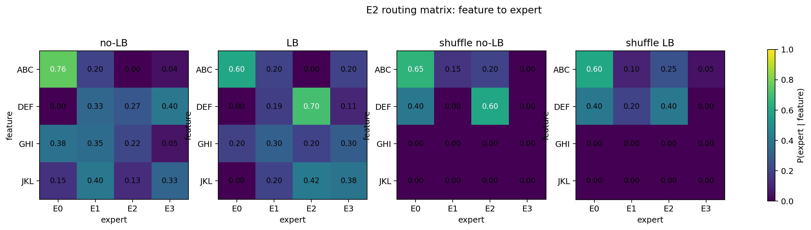
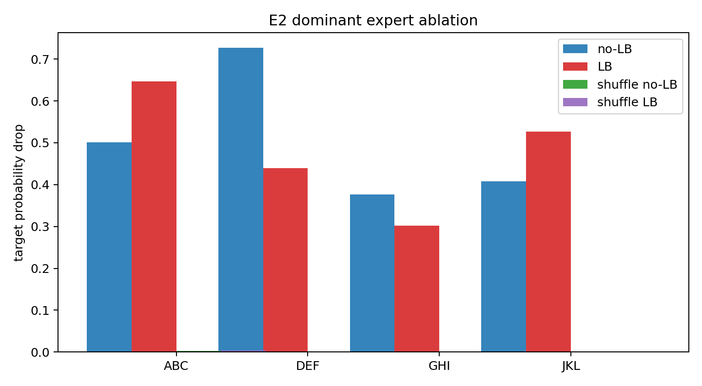
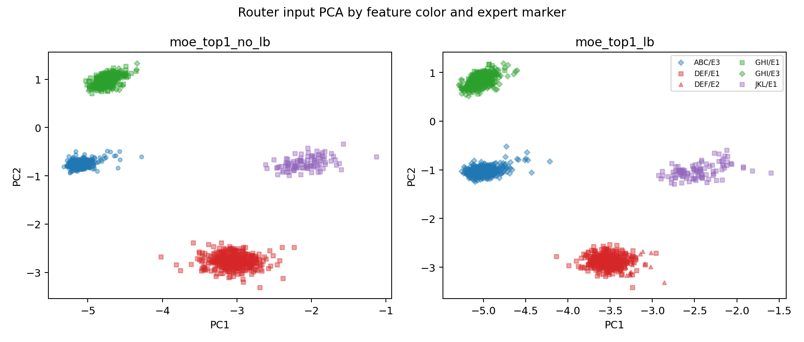
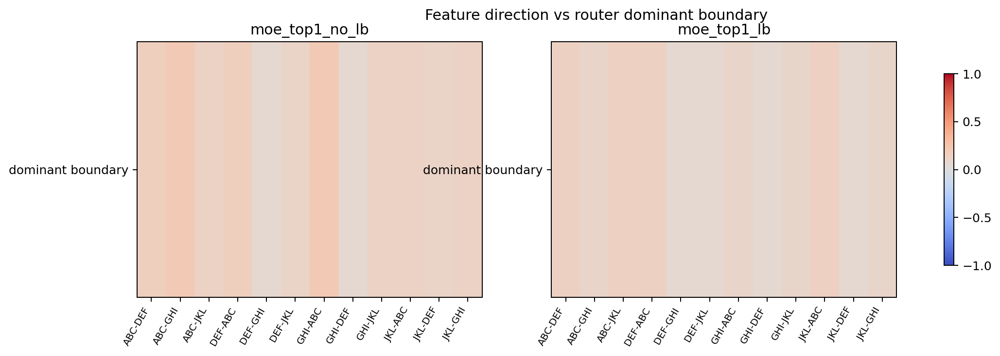
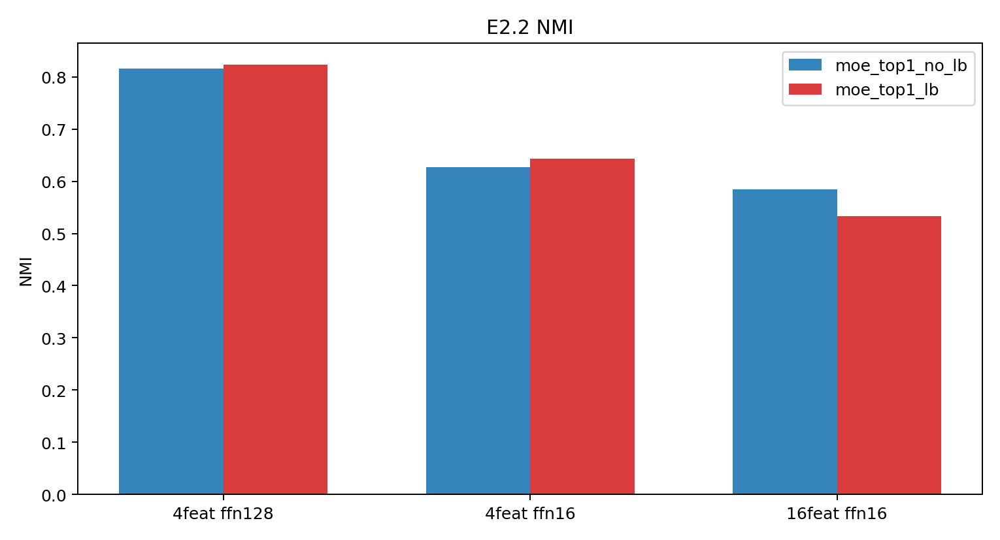
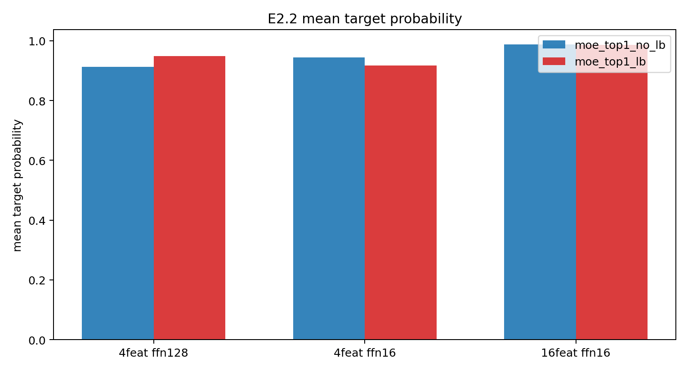

# 假设闭环：E2 MoE Feature Separation Anomaly - 0514

## 0. 一句话结论

E2 最稳妥的闭环不是“MoE 会自然形成 one-feature-one-expert”，而是：在 controlled trigram NTP 中，feature identity 可在 router input hidden space 中被读出，但 learned top-1 router 没有被 NTP loss 迫使沿 feature-separating directions 形成 clean expert specialization。

## 1. 原始目的

本轮实验原本要检验：当 toy next-token corpus 中反复出现明确的 sequential trigram features，例如 `[1,2] -> 22`、`[3,4] -> 23`，模型是否不仅能读回这些规则，还会在 top-1 MoE 中把不同 feature representations 分给不同 experts。

需要严格区分三件事：

- `feature` / `motif`：数据层面的人工规则，例如 `[1,2] -> 22`。
- `representation`：模型在 prefix-end 位置形成的 hidden state，例如 $h_{[1,2]}$。
- `expert specialization`：router 是否把不同 feature hidden states 映射到不同 experts，并且这些 expert outputs 是否对对应 feature prediction 有因果贡献。

## 2. 主线锚点与待判定假设

主线锚点：重复出现的上下文规则是否形成可读回的内部表征，并进一步驱动 MoE expert 分工。

待判定假设：

```text
H-weak: controlled trigram features 能驱动可测的 feature-expert alignment。
H-strong: 如果 feature representations 在 router input space 中可分，top-1 router 会自然形成 clean one-feature-one-expert partition。
```

当前结论：H-weak 被支持；H-strong 被削弱。

## 3. 可执行性说明

本次上传的 `E2_theory_ai_package.zip` 包含报告与图片，但不包含 `.py` 脚本、原始 `.csv` 表、checkpoint、hidden state tensor 或 `.npz/.pt` 中间结果。因此这次不能诚实地重跑新实验；本 closure 是基于包内 E2.0/E2.1/E2.2 已有结果做的理论诊断与下一轮实验设计。

## 4. 直接结果

### E2.0：MoE 确实学到 feature-expert alignment，但不是严格一一对应

- all-trigram MoE feature readback 很高：ABC 0.999/0.998，DEF 0.998/0.997，GHI 0.975/0.967，JKL 0.679/0.829（no-LB/LB）。
- shuffled unigram control feature readback 约为 0.001-0.011，说明主信号不是 unigram frequency。
- routing alignment 明显高于 random baseline：no-LB NMI 0.816、ARI 0.838；LB NMI 0.823、ARI 0.841；random NMI 约 0.0004、ARI 约 0。
- dominant expert ablation 会损伤 feature readback：no-LB drop 0.377-0.727，LB drop 0.302-0.646。
- force-routing 显示 dominant expert 通常更好，但不是唯一可用 expert；例如 no-LB JKL dominant P 0.679，best P 0.851，dominant-is-best 只有 0.40。

解释：MoE 有 feature-expert alignment，也有一定因果贡献；但不能说已经形成 clean one-feature-one-expert。





### E2.1：router input 可分，但 router boundary 不沿 feature-difference directions

- router input feature centroids 仍可分：Fisher ratio mean no-LB 123.220，LB 104.152。
- router boundary 与 feature-difference direction alignment 很低：mean abs alignment no-LB 0.129，LB 0.109；max alignment no-LB 0.266，LB 0.176。
- router entropy 接近 $\log(4)=1.386$：例如 no-LB feature entropy 1.301-1.338，LB 1.359-1.372。
- hidden similarity 与 routing similarity 相关性弱：no-LB 0.220，LB 0.175。
- force-routing dominant advantage 为正，但多个 experts 仍能支持同一 feature。

解释：不干净的 routing 不是因为 representation collapse；更像是 router 没有使用人类定义的 feature-separating directions，且 expert competence 存在 sharing。





### E2.2：增加 specialization pressure 没有推出 clean specialization

三组条件：baseline 4 features/ffn_dim 128，bottleneck 4 features/ffn_dim 16，pressure 16 features/ffn_dim 16。

关键表：

| Condition | Variant | CE | NMI | ARI | Readback | Ablation drop | Routing entropy | Dominant frac | Load imbalance |
|---|---|---:|---:|---:|---:|---:|---:|---:|---:|
| baseline | no-LB | 6.624 | 0.816 | 0.838 | 0.913 | 0.503 | 0.208 | 0.909 | 0.356 |
| baseline | LB | 6.625 | 0.823 | 0.841 | 0.948 | 0.479 | 0.126 | 0.935 | 0.015 |
| bottleneck | no-LB | 6.626 | 0.627 | 0.548 | 0.945 | 0.029 | 0.150 | 0.937 | 0.607 |
| bottleneck | LB | 6.625 | 0.644 | 0.591 | 0.917 | 0.003 | 0.204 | 0.922 | 0.014 |
| pressure | no-LB | 6.250 | 0.584 | 0.316 | 0.987 | 0.043 | 0.146 | 0.940 | 0.641 |
| pressure | LB | 6.250 | 0.534 | 0.241 | 0.986 | 0.065 | 0.114 | 0.953 | 0.027 |

解释：如果“容量太大”或“feature 太少”是主因，bottleneck 或 16-feature pressure 应该提高 NMI/ARI 和 ablation drop。实际相反：readback 仍高，但 ablation drop 崩到约 0.00-0.06。这强烈提示 feature prediction 可以绕过 dominant expert path，或者由多个 experts/shared path 共同承担。





## 5. 三个最可能机制解释与可证伪预测

### 机制 1：NTP objective 下的 shared-path bypass

定义：NTP loss 只奖励 target prediction，不奖励 feature-aligned routing。如果 attention/residual/LM head 或 shared expert corrections 已足够支持 readback，router 没有必要学习 feature boundary。

为什么符合现有结果：

- E2.2 中 readback 仍高，但 dominant expert ablation drop 从 baseline 约 0.48-0.50 降到 bottleneck/pressure 的约 0.00-0.06。
- 增加 feature count 和降低 expert capacity 没有让 expert 更必要，反而让 expert-path 因果性变弱。

可证伪预测：

- 对 feature prefix 做 logit decomposition，如果 shared-path bypass 为真，target logit 的主要贡献来自 pre-MoE residual / attention / LM head，而不是 selected expert delta。
- 将 MoE output 置零、替换为 feature-conditional mean、或随机路由时，readback 下降应小于 feature-oracle routing 与 selected-expert ablation的预期。
- 如果削弱 shared path，例如冻结/削弱 attention-to-LM-head shortcut、降低 residual bypass、只允许 expert delta 贡献 feature target，feature-aligned routing 和 ablation drop 应上升。

### 机制 2：expert competence sharing 与早期 co-adaptation

定义：多个 experts 都能完成同一 feature prediction；top-1 router 只是选择一个 loss-compatible expert，而不是唯一正确 expert。早期随机 routing history 会让 experts 与 router 共同适配到局部稳定分配。

为什么符合现有结果：

- E2.1 force-routing 显示 dominant experts 通常更好，但非 dominant experts 也有可观 target probability。
- no-LB JKL 中 dominant P 0.679，best P 0.851，说明 router-selected expert 不一定是该 feature 的最强 expert。
- boundary alignment 低但 routing 仍有一定 feature alignment，符合“够用路径”而不是“feature classifier”。

可证伪预测：

- top-2 routing 或 all-expert evaluation 会显示同一 feature 的多个 experts 产生相近 target logits。
- 冻结 experts 后重新训练 router，不会自然恢复 clean feature partition；或者恢复的是原先 co-adapted partitions，而不是 feature labels。
- 用 feature-oracle router 替换 learned router，loss/readback 改善很小；但若从初始化开始使用 feature-oracle warm start 并加约束，ablation drop 才会显著增加。

### 机制 3：router 使用 shortcut / scale / difficulty / low-variance loss-relevant directions，而不是 feature centroid directions

定义：linear router 的决策边界可以由 hidden norm、activation scale、prefix-end token identity、target confidence、CE difficulty、frequency、或低方差但对 expert loss 有用的方向决定。PCA / centroid direction 可分，不等于 router 梯度会使用这些方向。

为什么符合现有结果：

- E2.1 中 router boundary 与 feature-difference directions alignment 低。
- entropy 接近 $\log(4)$ 且 margin 不强，说明 router 没有形成强 feature classifier。
- 当前四个 feature 的 prefix-end token `B` 分别是 2/4/7/9，唯一标识 feature，因此 token shortcut 仍是开放风险。

可证伪预测：

- multinomial expert-id regression 中，prefix-end token、hidden norm、CE/margin、router-logit principal dimensions 对 expert id 的解释力高于 feature label；或者 feature label 的解释力在控制这些变量后消失。
- 将 hidden states 做 norm-matching / centering / feature-subspace projection 后，如果 routing 大幅变化但 feature probe 仍可分，说明 router 用的是 scale/low-variance directions。
- 在 crossed-feature 设计中让同一个 B token 出现在多个 feature 中，例如 `[1,2]->22` 与 `[3,2]->23`，如果 routing/readback collapse 或仍只按 B token 路由，则原设计存在 token shortcut。

## 6. 最小实验集合：判断 router 到底按什么划分

### E2.3-A：Router Behavior Decomposition（不重训，第一优先级）

目标：把 expert id 当作待解释变量，比较 feature identity、prefix-end token、target token、hidden norm、CE difficulty、logit margin、frequency、PCA coordinates、router-logit dominant dimensions 的解释力。

输入：E2 checkpoints、feature-prefix samples、background samples、router input hidden states、router logits、target logits。

具体分析：

1. 训练/评估多个 multinomial predictors：
   - `feature_id -> expert_id`
   - `B_token -> expert_id`
   - `A_token + B_token -> expert_id`
   - `hidden_norm + CE + margin + frequency -> expert_id`
   - `PCA_top_k -> expert_id`
   - `router_logit_basis / W_router h components -> expert_id`
   - combined model with conditional permutation importance。
2. 对比指标：expert-id prediction accuracy、NLL、McFadden pseudo-$R^2$、mutual information、conditional permutation drop。
3. 关键 control：在同一 `B_token` 内比较不同 context；在相同 norm/CE bucket 内比较不同 feature。

判定：

- 如果 feature probe 高但 expert-id 最好由 `B_token/norm/CE/router-logit dims` 解释，支持“representation 可分但 router 不使用 feature directions”。
- 如果 `feature_id` 控制其他变量后仍是最强解释变量，则说明 router 可能确实按 feature 分，只是 feature-to-expert 不是 one-to-one 或 boundary metric 不充分。

### E2.3-B：Counterfactual Hidden Intervention（不重训或轻量重跑，第二优先级）

目标：直接测试 router decision 对哪些 hidden directions 敏感。

干预：

1. Project out feature centroid subspace：$h' = h - P_{feature}h$。
2. Project out router boundary subspace：$h' = h - P_{router}h$。
3. Norm matching：把各 feature hidden norms 拉到同一分布。
4. Low-variance direction ablation：从 router logits 的 top-contributing hidden dimensions 或 CCA/PLS direction 中移除低方差但高 router-effect direction。

读数：

- feature probe accuracy；
- expert assignment stability；
- target readback / CE；
- router margin / entropy。

判定：

- 移除 feature subspace 后 feature probe 下降，但 expert assignment 不变：router 没有用 feature subspace。
- 移除 router boundary subspace 后 expert assignment 变，readback 不变：router boundary 对任务不是必要机制。
- norm matching 后 routing 变干净或崩掉：hidden scale 是重要解释变量。

### E2.3-C：Expert Path Necessity / Shared Path Test（可重训或用 checkpoint，第三优先级）

目标：判断 feature prediction 是否主要由 selected expert output 承担。

干预与 baselines：

- learned routing；
- random routing matched load；
- feature-oracle routing；
- all-expert average / top-2 routing；
- zero MoE output；
- replace selected expert output by feature-conditional mean / global mean；
- ablate attention/residual shortcut 或降低 shared path capacity 后重训。

读数：feature readback、feature-prefix CE、dominant expert ablation drop、target logit contribution decomposition。

判定：

- 如果 zero/replaced/random MoE 仍保持高 readback，说明 shared path 已承担预测。
- 如果 feature-oracle router 明显提升 ablation drop 而不明显提升 CE，说明 clean partition 不是 NTP 必需，只是可施加结构。
- 如果削弱 shared path 后 feature-aligned routing 和 ablation drop 才上升，说明当前设计有 bypass shortcut。

### E2.4：Crossed-feature shortcut control（需要新数据，第四优先级但很关键）

目标：专门排除 prefix-end token shortcut。

设计：

- shared-B design：`[1,2]->22` 与 `[3,2]->23`，同一个 B token 需要根据 A token 区分 target。
- shared-target design：`[1,2]->22` 与 `[3,4]->22`，target 相同但 context 不同，检查 router 是否仍按 context 分。
- crossed-frequency design：打乱 feature frequency 与 B token，避免 high-frequency token 解释 routing。

判定：

- 如果 original design 中 router 看似 feature-aligned，但 shared-B design 中 routing/readback 明显失败或仍按 B token 走，则说明 E2 的“feature separability”很可能混入 token shortcut。
- 如果 shared-B design 仍能读回且 router decomposition 显示 A+B relation 解释力强于 B token，shortcut 风险下降。

## 7. 哪些结果支持“representation separability != router specialization”

最强支持组合如下：

1. `router_input_hidden -> feature_id` linear probe accuracy 高，Fisher ratio 高，PCA/centroid 可分。
2. `router_input_hidden -> expert_id` 的可解释模型显示 expert choice 主要由 B token、norm、CE/margin、frequency 或 router-logit low-rank directions解释，而不是 feature_id。
3. Project out feature subspace 会伤害 feature probe，但不显著改变 learned expert assignment。
4. Feature-oracle router 可以制造 clean partition，但 learned router 的 CE/readback 与 oracle 接近，说明 NTP loss 没有要求这种 partition。
5. 多个 experts forced-routing 都能支持同一 feature，selected expert 不是唯一必要路径。

这组结果可以支持的公开表述：

```text
In this controlled trigram NTP setup, feature identity is recoverable from router-input hidden states, but the learned top-1 router is not optimized to use the feature-separating directions as its expert partition.
```

## 8. 哪些结果说明只是实验设计有 shortcut

以下任一结果都会把 E2 从“router 专门化反常”降级为“设计 shortcut 未排除”：

1. `B_token -> expert_id` 或 token embedding alone 的预测力接近 full hidden model。
2. `B_token -> target` 已经唯一确定 feature；在 shared-B crossed design 中 readback 或 routing alignment 大幅下降。
3. Shuffled 或 token-only contexts 仍能产生类似 routing，但不能产生真正 relation readback。
4. Norm/frequency bucket 足以解释 expert id；feature_id 在控制 norm/frequency 后解释力接近 0。
5. feature centroid separability 主要来自 unique token identity，而不是 A+B relation。

如果出现这些结果，应改写 claim：当前 E2 只能说明模型利用了 toy corpus 中的 token-conditioned shortcut 或 scale signal，不能说明 relation-level feature representation 与 router specialization 分离。

## 9. 下一轮优先级排序

1. **先做 E2.3-A Router Behavior Decomposition。** 这是最快、最判别的实验；它直接回答 router 到底按什么变量划分。
2. **接着做 E2.3-C Expert Path Necessity。** E2.2 已经显示 ablation drop collapse；必须确认 shared path 是否承担预测。
3. **再做 E2.4 Crossed-feature shortcut control。** 这是 claim 安全所需；特别是当前 B token 唯一标识 feature，必须排除 token shortcut。
4. **最后做 E2.3-B Hidden Intervention。** 它能给机制更强证据，但需要更精细实现，优先级略低于前面三个决策性实验。
5. **不要优先做更大 sweep。** 更多 seeds / features / capacity sweep 只能巩固趋势，不能回答 router 使用什么变量。

## 10. Claim audit

### Result

E2.0 显示 all-trigram MoE 能读回 planted features，并有高于 random 的 feature-expert alignment 与 dominant expert ablation effect。E2.1 显示 feature identity 在 router input 中仍可分，但 router boundary 与 feature-difference directions alignment 低。E2.2 显示容量下降和 feature 数增加没有推动 clean one-feature-one-expert，且 dominant expert ablation effect 变弱。

### Interpretation

当前最合理解释是：NTP loss 给出的优化压力不足以选择 feature-aligned expert partition；router 可能选择 loss-compatible shortcut/scale/difficulty directions，或被 expert sharing/co-adaptation 固化；shared path 可能已经承担主要 feature prediction。

### Claim

支持：在 controlled toy trigram NTP 中，representation separability 不自动推出 router specialization。

### Speculation

router 具体按 prefix-end token、hidden norm、CE difficulty、低方差方向或早期 routing history 划分，目前仍是 speculation，需要 E2.3/E2.4 诊断。

### Claim strength

- H-weak：controlled trigram features drive measurable feature-expert alignment。**Supported**。
- H-strong：hidden separability naturally yields one-feature-one-expert。**Contradicted / weakened in this setup**。
- “router 按 token shortcut / norm / difficulty 划分”：**Unclear / plausible speculation**。
- “shared path 已承担主要预测”：**Weakly supported**，因为 E2.2 ablation drop collapse，但仍需 logit decomposition。
- “真实 LLM expert 语义分工类似”：**Unsupported**。

## 11. What cannot be claimed

不能声称：

- 真实 LLM expert 按语义 feature 分工或不分工；
- synthetic trigram feature 等同于自然语言语义 feature；
- MoE router 可以或不可以作为 KV retrieval index；
- PCA/spectral direction 就是 semantic mechanism；
- MoE 不可能形成 specialization；
- 当前 router 已被证明按某一个具体变量划分。

## 12. 最弱点

当前最容易被攻击的是：虽然 E2.1 证明 router input feature 可分且 router boundary 不对齐 feature-difference direction，但还没有证明 router 真正使用了哪个替代变量；并且当前 feature 的 prefix-end token 唯一标识 feature，token shortcut 没有被 crossed design 排除。

## 13. 30 秒汇报版本

我们在 controlled trigram NTP 里看到 MoE 确实读回 feature，也有 feature-expert alignment 和 ablation effect；但 E2.1/E2.2 说明 hidden representation 可分并不会自然推出 clean one-feature-one-expert。router boundary 不沿 feature-difference directions，多个 experts 都能支持同一 feature，而且增加 feature 数或降低 expert 容量后 readback 仍高、dominant expert ablation 反而变弱。下一步不是继续做大 sweep，而是做 router behavior decomposition：比较 feature id、B-token shortcut、hidden norm、CE difficulty、PCA/low-rank router directions 和 shared-path logit contribution，判断 router 到底在按什么变量划分。

## 14. Suggested files to update

```text
main/hypotheses/E2_router_specialization_anomaly_0514/hypothesis_closure.md
main/experiments/E0_E3_synthetic_data_understanding/stages/E2_moe_feature_separation/versions/E2_3_router_behavior_decomposition/purpose_card.md
main/experiments/E0_E3_synthetic_data_understanding/stages/E2_moe_feature_separation/versions/E2_3_router_behavior_decomposition/execution_plan.md
main/consensus.md
```
