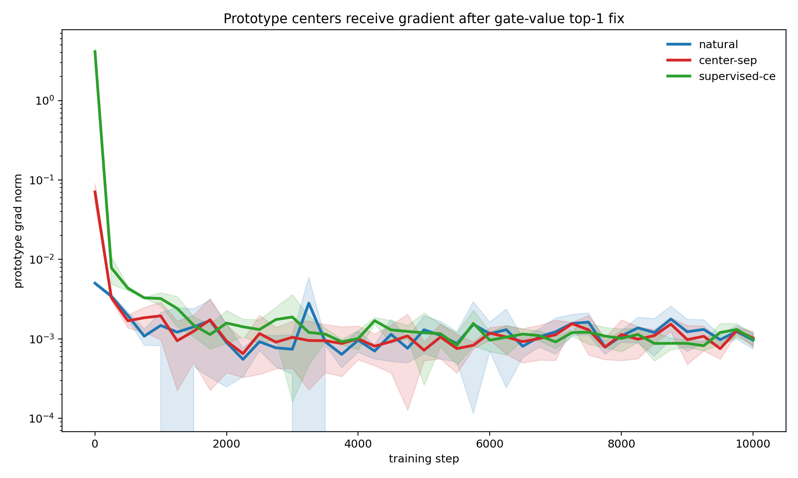
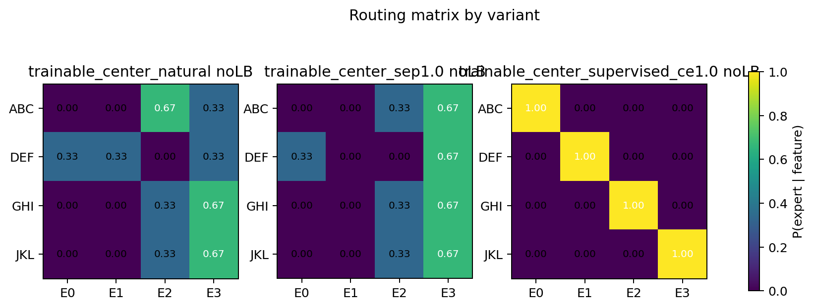
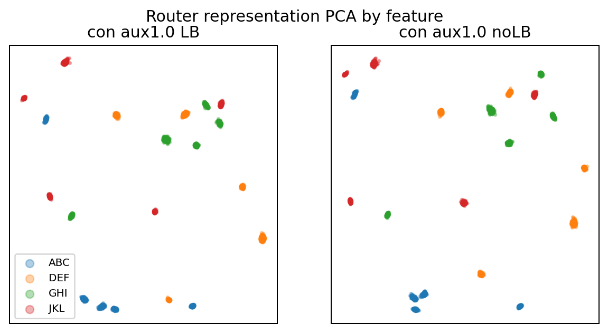
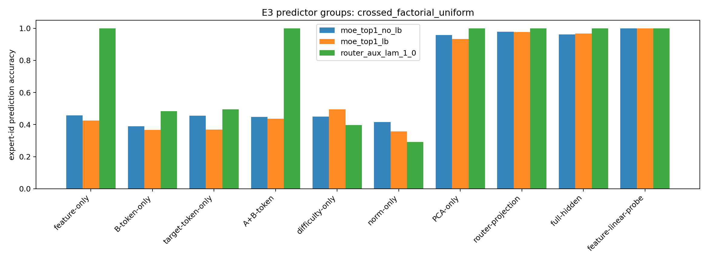

# 假设闭环：Natural MoE Router 为什么不形成 clean specialization - 0518

## 1. 核心问题

本轮要回答：

```text
synthetic trigram feature 已经能被模型读回，
为什么 natural top-1 MoE router 仍没有形成 clean one-feature-one-expert？
```

主线锚点：

```text
representation separability != router specialization
```

待判定假设：

```text
Natural router 不 clean，不是因为 feature 没学到、模型容量不够或代码链路坏了，
而是因为 NTP objective 下 clean feature partition 不是必要解。
```

## 2. 实验结构

我们用两条证据线闭环：

| 实验线 | 问题 | 结论 |
|---|---|---|
| E2-B / E2-B3 | prototype center router 是否自然 clean？ | 不会。centers 有梯度并移动，但没有 assignment pressure。 |
| E2-C | representation 更可分是否足够？ | 不够。feature 可线性读出，但 top-1 expert assignment 仍不 clean。 |
| E3 | natural router 到底按什么切？ | 更像按 hidden geometry / router projection 切，而不是人工 feature label。 |

## 3. 关键结果

### E2-B3: prototype centers 有梯度，但不自然 clean

修正后的 gate-value top-1：

$$
y_t=p_{t,e^*}\mathrm{Expert}_{e^*}(h_t),
\quad e^*=\arg\max_e p_{t,e}
$$

| variant | first prototype grad | readback | NMI | best-perm acc |
|---|---:|---:|---:|---:|
| natural NTP | 0.0050 | 0.9957 | 0.5772 | 0.5000 |
| center separation | 0.0706 | 0.9955 | 0.1924 | 0.3333 |
| supervised CE | 4.1205 | 0.9969 | 1.0000 | 1.0000 |

结论：prototype router 能承载 clean specialization，但 natural NTP 不会自动给出 feature-to-center assignment。

### E2-C: 表示可分，不等于路由 clean

E2-C 的 router representation probe accuracy 是 `1.0`，说明 feature 在 $r_t$ 中可线性读出；但 routing NMI 仍不高。

| variant | readback | NMI | best-perm acc |
|---|---:|---:|---:|
| contrastive_no_aux_no_lb | 0.9944 | 0.4382 | 0.5073 |
| contrastive_no_aux_lb | 0.9954 | 0.1363 | 0.3132 |
| contrastive_aux_1_0_no_lb | 0.9956 | 0.6920 | 0.6189 |

结论：让 representation 更可分，仍不能保证 router boundary 按 feature 切。

### E3: natural router 更像 hidden geometry / router projection

E3 跑了 4 个 uniform control datasets × 3 variants × 5 seeds。

| setting | readback | NMI |
|---|---:|---:|
| natural no-LB | 0.995-0.997 | 0.560-0.724 |
| natural LB | 0.994-0.997 | 0.556-0.592 |
| supervised router | 0.996-0.997 | 1.000 |

Predictor decomposition:

| dataset / no-LB | feature-linear-probe | feature-only -> expert | router-projection -> expert | PCA-only -> expert |
|---|---:|---:|---:|---:|
| unique | 1.000 | 0.539 | 0.973 | 0.941 |
| shared-B | 1.000 | 0.510 | 0.984 | 0.968 |
| shared-target | 1.000 | 0.435 | 0.963 | 0.908 |
| crossed-factorial | 1.000 | 0.457 | 0.978 | 0.957 |

结论：feature 在 hidden state 中存在，但 expert choice 更容易由 router projection / PCA geometry 解释。

## 4. 关键图



Supports: 修正后 prototype centers 确实收到自然 NTP 梯度。



Supports: natural prototype 仍不 clean；supervised CE clean。



Supports: representation 可分不等于 top-1 expert assignment clean。



Supports: expert choice 更像由 router projection / hidden geometry 决定。

## 5. 综合解释

现在能排除四个错误解释：

- 不是 feature 没学到：`feature-linear-probe=1.0`。
- 不是模型不能分：supervised CE 可达 `NMI=1`。
- 不是 prototype centers 没梯度：E2-B3 修正后有非零梯度。
- 不是表示可分就足够：E2-C 中 representation probe 为 `1.0`，routing 仍不 clean。

更稳的解释是：

```text
NTP 只要求预测下一个 token；
只要 hidden geometry partition 或多个 experts 的冗余能力足够降低 loss，
router 就没有必要把人工 feature label 映射成 one-feature-one-expert。
```

这与 MoE router 的几何解释一致：router 主要看线性投影 $g=Ph$。feature 在 hidden space 可读出，不保证 router row-difference directions 对齐 feature-separating directions。

## 6. Claim 边界

支持：

- 在 controlled synthetic trigram setting 中，feature representation separability 不自动推出 clean router specialization。
- 当前模型可以 clean specialize；但需要 assignment-level pressure，例如 feature CE。
- Natural router 更像按 hidden geometry / router projection 切，而不是按人工 feature label 切。

弱支持：

- Expert utility degeneracy 是 natural router 不 clean 的原因之一。
- LB 改 load，不保证 feature-aligned routing。

不支持：

- “换成 prototype router 就会自然 clean。”
- “representation 可分就会自动 one-feature-one-expert。”
- “feature readback 成功就说明 MoE 已形成语义专家。”

不能声称：

- 真实 LLM MoE 没有语义专家。
- contrastive router objective 普遍无效。
- prototype router 是真实语言路由最终方案。

## 7. 下一步

不继续重复普通 MoE full run。下一步应做：

1. **utility gap test**：比较 learned router、feature-oracle router、best-utility router 的 loss。
2. **specialization pressure test**：降低 expert 冗余或增加 feature 冲突，让 clean routing 在 loss 上更必要。
3. **router geometry intervention**：直接干预 router projection directions，测试 $P$ 是否是 causal failure point。

建议更新 `consensus.md`：

```text
在当前 synthetic trigram setting 中，feature 在 hidden/router representation 中可分，
但 natural top-1 router 不会自动 clean specialize；
需要 assignment-level pressure 或更强任务压力，才能把 representation cluster 转成 expert partition。
```

## 8. 30 秒汇报

我们闭环了 natural MoE router 为什么不形成 clean feature specialization。结果不是模型没学到 feature，也不是 router 结构不能分；E3 里 feature 从 hidden 可线性读出，supervised router 也能稳定 `NMI=1`。关键失败点是：natural NTP 没有把“可分表示”转化成“按 feature 分 expert”的必要压力；router 更像按 hidden geometry 或 router projection 切。下一步要测 feature-aligned routing 是否真的带来 utility 优势。

