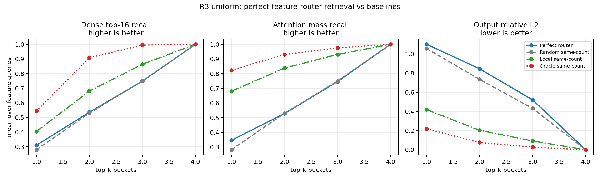
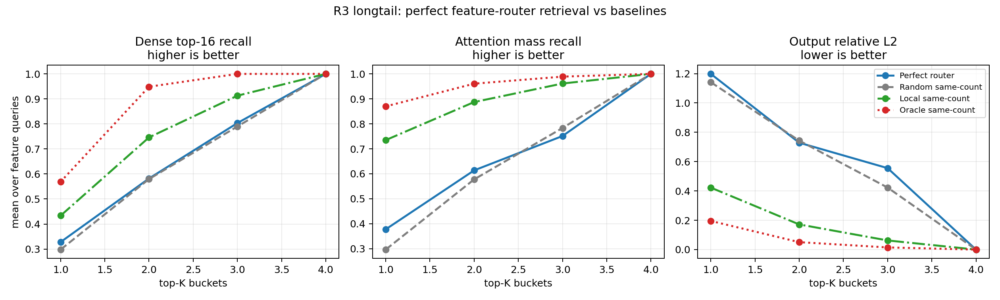

# 假设闭环：Perfect Router 是否足以作为 KV Index - 0518

## 1. 核心问题

R1/R2 中 natural router bucket 没有稳定检索 block2 high-mass KV。R3 要拆开一个关键歧义：

```text
失败是因为 natural router 没有 clean specialize，
还是因为即使 perfect specialization 成立，feature bucket 也不是好 KV index？
```

本实验用 `RouterFeatureCE` 强制四个 feature 形成 one-feature-one-expert：

```text
ABC -> expert 0
DEF -> expert 1
GHI -> expert 2
JKL -> expert 3
```

然后测试这些 feature-aligned buckets 能否高效召回 block2 full attention 的 high-mass KV。

## 2. 实验设置

两个数据版本：

| Dataset | Feature distribution | Seeds |
|---|---|---:|
| uniform | 四个 feature 都是 5000 次 | 4 |
| feature-long-tail | 10000 / 5000 / 500 / 100 | 4 |

训练目标：

```text
NTP_CE + RouterFeatureCE
```

Retrieval 评估：

```text
router top-K bucket, K=1..4
same-count random
same-count local
oracle top-M
full prefix sanity
```

## 3. 直接结果

实验前提成立：

| Dataset | NMI | ARI | fixed-label routing | feature readback acc |
|---|---:|---:|---:|---:|
| uniform | 1.000 | 1.000 | 1.000 | 1.000 |
| longtail | 1.000 | 1.000 | 1.000 | 1.000 |

Dense attention 本身仍然 sparse：

| Dataset | Top16 mass | Mass90 support | Effective support |
|---|---:|---:|---:|
| uniform | 0.934 | 12.58 | 9.12 |
| longtail | 0.953 | 10.33 | 7.47 |

但 retrieval 没有成功。Feature queries 上：

| Dataset | K | Router recall | Random recall | Local recall | Router mass | Local mass | Router L2 | Local L2 |
|---|---:|---:|---:|---:|---:|---:|---:|---:|
| uniform | 1 | 0.310 | 0.279 | 0.404 | 0.346 | 0.681 | 1.101 | 0.420 |
| uniform | 2 | 0.536 | 0.530 | 0.680 | 0.528 | 0.838 | 0.846 | 0.204 |
| longtail | 1 | 0.328 | 0.298 | 0.433 | 0.378 | 0.735 | 1.198 | 0.423 |
| longtail | 2 | 0.582 | 0.580 | 0.746 | 0.614 | 0.887 | 0.729 | 0.172 |

K=4 sanity 通过：候选等于 full prefix，recall/mass=1.0，L2=0。

## 4. 关键图





## 5. 解释

R3 的结论是负向的：

```text
在当前 E-series all-trigram setup 中，
perfect feature specialization 仍不足以形成高效 KV retrieval index。
```

这说明 R1/R2 的失败不只是 natural router 没有 specialize。即使我们人为做到 one-feature-one-expert，block2 attention 的 high-mass KV 也没有主要按 feature label 聚集。

更合理的下一步解释方向是：

```text
block2 attention 可能更依赖 locality、token identity、hidden similarity、
value/output similarity，或 head-specific pattern。
```

## 6. Claim 边界

可以说：

- 在当前 synthetic all-trigram setup 中，perfect feature-aligned router bucket 不是高效 block2 KV index。
- one-feature-one-expert specialization 不是 attention search 成立的充分条件。
- 下一步应诊断 dense attention 真正依赖的 source variable。

不能说：

- 所有 MoE router 都不能做 KV index。
- 真实 LLM 中 feature specialization 没有检索价值。
- 当前结果证明没有加速可能。

## 7. 最弱点与下一步

最弱点：

```text
seq_len=32 且 feature 是短 trigram；这个设置可能强化 local baseline。
```

下一步：

```text
做 attention source decomposition：
locality / token identity / hidden similarity / value similarity / feature identity
分别解释多少 attention mass。
```

## 8. 30 秒汇报

我们做了一个 perfect-router upper-bound 实验：用 `RouterFeatureCE` 把四个 feature 强制成 one-feature-one-expert，uniform 和 long-tail 两种数据上都达到 `NMI=1`。但 retrieval 仍失败：router bucket 只略高于 random，明显弱于 same-count local，输出 L2 也更差。结论是，在当前 synthetic all-trigram setup 中，feature specialization 不是 KV index 成立的充分条件；下一步要找 block2 attention 真正依赖的变量。

