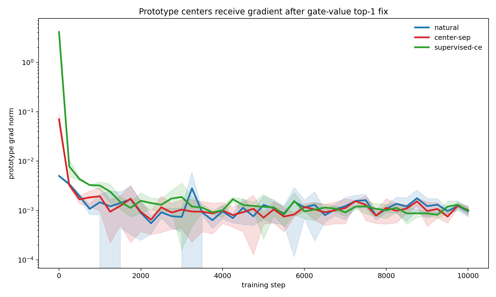
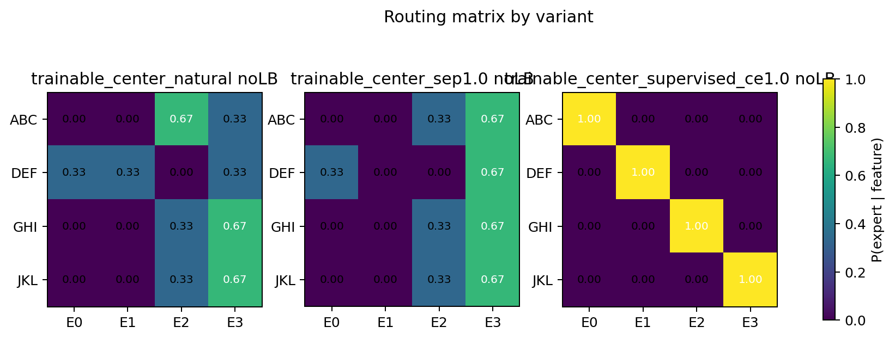
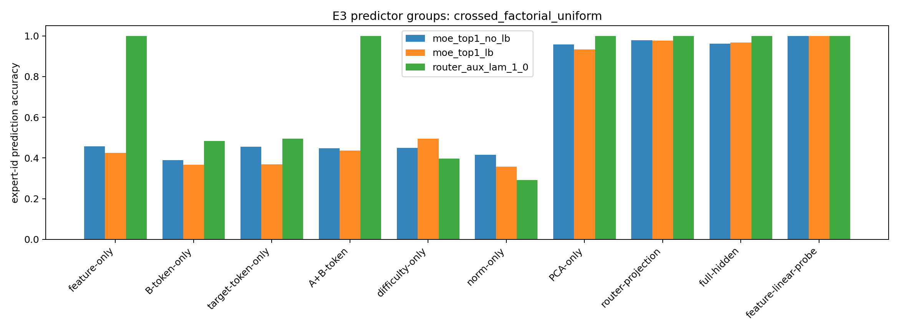
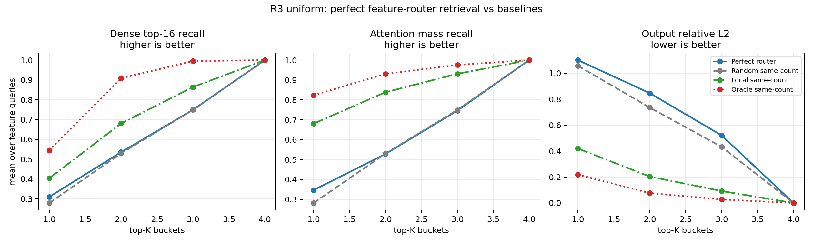
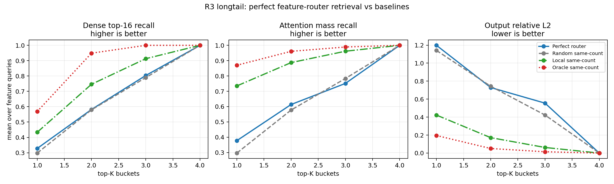

# 0518 Report: Hypothesis Closure for Router Specialization and KV Retrieval

## 1. 30-Second Message

This round tests whether an MoE router can first learn `one feature -> one expert` and then use expert buckets as a KV retrieval index. The safest conclusion is a two-level negative result. First, even when features are readable from hidden states, natural NTP does not turn them into clean expert assignments. Second, even when supervised training forces perfect feature routing, those feature-aligned buckets still do not retrieve the high-mass KV positions needed by block2 attention. In short: `feature separability != router specialization`, and `router specialization != KV index`. The next step is not to run more MoE variants, but to decompose what actually explains high-mass dense attention: locality, token identity, hidden similarity, value similarity, or feature identity.

## 2. Hypotheses Closed In This Report

This report does not prove whether MoE is useful in general. It closes three smaller hypotheses.

| ID | Hypothesis | Current decision |
|---|---|---|
| H1 | If features are separable in hidden/router representations, natural routing will learn `one feature -> one expert`. | Not supported |
| H2 | If experts have trainable prototype centers, NTP will push centers toward different feature clusters. | Not supported |
| H3 | If we force perfect feature routing, feature-aligned buckets will become useful KV retrieval indexes. | Not supported |

Mainline update:

```text
feature representation separability does not imply router specialization;
router specialization does not imply a KV retrieval index.
```

## 3. Experimental World And Boundary

This report is self-contained within a controlled synthetic setting. It does not claim the same result already holds for real LLMs.

| Item | Setting |
|---|---|
| Data | all-trigram synthetic corpus |
| Features | four context relations: `ABC`, `DEF`, `GHI`, `JKL` |
| Model | tiny causal Transformer + 4-expert top-1 MoE |
| Training | next-token prediction, plus optional router supervision |
| Retrieval target | high-mass KV positions from block2 full attention |

The intended chain was:

```text
controlled features
-> learned feature representations
-> feature-aligned expert routing
-> feature-aligned buckets retrieve attention-relevant KV
```

The 0518 results break this chain in two places:

1. separable feature representations do not force the router to specialize by feature;
2. feature-specialized routing does not guarantee useful KV retrieval.

## 4. H1/H2: Why Does Natural Routing Not Become One-Feature-One-Expert?

### 4.1 Purpose

We first ask whether natural routing fails because the model did not learn the features, or because the router objective does not require feature-aligned expert assignment.

### 4.2 Experiments

| Experiment | Question | Result |
|---|---|---|
| E2-B3 prototype centers | Do trainable expert centers naturally align with features? | Centers receive gradients and move, but do not become clean. |
| E2-C contrastive representation | Is a more separable router representation sufficient? | No. Features are readable, but expert assignment remains not clean. |
| E3 predictor diagnostic | What better explains expert choice? | Hidden geometry / router projection, not human feature labels. |

### 4.3 Evidence 1: Prototype Centers Receive Gradients But Do Not Become Clean

E2-B3 fixes the hard top-1 gradient issue by multiplying the selected expert output by its gate value:

$$
\begin{aligned}
e^* &= \arg\max_e p_{t,e}, \\
y_t &= p_{t,e^*}\,\mathrm{Expert}_{e^*}(h_t).
\end{aligned}
$$

This ensures that NTP loss can affect prototype centers.

| Variant | first prototype grad | readback | NMI | best-perm acc |
|---|---:|---:|---:|---:|
| natural NTP | 0.0050 | 0.9957 | 0.5772 | 0.5000 |
| center separation | 0.0706 | 0.9955 | 0.1924 | 0.3333 |
| supervised CE | 4.1205 | 0.9969 | 1.0000 | 1.0000 |

Interpretation:

- natural NTP does send gradients to the centers;
- the centers still do not become four feature centers;
- center separation spreads centers apart but does not assign feature clusters to them;
- supervised CE reaches `NMI=1`, so the architecture can implement clean routing when assignment-level pressure exists.





### 4.4 Evidence 2: Features Are Readable, But The Router Does Not Use Feature Labels

In E3, feature labels are linearly readable from hidden states:

```text
feature-linear-probe = 1.0
```

But feature labels alone do not explain expert choice well. Router projection and PCA geometry explain it much better:

| Dataset / no-LB | feature-linear-probe | feature-only -> expert | router-projection -> expert | PCA-only -> expert |
|---|---:|---:|---:|---:|
| unique | 1.000 | 0.539 | 0.973 | 0.941 |
| shared-B | 1.000 | 0.510 | 0.984 | 0.968 |
| shared-target | 1.000 | 0.435 | 0.963 | 0.908 |
| crossed-factorial | 1.000 | 0.457 | 0.978 | 0.957 |

This means:

```text
The model can distinguish the features internally.
The router is not random.
But it learns another low-loss partition of hidden space,
not the human-defined ABC/DEF/GHI/JKL one-to-one partition.
```



### 4.5 Decision For H1/H2

We can rule out four explanations:

- the feature was not learned;
- the model or code cannot route cleanly;
- prototype centers receive no gradient;
- representation separability is sufficient.

The stronger explanation is:

```text
NTP only requires next-token prediction.
If a hidden-geometry partition or redundant expert utility is enough to reduce loss,
the router has no reason to learn one-feature-one-expert.
```

This is not fully closed yet. We still need to explain why the natural router chooses its particular low-loss partition and what pressure would make feature-aligned routing necessary.

## 5. H3: If Routing Is Perfect, Does It Become A KV Index?

### 5.1 Purpose

R3 is an upper-bound test. Instead of waiting for natural specialization, we force perfect one-feature-one-expert routing using `RouterFeatureCE`.

Mapping:

```text
ABC -> expert 0
DEF -> expert 1
GHI -> expert 2
JKL -> expert 3
```

Then we test whether these feature-aligned buckets retrieve the high-mass KV positions used by block2 full attention.

### 5.2 Key Result

The forced routing succeeds:

| Dataset | NMI | ARI | fixed-label routing | feature readback acc |
|---|---:|---:|---:|---:|
| uniform | 1.000 | 1.000 | 1.000 | 1.000 |
| longtail | 1.000 | 1.000 | 1.000 | 1.000 |

But retrieval does not succeed:

| Dataset | K | Router recall | Random recall | Local recall | Router mass | Local mass |
|---|---:|---:|---:|---:|---:|---:|
| uniform | 1 | 0.310 | 0.279 | 0.404 | 0.346 | 0.681 |
| uniform | 2 | 0.536 | 0.530 | 0.680 | 0.528 | 0.838 |
| longtail | 1 | 0.328 | 0.298 | 0.433 | 0.378 | 0.735 |
| longtail | 2 | 0.582 | 0.580 | 0.746 | 0.614 | 0.887 |

Conclusion:

```text
perfect feature routing is only slightly better than random,
and clearly worse than the same-count local baseline.
```





### 5.3 Decision For H3

H3 is not supported.

In the current synthetic all-trigram setup, one-feature-one-expert is not sufficient for KV retrieval. This means R1/R2 did not fail only because natural routing lacked specialization. Even perfect feature specialization does not group the high-mass KV positions required by attention.

More likely explanatory variables are:

- locality;
- token identity;
- hidden similarity;
- value/output similarity;
- head-specific attention pattern.

## 6. Claim Boundary

Supported claims:

- In the controlled synthetic trigram setting, natural top-1 routing does not automatically become clean one-feature-one-expert.
- Feature readability in hidden states is not sufficient for feature-aligned expert assignment.
- Supervised feature routing can reach `NMI=1`.
- Even perfect feature routing is not sufficient to become an efficient KV index in the current setup.
- The next step should diagnose what variables determine high-mass attention KV positions.

Do not claim:

- real LLM MoEs do not learn semantic experts;
- MoE routers can never serve as retrieval indexes;
- feature specialization has no retrieval value in all tasks;
- the current experiment rules out long-context acceleration.

## 7. Next Step

Priority: attention source decomposition.

```text
locality / token identity / hidden similarity / value similarity / feature identity
```

Goal: measure how much attention mass each variable explains.

Also run a utility gap test:

```text
learned router vs feature-oracle router vs best-utility router
```

If the feature-oracle router is not better than the learned router, then one-feature-one-expert is a human-desired interpretability partition, not a necessary solution for the current NTP/attention mechanism.

## 8. What Not To Say In Meeting

- Do not say "MoE routers have no semantics."
- Do not say "feature routing is useless."
- Do not say "retrieval is impossible."
- Do not treat `NMI=1` as retrieval success; R3 shows that clean routing and useful retrieval are different.

## 9. One-Minute Meeting Script

I closed two small hypotheses. First, I tested whether separable features naturally become one-feature-one-expert routing. This is not supported: features are linearly readable from hidden states and supervised routing can reach `NMI=1`, but natural NTP still does not make expert assignment clean. The router is better explained by hidden geometry or router projection than by human feature labels. Second, I tested whether perfect feature routing is enough for KV retrieval. R3 also says no: even with `NMI=1`, router buckets are only slightly better than random and much worse than local retrieval. So the current conclusion is that feature separability does not imply router specialization, and router specialization does not imply a KV index. The next step is to decompose dense attention and measure whether high-mass KV positions are explained by locality, token identity, hidden similarity, value similarity, or feature identity.
