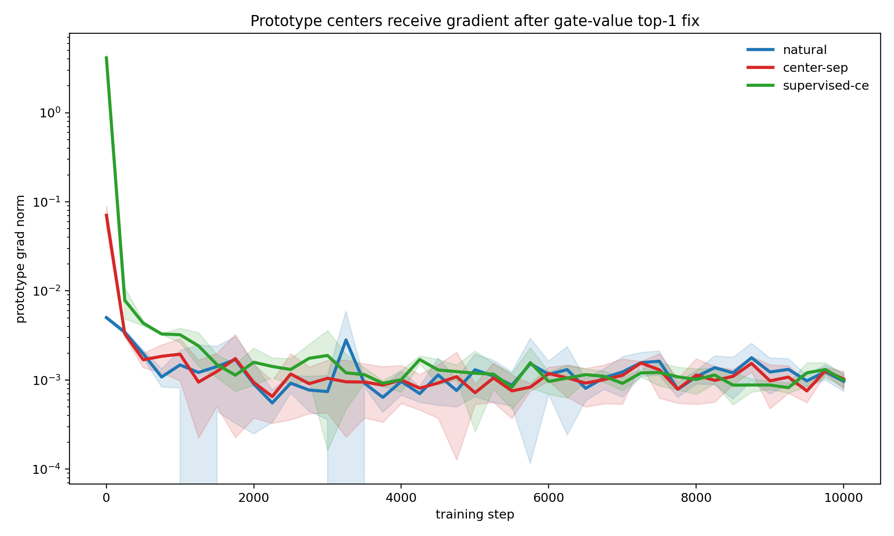
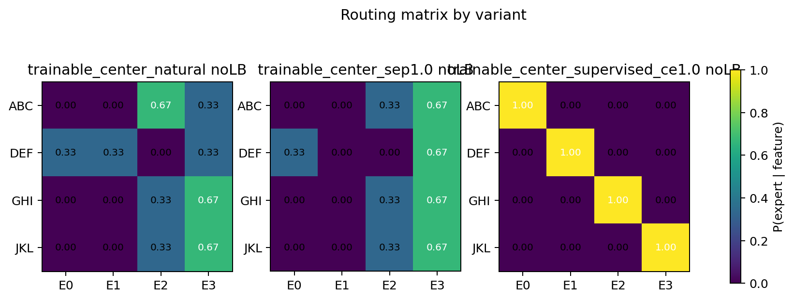
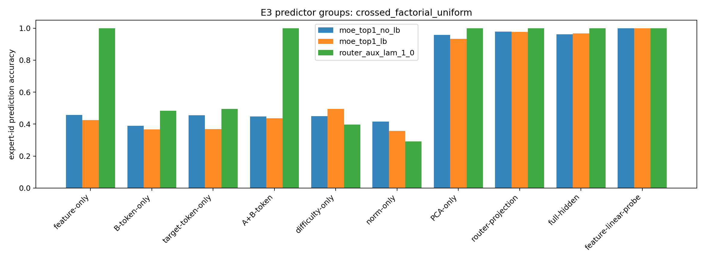
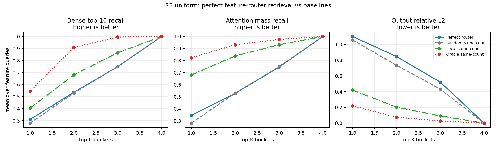
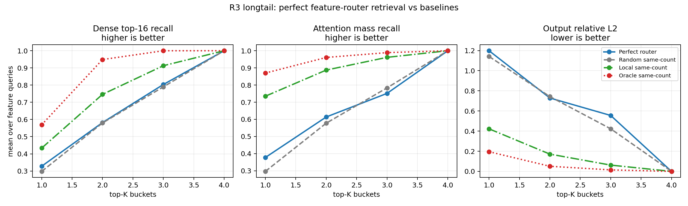

# 0518 汇报报告：MoE Router 为什么不自然 one-feature-one-expert，以及这是否足以做检索索引

## 1. 一句话结论

当前最稳的结论是：

```text
在 controlled synthetic trigram setting 中，模型能学到 feature，
也能在监督信号下形成 one-feature-one-expert；
但 natural NTP router 不会自然形成这种分工。

进一步，即使人为得到 perfect one-feature-one-expert，
它也还不足以成为高效可靠的 KV retrieval index。
```

所以主线被拆成两个问题：

1. 为什么 router 不自然按 `one feature -> one expert` 分？
2. 如果我们强行得到 `one feature -> one expert`，它能否让 index retrieval 高效可靠？

目前第一个问题还没有完全解释清楚，但已经排除了一些错误解释；第二个问题更清楚：在当前设置下，答案是否定的。

## 2. 研究目的

我们的长期目标是理解：

```text
MoE router 是否能作为一种 model-native index，
把不同 feature / context relation 分到不同 expert 或 bucket，
进而支持更高效的 KV retrieval。
```

这需要先验证一个链条：

```text
数据中有可控 feature
-> 模型学到 feature representation
-> router 按 feature 分 expert
-> feature-aligned expert/bucket 能召回 attention 需要的 KV
```

0518 的结果说明，这条链条在两个地方断了：

- representation 可分，不代表 router 会自然按 feature 分。
- router 被强制按 feature 分，也不代表它就是好的 KV index。

## 3. 实验线 A：为什么 natural router 不形成 one-feature-one-expert？

### 3.1 我们做了什么

数据是 synthetic trigram features：

| feature | relation |
|---|---|
| ABC | `[1,2] -> 22` |
| DEF | `[3,4] -> 23` |
| GHI | `[6,7] -> 20` |
| JKL | `[8,9] -> 21` |

模型是 tiny causal Transformer + 4-expert top-1 MoE。训练任务是 next-token prediction。

我们测试了三类解释：

| 实验 | 问题 | 结论 |
|---|---|---|
| E2-B3 prototype center | 如果每个 expert 有可训练质心 $c_e$，会自然分开吗？ | 不会。质心有梯度并移动，但没有自然对齐 feature。 |
| E2-C contrastive router representation | 让 router representation 更可分，是否足够？ | 不够。feature 可读出，但 expert assignment 仍不 clean。 |
| E3 failure-mode diagnostic | router 到底按什么切？ | 更像按 hidden geometry / router projection 切，而不是人工 feature label。 |

### 3.2 关键结果 1：prototype center 有梯度，但不自然 clean

我们修正了 hard top-1 的梯度问题，让被选中的 expert output 乘上 gate value：

$$
\begin{aligned}
e^* &= \arg\max_e p_{t,e}, \\
y_t &= p_{t,e^*}\,\mathrm{Expert}_{e^*}(h_t).
\end{aligned}
$$

这样 NTP loss 可以反传到 expert center $c_e$。

结果：

| variant | first prototype grad | readback | NMI | best-perm acc |
|---|---:|---:|---:|---:|
| natural NTP | 0.0050 | 0.9957 | 0.5772 | 0.5000 |
| center separation | 0.0706 | 0.9955 | 0.1924 | 0.3333 |
| supervised CE | 4.1205 | 0.9969 | 1.0000 | 1.0000 |

解释：

- `natural NTP` 下，centers 确实收到梯度，也确实移动。
- 但它们没有自然演化成四个 feature centers。
- `center separation` 能把 centers 撑开，但不能把 feature clusters 分配给不同 centers。
- 只有 `supervised CE` 能稳定达到 `NMI=1`。





### 3.3 关键结果 2：feature 表征可分，但 router 不按 feature label 分

E3 中，feature 可以从 hidden state 线性读出：

```text
feature-linear-probe = 1.0
```

但仅用 feature label 去预测 router 的 expert choice，准确率不高：

| dataset / no-LB | feature-linear-probe | feature-only -> expert | router-projection -> expert | PCA-only -> expert |
|---|---:|---:|---:|---:|
| unique | 1.000 | 0.539 | 0.973 | 0.941 |
| shared-B | 1.000 | 0.510 | 0.984 | 0.968 |
| shared-target | 1.000 | 0.435 | 0.963 | 0.908 |
| crossed-factorial | 1.000 | 0.457 | 0.978 | 0.957 |

这说明：

```text
模型内部知道 feature 不同；
router 也不是随机切；
但 router 学到的是 hidden space 中另一个低损失分区，
不是人工定义的 ABC/DEF/GHI/JKL 一对一分区。
```



### 3.4 对实验线 A 的结论

我们现在可以排除：

- 不是 feature 没学到。
- 不是模型/代码不能分。
- 不是 prototype centers 没有梯度。
- 不是 representation 可分就足够。

更稳的解释是：

```text
NTP objective 只要求预测下一个 token；
只要某种 hidden geometry partition 或多个 experts 的冗余能力足够降低 loss，
router 就没有必要形成 one-feature-one-expert。
```

这也是为什么第一个问题还没有完全结束：我们还需要解释 natural router 选择的那个 partition 为什么是低损失解，以及什么压力会让 feature-aligned partition 变成必要解。

## 4. 实验线 B：如果 one-feature-one-expert 成立，能否做高效 KV retrieval？

### 4.1 我们做了什么

R3 做的是 upper-bound test：

```text
不再等待 natural router 自然 specialize，
而是用 RouterFeatureCE 强制得到 perfect one-feature-one-expert。
```

即：

```text
ABC -> expert 0
DEF -> expert 1
GHI -> expert 2
JKL -> expert 3
```

然后测试这些 feature-aligned buckets 能否召回 block2 full attention 的 high-mass KV。

### 4.2 关键结果：perfect router 仍不是好 KV index

实验前提成立：

| Dataset | NMI | ARI | fixed-label routing | feature readback acc |
|---|---:|---:|---:|---:|
| uniform | 1.000 | 1.000 | 1.000 | 1.000 |
| longtail | 1.000 | 1.000 | 1.000 | 1.000 |

但 retrieval 没有成功。Feature queries 上：

| Dataset | K | Router recall | Random recall | Local recall | Router mass | Local mass |
|---|---:|---:|---:|---:|---:|---:|
| uniform | 1 | 0.310 | 0.279 | 0.404 | 0.346 | 0.681 |
| uniform | 2 | 0.536 | 0.530 | 0.680 | 0.528 | 0.838 |
| longtail | 1 | 0.328 | 0.298 | 0.433 | 0.378 | 0.735 |
| longtail | 2 | 0.582 | 0.580 | 0.746 | 0.614 | 0.887 |

结果说明：

```text
perfect feature routing 只略好于 random，
明显弱于 same-count local baseline。
```





### 4.3 对实验线 B 的结论

在当前 synthetic all-trigram setup 中：

```text
one-feature-one-expert 不是 KV retrieval 成立的充分条件。
```

这说明 R1/R2 的失败不只是 natural router 没有 specialize。即使我们人为得到 perfect feature specialization，attention 需要的 high-mass KV 也没有主要按 feature label 聚集。

更可能的解释是，block2 attention 依赖：

- locality；
- token identity；
- hidden similarity；
- value/output similarity；
- head-specific attention pattern；

而不是单纯依赖 feature identity。

## 5. 当前总判断

当前主线应该这样表达：

```text
我们原本想把 MoE router 看成 feature index。
但现在的实验显示，这需要两个额外条件：

1. router 必须真的形成 feature-aligned partition；
2. feature-aligned partition 必须能召回 attention 所需要的 KV。

在当前 synthetic trigram setting 中，这两个条件都没有自然成立。
```

更短版本：

```text
feature representation separability 不等于 router specialization；
router specialization 也不等于 KV retrieval index。
```

## 6. Claim 边界

可以说：

- 在 controlled synthetic trigram setting 中，natural top-1 router 不会自动形成 clean one-feature-one-expert。
- 给 feature supervision 后，模型可以形成 clean routing。
- 但即使 perfect feature routing 成立，也不足以在当前设置下成为高效 KV index。
- 下一步应该诊断 attention high-mass KV 到底由什么变量决定。

不能说：

- 真实 LLM MoE 不会形成语义 expert。
- MoE router 永远不能做 retrieval index。
- feature specialization 在所有任务中都没有检索价值。

## 7. 下一步

优先做 attention source decomposition：

```text
locality / token identity / hidden similarity / value similarity / feature identity
分别解释多少 attention mass。
```

同时做 utility gap test：

```text
learned router vs feature-oracle router vs best-utility router
```

如果 feature-oracle router 不优于 learned router，说明 one-feature-one-expert 是人类期望，不是当前 NTP / attention 机制的必要解。

## 8. 30 秒汇报

我的主线是想判断 MoE router 能不能成为一种 feature index，并进一步支持 KV retrieval。现在分成两个问题看：第一，router 为什么不自然形成 one-feature-one-expert；第二，即使形成了，是否能提升 retrieval。E2/E3 说明，feature 在 hidden 中可读出，模型也能在监督下 `NMI=1`，但 natural NTP 不会自动把 feature 变成 expert assignment。R3 进一步说明，就算强制 perfect feature routing，router bucket 对 high-mass KV 的召回仍明显弱于 local baseline。因此当前结论是：feature representation separability 不等于 router specialization，router specialization 也不等于 KV index。下一步要直接诊断 attention 的 high-mass KV 到底由 locality、token identity、hidden similarity 还是 feature identity 决定。
