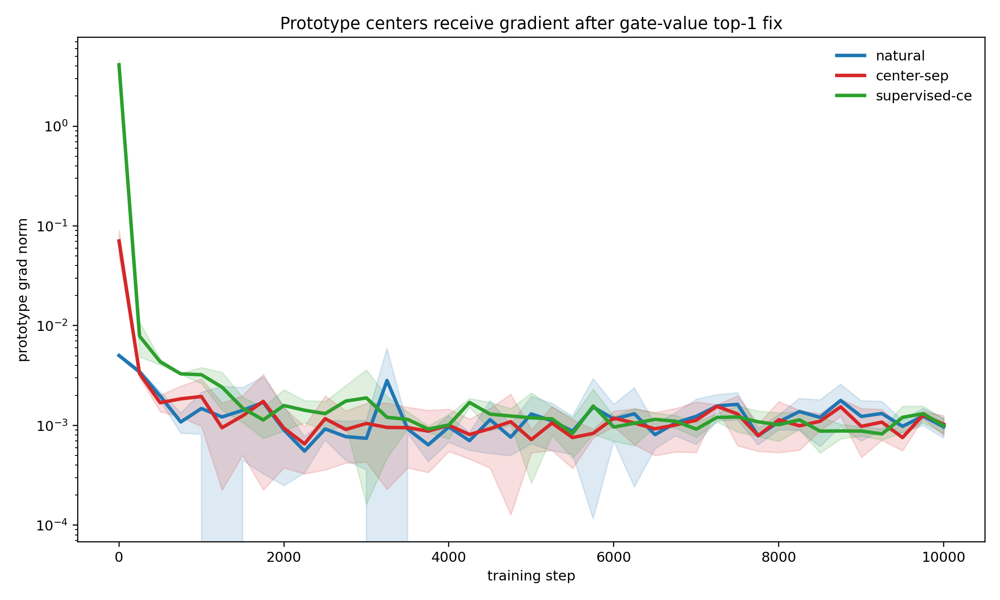
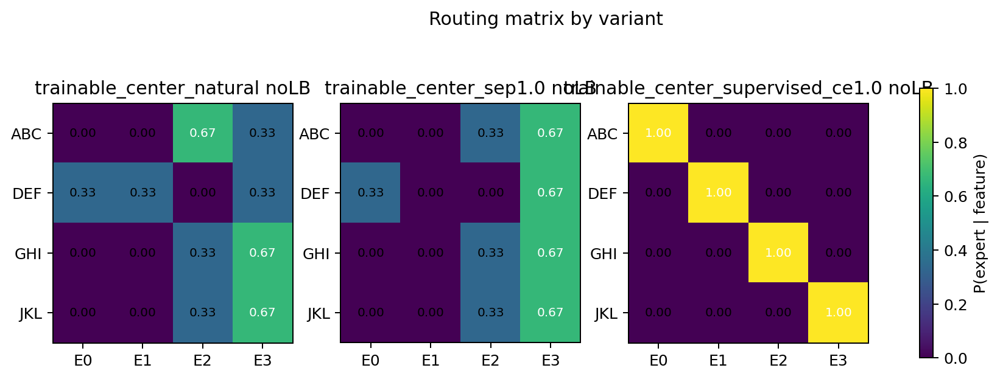
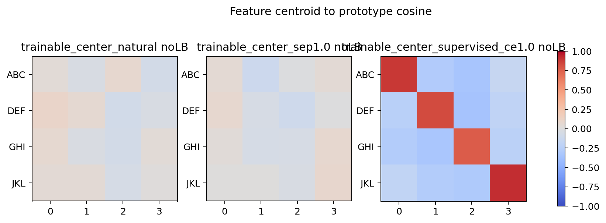

# MoE Router Geometry 综合诊断报告 - 0518

## 1. 结论

结合文章 *The Myth of Expert Specialization in MoEs* 和我们 E2-B / E2-B3 / E2-C / E3 的实验，现在可以较清楚地诊断：

```text
MoE 没有自然形成 one-feature-one-expert，
不是因为 synthetic feature 没被学到，
也不是因为模型/代码完全不能分；
而是因为 linear router 的自然目标不是 feature clustering，
NTP loss 下 clean feature assignment 不是必要解。
```

文章给出的理论解释是：router 本质上是线性投影

$$
g = Ph
$$

所以 expert choice 取决于 hidden state geometry 被 router row-difference directions 怎样投影。feature 在 hidden space 中可分，只说明存在可读方向；它不保证 router 的 separating directions 对齐这些 feature directions。

我们的实验给出的直接证据是：

- E2-B：prototype / center router 无监督时不 clean；加 feature CE 后可以 `NMI=1`。
- E2-B3：修正为 gate-value top-1 后，prototype centers 确实收到 NTP 梯度并移动，但仍不能自然 clean；center separation 也不能替代 assignment pressure。
- E2-C：contrastive representation 中 feature 可线性读出，但 routing 仍不 clean。
- E3：hidden feature probe 为 `1.0`，但 natural router NMI 只有约 `0.56-0.72`；supervised router 在所有控制数据上 `NMI=1`。

因此，当前最稳 claim 是：

```text
representation separability != router specialization
```

## 2. 我们现在能诊断出的失败原因

### 2.1 不是 feature 没有被学到

E3 中 `feature-linear-probe = 1.0`，说明从 hidden state 可以线性读出人工 feature label。

这排除了一个重要错误解释：

```text
MoE 不分 expert，是因为模型没有学到 ABC/DEF/GHI/JKL。
```

更准确地说：

```text
模型内部知道 feature 不同；
但 router 没有把这些差异映射成干净 expert 分配。
```

### 2.2 不是模型容量或代码链路坏了

E2-B3 的 supervised CE 和 E3 的 `router_aux_lam_1_0` 都能得到 clean specialization：

```text
NMI = 1.0
readback ≈ 0.996-0.997
ablation drop 显著上升
```

这说明：

```text
当前模型、expert 数量、top-1 route 位置、评估代码都能支持 one-to-one 分发。
```

失败不是“系统做不到”，而是“natural objective 不主动这样做”。

### 2.3 不是 prototype centers 没有梯度

我们发现旧 E2-B / E2-B2 有一个关键可信度问题：hard top-1 prototype routing 中，expert output 没有乘以 selected gate probability，因此自然 $L_{\text{NTP}}$ 不能可靠反传到 prototype centers。

E2-B3 已修正为 gate-value top-1：

$$
\begin{aligned}
e^* &= \arg\max_e p_{t,e}, \\
y_t &= p_{t,e^*}\,\mathrm{Expert}_{e^*}(h_t).
\end{aligned}
$$

修正后结果是：

| variant | first prototype grad | readback | NMI | best-perm acc | fixed-label acc |
|---|---:|---:|---:|---:|---:|
| natural NTP | 0.0050 | 0.9957 | 0.5772 | 0.5000 | 0.3333 |
| center separation | 0.0706 | 0.9955 | 0.1924 | 0.3333 | 0.2500 |
| supervised CE | 4.1205 | 0.9969 | 1.0000 | 1.0000 | 1.0000 |

这说明：

```text
prototype centers 确实能在 NTP 下收到梯度并移动；
但自然移动不会自动演化成四个 feature centers。
```

Center separation 能把 centers 撑开，但不能把 feature clusters 分配给不同 centers。因此失败不是“质心不训练”，而是“质心训练目标没有 assignment-level pressure”。

### 2.4 不是“表示聚类”就够了

E2-C 中 router representation probe accuracy 为 `1.0`，但最强 contrastive variant 也只有：

```text
NMI = 0.692
best-perm acc = 0.619
```

这说明：

```text
让 representation 更可分，不等于让 top-1 expert boundary 按 feature 切。
```

文章的 $g=Ph$ 几何解释正好解释这一点：router 关心的是 $P$ 的投影方向，而不是人类看到的 PCA cluster 或 feature centroid。

### 2.5 Natural router 更像按 router projection / hidden geometry 切

E3 predictor decomposition 显示，在 no-LB 下：

| dataset | feature-linear-probe | feature-only -> expert | router-projection -> expert | PCA-only -> expert |
|---|---:|---:|---:|---:|
| unique | 1.000 | 0.539 | 0.973 | 0.941 |
| shared-B | 1.000 | 0.510 | 0.984 | 0.968 |
| shared-target | 1.000 | 0.435 | 0.963 | 0.908 |
| crossed-factorial | 1.000 | 0.457 | 0.978 | 0.957 |

含义：

```text
expert id 可以被 router projection / PCA geometry 高准确预测；
但不能被 feature label 高准确预测。
```

所以 router 不是完全随机。它确实在切 hidden space，只是切的不是我们定义的 feature boundary。

### 2.6 Expert utility 存在冗余

E3 component ablation 显示，natural setting 中：

- learned route readback 很高；
- random expert expectation 仍然较高；
- mean expert output 也很高；
- supervised router 下 random/mean expert 明显下降。

这说明 natural MoE 下多个 experts 都能支持同一个 feature prediction。

因此 one-feature-one-expert 没有被强迫出来：

```text
如果多个 experts 都能预测 C，
router 就没有必要把 [A,B]->C 独占分给某一个 expert。
```

## 3. 我们还不能完全诊断的部分

### 3.1 不能说真实 MoE 没有语义 expert

我们的数据是人工 trigram feature，不是真实语言语义。文章也提醒，expert usage pattern 不等于 human-interpretable expertise。

所以不能 claim：

```text
真实 LLM MoE 不会学语义专家。
```

只能说：

```text
在 controlled synthetic setting 中，feature 可分不自动导致 router clean specialization。
```

### 3.2 不能说 contrastive 方法普遍无效

E2-C 只测试了当前 supervised contrastive 版本。它说明这版 representation pressure 不足以变成 expert assignment。

不能扩展成：

```text
所有 contrastive router objective 都不行。
```

### 3.3 不能说 LB 一定有害

LB 在我们的设置中没有改善 clean feature routing，有时还降低 NMI。但它的目标本来是负载均衡，不是 feature purity。

更准确地说：

```text
LB 可以让 load 更均匀，但不会自动把 expert 对齐人工 feature。
```

## 4. 能否给出满足 one-to-one 分发的改进措施？

可以，但要区分两类目标。

### 4.1 如果目标是 synthetic diagnosis：可以直接满足

最有效方案是 assignment-level supervision。

已经被 E2-B3 / E3 验证可行：

$$
L = L_{\text{NTP}} + \lambda \cdot \mathrm{CE}(\text{router logits}, \text{feature id})
$$

或者 prototype CE：

```text
ABC -> prototype/expert 0
DEF -> prototype/expert 1
GHI -> prototype/expert 2
JKL -> prototype/expert 3
```

效果：

```text
NMI = 1.0
readback 不下降
ablation drop 显著升高
```

结论：

```text
如果给 feature label，one-to-one 分发可以被稳定实现。
```

## 5. 关键图



Figure: E2-B3 prototype gradient  
Supports: 修正后 natural NTP 确实给 prototype centers 非零梯度。



Figure: E2-B3 routing matrix  
Supports: 有梯度的 trainable centers 仍不自然 clean；supervised CE clean。



Figure: E2-B3 feature centroid to prototype  
Supports: 只有 supervised CE 把 feature centroid 对齐到指定 prototype。

## 6. 如果目标是不使用 feature label 的自然分工：还需要增强任务压力

因为文章和实验都说明，natural router 不会自动追求人类定义的 feature partition。要想无监督或弱监督地得到 one-to-one，需要让这种分工在 loss/utility 上变得必要。

可尝试的改进：

1. 降低 expert 冗余  
   让单个 expert 难以同时处理多个 feature，例如降低 expert FFN dim、减少 shared path 能力、限制 attention/LM head bypass。

2. 增加 feature 冲突  
   构造同一 token 在不同 context 下预测不同 target 的任务，让 token shortcut 不够用。

3. 加 assignment-level pressure  
   不一定用固定 label，可以用 entropy / diversity / mutual information 形式，让不同 feature cluster 使用不同 experts。

4. 对齐 router boundary 与 feature direction  
   如果有 synthetic feature label，可以正则化：

   $$ 
   \cos(\mu_f-\mu_{f'}, w_e-w_{e'})
   $$

   让 router row-difference directions 对齐 feature-difference directions。

5. 比较 feature-oracle router 与 learned router 的 loss  
   如果 feature-oracle router 不比 learned router 好，说明 one-to-one 不是 NTP 最优；如果 oracle 更好但学不到，说明是 optimization/objective 问题。

6. 训练 dynamics 中加入 early specialization pressure  
   文章和我们的 dynamics 都提示 early routing 会影响后续 co-adaptation。可以在早期使用较强 assignment pressure，后期 anneal。

## 7. 推荐的下一步实验

最优先不是继续跑普通 MoE，而是做 specialization pressure test。

### E4.1 Feature-oracle vs learned router utility

目的：判断 one-to-one routing 是否真的对 NTP loss 更好。

比较：

```text
learned router
feature-oracle router
best-utility router
random router
```

如果 feature-oracle 不优于 learned router：

```text
one-to-one 是人类期望，不是当前 NTP objective 的必要解。
```

如果 feature-oracle 明显更好但 learned router 学不到：

```text
问题在 optimization / router objective。
```

### E4.2 Capacity / bypass pressure sweep

目的：让 expert 分工变得必要。

扫：

```text
expert_ffn_dim
shared attention capacity
MoE output scale
LM head / residual bypass
feature count
context collision strength
```

观察：

```text
NMI 是否上升
random expert utility 是否下降
dominant ablation drop 是否上升
```

### E4.3 Router boundary alignment regularization

目的：直接测试文章几何解释。

让 feature direction 和 router boundary direction 对齐：

$$
(\mu_f-\mu_{f'}) \parallel (w_e-w_{e'})
$$

如果对齐后 clean routing 出现，说明失败确实来自 router projection direction 没用 feature direction。

### E4.4 Weak-label assignment pressure

目的：不固定 ABC->expert 0，只要求不同 feature 使用不同 experts。

可选目标：

```text
maximize I(feature; expert)
minimize H(expert | feature)
maximize H(expert)
```

它比 feature CE 更接近“发现分工”，但仍然依赖 synthetic feature label 做诊断。

## 8. 对主线的更新

这篇文章让我们的主线判断更稳：

```text
Router bucket 不能默认当作 feature reverse index。
必须额外证明：
1. router boundary 与目标 feature direction 对齐；
2. routing 对 downstream readback/retrieval 有因果 utility；
3. feature-specific expert utility 不是高度冗余的。
```

因此，对 one-to-one 分发的目标，我们现在的判断是：

```text
可以通过显式 assignment pressure 实现；
但不能期待普通 NTP + linear router 自然给出。
```

## 9. 30 秒汇报版本

这篇 MoE router geometry 文章和我们的实验结论高度一致：linear router 本质是 $g=Ph$，所以 expert 分配取决于 hidden geometry 被 router 投影成什么方向，而不是自动按人类定义的 feature 聚类。我们还修正了 prototype top-1 的梯度链路：修正后 natural NTP 确实能移动 prototype centers，但仍不能自然形成 clean one-feature-one-expert；center separation 也不够。只有 feature CE 能稳定 `NMI=1`。因此最稳结论是：representation separability、center movement、center separation 都不等于 router specialization；下一步要测试什么 assignment-level pressure 或任务压力能让 one-to-one 成为必要解。
