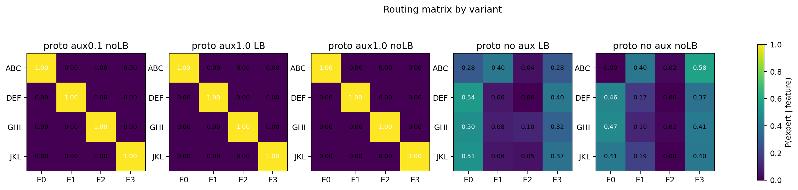
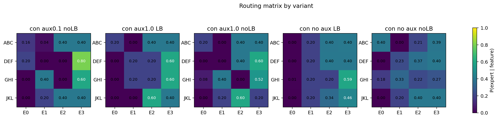
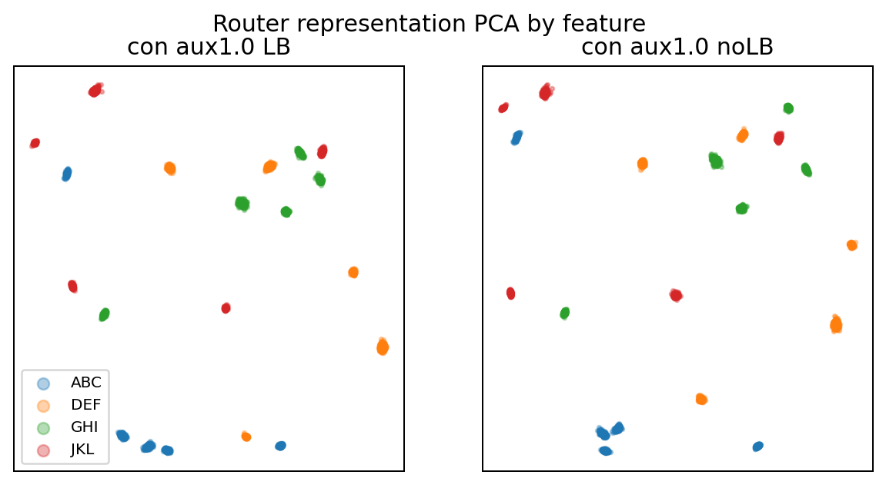
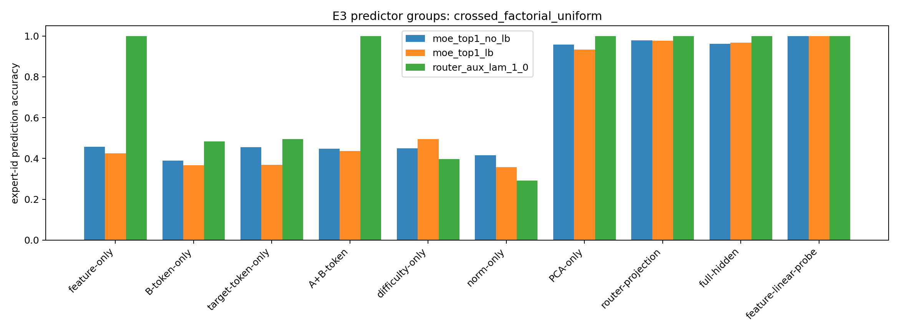
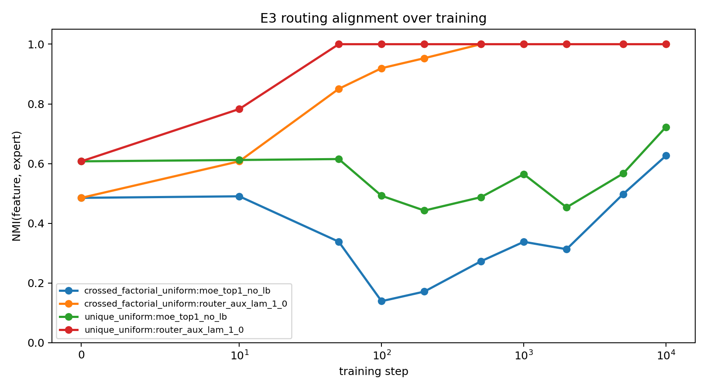
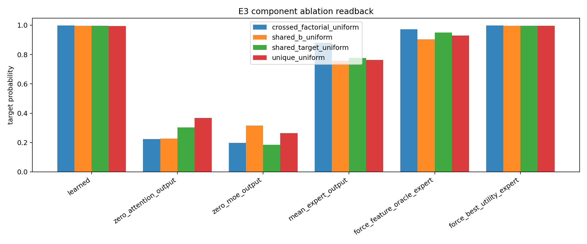

# 假设闭环：Router Failure Modes - 0518

## 1. 原始目的

这一组实验要闭环的问题是：

```text
当 synthetic feature 的 hidden representation 已经可分时，
为什么 natural top-1 MoE router 仍然没有形成 clean one-feature-one-expert？
```

我们依次测试了三种可能：

1. 换成 prototype / center gating，是否更容易把 feature cluster 映射到 expert。
2. 加 contrastive router representation loss，是否只要表示聚类就能诱导 clean routing。
3. 系统诊断 natural router 到底被哪些变量解释，以及 supervised feature signal 是否能让同一模型 clean specialize。

## 2. 主线锚点与待判定假设

主线锚点：

```text
representation separability != router specialization
```

待判定假设：

```text
H: Natural top-1 MoE router 不 clean，不是因为 feature 不可分或模型容量不够，
而是因为 NTP objective 下 clean feature partition 不是必要解。
```

实验前证据强度：弱支持。E2.1/E2.2 已经显示 hidden 可分但 routing 不干净，但还不能排除 router 结构、表示聚类方式、代码链路或 capacity 问题。

## 3. 直接结果

### E2-B Prototype / Center Gating

Prototype router 的形式是：

$$
s_{t,e} = \tau \cdot \frac{z_t^\top c_e}{\|z_t\|\|c_e\|}
$$

结果：

| variant | readback | NMI | best-perm acc | fixed-label acc | ablation drop |
|---|---:|---:|---:|---:|---:|
| prototype_no_aux_no_lb | 0.9953 | 0.5249 | 0.5289 | 0.1474 | 0.3804 |
| prototype_no_aux_lb | 0.9951 | 0.4673 | 0.5082 | 0.2044 | 0.3595 |
| prototype_aux_0_1_no_lb | 0.9961 | 1.0000 | 1.0000 | 1.0000 | 0.9494 |
| prototype_aux_1_0_no_lb | 0.9967 | 1.0000 | 1.0000 | 1.0000 | 0.9493 |
| prototype_aux_1_0_lb | 0.9966 | 1.0000 | 1.0000 | 1.0000 | 0.9657 |

结论：prototype 架构可以承载 clean specialization，但无辅助监督时不会自然 clean。

### E2-C Contrastive Router Loss

Router representation 为：

$$
r_t = \mathrm{normalize}(W_p h_t)
$$

结果：

| variant | readback | NMI | best-perm acc | fixed-label acc | ablation drop |
|---|---:|---:|---:|---:|---:|
| contrastive_no_aux_no_lb | 0.9944 | 0.4382 | 0.5073 | 0.3132 | 0.5755 |
| contrastive_no_aux_lb | 0.9954 | 0.1363 | 0.3132 | 0.2146 | 0.4472 |
| contrastive_aux_0_1_no_lb | 0.9960 | 0.5294 | 0.5002 | 0.1401 | 0.6982 |
| contrastive_aux_1_0_no_lb | 0.9956 | 0.6920 | 0.6189 | 0.1009 | 0.7091 |
| contrastive_aux_1_0_lb | 0.9954 | 0.4192 | 0.4498 | 0.2498 | 0.6173 |

所有 variants 的 router representation probe accuracy 都是 `1.0`。结论是：feature 信息在 $r_t$ 中可读出，但 representation cluster 不自动变成 expert assignment。

### E3 Gating Failure Mode Diagnostic

E3 使用 4 个 uniform datasets、3 个 variants、5 个 seeds，共 60 个 full runs。

结果：

| setting | readback | NMI |
|---|---:|---:|
| natural no-LB | 0.995-0.997 | 0.560-0.724 |
| natural LB | 0.994-0.997 | 0.556-0.592 |
| supervised router | 0.996-0.997 | 1.000 |

关键 predictor 结果：

| dataset / no-LB | feature-linear-probe | feature-only -> expert | router-projection -> expert | PCA-only -> expert |
|---|---:|---:|---:|---:|
| unique | 1.000 | 0.539 | 0.973 | 0.941 |
| shared-B | 1.000 | 0.510 | 0.984 | 0.968 |
| shared-target | 1.000 | 0.435 | 0.963 | 0.908 |
| crossed-factorial | 1.000 | 0.457 | 0.978 | 0.957 |

结论：hidden state 中 feature identity 可线性读出，但 learned router choice 不是按人工 feature label 走，而更像由 router projection / hidden geometry 解释。

## 4. 关键图片



Figure: E2-B routing matrix  
Supports: prototype aux 可以 clean；no-aux prototype 不 clean。



Figure: E2-C routing matrix  
Supports: contrastive representation pressure 没有稳定诱导 clean expert assignment。



Figure: E2-C router representation PCA  
Supports: 表示可分不等于路由边界按 feature 切分。



Figure: E3 crossed-factorial predictor accuracy  
Supports: expert choice 更容易被 router projection / PCA geometry 解释，而不是 feature label 本身。



Figure: E3 routing dynamics  
Supports: supervised signal 很快把 router 推到 clean partition；natural objective 不会。



Figure: E3 component ablation  
Supports: natural router 下多个 experts 都能支持同一 feature prediction，存在 expert utility degeneracy。

## 5. 解释

三组实验共同支持一个更精确的判断：

```text
问题不在于模型完全不能分，也不在于 feature representation 不存在；
问题在于 natural NTP objective 没有把“可分表示”转化成“按 feature 分 expert”的必要压力。
```

E2-B 排除了“只要换成聚类式 prototype router 就会自然 clean”的解释。  
E2-C 排除了“只要让 router representation 更可分，就会自然 clean”的解释。  
E3 排除了“模型容量或代码链路坏了”的解释，因为 supervised router 在所有控制数据上 clean。

因此当前最稳的解释是：

```text
feature identity 在 hidden / router representation 中存在，
但 natural router 学到的是一个足够降低 NTP loss 的 partition，
这个 partition 可以利用 hidden geometry / router projection / 多 expert utility，
而不必等同于人工 feature label。
```

## 6. Claim 边界

支持：

- 在 controlled synthetic setting 中，feature representation separability 不自动推出 clean router specialization。
- 当前模型和代码链路可以实现 clean specialization；supervised feature signal 足够时，router 能达到 `NMI=1`。
- Prototype CE 比 contrastive representation loss 更直接地把 feature signal 变成 expert assignment。
- Natural router failure 更像 objective / assignment pressure 不足，而不是 capacity 不足。

弱支持：

- Expert utility degeneracy 是重要原因：natural setting 中多个 experts 都能支持同一 feature prediction。
- LB 主要改变 load，不保证 feature-aligned routing。

不支持：

- “换成 prototype center gating 就会自然 clean。”
- “router representation 可分就会自动 one-feature-one-expert。”

仍不清楚：

- 什么最小 specialization pressure 可以在不使用人工 feature label 的情况下诱导 clean assignment。
- 更复杂、更真实的语义数据中是否会自然产生类似 feature-aligned routing。

不能声称：

- 真实 LLM MoE 没有语义 expert。
- contrastive router loss 普遍无效。
- prototype router 是真实语言路由的最终方案。

## 7. 最弱点与下一步

最弱点：

```text
当前 clean specialization 依赖 synthetic feature label；
它证明模型能分，但不证明真实语言里能无监督获得同样 feature label。
```

下一步：

1. 不继续重复普通 MoE full run。
2. 设计 specialization pressure test：让 one-feature-one-expert 在 loss 或 utility 上变得更必要。
3. 比较 `learned router`、`feature-oracle router`、`best-utility router` 的 loss 差异，判断 feature-aligned routing 是否真是 NTP 最优或只是人类期望。
4. 如果要往真实数据走，先定义可操作的 feature family，而不是直接 claim 语义分工。

`consensus.md` 建议更新：

```text
新增共识：在当前 synthetic trigram setting 中，hidden feature 可分并不足以让 natural top-1 router clean specialize；
需要 assignment-level pressure 或更强任务压力，才能把 representation cluster 变成 expert partition。
```

## 8. 30 秒汇报版本

我们做了三组诊断：prototype center gating、contrastive router representation、以及 full failure-mode decomposition。结论是，模型不是不能分：只要给 feature label supervision，router 可以在所有控制数据上 `NMI=1`，且 readback 不掉。但 natural NTP 下，即使 feature 能从 hidden 中线性读出，router 也只形成 partial alignment。现在最稳的判断是：representation separability 不等于 router specialization；问题主要是 objective 和 assignment pressure 不足，下一步要测试什么任务压力会让 feature-aligned routing 变成必要解。
