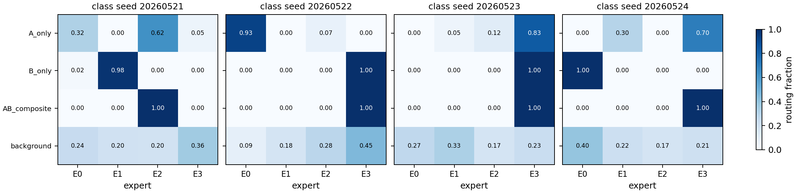
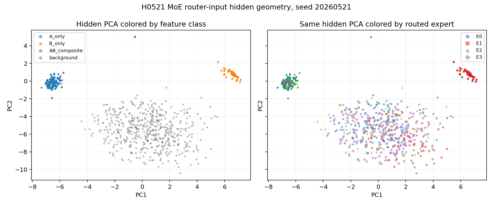
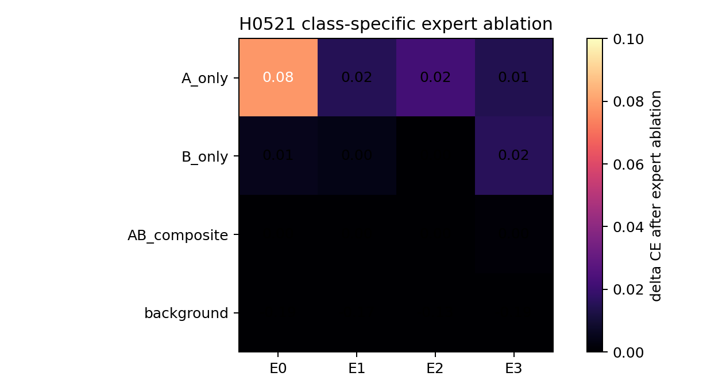

# Reporting Card: H0521a Seq2 AB Feature Specialization

Source closure:

```text
Projects/from-attention-to-search/XingyuD/main/hypotheses/H0521_router_feature_specialization/H0521a_seq2_ab_feature_specialization/hypothesis_closure.md
```

## Oral Report Card - Fill Before Meeting

目的：

假设：

结论：

证据：

1.
2.
3.

## Closure Snapshot

# 假设闭环：H0521a Seq2 AB Feature Specialization

## 1. 目的

这轮实验要判断：普通无负载均衡 top-1 MoE 路由是否会在最小 A/B/AB synthetic setup 中自然形成干净的 feature-level expert bucket。

这个问题服务于 `from-attention-to-search` 主线中的 learned index 机制诊断：如果 expert bucket 本身不是干净 feature bucket，那么不能直接把它当作 Reverse Index 的候选 KV 分桶。

## 2. 假设

H：普通 top-1 token-level MoE 更可能学习 mixed token/context bundle，而不是干净的 A-only、B-only、AB-composite feature-level specialization。

Rival 1：top-1 MoE 可以自然形成 feature-level specialization，即 A-only、B-only、AB-composite 分别进入稳定不同 expert，并且对应 expert 的 ablation 主要伤害自己的 class。

Rival 2：hidden representation 本身没有保留 A/B/AB 信息，所以 router 无法按 feature 切分。

Rival 3：routing assignment 看起来混合，但 expert function 仍可能有功能分工。

## 3. 数学建模

输入前缀为 $x_{\le t}$，预测位置 hidden state 为 $h_t = F_\theta(x_{\le t})$。令 $z_A, z_B, z_{AB}$ 表示 A-only、B-only、AB-composite 的 feature indicator。

工作模型是：

$$
h_t \approx U_A z_A + U_B z_B + U_{AB} z_{AB} + \epsilon
$$

top-1 router 对整个 mixed hidden state 打分：

$$
g_i(h_t) = w_i^\top h_t,\qquad e^*(h_t)=\arg\max_i g_i(h_t)
$$

要区分的是两种机制：

```text
feature-level specialization:
A-only -> expert_A, B-only -> expert_B, AB-composite -> expert_AB

bundle routing:
mixed h(A, B, AB, context) -> expert_j
```

主判定指标是 `class-specific expert ablation delta CE`：

$$
\Delta L_c(e)=L_c(\text{mask expert }e)-L_c(\text{original})
$$

其中 $c \in \{A,B,AB,\text{background}\}$。如果某个 expert 真正服务 AB-composite，mask 它应该主要提高 $\Delta L_{AB}$，而不是只在 routing heatmap 上接收 AB 样本。

## 4. 实验设置

使用最小 synthetic feature-composition task：

```text
A-only:       [A, r] -> y_A
B-only:       [r, B] -> y_B
AB-composite: [A, B] -> y_AB
background:  [r_i, r_j] -> r_k
```

第一版同时跑 dense tiny Transformer baseline 和无负载均衡 top-1 MoE tiny Transformer。实验在 ACP 4 卡任务 `pt-527v9od5` 上完成，4 个 seeds 成功。

这个 setup 有效的前提是：dense 和 MoE 都必须学会 A/B/AB 规则，否则 routing 诊断没有意义。

## 5. 结论

H0521a 得到部分支持：普通 top-1 MoE 在这个 setup 中没有自然形成干净 feature-level specialization；同一 expert 的共同性更像 mixed router geometry / predictive-signal cell，而不是单一 A/B/AB feature。

## 6. 证据

1. 任务可学：dense 和 MoE 都学会了 A/B/AB 规则，三类 signal accuracy 都是 `1.0`。因此负结果不是因为数据或模型容量不足。

2. routing assignment 不干净：AB-composite 有 `75%` 被分到 E3，但 E3 同时接收 `39.7%` A-only、`50.0%` B-only 和 `31.4%` background。E3 内部平均包含 `AB=1200`, `B=800`, `A=635.5`, `background=503` 个评估样本。

3. 逐 seed routing 图说明：不同 seed 下 routing cell 的编号会变，AB-composite 可以高度集中到某个 expert，但这个 expert 不稳定等同于 “AB-only expert”。



4. representation 不是主要失败点：hidden probe accuracy 接近 1，PCA 中 A-only、B-only、AB-composite 在 hidden state 中可分，但 routed expert 没有按这些 feature class 一一切开。



5. 功能性证据仍弱：expert ablation delta 很小，AB-composite 对任何 expert 的 ablation delta 都接近 0。因此当前只能说 assignment-level mixed cell，不能说 expert function 已经强混合。



## 7. 结论边界

能说：

```text
routing assignment 层面混合；普通 top-1 MoE 没有在该 setup 中形成干净 feature-level expert bucket。
```

不能说：

```text
expert function 已经强混合；真实语言 MoE 也一定如此；Reverse Index 完全不可行。
```

最弱点：主指标 `class-specific expert ablation delta CE` 很小，说明当前架构中 expert path 的因果必要性弱，可能被 residual / attention / lm head 绕过。

## 8. 下一步决策

下一步不要直接用 expert bucket 做 Reverse Index。应该先增强 expert-path necessity，例如减弱 residual bypass 或使用更严格的 counterfactual routing，判断 mixed router cell 是否也对应 mixed functional expert。

## 9. 结果文档

- 实验摘要：`Projects/from-attention-to-search/XingyuD/main/experiments/H0521_router_feature_specialization/H0521a_seq2_ab_feature_specialization/summary.md`
- 详细报告：`Projects/from-attention-to-search/XingyuD/main/experiments/H0521_router_feature_specialization/H0521a_seq2_ab_feature_specialization/detailed.md`
- 运行结果目录：`Projects/from-attention-to-search/XingyuD/Attention_Search_Experiments/active/synthetic_data_understanding/results/h0521_ab_feature_specialization/h0521_ab_feature_specialization_4gpu_guaranteed_20260521/`
