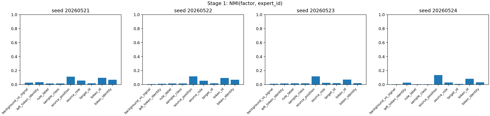
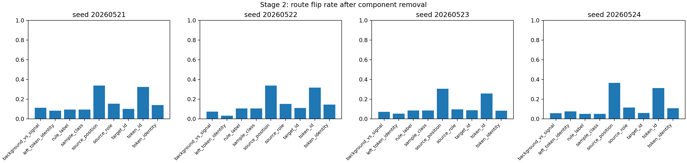
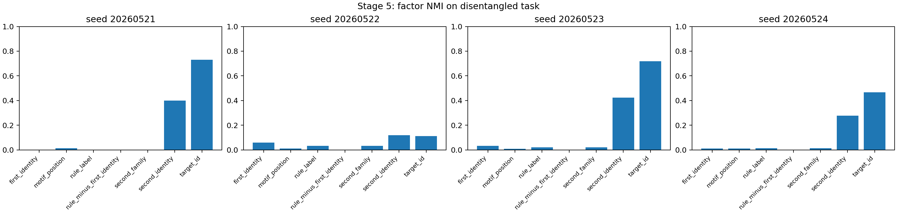

# H0522 Router Factor Audit Seq32 Reporting Card

## Oral Report Card - Fill Before Meeting

目的：

假设：

结论：

证据：

## Closure Snapshot

## 目的

我们想知道：`seq_len=32` synthetic setup 中，ordinary top-1 MoE 的 expert id 是按 rule/function 分，还是被 token identity、source position、target shortcut 和 mixed hidden state 共同影响。

## 假设

主假设是 mixed routing：expert id 不是 clean rule/function index。

对立解释是 rule/function routing：同一 rule 应该跨 token identity / position 稳定进入相同 expert。

## 结论

本轮不支持 ordinary top-1 MoE 自然形成稳定 rule/function expert bucket。

核心判断：

```text
source-position、token-id、target/second-token shortcut 比 rule/function
更能解释 router 分发。
```

## 证据



Stage 1：`source_position` 平均 NMI 为 0.1205，`token_id` 为 0.0861，`rule_label` 只有 0.0138。



Stage 2：移除 position/token-id component 更容易翻转 expert，移除 rule_label 的影响较弱。



Stage 5：模型能完成任务，但 rule_label 没有胜过 identity；target/second-token shortcut 最强。

## 结论边界

这不能说明 MoE routing 一般失败。它只说明：当前 ordinary top-1 expert id 不能直接作为 clean feature/function Reverse Index。

## 下一步

下一版做 anti-shortcut synthetic：平衡 identity、position、target，再看 rule/function 是否跨 seed 稳定胜出。
