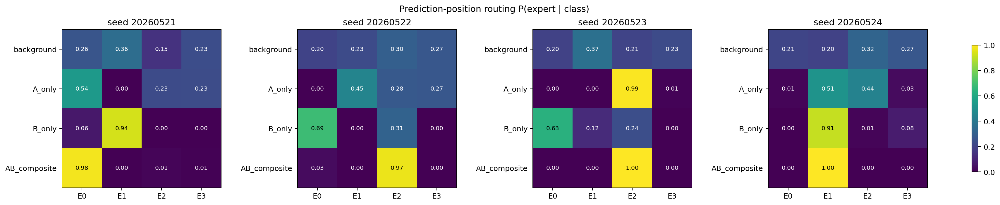
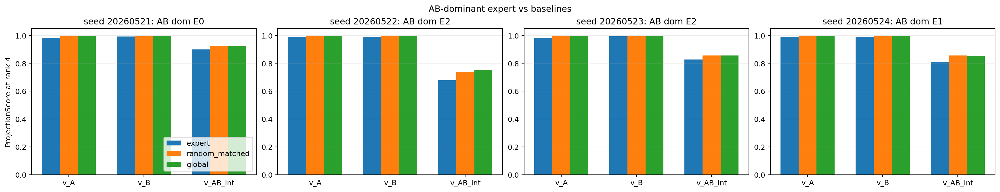
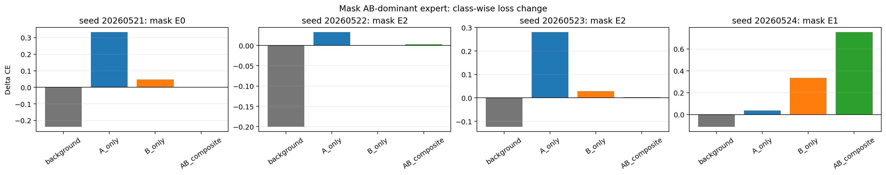

# Reporting Card: H0522 SVD Feature Mixing Seq32

Source closure:

```text
Projects/from-attention-to-search/XingyuD/main/hypotheses/H0521_router_feature_specialization/H0522_svd_feature_mixing_seq32/hypothesis_closure.md
```

## Oral Report Card - Fill Before Meeting

目的：

假设：

结论：

证据：

1.
2.
3.

## Closure Snapshot

## 1. 目的

这轮是在已训练 `seq_len=32` top-1 MoE 上做 post-training diagnostic，判断 AB-composite 的 dominant expert 是 clean AB feature specialist，还是 mixed hidden bucket。

## 2. 假设

H: ordinary top-1 MoE expert bucket 是 feature-entangled mixed bucket。

Rival: AB-dominant expert 是 clean AB interaction specialist。

## 3. 数学建模

在 prediction position $p^*=31$ 取 router input hidden state $h_i$。定义：

$$
v_A=\mu_A-\mu_0,\quad v_B=\mu_B-\mu_0,\quad v_{AB}^{int}=\mu_{AB}-\mu_A-\mu_B+\mu_0
$$

对 AB-dominant expert 的 hidden bucket 做 SVD，计算：

$$
\mathrm{ProjScore}(v,e,r)=\frac{\lVert P_{S_{e,r}}v\rVert_2^2}{\lVert v\rVert_2^2}
$$

再 mask 该 expert，看各 class 的 cross entropy 增量。

## 4. 实验设置

```text
devices: cuda:0, cuda:1
seeds: 20260521, 20260522, 20260523, 20260524
n_eval_per_class: 4096
motif_position: 15
classes: background / A-only / B-only / AB-composite
```

## 5. 结论

当前 AB-dominant expert 不是稳定、干净的 AB specialist。它更像 mixed hidden bucket。

## 6. 证据

AB-composite 在每个 seed 都有 dominant expert：



但 AB expert 的 projection 不优于 random/global baseline：



Mask AB expert 后的功能损伤不稳定；只有一个 seed 明显主要伤害 AB-composite：



## 7. 结论边界

能说：当前 controlled synthetic setup 下，ordinary top-1 MoE 的 AB prediction expert 不是稳定 clean feature specialist。

不能说：MoE routing 一般无用，或真实语言模型没有 specialization。

## 8. 下一步决策

做 anti-shortcut router factor audit：显式平衡 token identity、source position、target token 和 rule/function，再看 router score / expert id 由哪个 factor 主导。

