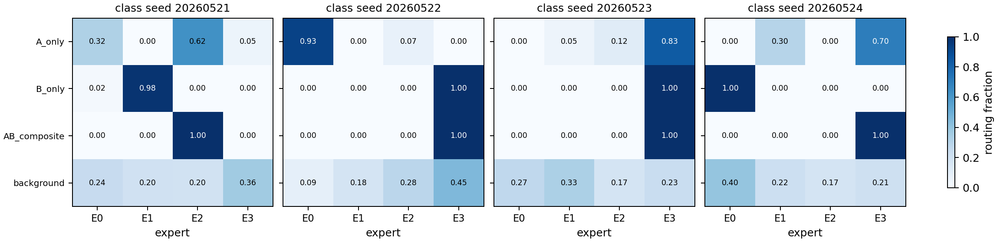
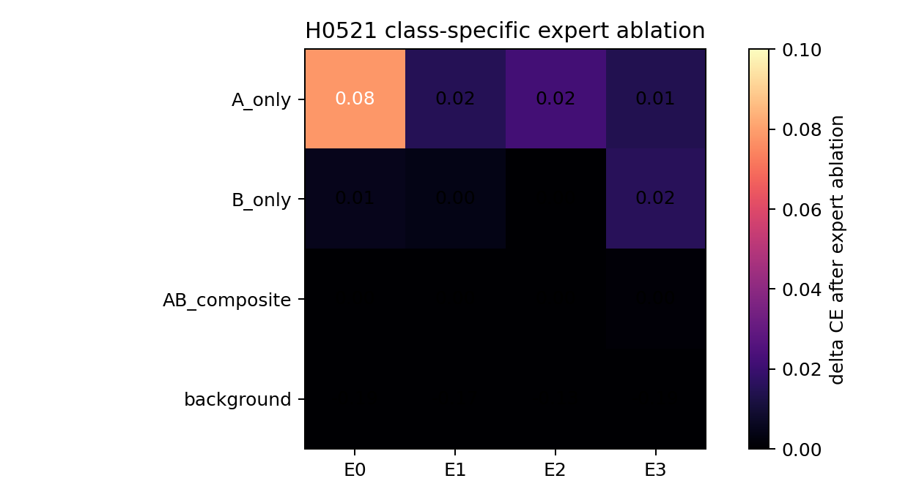
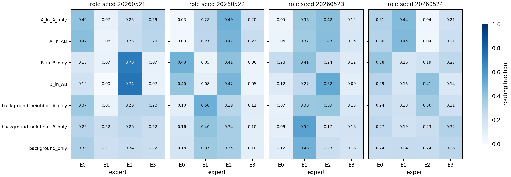
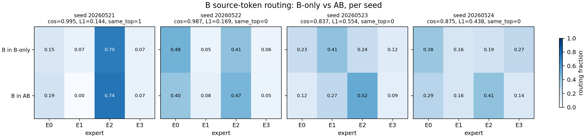
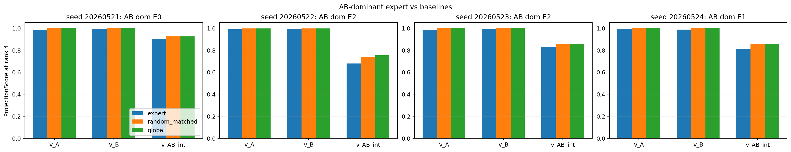
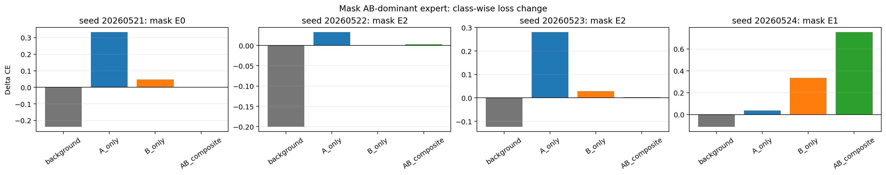
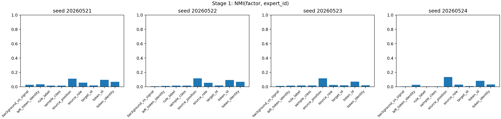
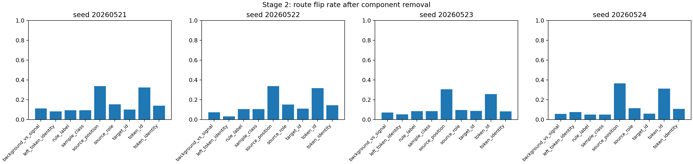
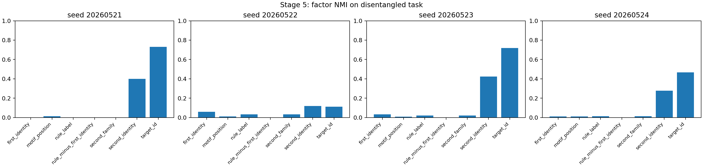

# Group Meeting Report - Router Feature Specialization Audit

Date: 2026-05-22

## 1. Report Purpose

这次组会只回答一个收窄后的问题：

```text
在最简单 AB synthetic setting 中，当前 top-1 MoE router 到底是在按 token identity 分发，
还是按 context / sequence-conditioned feature 分发？

进一步，expert bucket 是否形成了 feature-level specialization，
还是混合了 A、B、AB 信息？
```

我现在不会把结论讲强。最安全的表述是：

```text
当前 ordinary top-1 MoE 没有表现出稳定、干净、可直接作为 feature-level index 的 expert bucket。
```

## 2. Short Conclusion

初步 routing audit 显示：B token 的路由不是只由 B identity 决定。B-only 中的 B 与 AB 序列中的 B 的路由一致性跨 seed 不稳定，说明 router 至少受到 sequence / causal context 信息影响。

但这还不能证明 expert 已经发生强 feature mixing，也不能证明它没有 semantic routing。更准确地说：

```text
routing-level 证据削弱了 clean token-identity bucket 假设；
SVD audit 进一步显示 AB-dominant prediction expert 不是稳定、独有的 AB specialist；
factor audit 则提示 position、token identity、target shortcut 等因素比 rule/function 更能解释当前 expert id。
```

所以当前结论是弱负结果：ordinary top-1 expert id 暂时不能作为干净 feature/function Reverse Index。

## 3. Research Background

主线目标是判断 long-context attention 能否被理解成 learned search over KV memory。MoE expert id 是一个候选 learned index：

```text
hidden state -> router -> expert id -> possible KV bucket
```

如果 expert bucket 是 feature-pure 的，它可能帮助缩小候选 KV；如果 bucket 是 mixed 的，就不能直接当作检索索引。

本轮 AB synthetic 不是要证明真实长上下文收益，而是先做一个机制诊断：

```text
ordinary top-1 MoE 是否自然学出可解释、稳定、功能相关的 feature bucket？
```

## 4. Modeling / Mechanism

对某个 token hidden state $h$，top-1 router 做：

$$
e^*(h)=\arg\max_i w_i^\top h
$$

关键问题是 $h$ 里可能同时包含：

$$
h \approx h_{id}+h_{pos}+h_{context}+h_{rule}+h_{target}+\epsilon
$$

所以 expert id 可能对应几种不同机制：

| 层级 | 想验证什么 | 目前结果 |
|---|---|---|
| routing-level | A/B/AB 是否稳定进不同 expert | 不稳定，不是 clean partition |
| representation-level | expert subspace 是否只承载某一 feature | AB expert 不表现为独有 AB subspace |
| function-level | mask expert 是否主要伤害对应 class | 不稳定，不能强说功能专门化 |
| retrieval-level | expert bucket 是否能召回 KV | 本轮还没证明 |

## 5. Evidence 1 - Seq2 最小 AB setting

### Question

在最小 `seq_len=2` 的 A-only / B-only / AB-composite setup 中，top-1 MoE 是否会自然形成干净 feature bucket？

### Result

Dense 和 MoE 都学会了任务，A/B/AB 三类 signal accuracy 都是 `1.0`。因此 routing 诊断不是在分析失败模型。

但是 routing assignment 不干净：AB-composite 可以高度集中到某个 expert，但该 expert 同时接收 A-only、B-only 和 background。



### Interpretation

这说明最小 setting 下没有自然出现 clean A/B/AB expert partition。

但这个证据只到 assignment-level。功能性 ablation delta 很小：



所以不能说 expert function 已经强混合；只能说 routing bucket 不是干净 feature bucket。

## 6. Evidence 2 - Seq32 source-token routing

### Question

更接近 Reverse Index 的场景是 source token：历史 token 的 KV 会被检索，而不是只看最后 prediction state。

因此 H0521b 问：

```text
在 seq_len=32 中，A token、B token、background token 是否形成稳定 source-token identity bucket？
```

### Result

跨 seed 稳定规则：

| Rule | Result |
|---|---:|
| A token 在 A-only 和 AB 中 dominant expert 一致 | 4/4 seeds |
| B token 在 B-only 和 AB 中 dominant expert 一致 | 1/4 seeds |
| A 与 B 是否进入不同 dominant expert | 2/4 seeds |
| source identity NMI | mean 0.047 |
| source role NMI | mean 0.042 |



B-only vs AB 中的 B source token 对比尤其重要：



### Interpretation

这支持一个弱但有用的判断：

```text
B token routing 不是只由 B identity 决定；
B 的 expert assignment 会受到 left context / sequence condition 调制。
```

但同时也不能说 identity 完全不存在。更准确是：

```text
identity anchor + context modulation
```

这就是为什么我不把结论说成“router 已经学了 semantic feature mixing”。当前只能说 clean token-identity bucket 假设被削弱。

## 7. Evidence 3 - SVD representation audit

### Question

Routing matrix 只能告诉我们“分到了哪里”，不能告诉我们 expert bucket 内部表示到底是什么。

因此 SVD audit 问：

```text
AB-composite 的 dominant expert 是否有独有的 AB interaction subspace？
```

定义 prediction position 的 feature directions：

$$
v_A=\mu_A-\mu_0,\quad v_B=\mu_B-\mu_0,\quad v_{AB}^{int}=\mu_{AB}-\mu_A-\mu_B+\mu_0
$$

对 AB-dominant expert 的 hidden states 做 SVD，计算：

$$
\mathrm{ProjScore}(v,e,r)=\frac{\lVert P_{S_{e,r}}v\rVert_2^2}{\lVert v\rVert_2^2}
$$

### Result

AB-composite 在每个 seed 都有 dominant expert。但 AB expert 对 A、B、AB interaction 都高投影，且不优于 random matched / global baseline：



Mask AB-dominant expert 的功能损伤也不稳定，只有一个 seed 明显主要伤害 AB-composite：



### Interpretation

SVD audit 把 routing 现象推进了一步：

```text
AB-dominant expert 不是稳定、独有、干净的 AB specialist。
```

但这仍然不是“强 feature mixing 已被证明”。因为 high projection 也出现在 global/random baseline 中，更保守的解释是：

```text
prediction-position hidden space 本身有低维 class structure；
ordinary top-1 expert bucket 没有展示出 expert-specific AB subspace。
```

### Three meeting statements for SVD audit

第一点：SVD audit 的对象不是“分发比例”，而是“expert bucket 的表示子空间是否和 feature direction 对齐”。

做法是：在 prediction position $p^*=31$ 取 router 实际看到的 hidden state $h_i$，按 class 计算均值：

$$
\mu_0,\quad \mu_A,\quad \mu_B,\quad \mu_{AB}
$$

然后构造：

$$
v_A=\mu_A-\mu_0,\quad v_B=\mu_B-\mu_0,\quad v_{AB}^{int}=\mu_{AB}-\mu_A-\mu_B+\mu_0
$$

这里 $v_{AB}^{int}$ 是最关键的定义，因为 $v_{AB}^{raw}=\mu_{AB}-\mu_0$ 几乎就是 $v_A+v_B$。实际结果中 $\cos(v_{AB}^{raw}, v_A+v_B)=0.994-0.998$，所以不能把 raw AB direction 当作 AB interaction。

第二点：右奇异向量对齐已经做了，但结果不支持 clean AB specialist。

对 AB-dominant expert 收集其接收的 hidden states $H_e$，中心化后做：

$$
\tilde{H}_e=U_e\Sigma_e V_e^\top
$$

$V_e$ 的前 $r$ 个右奇异向量表示该 expert bucket 中 hidden state 的 dominant directions。我们用：

$$
\mathrm{ProjScore}(v,e,r)=\frac{\lVert P_{S_{e,r}}v\rVert_2^2}{\lVert v\rVert_2^2}
$$

评估 feature direction 是否落在 expert dominant subspace 中。rank 4 下结果是：

| Direction | AB expert mean | random matched mean | global mean |
|---|---:|---:|---:|
| $v_A$ | 0.986 | 0.998 | 0.998 |
| $v_B$ | 0.991 | 0.998 | 0.998 |
| $v_{AB}^{int}$ | 0.803 | 0.843 | 0.846 |

因此 AB expert 确实和 A/B/AB interaction 方向都对齐，但这种对齐不比 random matched bucket 或 global hidden subspace 更强。它更像全局 hidden geometry，而不是 AB expert 独有的 feature specialization。

第三点：SVD metric 是合理的，但必须配 baseline 和 ablation 一起读。

它合理的原因是：如果一个 expert 真的是 feature-level specialist，那么它接收的 hidden states 的主变化方向应该和对应 feature direction 对齐；右奇异向量正是在测 expert bucket 内部的 dominant variance directions。

但它不是充分证据。因为如果整个 prediction hidden space 本身已经低维，任何大样本 bucket 的 top SVD directions 都可能和 A/B/AB 方向高度对齐。所以必须比较：

```text
AB expert vs random matched bucket vs global hidden subspace
```

并再看 mask AB expert 后是否主要伤害 AB-composite。当前 mask 结果不稳定：只有 seed `20260524` 明显主要伤害 AB-composite，其他 seed 主要伤害 A-only 或几乎不伤害 AB。因此不能说形成了稳定 functional AB specialist。

### Motif frequency in seq32 experiments

H0522 SVD audit 的 fixed-position eval set 是严格 balanced：

| Class / motif type | Count per seed | Frequency |
|---|---:|---:|
| background | 4096 | 25% |
| A-only: `[A, r]` | 4096 | 25% |
| B-only: `[r, B]` | 4096 | 25% |
| AB-composite: `[A, B]` | 4096 | 25% |

总计每个 seed `16384` 条样本，4 个 seed。SVD audit 中 motif position 固定为 `15`，目的是先去掉 position 分布对 feature direction 的干扰。

原始 H0521b 训练设置也是 class-balanced：train 每类 `6000`，eval 每类 `1600`；motif position 在合法位置中均匀采样。也就是说，本轮主要不是 class imbalance 导致的 routing 现象。

## 8. Evidence 4 - Factor audit

### Question

如果 expert id 不是干净 feature bucket，那它更像由什么因素驱动？

H0522 factor audit 把可能因素拆成：

```text
token identity / source position / left context / rule-function / target shortcut
```

### Result

旧 H0521b checkpoint 中，`source_position` 和 `token_id` 比 `rule_label` 更能解释 expert id：



移除 position/token-id component 更容易导致 expert flip：



在 factor-disentangled task 中，模型能做对任务，但 `rule_label` 没有稳定胜过 identity；`target_id` 和 `second_identity` 更强：



### Interpretation

这进一步支持：

```text
当前 expert id 更像 shortcut-modulated mixed routing，
而不是稳定 rule/function bucket。
```

## 9. Current Interpretation

当前最稳的解释是：

```text
ordinary no-load-balance top-1 MoE 能学会 AB synthetic task，
但它的 expert id 没有自然变成干净 feature-level index。
```

具体说：

1. 最小 `seq_len=2` 中，routing assignment 已经不是 clean A/B/AB partition。
2. `seq_len=32` source-token routing 中，B 的分发受到 context 调制，不能只由 B identity 解释。
3. SVD 显示 AB-dominant prediction expert 不具备独有 AB subspace。
4. Factor audit 显示 position/token-id/target shortcut 比 rule/function 更强。

## 10. Claims To Downgrade

组会上不要说：

```text
MoE routing 没用。
```

不要说：

```text
router 完全没有 semantic signal。
```

不要说：

```text
我们已经证明 expert function 强 feature-mixing。
```

更安全的说法是：

```text
在当前 controlled synthetic setup 下，ordinary top-1 expert id 还不能被当作稳定、干净、可复用的 feature/function index。
```

## 11. Next Iteration

下一步不应直接做 Reverse Index alignment。

应该先做 anti-shortcut synthetic：

```text
balance token identity x source position x target token x rule/function
```

目标是让同一个 rule/function 跨多个 token identity、position、target 出现，然后再问：

```text
rule/function 是否仍能跨 seed 稳定预测 router score / expert id？
```

如果这一步仍失败，ordinary top-1 expert id 作为 clean learned index 的路线就要继续降级。

如果这一步成功，再进入：

```text
specialization -> Reverse Index alignment
```

也就是测试 bucket 是否真的覆盖 dense attention high-mass KV。

## 12. Meeting Version

### 30 秒版本

我这周做的是一个 AB synthetic 下的 top-1 MoE routing audit。问题是：expert id 到底是在按 token identity 分，还是受到上下文和 feature 组合影响。最稳的结果是，当前 expert bucket 不干净。尤其是 B token 在 B-only 和 AB context 中的 routing 跨 seed 不稳定，说明 B 的路由不是只由 B identity 决定。进一步 SVD 显示，AB-dominant expert 也不是独有的 AB specialist；它的高投影不优于 random/global baseline。所以我现在不会说 MoE routing 没用，只能说当前 ordinary top-1 expert id 还不能直接作为 clean feature-level Reverse Index。

### 1 分钟版本

我的主线是想把 attention retrieval 理解成 learned index。MoE expert id 是一个候选 index，所以我先在最小 AB synthetic 上检查 expert bucket 是否干净。第一步 `seq_len=2` 显示 routing assignment 不形成 clean A/B/AB partition，但 ablation 弱，所以只能说 assignment-level 不干净。第二步 `seq_len=32` 看 source-token routing，发现 A across context 比较稳定，但 B-only 中的 B 和 AB 中的 B 跨 seed 不稳定，source identity NMI 也很低，因此 clean token identity bucket 假设被削弱。第三步 SVD audit 看 AB-dominant prediction expert，发现它对 A/B/AB interaction 都高投影，而且不优于 random/global baseline，mask 结果也不稳定。因此我现在的结论是：ordinary top-1 MoE 能学会任务，但 expert id 更像 mixed routing cell，不是稳定 clean feature/function index。下一步要做 anti-shortcut synthetic，平衡 identity、position、target，再看 rule/function 是否能稳定胜出。

## 13. Likely Questions

### Question 1: 你能不能说 expert 已经发生 feature mixing？

Short answer:

不能强说。现在能说的是 expert bucket 没有表现为 clean feature specialist。

Evidence:

AB expert 对 A/B/AB interaction 都高投影，但 random/global baseline 也高；mask AB expert 的损伤也不跨 seed 稳定。

How to redirect back to the mainline:

所以这轮不是证明“强 mixing”，而是降低“ordinary top-1 expert id 可直接作为 clean index”的可信度。

### Question 2: B token routing 不稳定是否就说明 router 看 context？

Short answer:

说明至少不只看 B identity，但不能唯一归因于 semantic context。

Evidence:

B-only 和 AB 中的 B dominant expert 一致性只有 `1/4` seeds；但 factor audit 显示 position、token-id、target shortcut 也很强。

How to redirect back to the mainline:

下一步要用 anti-shortcut construction 把这些因素显式平衡，才判断 rule/function 是否真的主导 routing。

### Question 3: 这是否已经否定 Reverse Index？

Short answer:

没有。它只否定“当前 ordinary top-1 expert id 可以直接当 clean feature index”的强版本。

Evidence:

本轮分析的是 routing、representation 和部分 function-level ablation，还没有测试 bucket 对 dense attention high-mass KV 的覆盖。

How to redirect back to the mainline:

Reverse Index alignment 要放在 clean specialization 或 factor mechanism 更清楚之后再测。
