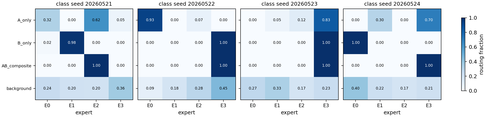
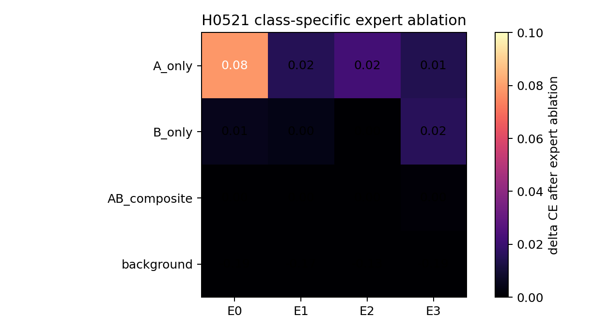
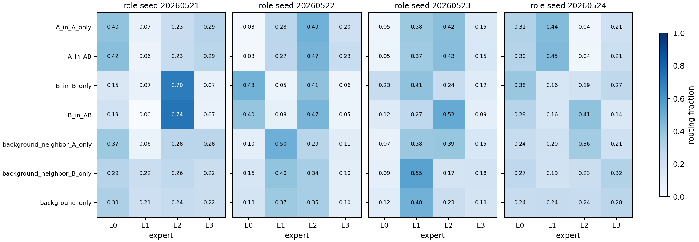
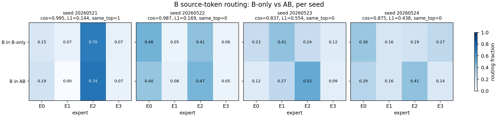
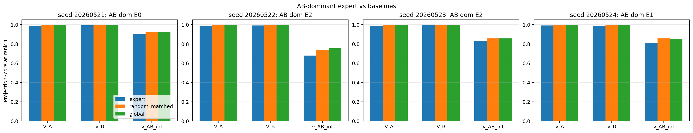
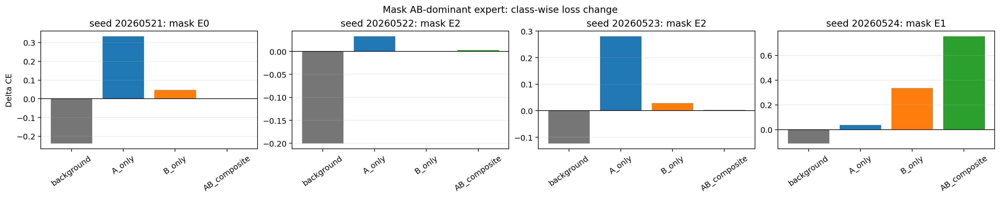

# Reporting Report: Router Feature Specialization Audit

Date: 2026-05-22

Source closures:

```text
Projects/from-attention-to-search/XingyuD/main/hypotheses/H0521_router_feature_specialization/H0521a_seq2_ab_feature_specialization/hypothesis_closure.md
Projects/from-attention-to-search/XingyuD/main/hypotheses/H0521_router_feature_specialization/H0521b_seq32_contiguous_ab/hypothesis_closure.md
Projects/from-attention-to-search/XingyuD/main/hypotheses/H0521_router_feature_specialization/H0522_svd_feature_mixing_seq32/hypothesis_closure.md
```

## 0. Oral Report Card

目的：

我现在想回答一个很小的问题：在最简单的 AB synthetic setting 中，ordinary top-1 MoE router 到底有没有自然形成可解释、稳定的 feature-level expert bucket。

假设：

如果 expert bucket 是 feature-level specialization，那么 A-only、B-only、AB-composite 应该稳定进入不同 expert；进一步，AB expert 的表示子空间应该主要对齐 AB interaction，而不是同时混入 A 和 B。

结论：

当前结论是弱负结果：ordinary top-1 MoE 能学会 AB synthetic task，但 expert id 目前不能被当作稳定、干净、可直接用作 Reverse Index 的 feature bucket。

证据：

1. 主 routing 结果来自 `seq_len=32` source-token audit：B-only 里的 B 和 AB 里的 B 路由跨 seed 不稳定，说明 B routing 不只由 B identity 决定，但也不能说 identity 完全消失。
2. 主 representation 结果来自 SVD audit：AB-dominant expert 对 A、B、AB interaction 都有高投影，但不优于 random/global baseline；mask AB expert 的损伤也不跨 seed 稳定，所以不能说形成了稳定 clean AB specialist。
3. `seq_len=2` 只作为最小背景 sanity：它说明 routing assignment 一开始就不是 clean A/B/AB partition，但由于 ablation 弱，不作为强功能结论。

一句话版本：

```text
当前 evidence 不是在证明 MoE routing 没有语义，而是在降低一个强假设：
ordinary top-1 expert id 暂时不能直接作为 clean feature/function index。
```

## 1. 目的

本报告整合 H0521a、H0521b、H0522 SVD 三个 closure，服务于组会汇报。主结果以 H0521b 和 H0522 SVD 为主；H0521a 只作为最小背景和 sanity check。

核心问题：

```text
在最简单 AB synthetic setting 中，top-1 MoE router 到底是在按 token identity 分发，
还是受到 context / sequence-conditioned feature 调制？

进一步，expert bucket 是否形成 feature-level specialization，
还是混合了 A、B、AB 信息？
```

这里的关键不是证明真实语言模型里的 MoE 一定失败，而是先判断当前 synthetic setup 中的 ordinary top-1 expert id 有没有资格作为 learned index 的候选信号。

## 2. 假设

主假设：

```text
ordinary top-1 MoE 更可能形成 mixed routing bucket，
而不是稳定、干净、feature-level expert bucket。
```

对立假设：

```text
router 会自然形成 feature-level specialization：
A-only、B-only、AB-composite 分别进入稳定 expert，
并且对应 expert 的表示子空间和功能损伤都与该 feature 对齐。
```

## 3. 数学建模

对某个 hidden state $h$，top-1 router 做：

$$
e^*(h)=\arg\max_i w_i^\top h
$$

如果 hidden state 同时包含 token identity、position、context 和 feature signal：

$$
h \approx h_{id}+h_{pos}+h_{context}+h_{feature}+\epsilon
$$

那么 expert id 可能不是单一 feature 的 index，而是 mixed hidden vector 的 hard assignment。

本轮把证据分成三层：

| 层级 | 问题 | 当前判断 |
|---|---|---|
| routing-level | 样本或 source token 是否稳定进入 feature-specific expert | 不稳定，不是 clean partition |
| representation-level | expert bucket 的 SVD 子空间是否独有对齐 feature direction | AB expert 不独有对齐 AB interaction |
| function-level | mask expert 是否主要伤害对应 class | 证据弱且跨 seed 不稳定 |

## 4. 实验设置

### H0521a: seq_len=2 最小 AB setup

```text
A-only:       [A, r] -> y_A
B-only:       [r, B] -> y_B
AB-composite: [A, B] -> y_AB
background:  [r_i, r_j] -> r_k
```

目的：先看最小 prediction-position routing 是否形成 A/B/AB expert bucket。

### H0521b: seq_len=32 source-token setup

```text
A-only:       background 中插入 [A, r] -> y_A
B-only:       background 中插入 [r, B] -> y_B
AB-composite: background 中插入 [A, B] -> y_AB
background:  全 background token -> r_k
```

目的：更接近 Reverse Index 的 source-token 场景，看历史 A/B/background token 自己被 routed 到哪里。

### H0522 SVD: representation-level audit

复用 H0521b 已训练 `seq_len=32` MoE，分析 prediction position $p^*=31$ 的 router input hidden state。eval set 严格 balanced：

| Class / motif | Count per seed | Frequency |
|---|---:|---:|
| background | 4096 | 25% |
| A-only `[A,r]` | 4096 | 25% |
| B-only `[r,B]` | 4096 | 25% |
| AB-composite `[A,B]` | 4096 | 25% |

SVD audit 中 motif position 固定为 `15`，用于减少 position 分布对 feature direction 的干扰。

## 5. 结论

最安全的结论：

```text
当前 ordinary top-1 MoE 没有表现出稳定、干净、可直接作为 feature-level index 的 expert bucket。
```

更细化地说：

1. `seq_len=32` source-token audit 显示 source identity signal 存在，但 B token routing 会被 context 调制。
2. SVD audit 显示 AB-dominant prediction expert 不是稳定、独有的 AB specialist。
3. `seq_len=2` 只提供背景：最小 setup 下 routing assignment 也不干净，但 function-level 证据弱。

## 6. 证据

### 6.1 Background: H0521a 只作为最小 sanity

这部分不是今天的主结果。它的作用只是说明：即使在最小 `seq_len=2` setup 中，routing assignment 也没有自然形成 clean A/B/AB partition。

任务可学：dense 和 MoE 都学会 A/B/AB 规则，三类 signal accuracy 都是 `1.0`。因此这个背景结果不是失败模型导致的。

关键 observation：

```text
AB-composite 可以集中到某个 expert，
但该 expert 同时接收大量 A-only、B-only 和 background。
```



这只支持一个背景判断：

```text
routing assignment 层面不是 clean A/B/AB partition。
```

但 expert ablation delta 很小：



因此不能说：

```text
expert function 已经强 feature-mixing。
```

只能说：

```text
routing-level bucket 不干净，function-level specialization 仍未被强证实。
```

### 6.2 Main Result 1: H0521b 显示 B routing 不只由 B identity 决定

最重要指标是 source-token routing purity。它在 inference 阶段看 source token 自己进入哪个 expert，并且逐 seed 判断。

跨 seed 结果：

| Rule | Result |
|---|---:|
| A token 在 A-only 和 AB 中 dominant expert 一致 | 4/4 seeds |
| B token 在 B-only 和 AB 中 dominant expert 一致 | 1/4 seeds |
| A token 与 B token 是否进入不同 dominant expert | 2/4 seeds |
| source identity NMI | mean 0.047 |
| source role NMI | mean 0.042 |



B-only 与 AB 中的 B source token 对比：



这个结果支持：

```text
B token routing 不是只由 B identity 决定。
```

但这句话要很小心。它不等于：

```text
router 已经学到 semantic AB feature。
```

更稳的说法是：

```text
B routing 至少受到 sequence / causal context 调制；
当前更像 identity anchor + context modulation，而不是 clean hard identity bucket。
```

### 6.3 Main Result 2: H0522 SVD 显示 AB expert 没有独有 AB subspace

SVD audit 的目的不是再看“分到哪个 expert”，而是看：

```text
expert bucket 的 dominant subspace 是否和 feature direction 对齐。
```

定义 prediction position hidden mean：

$$
\mu_0,\quad \mu_A,\quad \mu_B,\quad \mu_{AB}
$$

构造 feature directions：

$$
v_A=\mu_A-\mu_0,\quad v_B=\mu_B-\mu_0
$$

$$
v_{AB}^{int}=\mu_{AB}-\mu_A-\mu_B+\mu_0
$$

注意：$v_{AB}^{raw}=\mu_{AB}-\mu_0$ 不能直接当 AB interaction。实验中：

```text
cos(v_AB_raw, v_A + v_B) = 0.994-0.998
```

所以 raw AB direction 主要是 A+B。

对 AB-dominant expert 的 hidden states $H_e$ 做 SVD：

$$
\tilde{H}_e = U_e\Sigma_eV_e^\top
$$

用前 $r$ 个右奇异向量张成 $S_{e,r}$，计算：

$$
\mathrm{ProjScore}(v,e,r)=\frac{\lVert P_{S_{e,r}}v\rVert_2^2}{\lVert v\rVert_2^2}
$$

这个指标合理，因为如果 expert 是 feature specialist，它接收的 hidden states 的 dominant variance directions 应该和对应 feature direction 对齐。

rank 4 下：

| Direction | AB expert mean | random matched mean | global mean |
|---|---:|---:|---:|
| $v_A$ | 0.986 | 0.998 | 0.998 |
| $v_B$ | 0.991 | 0.998 | 0.998 |
| $v_{AB}^{int}$ | 0.803 | 0.843 | 0.846 |



解释：

```text
AB expert 与 A/B/AB interaction 都高对齐；
但这种对齐不强于 random matched 或 global baseline。
```

所以不能说：

```text
AB expert 有独有 AB-specialized subspace。
```

更稳的判断是：

```text
prediction hidden space 本身有低维 class structure；
AB expert 没有表现出 expert-specific AB specialization。
```

功能证据也不稳定：



只有 seed `20260524` 明显主要伤害 AB-composite；其他 seed 主要伤害 A-only 或几乎不伤害 AB-composite。因此不能把单 seed 的 AB damage 当作结论。

## 7. 结论边界

能说：

```text
在当前 controlled AB synthetic setup 中，
ordinary top-1 MoE expert id 还不能被当作稳定、干净、可复用的 feature-level index。
```

不能说：

```text
MoE routing 一般无用。
router 完全没有 semantic signal。
expert function 已经强 feature-mixing。
真实语言模型中也一定如此。
Reverse Index 已经被否定。
```

最重要边界：

```text
当前证据主要削弱 clean expert bucket 假设；
它还没有给出一个强的 positive mechanism。
```

## 8. 下一步决策

我组会上建议把下一步说成：

```text
先不要直接进入 Reverse Index alignment。
下一步要构造更严格的 anti-shortcut synthetic，
显式平衡 token identity、source position、target token 和 rule/function，
再看 rule/function 是否能跨 seed 稳定解释 router score / expert id。
```

但这部分今天可以只作为方向，不展开 factor audit 的已有结果，因为当前对 factor audit 的测法还需要再消化。

## 9. 结果文档

H0521a closure:

```text
Projects/from-attention-to-search/XingyuD/main/hypotheses/H0521_router_feature_specialization/H0521a_seq2_ab_feature_specialization/hypothesis_closure.md
```

H0521b closure:

```text
Projects/from-attention-to-search/XingyuD/main/hypotheses/H0521_router_feature_specialization/H0521b_seq32_contiguous_ab/hypothesis_closure.md
```

H0522 SVD closure:

```text
Projects/from-attention-to-search/XingyuD/main/hypotheses/H0521_router_feature_specialization/H0522_svd_feature_mixing_seq32/hypothesis_closure.md
```

## 10. Stable Q&A

### Q1: 你现在能说 expert bucket 已经发生 feature mixing 吗？

不能强说。当前能说的是：expert bucket 没有表现为 clean feature specialist。

原因是 SVD 中 AB expert 对 A/B/AB interaction 都高投影，但 random/global baseline 也高；ablation 也不跨 seed 稳定。

### Q2: B routing 不稳定是否说明 router 在看 context？

可以说“至少不只看 B identity”。但不能直接说它学到了 semantic context。

稳妥表述：

```text
B routing 受到 sequence / causal context 调制；
当前更像 identity anchor + context modulation。
```

### Q3: 这是否否定 Reverse Index？

没有。它只否定一个强版本：

```text
当前 ordinary top-1 expert id 可以直接当 clean feature index。
```

Reverse Index 是否可行还需要后续测 bucket 对 dense attention high-mass KV 的覆盖。

### Q4: 为什么 SVD right singular vector alignment 是合理的？

因为 expert bucket 是一组 hidden states。SVD 的右奇异向量给出这些 hidden states 在 representation space 中的主变化方向。如果 expert 是 feature specialist，它的主方向应当和该 feature direction 对齐。

但它必须配 baseline。否则全局 hidden space 的低维结构也会让任何 bucket 看起来“对齐”。
