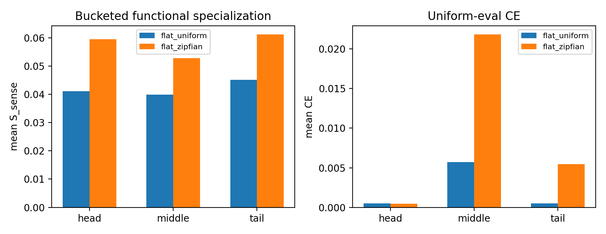

# Reporting Card: H0529a Zipfian Frequency Shortcut

Source closure:

```text
Projects/from-attention-to-search/main/hypotheses/H0529a_zipfian_frequency_shortcut/hypothesis_closure.md
```

## Oral Report Card - Fill Before Meeting

目的：

假设：

结论：

证据：

1.
2.
3.

## Closure Snapshot

目的：判断 Zipfian token frequency 是否会放大 flat top-1 sparse router 的 route-function mismatch。

假设：当 $P(b_i)$ 是 Zipfian、但 $P(c\mid b_i)$ balanced 时，flat router 会更偏 token/common/frequency shortcut，tail context-sense functional specialization 会变弱。

结论：强假设被削弱。Zipfian 改变了 load / optimization structure，但没有降低 tail $S_{\mathrm{sense}}$ 或 tail route-function alignment。

关键证据：

| Condition | Tail $S_{\mathrm{sense}}$ | Tail alignment | Final load entropy |
|---|---:|---:|---:|
| `flat_uniform` | `0.0451` | `0.7777` | `0.8143` |
| `flat_zipfian` | `0.0612` | `0.7930` | `0.5218` |



这张图说明：Zipfian 没有降低 tail $S_{\mathrm{sense}}$，但 uniform-eval middle/tail CE 略差。

结论边界：不能说 Zipfian distribution harmless；只能说 token-frequency skew alone 在当前 context-balanced setup 下不是充分解释。

下一步：转向 route-function binding / utility-aware routing。
