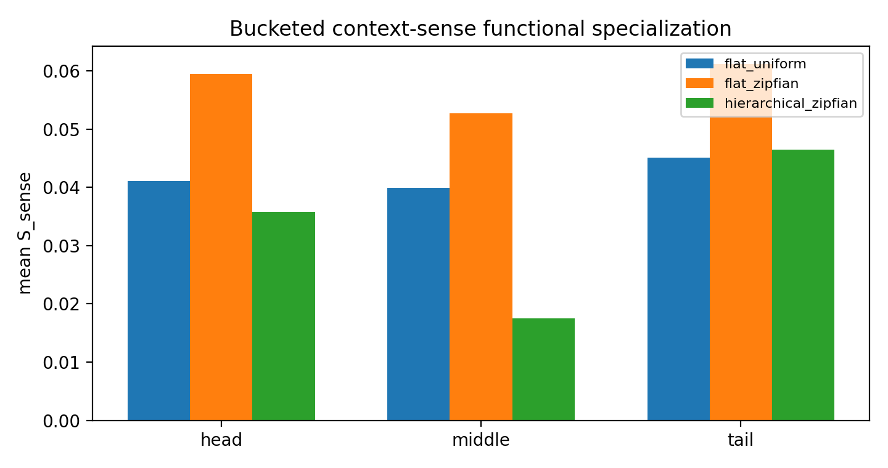
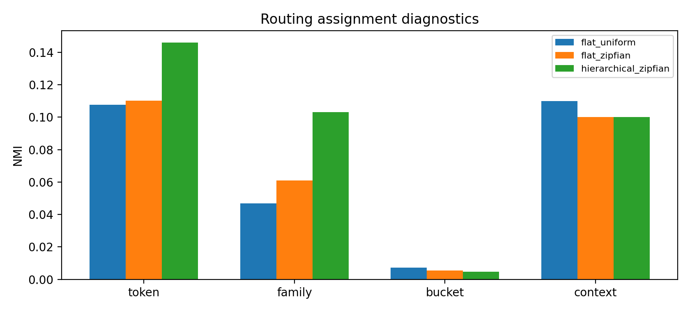

# Reporting Card: H0530a Hierarchical Common/Sense MoE

Source closure:

```text
Projects/from-attention-to-search/main/hypotheses/H0530a_hierarchical_common_sense_moe/hypothesis_closure.md
```

## Oral Report Card - Fill Before Meeting

目的：

假设：

结论：

证据：

1.
2.
3.

## Closure Snapshot

目的：判断 two-level common/sense Hierarchical MoE 是否能改善 Zipfian setup 下的 functional expert specialization。

假设：把 common family route 和 context-conditioned fine route 分开，可以让 fine router 更稳定地绑定 context-sense causal function。

结论：假设被削弱。当前 minimal hierarchy 没有改善 tail functional specialization；tail route-function alignment 反而明显变差。

关键证据：

| Condition | Tail $S_{\mathrm{sense}}$ | Tail alignment | Tail CE |
|---|---:|---:|---:|
| `flat_zipfian` | `0.0612` | `0.7930` | `0.0055` |
| `hierarchical_zipfian` | `0.0465` | `-0.0693` | `0.0920` |



这张图说明：hierarchy 没有提高 $S_{\mathrm{sense}}$。



这张图说明：hierarchy 的 route-token / route-family NMI 更高，但这不是 functional evidence。

结论边界：不能说所有 Hierarchical MoE 失败；只能说当前 minimal hierarchy 没有解决 route-function mismatch。

下一步：不要继续只改 routing geometry，优先测试 route-function consistency / utility-aware routing。
