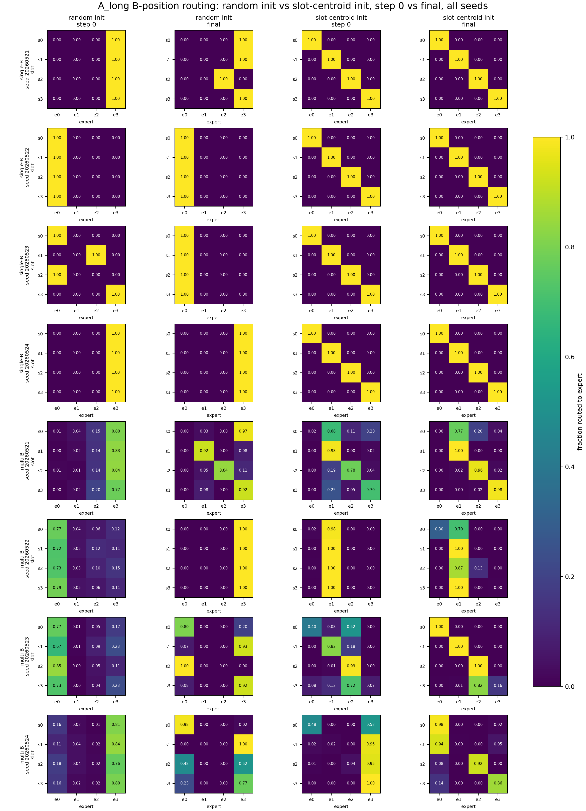
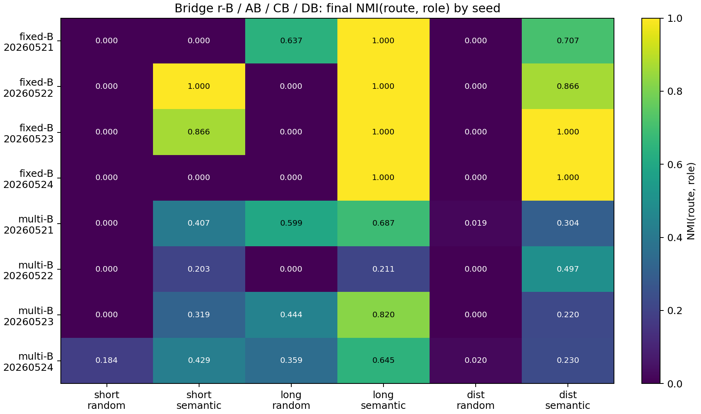
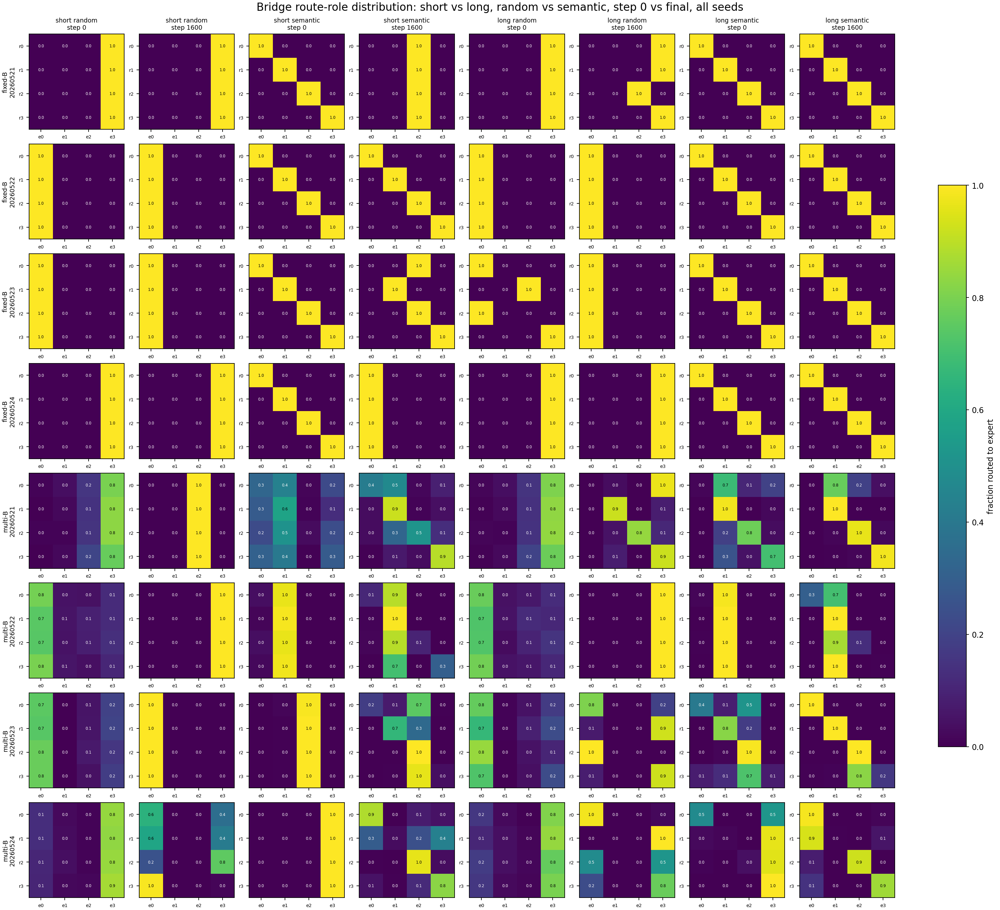

# Sync Closure: Slot-Context Dominance Router Specialization

Anchor:

```text
Projects/from-attention-to-search/main/problem_anchors/gated_main_causes/slot_context_dominance_router_specialization_anchor.md
```

Story:

```text
This experiment tests whether stronger slot context can make top-1 MoE routing follow slot-specific expert utility rather than B-token identity variation.
```

## Meeting Brief

30 秒版本：

```text
slot 变长增强了 B hidden state 中的 slot feature，所以 router 更容易按 slot 分；
但 multi-B 里 B identity 仍然干扰，所以只得到部分 specialization。
```

三张主图：

```text
1. short vs long routing: ../figures/discussion_random_vs_slot_init_init_final_route_heatmaps.png
2. fixed-B / multi-B seed result: ../figures/bridge_abcd_final_nmi_by_seed_heatmap.png
3. bridge short vs long heatmap: ../figures/bridge_abcd_short_long_init_final_route_heatmaps.png
```

回答边界：

```text
NMI 上升说明 route-slot alignment 改善；
functional specialization 还需要 forced utility heatmap 和 Assign-Utility 一起支持；
当前支持弱版本，不支持 vanilla top-1 NTP 自动稳健学出 slot experts。
```

## 0. Oral Report Card - Fill Before Meeting

目的：判断弱 slot signal 是否解释之前 top-1 MoE routing failure。

假设 / 问题：如果 slot 在 B-position hidden state 中足够可见且决定 target，slot-centroid init 是否能让 learned router 形成 slot-functional specialization？

结论：single-B 支持 slot 可控 routing；multi-B 削弱 strong hypothesis。follow-up trajectory 说明 multi-B 的主要缺口不是“训练破坏了干净对角 routing”，而是 slot-centroid init 在 256 个 B identity 下起点就不干净；训练改善但没有稳定绑定 assignment 和 utility。bridge `r-B / AB / CB / DB` 说明 0524 semantic-prior decay 与当前 fixed-B NMI 上升不矛盾。

证据：multi-B `B_long_distributed` 的 route NMI `0.078 -> 0.313`、Assign-Utility `0.326 -> 0.747`；`A_long_repeated` 的 route NMI `0.243 -> 0.591`、Assign-Utility `0.565 -> 0.925`；`Oracle_b_position_only` 最终为 1.0。bridge fixed-B `long_role_semantic_init` final NMI 为 `1.000` across seeds，multi-B semantic init 在 short/long/distributed 上都高于 random init。

## 1. Purpose

本轮不是测试 reverse KV retrieval，也不是比较 MoE 架构。它只检验一个失败解释：

```text
此前 B-context routing failure 是否主要因为 slot context 在 B hidden state 中太弱？
```

## 2. Anchor Question And Physical Prior

Physical prior:

```text
A router can specialize by a feature only if that feature is visible in the router input and useful for the loss.
```

第二个 prior:

```text
Routing alignment is not enough; assigned expert must have causal utility for that slot.
```

因此判断不能只看 route heatmap，也不能只看 Assign-Utility；需要一起看：

```text
route NMI / route heatmap / forced utility heatmap / assignment_utility_agreement
```

## 3. Mathematical / Computational Setup

每条样本的 motif 固定在：

```text
positions 10-14: slot prefix
position 15: B_i
position 16: Y_{s,i}
seq_len = 32
```

训练是 normal full-sequence causal NTP：

```text
loss = mean CE(x_t -> x_{t+1})
```

主评估只看 B position，因为那里是 slot context 和 B identity 竞争的地方。

## 4. Experiment Setup

Two full ACP jobs:

| Job | Mode | Job id | Role |
|---|---|---|---|
| `slot_context_single_b_full_20260526` | `single_b_sanity` | `pt-1hik6tn0` | fixed B identity; clean slot-control test |
| `slot_context_multi_b_full_20260526` | `multi_b_primary` | `pt-9pm1t5ul` | 256 B identities; main claim test |

Conditions:

```text
C0_short_slot_init
A_long_repeated_slot_init
B_long_distributed_slot_init
Oracle_slot_router
```

## 5. Conclusion

结论分两层：

```text
single-B: slot context can control routing and align assignment with utility.
multi-B: stronger slot context does not robustly overcome B identity variation.
```

因此 anchor 的强版本被削弱：

```text
slot visibility + slot-centroid init is not sufficient for stable functional specialization under many B identities.
```

## 6. Evidence

| Mode | Condition | Target Acc | Probe h_B->slot | Route NMI | Diag Purity | Assign-Utility |
|---|---|---:|---:|---:|---:|---:|
| `single_b_sanity` | `A_long_repeated_slot_init` | 1.000 | 1.000 | 1.000 | 1.000 | 1.000 |
| `single_b_sanity` | `B_long_distributed_slot_init` | 1.000 | 1.000 | 0.893 | 0.812 | 1.000 |
| `multi_b_primary` | `A_long_repeated_slot_init` | 1.000 | 1.000 | 0.593 | 0.646 | 0.921 |
| `multi_b_primary` | `B_long_distributed_slot_init` | 1.000 | 1.000 | 0.297 | 0.502 | 0.733 |
| `multi_b_primary` | `Oracle_slot_router` | 1.000 | 0.997 | 1.000 | 1.000 | 1.000 |

Trajectory follow-up:

| Mode | Condition | NMI 0 -> 1600 | Assign 0 -> 1600 | Center norm 0 -> 1600 | Router delta final |
|---|---|---:|---:|---:|---:|
| `single_b` | `A_long_repeated_slot_init` | 1.000 -> 1.000 | 0.438 -> 1.000 | 1.089 -> 3.186 | 0.165 |
| `single_b` | `B_long_distributed_slot_init` | 1.000 -> 0.893 | 0.438 -> 1.000 | 0.491 -> 4.185 | 0.146 |
| `multi_b` | `A_long_repeated_slot_init` | 0.243 -> 0.591 | 0.565 -> 0.925 | 1.166 -> 4.903 | 0.167 |
| `multi_b` | `B_long_distributed_slot_init` | 0.078 -> 0.313 | 0.326 -> 0.747 | 0.652 -> 4.298 | 0.177 |
| `multi_b` | `Oracle_b_position_only` | 1.000 -> 1.000 | 0.625 -> 1.000 | 1.166 -> 3.644 | 0.000 |
| `multi_b` | `B_long_random_init` | 0.006 -> 0.010 | 0.420 -> 0.998 | 0.652 -> 5.039 | 0.285 |

### Key Figure For Discussion



How to read: each small heatmap is B-position routing, with row = slot, column = expert, and value = fraction routed to that expert. Columns compare `random init` and `slot-centroid init`; inside each pair, left is step 0 and right is final. Rows show all fixed-B and multi-B seeds without seed averaging.

Vertical comparison asks what NTP training changes from initialization to final. Fixed-B `A_long` keeps clean slot-specialized routing under slot-centroid init; random init does not reliably discover that partition. Multi-B shows partial improvement, but not stable diagonalization.

Horizontal comparison asks whether slot-centroid initialization is stronger than random at the same stage. It is clearly stronger in fixed-B and generally more slot-aligned in multi-B, but multi-B remains seed-unstable.

Interpretation: the evidence supports “stronger context plus slot-centroid prior helps router partition by slot.” It does not support the stronger claim that ordinary top-1 NTP naturally and robustly learns slot-specialized routing under multi-B identity variation.

### Bridge Figure: r-B / AB / CB / DB

结论：这个 bridge 说明 0524 的 AB/CB semantic-prior decay 和当前 fixed-B NMI 上升不矛盾。0524 削弱的是“semantic init alone 足以形成 stable functional specialization”；bridge 支持的是更弱结论：“当 B-position target pressure 对齐时，更长的 context 会增强 route-role alignment”。

| Mode | Condition | Init | Final NMI | Final Assign-Utility | Target Acc |
|---|---|---|---:|---:|---:|
| fixed-B | short role | semantic | 0.467 | 1.000 | 1.000 |
| fixed-B | long role | semantic | 1.000 | 1.000 | 1.000 |
| fixed-B | distributed role | semantic | 0.893 | 1.000 | 1.000 |
| multi-B | short role | semantic | 0.338 | 0.759 | 1.000 |
| multi-B | long role | semantic | 0.593 | 0.921 | 1.000 |
| multi-B | distributed role | semantic | 0.297 | 0.733 | 1.000 |



How to read: each row preserves one seed-level final NMI value. fixed-B long semantic is `1.000` for all seeds; multi-B semantic improves over random but does not become seed-stable.



How to read: compare random vs semantic init and step-0 vs final routing. The diagonal route-role pattern is most reliable under long role context plus semantic centroid init.

## 7. Observation

Observation 1:

```text
single-B 下 repeated long cue 完全对角，distributed code 的 assignment-utility 也达到 1.0。
```

Observation 2:

```text
multi-B 下 h_B -> slot probe 仍接近 1.0，说明 slot 并未从 representation 中消失。
```

Observation 3:

```text
multi-B Oracle = 1.0，说明 task 有 slot-specific utility 上界。
```

Observation 4:

```text
multi-B learned B_long distributed 的 assignment-utility 只有 0.733。
```

Observation 5:

```text
multi-B B_long_random_init 的 assignment-utility 达到 0.998，但 route NMI 只有 0.010。
```

## 8. Interpretation

slot signal 可见且有用，但 learned top-1 NTP routing 没有稳定把 slot 作为 functional routing axis。trajectory 把 failure 进一步定位到：

```text
multi-B initialization geometry 不干净 + route assignment / expert utility / NTP objective 之间缺少绑定机制
```

而不是简单的：

```text
slot signal completely absent from h_B
```

## 9. Claim Boundary

Safest claim:

```text
stronger slot context is sufficient for slot-controlled routing in a fixed-B diagnostic, but not sufficient for robust multi-B functional specialization.
```

What cannot be claimed:

```text
ordinary top-1 MoE naturally forms stable feature-level specialists;
route heatmap diagonal proves expert utility;
this result transfers to real data or retrieval utility.
```

## 10. Next Decision

下一步不应继续做更宽的 context sweep。更小的 decisive test 是：

```text
multi_b_primary + explicit route-function binding signal
```

优先测试：

```text
target-position slot-router auxiliary loss
```

判断它是否把：

```text
A_long assignment-utility: 0.921 -> near 1.0
B_long assignment-utility: 0.733 -> materially higher
```

## 11. Links

anchor:

```text
Projects/from-attention-to-search/main/problem_anchors/gated_main_causes/slot_context_dominance_router_specialization_anchor.md
```

summary:

```text
Projects/from-attention-to-search/main/experiments/slot_context_dominance_router_specialization/summary.md
```

detailed:

```text
Projects/from-attention-to-search/main/experiments/slot_context_dominance_router_specialization/detailed.md
```

bridge summary:

```text
Projects/from-attention-to-search/main/experiments/slot_context_bridge_abcd_context_length/summary.md
```

bridge detailed:

```text
Projects/from-attention-to-search/main/experiments/slot_context_bridge_abcd_context_length/detailed.md
```

source anchor copy:

```text
sync/S000_current_specialization/anchors/expert_specialization/slot_context_dominance_router_specialization_anchor.md
```

## 12. Artifact / Repro Map

code workspace:

```text
Projects/from-attention-to-search/XingyuD/Attention_Search_Experiments/active/synthetic_data_understanding
```

runner:

```text
scripts/run_slot_context_dominance_router_specialization.py
```

config:

```text
configs/slot_context_dominance_router_specialization.json
```

key code files:

```text
src/synthetic_data_understanding/tiny_moe.py
scripts/submit_slot_context_dominance_4gpu_acp.sh
```

data / manifest:

```text
results/slot_context_dominance_router_specialization/slot_context_single_b_full_20260526/data_audit.json
results/slot_context_dominance_router_specialization/slot_context_multi_b_full_20260526/data_audit.json
results/slot_context_dominance_router_specialization/slot_context_single_b_trajectory_full_20260527/data_audit.json
results/slot_context_dominance_router_specialization/slot_context_multi_b_trajectory_full_20260527/data_audit.json
results/slot_context_dominance_router_specialization/bridge_abcd_single_b_full_20260527/data_audit.json
results/slot_context_dominance_router_specialization/bridge_abcd_multi_b_full_20260527/data_audit.json
```

result dir:

```text
results/slot_context_dominance_router_specialization/slot_context_single_b_full_20260526
results/slot_context_dominance_router_specialization/slot_context_multi_b_full_20260526
results/slot_context_dominance_router_specialization/slot_context_single_b_trajectory_full_20260527
results/slot_context_dominance_router_specialization/slot_context_multi_b_trajectory_full_20260527
results/slot_context_dominance_router_specialization/bridge_abcd_single_b_full_20260527
results/slot_context_dominance_router_specialization/bridge_abcd_multi_b_full_20260527
```

figure dir:

```text
figures/slot_context_dominance_router_specialization/slot_context_single_b_full_20260526
figures/slot_context_dominance_router_specialization/slot_context_multi_b_full_20260526
figures/slot_context_dominance_router_specialization/slot_context_single_b_trajectory_full_20260527
figures/slot_context_dominance_router_specialization/slot_context_multi_b_trajectory_full_20260527
```

key files:

```text
Projects/from-attention-to-search/main/experiments/slot_context_dominance_router_specialization/tables/
Projects/from-attention-to-search/main/experiments/slot_context_dominance_router_specialization/figures/
Projects/from-attention-to-search/main/experiments/slot_context_bridge_abcd_context_length/summary.md
Projects/from-attention-to-search/main/experiments/slot_context_bridge_abcd_context_length/detailed.md
```

checkpoints / logs:

```text
results/slot_context_dominance_router_specialization/*/*/*/seed_*/model.pt
logs/acp/slot_context_single_b_full_20260526_runtime_*.log
logs/acp/slot_context_multi_b_full_20260526_runtime_*.log
logs/acp/slot_context_single_b_trajectory_full_20260527_runtime_*.log
logs/acp/slot_context_multi_b_trajectory_full_20260527_runtime_*.log
logs/acp/bridge_abcd_single_b_full_20260527_runtime_*.log
logs/acp/bridge_abcd_multi_b_full_20260527_runtime_*.log
```

repro command:

```bash
bash scripts/submit_slot_context_dominance_4gpu_acp.sh
```

job id:

```text
single_b_sanity: pt-1hik6tn0
multi_b_primary: pt-9pm1t5ul
single_b_trajectory_followup: pt-xmf0ui1b
multi_b_trajectory_followup: pt-1cchrtfq
bridge_abcd_single_b: pt-qeorv2p9
bridge_abcd_multi_b: pt-gr1vtgfn
```
