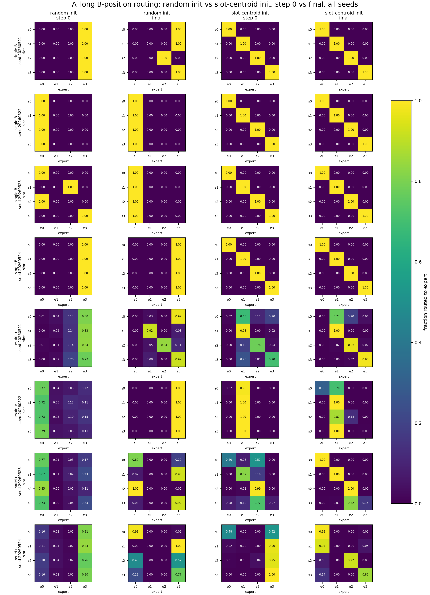
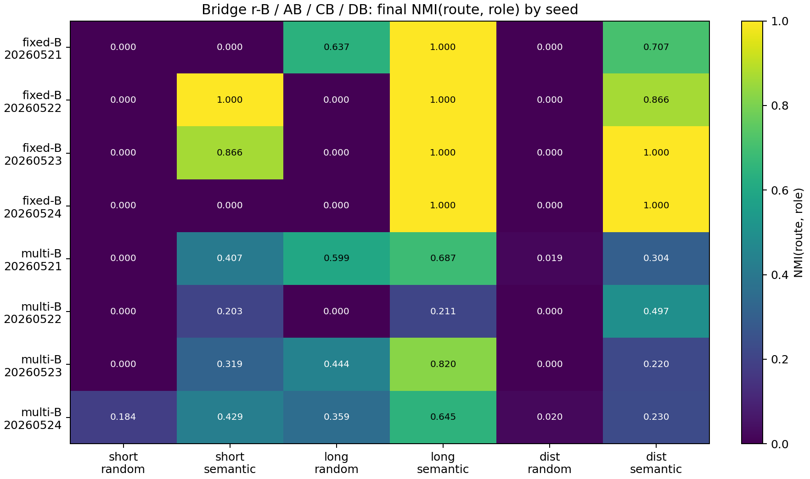
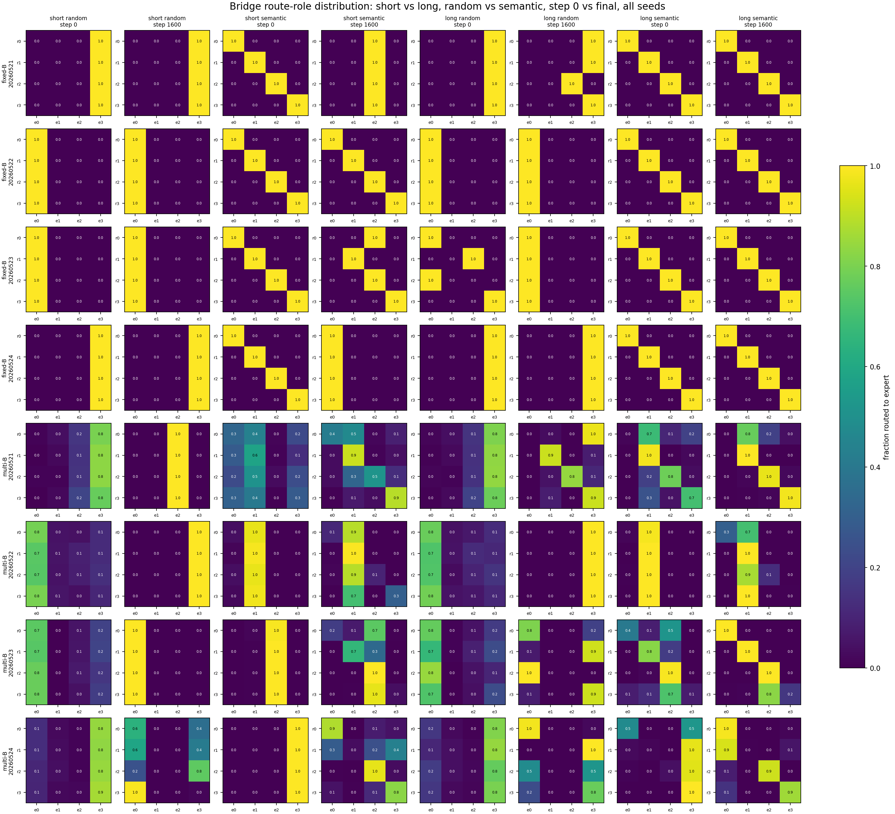

# 0526 Slot-Context 汇报话术

## 0. 汇报时只背这一句

```text
slot 变长增强了 B hidden state 中的 slot feature，所以 router 更容易按 slot 分；
但 multi-B 里 B identity 仍然干扰，所以只得到部分 specialization。
```

这句话是整场汇报的主线。不要先讲所有实验细节，先把问题和结论钉住。

## 1. 我在解决什么问题

话术：

```text
我现在做的是 MoE 里 router 为什么没有按 slot / feature 分 expert 的问题。
更具体地说，我想知道：同一个 B token 在不同 slot/context 下需要预测不同 target 时，
router 能不能利用 slot 信息，而不是主要被 B token identity 或 common feature 控制。
```

可看的文档：

```text
docs/anchor_slot_context_signal_and_route_utility_binding.md
```

看这个文档的：

```text
Reporting Summary
Question
Physical Prior
```

## 2. 我这轮问什么

话术：

```text
之前我们看到 short slot 的 semantic/context init 一开始有用，但训练后会下降。
所以这轮我问：是不是 slot 信息太短、太弱，在 B position 的 hidden state 里被 B identity 压过去了？
```

核心物理假设：

```text
h_{i,s}^{(m)} = c_i + beta_m u_s + epsilon
```

解释：

```text
c_i 是 B identity，u_s 是 slot/context feature。
slot 变长时 beta_m 变大，router 才更可能按 slot 分。
```

可看的文档：

```text
docs/anchor_slot_context_signal_and_route_utility_binding.md
```

看这个文档的：

```text
Physical Prior
Mechanistic Motivation
Mathematical Modeling
```

## 3. 我做了什么实验

话术：

```text
我把 slot 前面的上下文加长，并让同一个 B 在不同 slot 下对应不同 target。
然后分 fixed-B 和 multi-B 两种情况：
fixed-B 去掉 B identity 干扰，只看 slot 能不能控制 routing；
multi-B 把 256 个 B identity 加回来，看 slot signal 能不能在真实干扰下仍然稳定。
```

实验设置要点：

```text
seq_len = 32
positions 10-14: slot prefix
position 15: B_i
position 16: Y_{s,i}
training: normal full-sequence causal NTP
evaluation: primary metrics at B position
MoE: top-1 selected-gate, selected expert output multiplied by selected gate probability
```

可看的文档：

```text
docs/slot_context_summary.md
```

看这个文档的：

```text
Meeting Brief
Observation
Mechanism Diagnostic Addendum
```

## 4. 三张图怎么讲

### 图 1：short vs long 的 routing 对比

图片：



话术：

```text
这张图看 random init 和 slot-centroid init，从 step 0 到 final 的 routing 分布。
重点不是说 random 一定不行，而是看 slot-centroid init + long context 是否更能保持 slot-aligned routing。
fixed-B 下 long context 基本可以维持对角；
multi-B 下有增强，但没有完全稳定。
```

指向文档：

```text
docs/slot_context_summary.md
```

对应位置：

```text
Key Figure For Discussion
```

### 图 2：fixed-B 和 multi-B 的 seed-level NMI

图片：



话术：

```text
这张图保留每个 seed，不做 seed average。
fixed-B long semantic 的 final NMI 是 1.0 across seeds，说明只要去掉 B identity 干扰，
long context 确实能让 router 按 slot/role 分。
multi-B 也有提升，但 seed 之间不稳定，说明 B identity 干扰还在。
```

指向文档：

```text
docs/bridge_abcd_summary.md
```

对应位置：

```text
Key Figures
Observation
```

### 图 3：bridge short vs long 的始末 heatmap

图片：



话术：

```text
这张图是为了回答：0524 里 semantic prior 会下降，和现在 fixed-B NMI 上升是否矛盾？
bridge 把 r-B / AB / CB / DB 对齐到当前 full-NTP + B-position target protocol。
结果是 long context 确实比 short context 更能保持 route-role alignment。
所以旧结果和新结果不矛盾：旧结果反驳 semantic init alone 足够；
新结果支持 context strength helps routing。
```

指向文档：

```text
docs/bridge_abcd_summary.md
```

对应位置：

```text
Comparison To 0524
Interpretation
```

## 5. 我的结果和边界

话术：

```text
结果是 fixed-B 下 router 基本能按 slot 分；
multi-B 下也有增强，但不稳定。
所以我现在的结论是：增强 slot 信息确实会增强 router 按 slot 分发的趋势，
但只靠这个还不足以形成稳定的 expert specialization。
```

不要说：

```text
我们证明了 top-1 MoE 会自然形成 slot experts。
NMI 上升就等于 expert specialization。
fixed-B 成功就说明 multi-B 或真实语言一定成功。
```

可以说：

```text
我们支持了弱版本：context strength helps routing alignment。
我们削弱了强版本：slot visibility + slot-centroid init is sufficient for robust multi-B functional specialization。
下一步应该测 explicit route-function binding，而不是继续加 context length。
```

## 6. 预计三个问题

### Q1：训练是不是正常大模型预训练 NTP？

回答：

```text
是。训练是 normal full-sequence causal NTP。
B-position metrics 只是主评估位置，不是 supervised routing loss。
```

### Q2：NMI 上升是不是就说明 expert specialization？

回答：

```text
不是。NMI 只说明 route-slot alignment。
functional specialization 还要看 forced expert loss heatmap 和 Assign-Utility。
我们现在说的是 routing alignment 被 context 增强，不是说 vanilla top-1 已经稳定形成 causal experts。
```

### Q3：为什么 fixed-B 和 multi-B 都要跑？

回答：

```text
fixed-B 是 positive control，去掉 B identity 干扰，只检验 slot context 是否能控制 routing。
multi-B 是主测试，把 B identity 干扰加回来。
结果 fixed-B 强，multi-B 部分强，说明 weak slot signal 能解释一部分失败，但不是全部失败。
```

## 7. 汇报顺序

```text
1. 先讲一句话结论。
2. 讲问题：router 为什么不按 slot / feature 分 expert。
3. 讲实验：short/long slot context，fixed-B vs multi-B。
4. 看图 1：routing 始末对比。
5. 看图 2：fixed-B 与 multi-B seed-level NMI。
6. 看图 3：bridge 解释为什么不矛盾。
7. 收束到边界：context helps routing，但不是 robust functional specialization。
8. 下一步：multi-B + explicit route-function binding。
```

## 8. 文件索引

汇报入口：

```text
talk_track.md
docs/anchor_slot_context_signal_and_route_utility_binding.md
docs/slot_context_summary.md
```

实验审计：

```text
docs/source_presentation_brief.md
docs/bridge_abcd_summary.md
docs/sync_report.md
```

三张主图：

```text
figures/01_short_vs_long_routing_init_final.png
figures/02_fixed_multi_bridge_nmi_by_seed.png
figures/03_bridge_short_long_route_heatmaps.png
```
