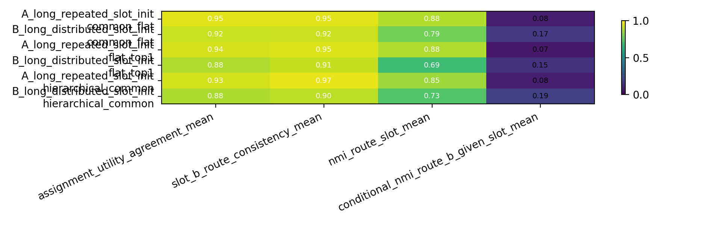
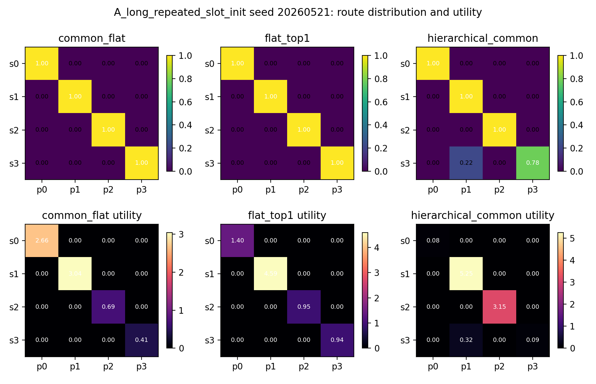
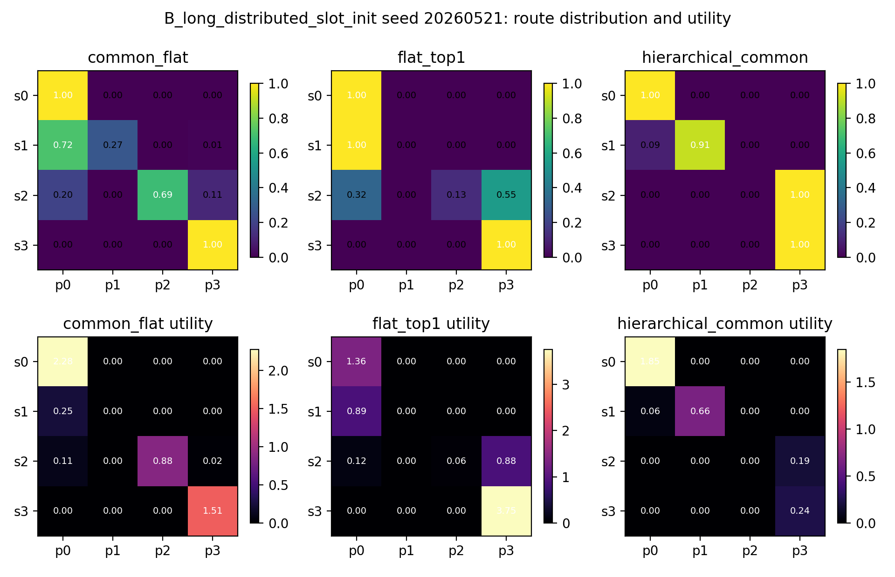
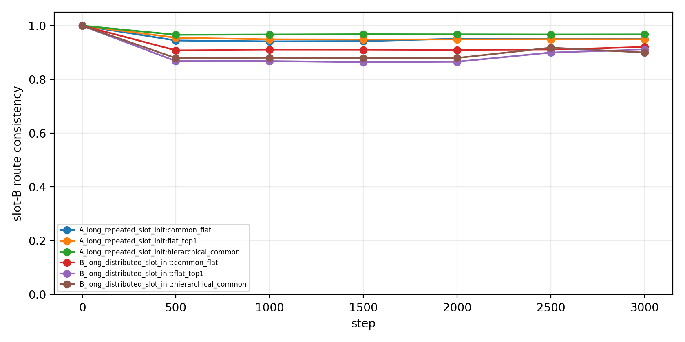

# Result Summary: hierarchical_route_utility_binding

Anchor:

```text
Projects/from-attention-to-search/main/problem_anchors/hierarchical_gating_frame/hierarchical_route_utility_binding_anchor.md
```

Story:

```text
给 MoE 一条常驻 common path，甚至再加一层 group common path，是否能让 leaf route 真正按 slot/function 分工？
```

## 0. Closure Summary

目的：

这轮不是为了证明模型能不能学会预测。预测已经很容易学会。真正要问的是：当同一个 $B_i$ 在不同 slot 下要预测不同 target 时，router 选中的 path 是否也是对这个 slot 最有用的 path。

结论：

```text
64-B uniform 设置下，common path 有一点帮助，但“两层级 hierarchy”没有稳定超过更简单的 common-flat。
```

更具体地说：`common_flat` 在两个 condition 的平均 `assignment_utility_agreement` 都最好；`hierarchical_common` 没有形成稳定优势，在 `B_long_distributed` 上还被 seed 23/24 拉低。因此这轮结果不支持“只要改成 hierarchical common/leaf routing，就自然解决 route-utility binding failure”的强说法。

关键证据：

| Condition | Model | Assign-Utility | Slot-B Consistency | Route-Slot NMI | Target Acc |
|---|---|---:|---:|---:|---:|
| A_long | flat_top1 | 0.935 | 0.948 | 0.883 | 1.0 |
| A_long | common_flat | **0.952** | 0.951 | 0.883 | 1.0 |
| A_long | hierarchical_common | 0.932 | **0.968** | 0.853 | 1.0 |
| B_long | flat_top1 | 0.880 | 0.912 | 0.689 | 1.0 |
| B_long | common_flat | **0.918** | **0.921** | **0.787** | 1.0 |
| B_long | hierarchical_common | 0.878 | 0.900 | 0.727 | 1.0 |

第一指标是 `assignment_utility_agreement`：它问“实际走的 path，是不是 ablation 后对该 slot 最有用的 path”。它比单纯 route NMI 更关键，因为高 NMI 可以只是漂亮分组，不等于 expert/path 有因果用处。

## Observation



Supports: 三个模型都学会了 target，说明训练充分；差异主要体现在 route 和 utility 是否绑定，而不是建模能力是否不足。



Supports: A_long 下某些 seed 已经接近干净分工，所以它不是最强压力测试。



Supports: B_long 更能暴露模型差异；但 hierarchy 的优势不是稳定的平均优势。



Supports: 同一 slot 下不同 $B_i$ 的路由多数是横向一致的；64-B 设置下 B identity 干扰被削弱了，因此它是 moderate stress，不是 256-B hard stress。

## Interpretation

这轮最自然的解释是：

```text
给 common computation 一条常驻路径确实有帮助；
但把 leaf route 再拆成 root/group/inner，并不会自动让 path 和 utility 更紧地绑定。
```

换句话说，问题可能不只是“缺一层 hierarchy”，而是 router 仍然缺少一个明确的信号告诉它：哪个 path 应该为哪个 slot 的预测负责。

## Limitation

这轮只覆盖：

```text
uniform 64-B
4 slots / 4 leaf paths
active FFN width matched to 256
semantic slot-centroid init
3000 full NTP steps
no load balance
no Zipf
```

不能直接外推到 256-B hard stress、Zipf frequency、真实语料或端侧 swapping 收益。

## Claim Update

Supported:

```text
common path 可能有助于减轻普通 flat routing 的 route-utility mismatch。
```

Weakened:

```text
两层级 H-MoE 结构本身不足以稳定解决 route-utility binding。
```

Still unclear:

```text
如果回到 256-B hard stress，common_flat 是否仍然优于 flat；
如果 leaf router 使用 common-residual input，是否能比当前 hierarchy 更稳。
```

## Next Decision

下一步不建议直接进入 Zipf。更合理的是先做一个小的机制分叉：

```text
common_flat vs common_residual_leaf_router，在 64-B 和 256-B 各跑一个最小对照。
```

如果 common-residual 能稳定提升 Assign-Utility，再进入 Zipf stress；否则应回到显式 route-function binding objective。
