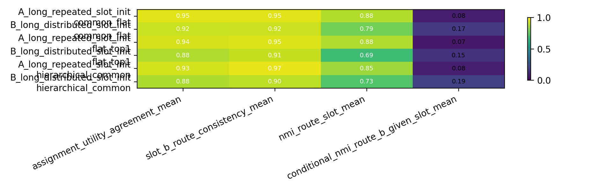

# 0528 Hierarchical Route-Utility Binding Sync

## Oral Report Card - Fill Before Meeting

目的：

我想确认一件事：普通 MoE 里 router 不稳定，是不是因为共享的 $B_i$ identity 和真正决定 target 的 slot feature 挤在一起了。如果给模型一条常驻 common path，再让 leaf path 负责 slot-specific 预测，routing 会不会更像真正的专家分工。

问题：

比较三种 active-compute matched 模型：

```text
flat_top1
common_flat = global common + flat leaf router
hierarchical_common = global common + group common + two-level leaf router
```

结论：

```text
common path 有一点帮助，但两层 hierarchy 没有稳定解决问题。
```

证据：

在更有区分度的 `B_long` 上，Assign-Utility 是：

```text
flat_top1: 0.880
common_flat: 0.918
hierarchical_common: 0.878
```

所以目前更像是：common path 值得保留，但不能说 H-MoE 结构本身已经解决 route-utility binding。

## Evidence-Backed Sync Closure

Anchor:

```text
Projects/from-attention-to-search/main/problem_anchors/hierarchical_gating_frame/hierarchical_route_utility_binding_anchor.md
```

目的：

上一轮已经看到 slot 信息可见、target 能学会，但 flat top-1 router 不总是选择对该 slot 最有用的 expert。这轮测试 common/hierarchy 是否能把共享计算和 slot-specific 计算拆开。

实验设置：

```text
uniform 64-B
4 slots
same B_i under different slot -> different target
3000 full NTP steps
4 seeds
active FFN width = 256 for all compared models
```

结果：

| Condition | Model | Assign-Utility | Slot-B Consistency | Route-Slot NMI | Target Acc |
|---|---|---:|---:|---:|---:|
| A_long | flat_top1 | 0.935 | 0.948 | 0.883 | 1.0 |
| A_long | common_flat | **0.952** | 0.951 | 0.883 | 1.0 |
| A_long | hierarchical_common | 0.932 | **0.968** | 0.853 | 1.0 |
| B_long | flat_top1 | 0.880 | 0.912 | 0.689 | 1.0 |
| B_long | common_flat | **0.918** | **0.921** | **0.787** | 1.0 |
| B_long | hierarchical_common | 0.878 | 0.900 | 0.727 | 1.0 |



解释：

`common_flat` 的提升说明 common path 可能真的有用；但 `hierarchical_common` 没有稳定超过它，说明“多一层 group router / group common”不是自动解法。当前更合理的下一步不是直接上 Zipf，而是测试 common-residual：让 leaf router 看去掉 common/B-identity 方向后的表示。

Artifact-Repro Map:

```text
code workspace:
Projects/from-attention-to-search/XingyuD/Attention_Search_Experiments/active/synthetic_data_understanding

runner:
scripts/run_hierarchical_route_utility_binding.py

config:
configs/hierarchical_route_utility_binding.json

submit:
scripts/submit_hierarchical_route_utility_binding_4gpu_acp.sh

result dir:
results/hierarchical_route_utility_binding/hierarchical_route_utility_binding_full_20260528

figure dir:
figures/hierarchical_route_utility_binding/hierarchical_route_utility_binding_full_20260528

curated summary:
Projects/from-attention-to-search/main/experiments/hierarchical_route_utility_binding/summary.md

curated detailed:
Projects/from-attention-to-search/main/experiments/hierarchical_route_utility_binding/detailed.md

job id:
pt-7y7u65m5
```
