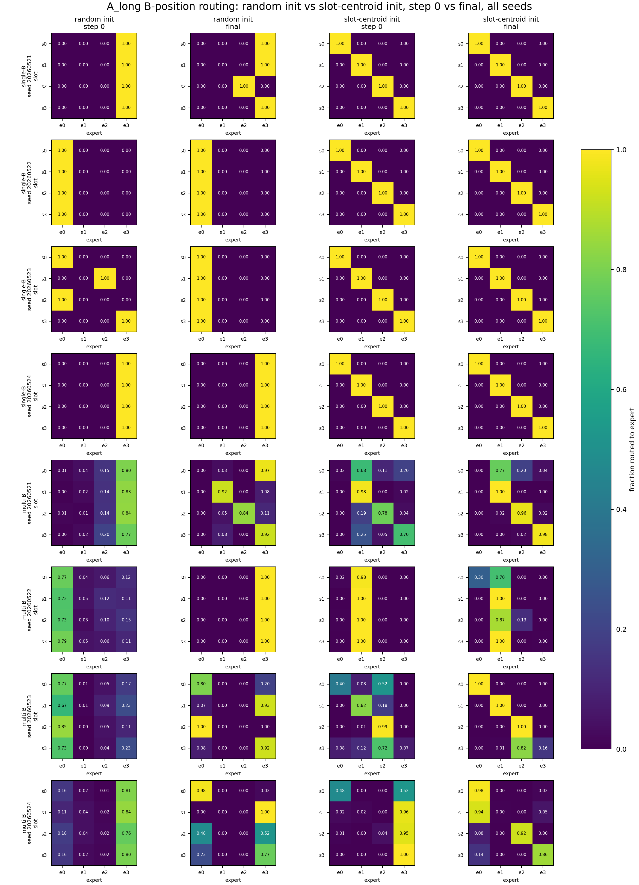
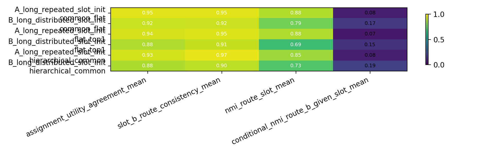
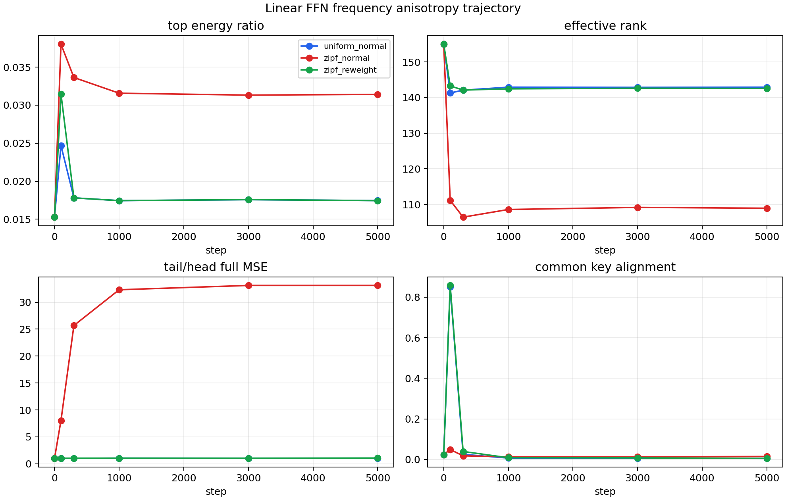
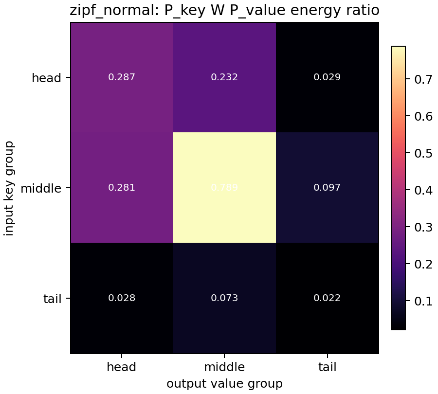

# 0529 Group Meeting: 思路更新

## 1. Research Question

结论先行：

```text
我现在不把问题表述成“怎么设计一个更复杂的 MoE 结构”，而是表述成：
在 NTP 中，router 到底被哪个 factor 控制，以及真正决定 target 的 tail/slot feature 有没有写进 expert function。
```

父问题是：

```text
MoE router 能不能形成稳定、可解释、可复用的 feature-level expert specialization？
```

我这里说的 specialization 不是 expert load skew，也不是 bucket purity，而是：

```text
一个 feature 对应的样本被路由到某个 expert/path；
同时这个 expert/path 对这个 feature 的预测确实有 causal utility。
```

所以主判断不能只看 routing NMI。最重要的判断是：

```text
route-feature alignment + forced/ablation utility + assignment-utility agreement 是否同时成立。
```

## 2. Why This Matters

这个问题和端侧 MoE / KV cache 的关系是：

```text
如果 expert 只是按 token identity、frequency、common component 或初始化噪声分组，
那 expert id 不能作为稳定的 feature index，也不能支撑后续 swapping / retrieval / compression story。
```

所以现在的顺序应该是：

```text
先证明 specialization 的机制；
再谈 reverse index 或系统收益。
```

## 3. Current Hypothesis

当前假设已经从宽泛的 “H-MoE 可能解决问题” 收窄为：

```text
NTP hidden state 同时包含 common / B identity / head-frequency / slot-target / tail-unique factors。
ordinary top-1 router 可能读到了 dominant factor，但这个 factor 不一定是 target 所需的 feature。
```

对应两个不同失败机制：

```text
机制 A: tail/slot feature 已经写进 expert function，但 router 被 common/head/B-identity factor 干扰。
机制 B: tail/slot feature 根本没有充分写进 expert function，所以只改 router 不会解决问题。
```

这两个机制对应不同下一步：

```text
如果是 A，做 common-residual / high-frequency-removed leaf router。
如果是 B，做 reweight / tail-write-in pressure / auxiliary objective。
```

## 4. Experiment Setup

我用三个层次的 evidence 来收窄问题。

第一层：slot-context NTP synthetic。

```text
同一个 B_i 在不同 slot context 下预测不同 target。
如果 router 真按 slot/function 分工，它应该在 B position 按 slot 选择 utility-best expert。
```

第二层：common / hierarchy MoE 对照。

```text
比较 flat_top1、common_flat、hierarchical_common。
目的不是看 target 能不能学会，而是看 common path 或 hierarchy 能不能恢复 route-utility binding。
```

第三层：linear FFN / KV toy。

```text
先不用 MoE 和 Transformer，只问 Zipf 频率是否足以让 W 优先写入 head feature，并造成 tail underfit。
```

## 5. Key Result

核心结论：

```text
slot/context 信息是可见且有用的；common path 有弱帮助；但 hierarchy 本身没有稳定解决 binding。
最新线性 toy 进一步提示：Zipf 下的问题可能不是简单 route-time interference，而是 tail feature write-in failure。
```

### Result A: slot 信息可见，但 learned routing 不稳定

在 multi-B 中：

```text
A_long_repeated: route NMI 0.243 -> 0.591, Assign-Utility 0.565 -> 0.925
B_long_distributed: route NMI 0.078 -> 0.313, Assign-Utility 0.326 -> 0.747
Oracle: 1.000
```

解释：

```text
任务不是无解，slot feature 也不是完全不可见；
失败点是 learned top-1 routing 没有稳定把 slot 轴绑定到 utility-best expert。
```



### Result B: common path 有帮助，但两层 hierarchy 不稳定

uniform 64-B、semantic slot-centroid init、4 seeds：

| Condition | Model | Assign-Utility | Route-Slot NMI | Target Acc |
|---|---|---:|---:|---:|
| A_long | flat_top1 | 0.935 | 0.883 | 1.0 |
| A_long | common_flat | **0.952** | 0.883 | 1.0 |
| A_long | hierarchical_common | 0.932 | 0.853 | 1.0 |
| B_long | flat_top1 | 0.880 | 0.689 | 1.0 |
| B_long | common_flat | **0.918** | **0.787** | 1.0 |
| B_long | hierarchical_common | 0.878 | 0.727 | 1.0 |

解释：

```text
common_flat 的提升说明 common path 值得保留；
但 hierarchical_common 没有稳定超过 common_flat，所以不能 claim “H-MoE 结构本身解决了 gating problem”。
```



### Result C: Zipf 频率会造成 head 写入强、tail 写入弱

linear FFN toy:

```text
x = k_c + k_{u_i} + noise
y = v_c + v_{u_i}
```

关键结果：

| Condition | Top Energy | Effective Rank | Tail/Head Full MSE |
|---|---:|---:|---:|
| uniform_normal | 0.0175 | 142.9 | 1.02 |
| zipf_normal | **0.0314** | **108.9** | **33.12** |
| zipf_reweight | 0.0174 | 142.6 | 1.06 |

解释：

```text
Zipf 会让 W 的高能子空间更偏 head/common，tail error 被拉大；
inverse-frequency reweight 基本把谱和 head/tail error 拉回 uniform。
```



进一步 decomposition：

| Condition | Head->Head Fro Ratio | Tail->Tail Fro Ratio | Head Own Unique MSE | Tail Own Unique MSE |
|---|---:|---:|---:|---:|
| uniform_normal | 0.0677 | 0.0666 | 0.00063 | 0.00064 |
| zipf_normal | **0.2869** | **0.0219** | **0.00010** | **0.00254** |
| zipf_reweight | 0.0676 | 0.0661 | 0.00062 | 0.00066 |

解释：

```text
Zipf 下 tail-tail component 自身弱；
remove-top / W_low 对 tail error 改善很小。
所以目前更像 tail feature 没写进去，而不只是 tail 已写入但被 high-frequency direction 污染。
```



## 6. Interpretation

我现在的理解是：

```text
之前看到的 routing failure 不应该直接解释成“缺 hierarchy”。
更准确的问题是：router input 里有多个 factor，training 又更偏向 common/head feature；
因此 route assignment 和 expert utility 没有自然绑定到真正决定 target 的 tail/slot feature。
```

这也解释为什么某些 metric 会误导：

```text
高 route NMI 可能只是漂亮分组，不证明 expert 有用。
高 Assign-Utility 也可能来自 utility-best path collapse，不证明 route 按 slot 分工。
所以必须同时看 route heatmap、forced expert loss、assignment-utility。
```

## 7. What We Cannot Claim

现在不能 claim：

```text
H-MoE 已经解决 gating / specialization。
linear FFN toy 已经证明 Transformer MoE router 失败原因。
Zipf 下 tail 失败一定来自 routing interference。
ordinary top-1 NTP 自然形成稳定 slot experts。
当前结果能直接推出真实语料或端侧 swapping 收益。
```

可以 claim 的只有：

```text
当前证据把问题收窄到 factor attribution 和 tail write-in：
我们需要知道 routing logits 被 common/head/B-identity/slot 哪个 factor 控制，
以及 tail/slot feature 是否真的进入 expert function。
```

## 8. Next Decision

我建议下一步不继续加 hierarchy 深度，也不直接进 Zipf stress。

下一步最小 decisive test：

```text
NTP factor attribution + tail write-in diagnostic
```

具体判断：

```text
1. router logits 主要由 common、head-frequency、B identity 还是 slot factor 解释？
2. forced/ablation utility 是否显示 tail/slot feature 已经写入 expert function？
3. 如果 tail/slot 已写入但 router 被干扰，再做 common-residual 或 high-frequency-removed leaf router。
4. 如果 tail/slot 没写入，优先做 reweight / tail-write-in pressure，而不是只改 router。
```

## 9. Backup Links / Artifact Map

Anchors:

```text
Projects/from-attention-to-search/main/problem_anchors/04_ntp_zipf_feature_factorization_anchor.md
Projects/from-attention-to-search/main/problem_anchors/03_hierarchical_route_utility_binding_anchor.md
Projects/from-attention-to-search/main/problem_anchors/01_slot_context_dominance_router_specialization_anchor.md
```

Experiment summaries:

```text
Projects/from-attention-to-search/main/experiments/slot_context_dominance_router_specialization/summary.md
Projects/from-attention-to-search/main/experiments/hierarchical_route_utility_binding/summary.md
Projects/from-attention-to-search/main/experiments/linear_ffn_frequency_anisotropy/summary.md
Projects/from-attention-to-search/main/experiments/linear_ffn_spectral_feature_decomposition/summary.md
```

Meeting figures:

```text
daily_research_reports/0529/meeting/figures/slot_context_route_heatmaps.png
daily_research_reports/0529/meeting/figures/hierarchy_decision_metrics.png
daily_research_reports/0529/meeting/figures/linear_ffn_trajectory_core_metrics.png
daily_research_reports/0529/meeting/figures/linear_ffn_zipf_oracle_projection.png
```

