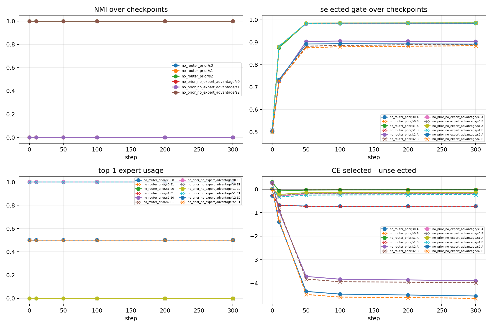
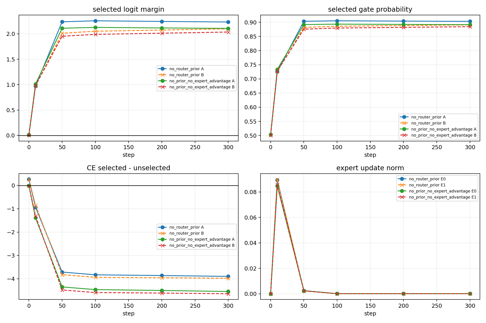
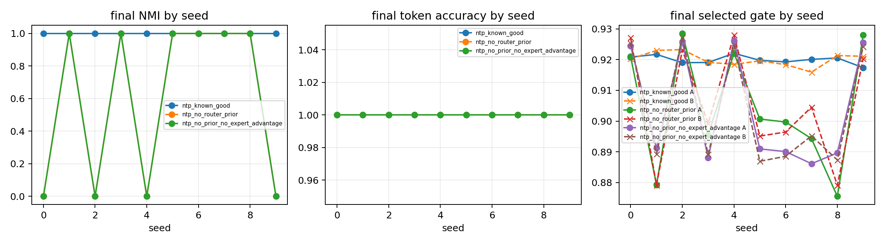

# Report Card: Top-1 Router Early Lock-in as a Mechanism Probe

## Source Files

Anchor: `02_ntp_style_top1_router_lockin_anchor.md`

Summary: `03_summary.md`

Detailed: `04_detailed.md`

Figures / Tables: `figures/`, `tables/`

## 0. Executive Summary

本轮目标：

解释 ABC / multi-B slot-context synthetic 中，ordinary top-1 router 为什么不能稳定形成 feature-level specialization。

最小机制审计：

使用 2-feature / 2-expert NTP-style top-1 proxy，检查 collapse 是 late optimization drift，还是 early top-1 lock-in。

清晰的假设：

在二维正交 feature 下，linear router 能表达 A/B 分到不同 expert；因此失败不主要是表达能力不足，而是 NTP 目标和 top-1 更新路径没有要求 router 形成稳定 route-pattern separation。这个假设可证伪：如果 A/B 初始 split 仍会后期 collapse，或 linear router 无法表达 split，那么该假设被削弱。

关键发现：

Failed seeds 在 step 0 已经 A/B same expert，之后 selected gate confidence 放大，未选 expert starvation；successful seeds 在 step 0 已经 A/B split，并稳定保持。

当前结论：

当前结果支持 early top-1 lock-in + expert starvation，而不是 late optimization drift。

结论边界：

这个结果只说明 minimal route-pattern dynamics，不说明 full LM、attention setting 或 utility-aligned specialization。

下一步：

不直接训大模型；下一步只测一个 anti-lock-in / route-function binding mechanism。

## 1. Research Process Update

Relation to previous evidence:
ABC / multi-B experiments showed slot visibility + semantic init is not sufficient; 2×2 audit explains this as possible early top-1 lock-in / starvation.

| item              | content                                                                                                       |
| ----------------- | ------------------------------------------------------------------------------------------------------------- |
| Previous mainline | ABC / multi-B synthetic shows slot information is visible, but learned flat top-1 routing is unstable.        |
| New probe         | 2x2 NTP-style top-1 mechanism audit.                                                                          |
| New evidence      | collapse already appears at step 0 in failed seeds; split also already appears at step 0 in successful seeds. |
| Knowledge update  | failure may come from early top-1 assignment lock-in and expert starvation, not from late optimization drift. |
| Next decision     | test one anti-lock-in mechanism before broadening.                                                            |

## 2. Terms Used Here

- `early lock-in`: step 0/10 的 top-1 expert 选择已经决定后续训练路径。
- `expert starvation`: 某个 expert 因为没有被 top-1 选中，几乎没有 token update。
- `route-pattern specialization`: A/B 这类 feature 被稳定分到不同 expert。
- `utility-aligned specialization`: 被选中的 expert 不只是路由上对齐，还对该 feature 的预测有 causal utility。
- `NMI`: normalized mutual information；这里用来衡量 A/B feature label 和 expert assignment 是否对齐。

## 3. Key Figures

### Figure 1: Early lock-in audit

What to see:

Failed seeds 是否在 step 0 已经 A/B same expert，以及 selected gate confidence 是否继续上升。

Supports:

failed seeds 从 step 0 开始 NMI 就是 0，后面没有恢复；同时 selected gate confidence 上升。

Cannot prove:

不能证明 full LM 或 attention setting 也一定出现同样机制。

### Figure 2: Success dynamics audit

What to see:

如果初始 routing geometry 已经给出正确 split，
NTP 可以保持它；训练更像是在reinforce 初始的 routing pattern

Supports:

如果初始 routing geometry 给出 split，训练可以稳定放大 route-pattern separation。

Cannot prove:

不能证明这个 split 已经是 utility-aligned specialization。

### Figure 3: No-router-bias diagnostic

What to see:

去掉 router bias 可以提高 random-init split rate  random-init split rate 从 3/10 提高到 6/10，
但不能保证 separation。

Supports:

Router bias 是 collapse 风险因子之一，但不是唯一原因。

Cannot prove:

不能证明去掉 bias 就足以解决 top-1 lock-in。

## 4. Current Claim

在当前 minimal 2-feature / 2-expert NTP-style top-1 proxy 中，route collapse 主要由 early top-1 lock-in 和 expert starvation 驱动；task learning 本身不足以保证 route-pattern specialization。

## 5. Claim Boundary

Can claim:

这个 proxy 支持“初始 top-1 assignment 会强烈影响最终 route-pattern separation”。

Cannot claim:

不能 claim full LM、attention setting、真实 MoE 训练都会如此；也不能 claim 当前 split 已经是 utility-aligned specialization。

## 6. Next Step

只测试一个 anti-lock-in / route-function binding mechanism。structured / semantic init 已经做过，multi-B 下不充分。
下一步测试 explicit route-function binding signal.