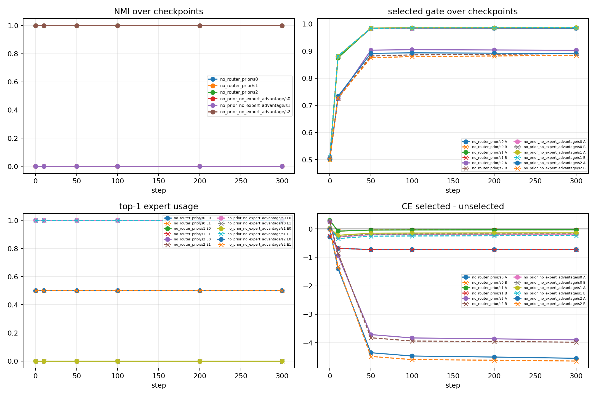
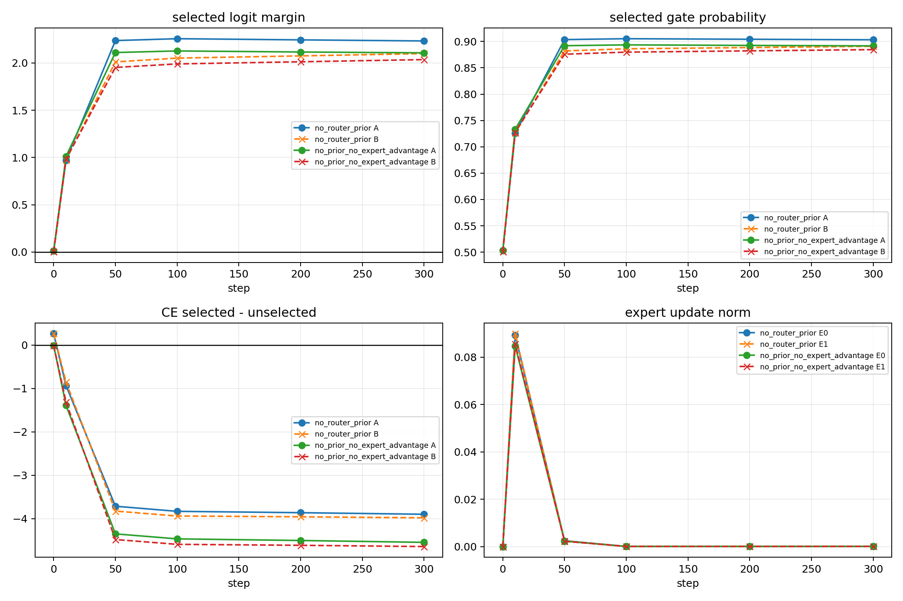
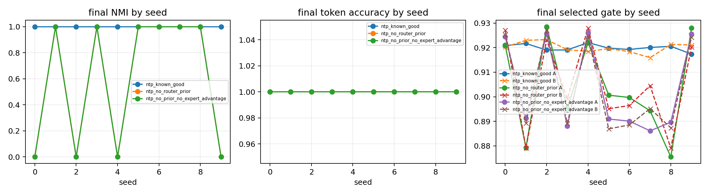

# Report Card: Top-1 Router Early Lock-in as a Mechanism Probe

## Source Files

Anchor: `../../../../Projects/from-attention-to-search/main/problem_anchors/02_ntp_style_top1_router_lockin_anchor.md`

Summary: `../../../../Projects/from-attention-to-search/main/experiments/A02_top1_router_lockin_2x2/summary.md`

Detailed: `../../../../Projects/from-attention-to-search/main/experiments/A02_top1_router_lockin_2x2/detailed.md`

Figures / Tables: `figures/`, `tables/curated_evidence_table.md`

## 0. Executive Summary

**本轮目标：**

解释 ABC / multi-B slot-context synthetic 中，ordinary top-1 router 为什么不能稳定形成 feature-level specialization。

**最小机制审计：**

使用 2-feature / 2-expert NTP-style top-1 实验，检查 collapse 是优化过程的梯度信号导致的分化，还是受到初始分发状态的限制。

**假设：**

在二维正交 feature 下，linear router 能将$e_1 = [1, 0] $， $e_2 = [0, 1]$ 分到不同 expert；因此失败不主要是表达能力不足，而是 NTP 目标和 top-1 更新路径没有要求 router 形成稳定 route-pattern separation。
这个假设可证伪：如果 e1、e2初始 split 仍会后期 collapse，或 linear router 无法表达 split，那么该假设被削弱。

**关键发现：**

Failed seeds 在 step 0 已经将e1、e2分到same expert，之后gating选中该专家的confidence增大，未选的expert得不到训练；successful seeds 在 step 0 已经把e1、e2 split，并稳定保持。

**当前结论：**

当前结果支持初始分发状态的限制 + expert under-trained，而不是 late optimization drift。

**结论边界：**

这个结果只说明 minimal route-pattern dynamics，不说明 full LM、attention setting 或 utility-aligned specialization。

**下一步：**

不直接训大模型；下一步测试 explicit route-function binding signal，判断是否能把 route assignment 和 expert causal utility 绑定起来。

## 1. Research Process Update

| item | content |
|---|---|
| Previous mainline | ABC / multi-B synthetic shows slot information is visible, but learned flat top-1 routing is unstable. |
| New probe | 2x2 NTP-style top-1 mechanism audit. |
| New evidence | collapse already appears at step 0 in failed seeds; split also already appears at step 0 in successful seeds. |
| Knowledge update | failure may come from early top-1 assignment lock-in and expert starvation, not from late optimization drift. |
| Next decision | test explicit route-function binding signal before broadening. |

## 2. Terms Used Here

- `early lock-in`: step 0/10 的 top-1 expert 选择已经决定后续训练路径。
- `expert starvation`: 某个 expert 因为没有被 top-1 选中，几乎没有 token update。
- `route-pattern specialization`: A/B 这类 feature 被稳定分到不同 expert。
- `utility-aligned specialization`: 被选中的 expert 不只是路由上对齐，还对该 feature 的预测有 causal utility。
- `NMI`: normalized mutual information；这里用来衡量 A/B feature label 和 expert assignment 是否对齐。
- `route-function binding signal`: 一个显式训练或约束信号，让“token 被路由到哪里”和“哪个 expert 对该 feature 真正有用”发生绑定。

## 3. Key Figures

### Figure 1: Early lock-in audit

What to see:

Failed seeds 是否在 step 0 已经 A/B same expert，以及 selected gate confidence 是否继续上升。

Supports:

Collapse 在训练一开始已经形成，并被 gate confidence 和 expert starvation 放大。

Cannot prove:

不能证明 full LM 或 attention setting 也一定出现同样机制。

### Figure 2: Success dynamics audit

What to see:

Successful seed 是否在 step 0 已经 A/B split，并稳定保持 NMI=1。

Supports:

如果初始 routing geometry 给出 split，训练可以稳定放大 route-pattern separation。

Cannot prove:

不能证明这个 split 已经是 utility-aligned specialization。

### Figure 3: No-router-bias diagnostic

What to see:

去掉 router bias 后 random-init split rate 从 3/10 提高到 6/10，但仍不能保证 separation。

Supports:

Router bias 是 collapse 风险因子之一，但不是唯一原因。

Cannot prove:

不能证明去掉 bias 就足以解决 top-1 lock-in。

## 4. Current Claim

在当前 minimal 2-feature / 2-expert NTP-style top-1 proxy 中，route collapse 主要由 early top-1 lock-in 和 expert starvation 驱动；task learning 本身不足以保证 route-pattern specialization。

**Mechanistic lemma**:
在 selected-gate top-1 中，如果某个 token 初始选择 expert e，且提高该 gate 能降低 loss，那么梯度会提高该 expert 对该 token 的 logit，并压低其他 expert 的 logit；同时未选 expert 没有该 token 的 expert update。因此 early assignment 会被 reinforced。

## 5. Claim Boundary

Can claim:

这个 proxy 支持“初始 top-1 assignment 会强烈影响最终 route-pattern separation”。

Cannot claim:

不能 claim full LM、attention setting、真实 MoE 训练都会如此；也不能 claim 当前 split 已经是 utility-aligned specialization。

## 6. Next Step

回到 multi-B / slot-context synthetic，只测试一个 explicit route-function binding signal。核心判断是：在 slot 信息可见、oracle 可解的条件下，显式绑定 route assignment 和 expert causal utility 是否同时改善 route-slot NMI、forced expert loss diagonal 和 assignment-utility agreement。
