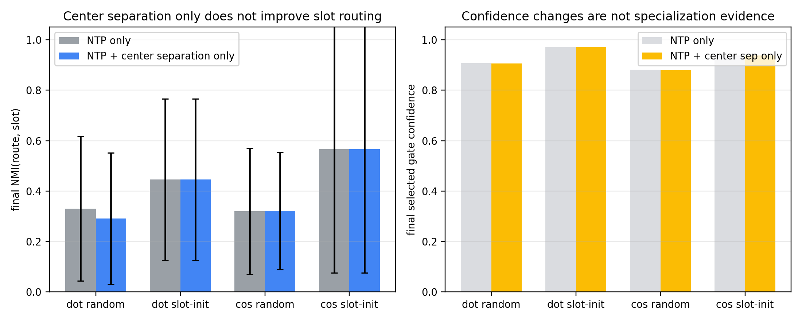
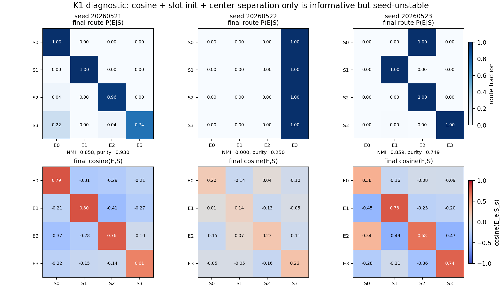

# Report Card: Center Separation Alone Is Not Reliable

## Source Files

Anchor: `../../problem_anchors/05_01_geometric_inhibition_anchor.md`

Summary: `summary.md`

Detailed: `detailed.md`

Figures / Tables: `figures/`, `tables/`

## 0. Executive Summary

本轮目标：

检验 label-free router-center separation 是否足以让 top-1 MoE 在 NTP 训练中形成稳定的 slot-aligned routing。

最小机制审计：

uniform multi-B synthetic；4 slots、4 experts；router 无 bias；D0/D1/K0/K1 全部关闭 supervised token margin，只保留 NTP 和 center separation。

清晰的假设：

H1: 如果 routing 失败主要来自 router rows 几何混合，那么 `NTP + center separation only` 应该比 `NTP only` 更稳定提高 final route-slot NMI。

H2: 如果几何 separation 需要 slot prototype 提供初始方向，那么 slot-init 条件 D1/K1 应强于 random-init 条件 D0/K0。

H3: 如果 cosine router 更适合这种几何机制，那么 K0/K1 应强于 D0/D1。

关键发现：

1. H1 被削弱：center separation only 没有稳定产生 slot-specialized routing。D0/D1/K0/K1 的 final NMI 分别是 0.291/0.446/0.322/0.566。
2. K1 是最值得注意的边界条件：`cosine + slot-init + center separation only` 在两个 seed 中出现较强 slot 分开，但另一个 seed 完全坍缩到单 expert。
3. 因此 cosine slot-init 有无监督几何信号，但 center separation alone 仍不是可靠的 assignment binding 机制。

当前结论：

无监督 router-center separation alone is not sufficient for stable slot-specialized routing. 更准确地说，它能维持或放大部分几何结构，尤其在 K1 中可见，但不能稳定防止 slot merge / single-expert collapse。

结论边界：

该结论只覆盖当前 synthetic setup 和当前 center-separation objective。不否定所有 unsupervised geometry 方法，也不声称必须使用 supervised labels。

下一步：

从“只分开 router rows”转向“发现或绑定 token-to-expert assignment”。K1 提示 cosine slot prototype 是可用 starting point，但需要 anti-merge 或 assignment-discovery 信号。

## 1. Research Process Update

| item | content |
|---|---|
| Previous mainline | Top-1 routing 会放大 early assignment；slot prototype init 能注入初始 slot 几何。 |
| New probe | 去掉 supervised token margin，只测试 center separation only。 |
| New evidence | D/K 系列没有稳定达到 NMI=1；K1 有两个 seed 分开、一个 seed 坍缩。 |
| Knowledge update | 失败点不是单纯 row separation，而是 assignment binding / anti-merge。 |
| Next decision | 保留 cosine slot-init 作为候选几何入口，但下一步必须加入无监督 assignment-discovery。 |

## 2. Terms Used Here

- `center separation`: label-free loss pushing normalized router rows away from each other.
- `slot-init`: router rows initialized from slot prototype directions; initialization uses slot labels.
- `route-slot NMI`: selected expert 与 slot label 的互信息对齐指标；越高表示 routing 越像 slot partition。
- `K1`: cosine router + slot-init + center separation only；没有 supervised token margin。
- `assignment binding`: 决定哪个 token/slot 应该进入哪个 expert 的机制，不等于只让 router rows 彼此分开。

## 3. Key Figures

### Figure 1: Center-Separation-Only Decision Summary

What to see:

Across dot/cosine and random/slot-init settings, center separation only does not reliably lift final route-slot NMI to stable slot routing.

Supports:

H1 is weakened: center separation alone is not a sufficient mechanism.

Cannot prove:

This aggregate view is not the mechanism proof and can hide seed-specific behavior; K1 is separated below because it is the important boundary case.

### Figure 2: K1 Seed-Specific Diagnostic

What to see:

K1 sometimes separates slots: seed `20260521` and seed `20260523` have high route-slot NMI. But seed `20260522` routes all slots to one expert. The E-to-S cosine row shows that geometry can be present without guaranteed one-to-one assignment.

Supports:

H2/H3 are partially supported: cosine slot-init gives a real geometric signal. But K1 seed instability shows center separation alone cannot serve as a reliable binding mechanism.

Cannot prove:

This does not identify the missing unsupervised signal. It only localizes the failure to assignment stability / anti-merge rather than absence of all geometry.

## 4. Current Claim

Center separation alone is insufficient as a reliable routing-specialization mechanism. The strongest center-only condition, K1, shows that cosine slot-init can sometimes preserve slot structure, but without an assignment-binding signal it remains seed-unstable and can collapse into many-to-one routing.

## 5. Claim Boundary

Can claim:

Under the tested uniform multi-B setup, label-free center separation alone does not robustly produce slot-aligned routing.

Cannot claim:

Cannot claim all unsupervised geometry fails. Cannot claim K1 has no useful signal. Cannot claim real-data transfer. Cannot claim expert utility specialization from route geometry alone.

## 6. Next Step

Use K1 as the next design clue: keep cosine slot-prototype geometry, but add a minimal unsupervised anti-merge / assignment-discovery signal and compare directly against K1 per seed.
