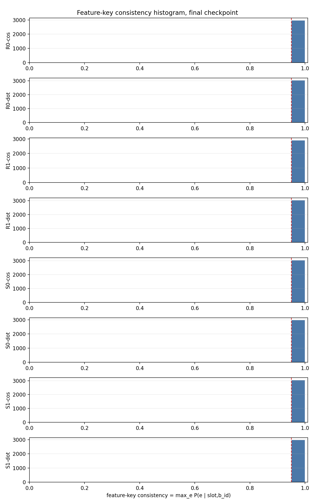
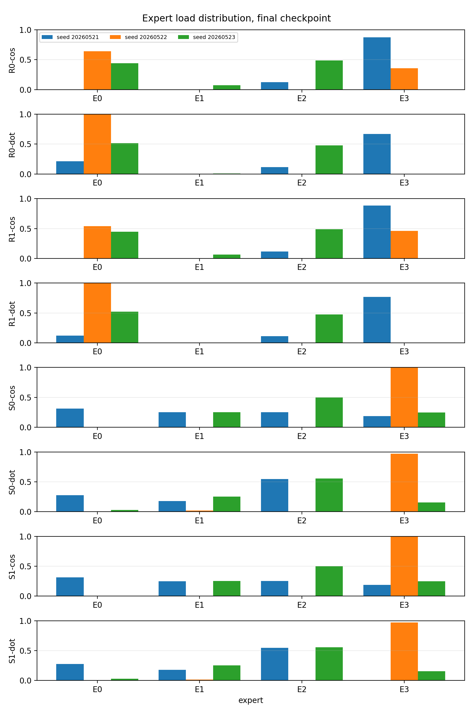
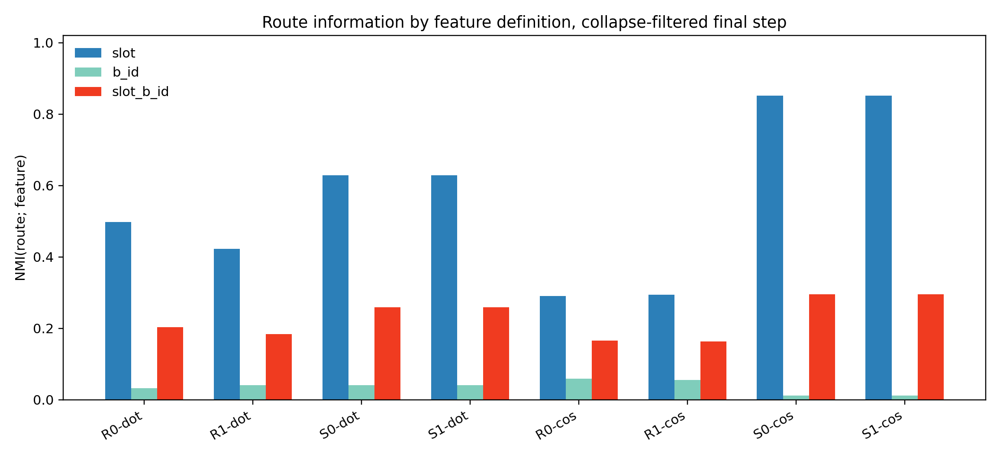
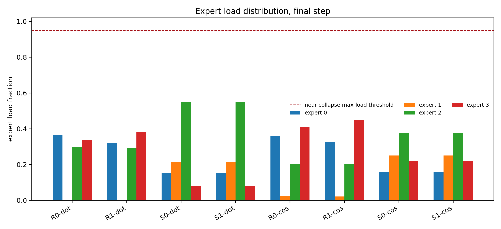

# Report Card: Feature-Axis Audit Before Assignment Binding

## Source Files

Anchor:

```text
Projects/from-attention-to-search/main/problem_anchors/05_01_geometric_inhibition_anchor.md
```

H0604a:

```text
A05_01_feature_key_routing_stability_center_only/summary.md
A05_01_feature_key_routing_stability_center_only/detailed.md
```

H0604b:

```text
A05_01_feature_axis_audit_existing_logs/summary.md
A05_01_feature_axis_audit_existing_logs/detailed.md
```

## 0. Executive Summary

本轮目标：

先回答 same-feature route consistency 和 feature axis，而不是进入 05_02 assignment binding。

最小机制审计：

在 uniform multi-B synthetic 中，feature 的候选定义有三种：`slot`、$B_i$、`(slot,B_i)`。H0604a 先检查同一个 exact key `(slot,B_i)` 是否稳定进同一 expert；H0604b 再用已有 route logs 审计 router 主要绑定哪一个 feature axis。

关键发现：

1. H0604a 支持 weak same-feature consistency：同一个 `(slot,B_i)` 基本能稳定 route 到某个 expert。
2. 但 high consistency 可以由 collapse 造成，所以不能单独当 specialization 证据。
3. H0604b 在去掉 collapse / near-collapse seeds 后显示：最佳条件 `S0/S1-cos` 的 route 信息主要是 `slot`，不是 $B_i$。
4. `S0-cos` 与 `S1-cos` 在该 audit 中近似相同，因此 center separation 没有独立增益。

当前结论：

当前主线不是“center separation 成功诱导 assignment binding”，而是：

> `cosine router + slot init` 给出了当前最干净的 non-collapsed slot-aligned routing；exact `(slot,B_i)` 是 same-feature consistency 的 atomic key，但下一步要问多个 slot features 进入同一 expert 后共享什么关系。

结论边界：

这仍然不是 expert utility specialization 证据，也不是 Zipf / real-data 证据。

下一步：

不要推进 05_02 assignment binding。下一步应做 same-expert feature composition audit：检查同一 expert 内多个 slot features 是否共享几何、预测目标、训练动态或只是 arbitrary bucket。

## 1. Research Process Update

| item | content |
|---|---|
| Previous mainline | 05_01 已削弱 center separation alone 的独立作用。 |
| New probe | H0604a/H0604b 把问题改成 same-feature consistency 和 feature-axis audit。 |
| New evidence | Exact `(slot,B_i)` consistency 高；best non-collapsed `S0/S1-cos` 更像 slot routing。 |
| Knowledge update | FeatureKeyConsistency 是弱指标，必须配合 collapse guard 和 feature-axis NMI。 |
| Next decision | 先审计同一 expert 内多个 slot features 的关系，再考虑 route-utility binding。 |

## 2. Terms Used Here

- `feature key`: exact atomic key `(slot_id,b_id)`，用于 same-feature consistency。
- `feature axis`: router 实际主要绑定的标签轴，可为 `slot`、$B_i$ 或 `(slot,B_i)`。
- `FeatureKeyConsistency`: $\mathrm{mean}_{s,i}\max_e P(e\mid s,i)$。
- `collapse guard`: expert load entropy / max load；用于排除 all-to-one 或 near-all-to-one routing。
- `center separation`: router-center separation only；不包含 supervised token-margin，也不包含 feature separation objective。

## 3. Key Figures

### Figure 1: H0604a Feature-Key Consistency



What to see:

Almost all conditions have high exact `(slot,B_i)` consistency.

Supports:

Weak same-feature route consistency is real under this operational key.

Cannot prove:

It cannot prove specialization, because collapse can also make the metric high.

### Figure 2: H0604a Expert Load Guard



What to see:

Some high-consistency seeds collapse or near-collapse into one expert.

Supports:

High consistency must be filtered by load entropy / max-load before interpretation.

### Figure 3: H0604b Feature-Axis NMI



What to see:

For `S0/S1-cos`, `NMI(route; slot)` is high while `NMI(route; B_i)` is near zero.

Supports:

The best current non-collapsed routing is slot-aligned, not $B_i$-aligned.

### Figure 4: H0604b Expert Load Histogram



What to see:

Branch interpretation is made after removing collapse / near-collapse seeds.

Supports:

The feature-axis claim is bounded to non-collapsed runs.

## 4. Current Claim

Can claim:

In the best non-collapsed H0604a/H0604b conditions, stable routing is better described as slot-aligned routing than $B_i$ routing, while exact `(slot,B_i)` remains the atomic key for same-feature consistency.

Cannot claim:

Cannot claim center separation independently caused this structure. Cannot claim expert utility specialization. Cannot claim Zipf or real-data robustness.

## 5. Claim Boundary

This report card covers local uniform multi-B synthetic diagnostics only. It uses existing H0604a/H0604b logs and does not introduce a new training objective.

## 6. Next Step

Run or write the next audit around:

```text
Given non-collapsed slot-aligned routing, what relation do multiple slot features share when they enter the same expert?
```
