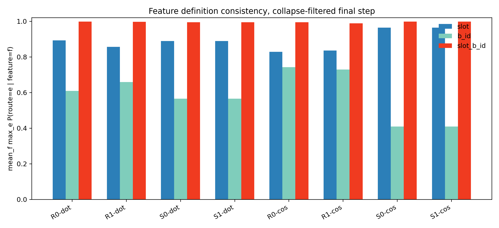
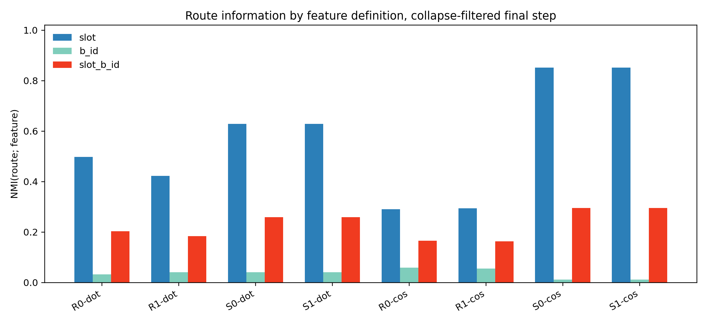
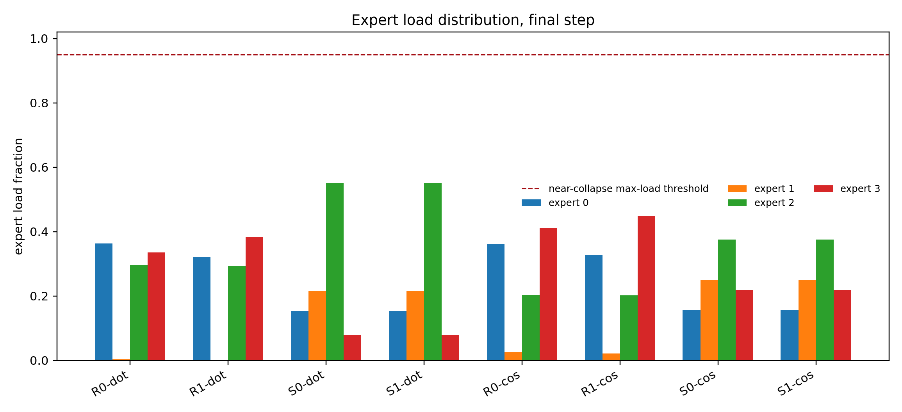
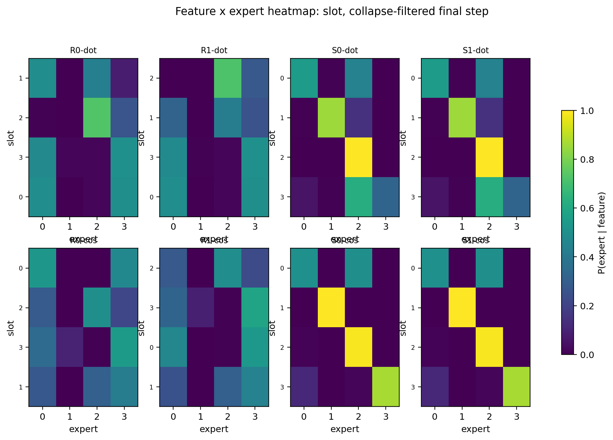
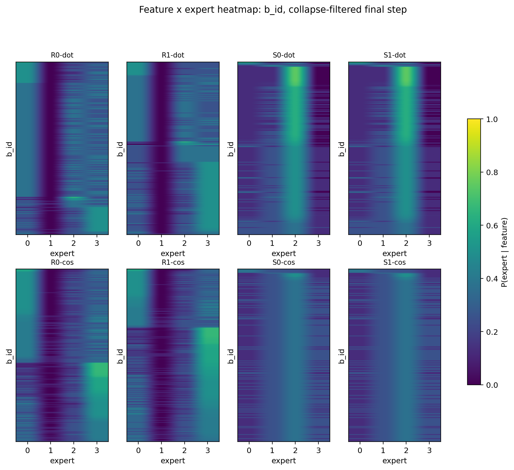
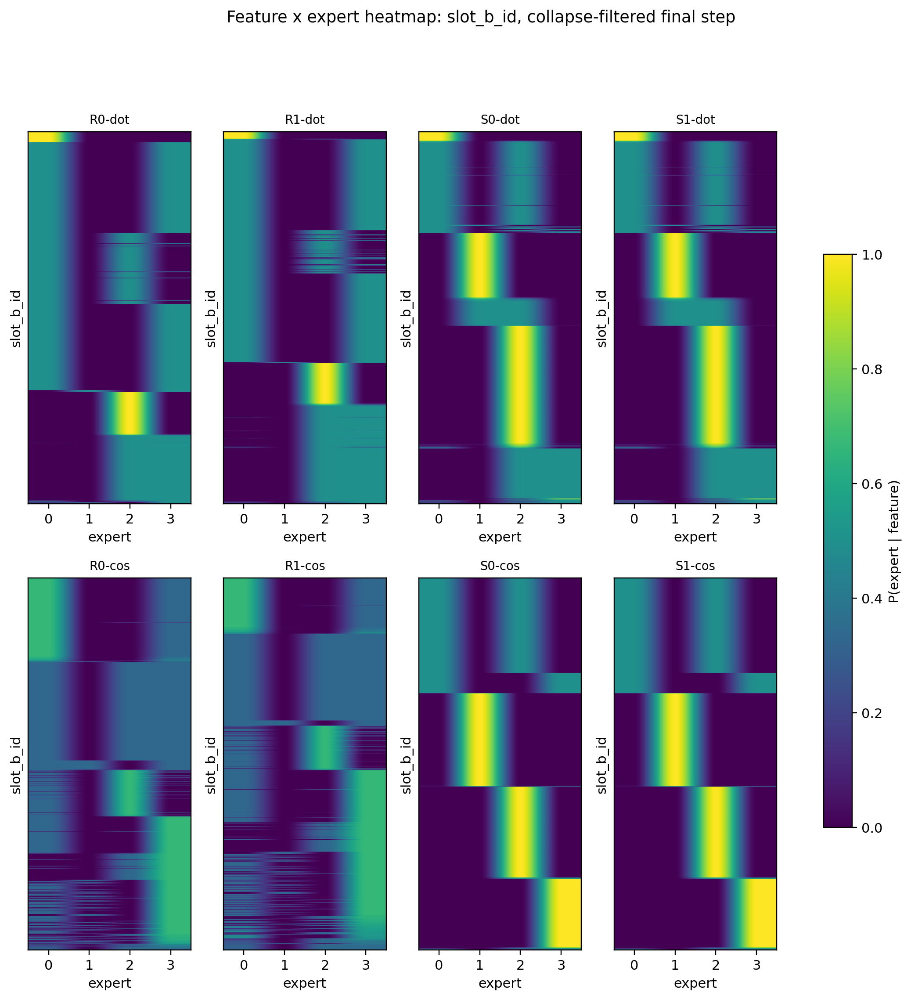

# Result Summary: H0604b Feature-Axis Audit On Existing Logs

Anchor:

```text
../../problem_anchors/05_01_geometric_inhibition_anchor.md
```

## Conclusion

H0604b supports branch **2C** for the current best non-collapsed conditions: exact `(slot,B_i)` features are stable, and the useful route information is mostly `slot`, not $B_i$.

The decisive case is `S0-cos` / `S1-cos` after removing collapse / near-collapse seeds:

| Condition | Feature label | Consistency | `NMI(route; feature)` | Load entropy norm | Max load |
|---|---:|---:|---:|---:|---:|
| S0-cos | `slot` | 0.964 | 0.852 | 0.869 | 0.407 |
| S0-cos | $B_i$ | 0.410 | 0.012 | 0.869 | 0.407 |
| S0-cos | `slot+B_i` | 0.999 | 0.295 | 0.869 | 0.407 |
| S1-cos | `slot` | 0.964 | 0.852 | 0.869 | 0.407 |
| S1-cos | $B_i$ | 0.410 | 0.012 | 0.869 | 0.407 |
| S1-cos | `slot+B_i` | 0.999 | 0.295 | 0.869 | 0.407 |

Interpretation:

1. `slot+B_i` has the highest consistency because it is the finest label and almost every atomic feature locks to one expert.
2. NMI decides the feature axis: in the best non-collapsed conditions, route contains much more `slot` information than $B_i$ information.
3. `S0-cos` and `S1-cos` are numerically identical in this audit, so center separation shows no independent gain over cosine + slot init.
4. This is still weak routing structure, not expert utility specialization.

## Decision

Use `slot` as the operational feature axis for the next local diagnostic, but keep `(slot,B_i)` as the exact atomic key for consistency checks.

Next branch:

```text
2C: exact feature is stable and non-collapsed, with clear slot-related structure.
```

The next experiment should ask:

```text
When multiple slot features enter the same expert, what relation do they share?
```

Do not move to route-utility binding, Zipf / frequency distribution, or real data yet.

## Collapse Guard

Collapsed / near-collapsed final seeds were removed before the main read:

| Condition | Seed | Reason |
|---|---:|---|
| R0-dot | 20260522 | strict all-to-one collapse |
| R1-dot | 20260522 | strict all-to-one collapse |
| S0-cos | 20260522 | strict all-to-one collapse |
| S1-cos | 20260522 | strict all-to-one collapse |
| S0-dot | 20260522 | near collapse: max load 0.971 |
| S1-dot | 20260522 | near collapse: max load 0.971 |

Branch counts after filtering:

```text
2C: 16 condition-seed pairs
2B: 2 condition-seed pairs
```

The two `2B` cases are random-cos seeds where exact `(slot,B_i)` is stable but slot information is weak. This means slot structure is not automatic; it depends on the slot-init conditions.

## Required Figures

The four requested figure families were generated.

Feature-axis consistency:



This shows same-feature stability for `slot`, $B_i$, and `slot+B_i`. It cannot by itself prove specialization because collapse can also make consistency high.

Feature-axis NMI:



This is the main feature-axis figure. For `S0/S1-cos`, `NMI(route; slot)` is high while `NMI(route; B_i)` is near zero.

Expert load histogram:



This removes the collapse false positive: high consistency is only interpreted after load entropy / max-load filtering.

Feature × expert heatmaps:







These show whether rows concentrate on experts for each feature definition.

## Claim Boundary

This audit is analysis-only on existing H0604a route logs. It does not test:

1. whether experts learn different useful computations;
2. whether route assignment improves target accuracy;
3. Zipf / high-frequency feature robustness;
4. real-corpus behavior;
5. route-utility binding.

The supported local claim is narrower:

> In the best non-collapsed H0604a conditions, the router's stable structure is better described as slot-aligned routing than $B_i$ routing, while exact `(slot,B_i)` remains the atomic consistency key.

## Artifacts

Tables:

```text
tables/feature_axis_consistency_by_condition.csv
tables/feature_axis_consistency_by_seed.csv
tables/feature_axis_nmi_by_condition.csv
tables/feature_expert_matrix_slot.csv
tables/feature_expert_matrix_b_id.csv
tables/feature_expert_matrix_slot_b_id.csv
tables/per_expert_composition_slot.csv
tables/per_expert_composition_b_id.csv
tables/per_expert_composition_slot_b_id.csv
tables/collapse_filtered_branch_decision.csv
```

Runner:

```text
Projects/from-attention-to-search/XingyuD/Attention_Search_Experiments/active/synthetic_data_understanding/scripts/analyze_h0604b_feature_axis_audit.py
```
