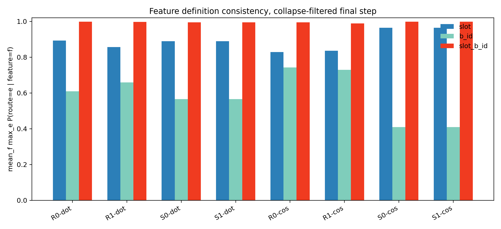
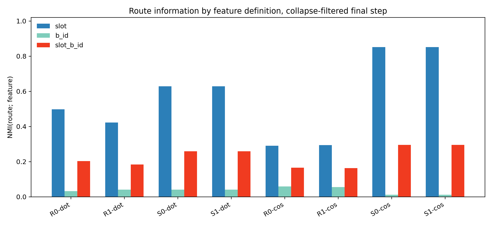
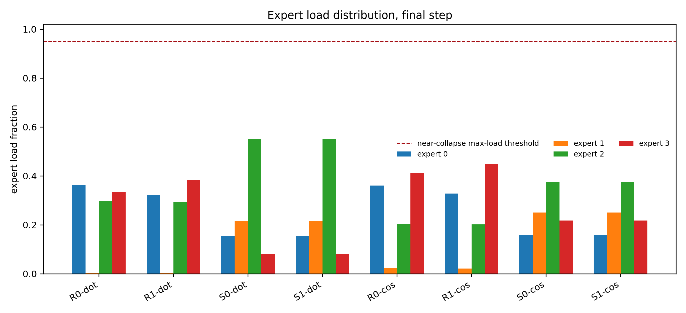
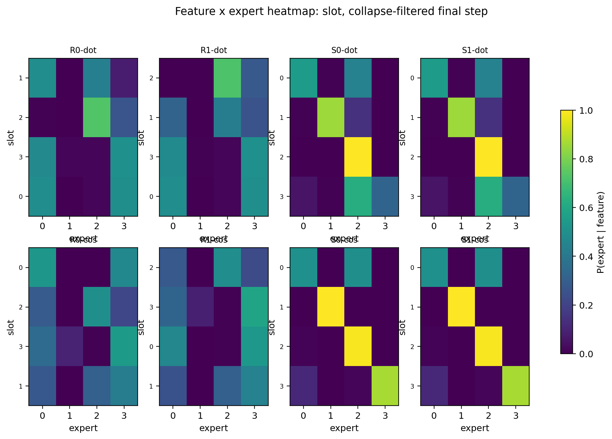
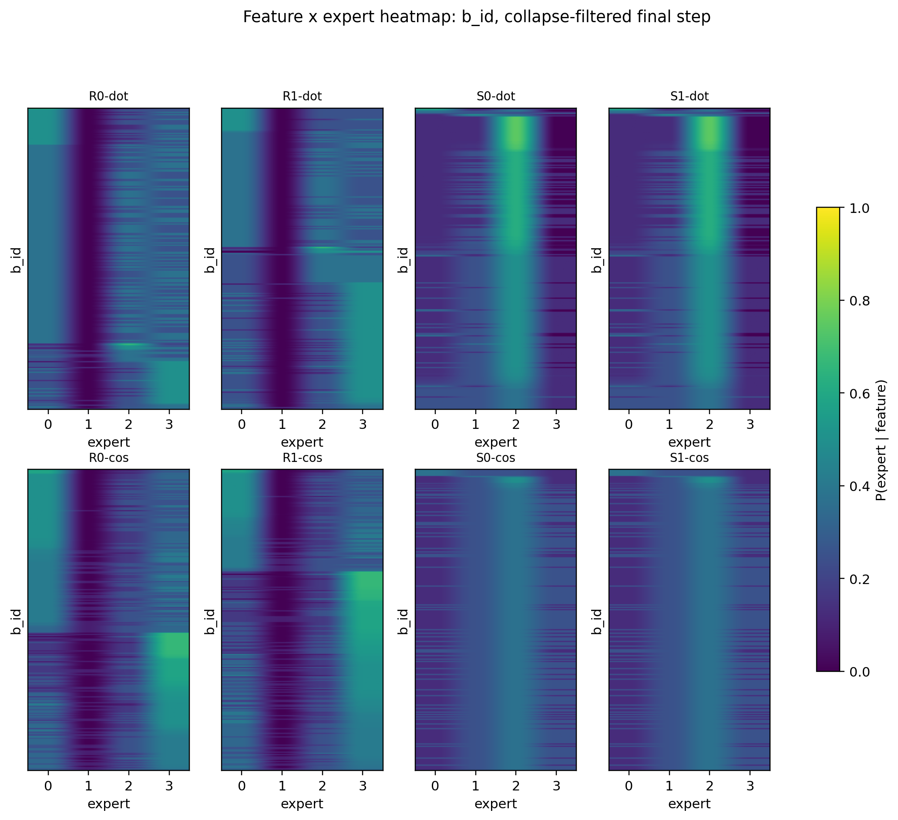
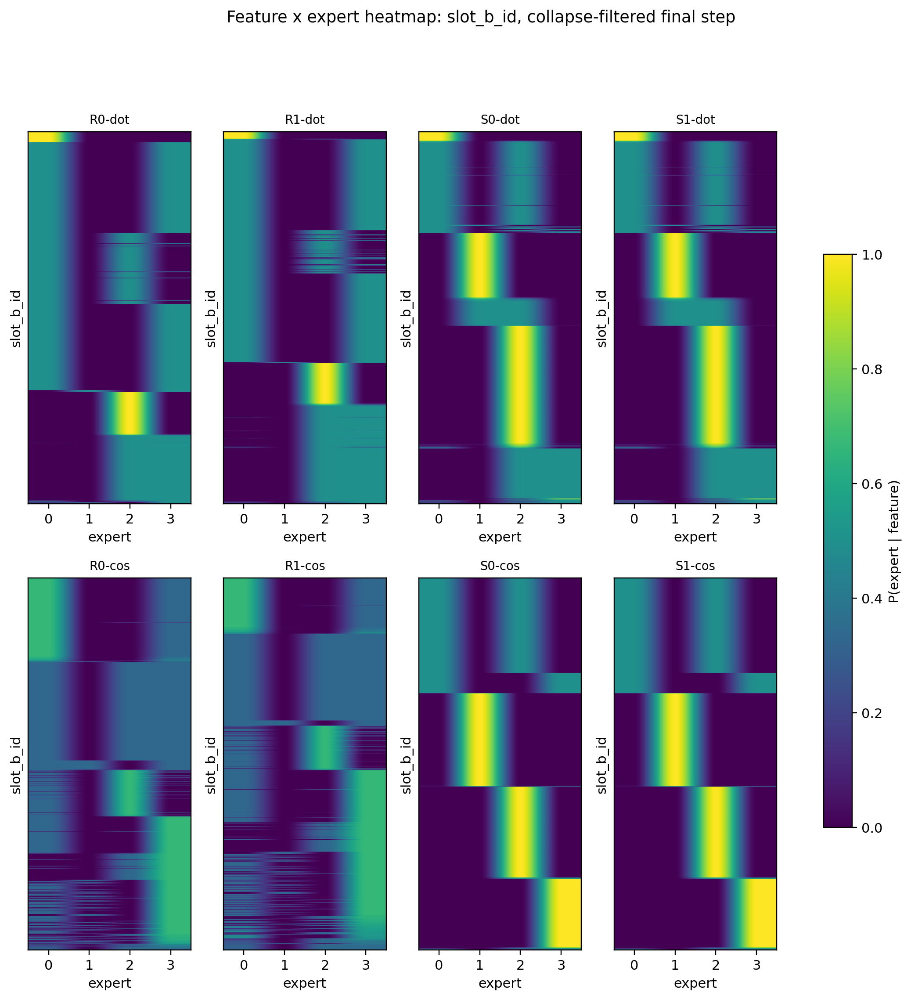
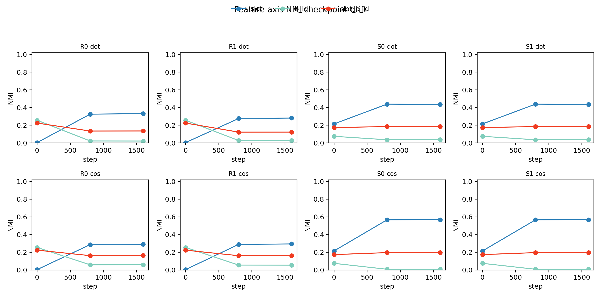

# Detailed Record: H0604b Feature-Axis Audit On Existing Logs

## 0. Purpose

This is the feature-definition audit for anchor `05_01`.

Question:

```text
In the existing H0604a route logs, does the router bind more to slot, B_i, or exact atomic (slot,B_i)?
```

Reason for this audit:

H0604a showed high same-feature consistency for tentative feature key `(slot,B_i)`, but that metric alone cannot distinguish specialization from collapse. It also does not tell us whether the operational feature is actually `slot`, $B_i$, or the atomic pair.

This run is analysis-only. It uses existing H0604a route matrices and does not retrain.

## 1. Inputs

Primary input:

```text
Projects/from-attention-to-search/XingyuD/Attention_Search_Experiments/active/synthetic_data_understanding/results/h0604a_feature_key_routing_stability_center_only/h0604a_feature_key_routing_stability_4gpu_20260603/feature_key_route_matrix.csv
```

Input columns used:

```text
step, slot, b_idx, expert, count, mode, condition, seed
```

Conditions:

| Code | Router | Init | Extra loss |
|---|---|---|---|
| R0-dot | dot | random | NTP only |
| R1-dot | dot | random | center separation only |
| S0-dot | dot | slot init | NTP only |
| S1-dot | dot | slot init | center separation only |
| R0-cos | cosine | random | NTP only |
| R1-cos | cosine | random | center separation only |
| S0-cos | cosine | slot init | NTP only |
| S1-cos | cosine | slot init | center separation only |

Seeds:

```text
20260521, 20260522, 20260523
```

Checkpoints:

```text
step 0, step 800, step 1600
```

Primary branch decision uses final step `1600`.

## 2. Feature Definitions

The input route matrix is exact `(slot,b_idx) × expert` count data. H0604b reconstructs three feature definitions:

| Feature definition | Construction | Meaning |
|---|---|---|
| `slot` | sum over all `b_idx` for each slot | slot-level context feature |
| $B_i$ | sum over all slots for each `b_idx` | B-token identity shortcut |
| `slot+B_i` | original `(slot,b_idx)` key | atomic predictive state |

Important interpretation rule:

`slot+B_i` is the finest label, so it can have very high consistency even when route information is not primarily about this label. The feature-axis decision therefore uses both consistency and `NMI(route; feature)`, after collapse filtering.

## 3. Metrics

For feature label type $F$:

$$
P(e\mid f)=\frac{\#\{route=e,\ feature=f\}}{\#\{feature=f\}}
$$

Consistency:

$$
\mathrm{Consistency}(F)=
\frac{1}{|F|}
\sum_{f\in F}\max_e P(e\mid f)
$$

Route-feature information:

$$
NMI(route;F)
$$

Collapse guard:

```text
active_experts > 1
max_load < 0.95
load_entropy_norm >= 0.2
```

High consistency is only considered meaningful after passing this guard.

## 4. Required Figures And What They Decide

| Figure | File | What it decides | Boundary |
|---|---|---|---|
| feature × expert heatmap | `figures/feature_expert_heatmap_slot.png`, `feature_expert_heatmap_b_id.png`, `feature_expert_heatmap_slot_b_id.png` | Whether rows concentrate on one expert for each feature label | Does not rule out collapse by itself |
| consistency bar plot | `figures/feature_axis_consistency_comparison.png` | Which label gives stable routing | Consistency alone is weak evidence |
| expert load histogram | `figures/expert_load_histogram.png` | Whether high consistency is all-to-one / near-all-to-one collapse | Does not define the feature axis |
| NMI bar plot | `figures/feature_axis_nmi_comparison.png` | Which label carries the most route information | Does not prove expert utility |
| checkpoint drift | `figures/feature_axis_checkpoint_drift.png` | Whether feature-axis information changes during training | Exploratory; final branch uses step 1600 |

## 5. Main Results

### 5.1 Branch Decision

After collapse / near-collapse filtering:

```text
2C: 16 condition-seed pairs
2B: 2 condition-seed pairs
2A: 0 condition-seed pairs
```

Interpretation:

1. Exact `(slot,B_i)` stability is not the failure mode; branch 2A is not supported.
2. Random-cos has two 2B cases: exact feature is stable, but slot information is weak.
3. Slot-init conditions, especially cosine + slot init, support 2C: exact feature is stable and non-collapsed, with strong slot structure.

Full branch table:

```text
tables/collapse_filtered_branch_decision.csv
```

### 5.2 Best Current Conditions

The decisive current comparison is `S0-cos` versus `S1-cos`:

| Condition | Feature label | Consistency | `NMI(route; feature)` | Load entropy norm | Max load | Kept seeds |
|---|---|---:|---:|---:|---:|---:|
| S0-cos | `slot` | 0.964 | 0.852 | 0.869 | 0.407 | 2 |
| S0-cos | $B_i$ | 0.410 | 0.012 | 0.869 | 0.407 | 2 |
| S0-cos | `slot+B_i` | 0.999 | 0.295 | 0.869 | 0.407 | 2 |
| S1-cos | `slot` | 0.964 | 0.852 | 0.869 | 0.407 | 2 |
| S1-cos | $B_i$ | 0.410 | 0.012 | 0.869 | 0.407 | 2 |
| S1-cos | `slot+B_i` | 0.999 | 0.295 | 0.869 | 0.407 | 2 |

Read:

1. `slot+B_i` consistency is near 1, so each atomic key is stable.
2. `NMI(route; slot)` is much higher than `NMI(route; B_i)`, so the route axis is slot-aligned rather than $B_i$-aligned.
3. `S0-cos` equals `S1-cos`, so center separation has no independent gain in this audit.

### 5.3 Dot Router Comparison

Dot + slot init is also slot-related but weaker than cosine + slot init:

| Condition | Feature label | Consistency | `NMI(route; feature)` | Load entropy norm | Max load |
|---|---|---:|---:|---:|---:|
| S0-dot | `slot` | 0.889 | 0.629 | 0.751 | 0.551 |
| S0-dot | $B_i$ | 0.566 | 0.041 | 0.751 | 0.551 |
| S0-dot | `slot+B_i` | 0.995 | 0.258 | 0.751 | 0.551 |
| S1-dot | `slot` | 0.889 | 0.629 | 0.751 | 0.551 |
| S1-dot | $B_i$ | 0.566 | 0.041 | 0.751 | 0.551 |
| S1-dot | `slot+B_i` | 0.995 | 0.258 | 0.751 | 0.551 |

Read:

Dot router is not the best current implementation for clean slot-aligned routing. It also shows no center-separation gain because `S0-dot` equals `S1-dot`.

### 5.4 Random Init Comparison

Random conditions can still show high exact `(slot,B_i)` consistency, but the slot axis is weaker and less stable:

| Condition | `slot` NMI | $B_i$ NMI | `slot+B_i` NMI | Main read |
|---|---:|---:|---:|---|
| R0-cos | 0.290 | 0.059 | 0.165 | weak slot structure; one 2B seed |
| R1-cos | 0.295 | 0.055 | 0.163 | weak slot structure; one 2B seed |
| R0-dot | 0.498 | 0.033 | 0.203 | moderate slot structure after filtering |
| R1-dot | 0.422 | 0.041 | 0.184 | moderate slot structure after filtering |

Read:

Slot-aligned routing is not automatic under random init. This is why the current claim should be attached to the non-collapsed slot-init conditions, not to all routers.

## 6. Collapse Filtering

These final condition-seed pairs were excluded before the main read:

| Condition | Seed | Load entropy norm | Max load | Active experts | Reason |
|---|---:|---:|---:|---:|---|
| R0-dot | 20260522 | 0.000 | 1.000 | 1 | strict collapse |
| R1-dot | 20260522 | 0.000 | 1.000 | 1 | strict collapse |
| S0-cos | 20260522 | 0.000 | 1.000 | 1 | strict collapse |
| S1-cos | 20260522 | 0.000 | 1.000 | 1 | strict collapse |
| S0-dot | 20260522 | 0.113 | 0.971 | 4 | near collapse |
| S1-dot | 20260522 | 0.113 | 0.971 | 4 | near collapse |

This is essential because several collapsed seeds have perfect or near-perfect consistency, which would be a false positive for specialization.

## 7. Figure Interpretations

### 7.1 Consistency Bar Plot



Observation:

`slot+B_i` is near 1 across most non-collapsed conditions.

Interpretation:

The weak advisor-style claim is supported: under an exact operational key, the same feature can lock to one expert. But this plot alone does not identify the semantic feature axis.

### 7.2 NMI Bar Plot



Observation:

In `S0-cos` / `S1-cos`, `NMI(route; slot)=0.852`, while `NMI(route; B_i)=0.012`.

Interpretation:

For the best current conditions, route assignment is much more slot-aligned than $B_i$-aligned.

### 7.3 Expert Load Histogram



Observation:

The main read excludes all-to-one and near-all-to-one seeds. The surviving `S0/S1-cos` read has average max load 0.407 and entropy norm 0.869.

Interpretation:

The slot-aligned result is not explained by all features entering one expert.

### 7.4 Feature × Expert Heatmaps

Slot:



$B_i$:



`slot+B_i`:



Observation:

The `slot` heatmap is the most readable for slot-init conditions. The $B_i$ heatmap does not show a comparably strong route axis in the best conditions. The `slot+B_i` heatmap shows row concentration but is too fine-grained to define the route axis alone.

Interpretation:

Use exact `(slot,B_i)` as the stability key, but use `slot` as the operational feature axis for the next local diagnostic.

### 7.5 Checkpoint Drift



Observation:

Slot information grows during training in slot-init cosine conditions, while $B_i$ information stays low.

Interpretation:

This supports the final-step read, but the final claim should remain based on collapse-filtered step 1600 metrics.

## 8. Claim Boundary

Supported:

1. Same exact `(slot,B_i)` features are stable after removing collapse seeds.
2. In the best current non-collapsed condition, the route axis is much closer to `slot` than to $B_i$.
3. Cosine + slot init is the cleanest current routing setup.
4. Center separation only shows no independent gain in this audit.

Not supported:

1. Expert utility specialization.
2. Accuracy improvement from routing structure.
3. Route-utility binding.
4. Zipf / high-frequency robustness.
5. Real-data generalization.
6. A claim that random init naturally gives slot-level specialization.

## 9. Decision

Proceed with branch 2C for the current best non-collapsed setup:

```text
exact feature stable + non-collapsed + slot-aligned route structure
```

Next local diagnostic:

```text
When multiple slot features enter the same expert, what relation do they share?
```

Do not run frequency / Zipf diagnostics until this relation is defined.

## 10. Artifact Map

Research record:

```text
Projects/from-attention-to-search/main/experiments/H0604b_feature_axis_audit_existing_logs/
```

Runner:

```text
Projects/from-attention-to-search/XingyuD/Attention_Search_Experiments/active/synthetic_data_understanding/scripts/analyze_h0604b_feature_axis_audit.py
```

Reproduction command:

```bash
python3 Projects/from-attention-to-search/XingyuD/Attention_Search_Experiments/active/synthetic_data_understanding/scripts/analyze_h0604b_feature_axis_audit.py \
  --input Projects/from-attention-to-search/XingyuD/Attention_Search_Experiments/active/synthetic_data_understanding/results/h0604a_feature_key_routing_stability_center_only/h0604a_feature_key_routing_stability_4gpu_20260603/feature_key_route_matrix.csv \
  --out-dir Projects/from-attention-to-search/main/experiments/H0604b_feature_axis_audit_existing_logs
```

Complete tables:

```text
tables/input_audit.csv
tables/feature_axis_metrics_by_step.csv
tables/feature_axis_consistency_by_seed.csv
tables/feature_axis_consistency_by_condition.csv
tables/feature_axis_nmi_by_condition.csv
tables/feature_axis_per_feature_consistency.csv
tables/feature_expert_matrix_slot.csv
tables/feature_expert_matrix_b_id.csv
tables/feature_expert_matrix_slot_b_id.csv
tables/per_expert_composition_slot.csv
tables/per_expert_composition_b_id.csv
tables/per_expert_composition_slot_b_id.csv
tables/collapse_filtered_branch_decision.csv
```

Figures:

```text
figures/feature_axis_consistency_comparison.png
figures/feature_axis_nmi_comparison.png
figures/expert_load_histogram.png
figures/feature_expert_heatmap_slot.png
figures/feature_expert_heatmap_b_id.png
figures/feature_expert_heatmap_slot_b_id.png
figures/feature_axis_checkpoint_drift.png
```
