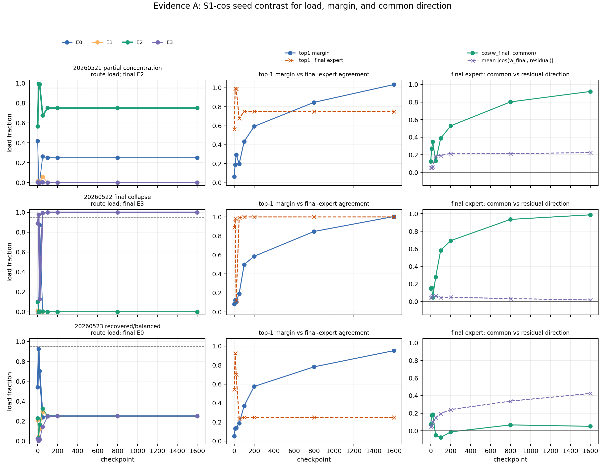
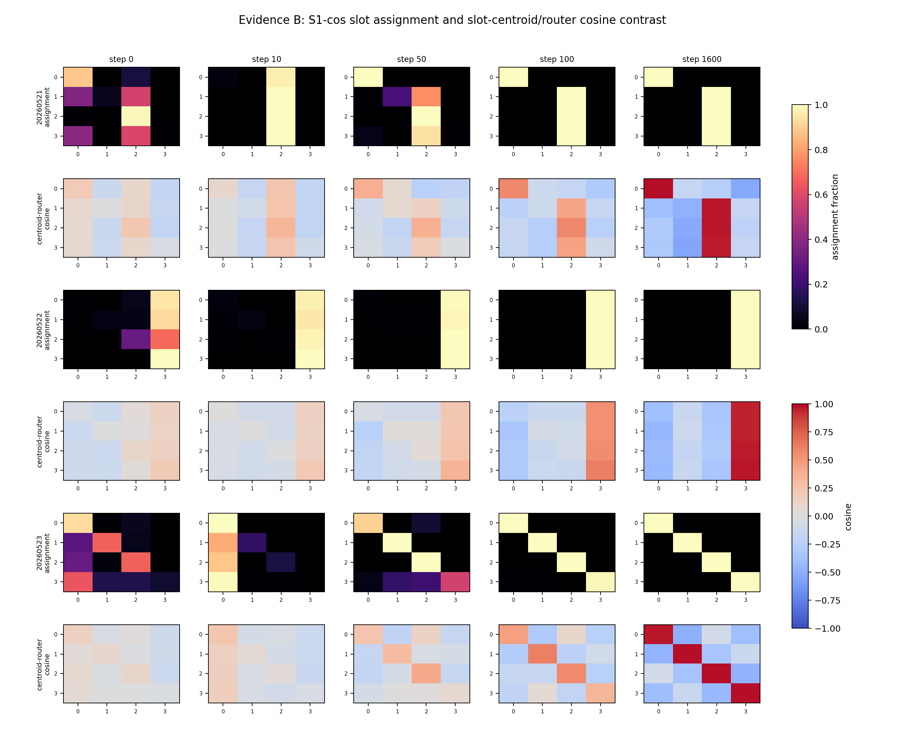
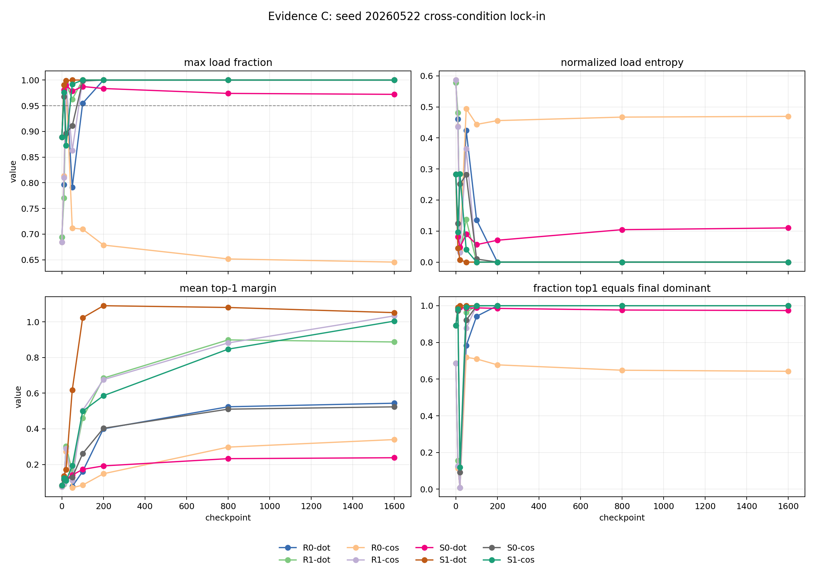
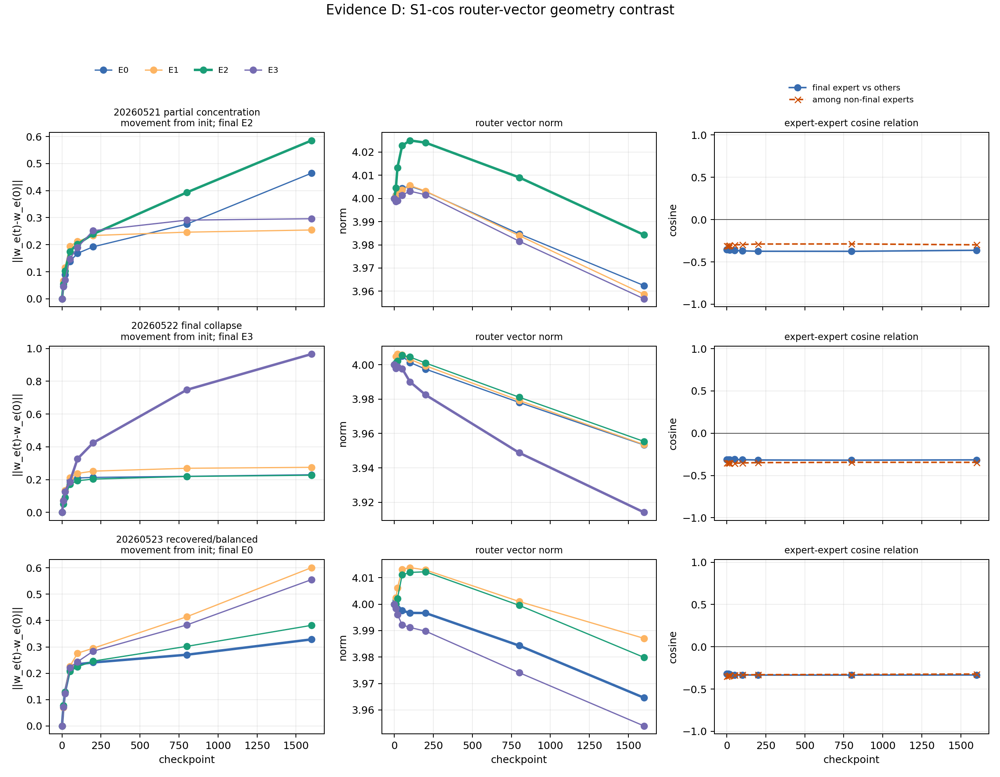

# Meeting Brief: 05_02 Feature Assumption Relaxation

## Meeting Summary

目前我们还不能放松上次提到的三个 feature assumptions：

1. token只由一个feature组成
2. feature是均匀分布的
3. 进入同一个expert的feature只有一个

因为复查最简均匀数据实验发现：虽然 inhibition 可以提高同一feature的分发一致性，但多数 seeds 出现 route collapse，而且使用 inhibition 有放大 collapse 的趋势。

我们将这次要回答的问题定为：

> 在 feature 均匀分布的情况下，collapse 是早期几何/初始化已经决定的，还是训练中 top-1 选择逐步放大学习common方向的趋势？

这个问题必须先回答，因为后续我们设计的实验结果被 collapse 强干扰，无法判断 router 是否真的在做 feature-level routing。

### 结论

经过audit实验，我们发现在最简均匀数据上的实验，MoE坍塌有以下的特征：

1. 最终 collapse 到的 expert 在早期几何中已经预见；但初始分发的logit margin 不大，训练过程会把这个早期偏置放大成 lock-in。（在最终坍塌的seed中，没有观察到足够的自我纠正；但也存在 recovery 的 seed，说明 early spike 并非必然导致 collapse。为什么需要recover还需要进行探究）
    1. 尽管random init让不同专家的分发向量一开始分了三六九等，但是仍然存在，不同的feature 一开始就是和某个专家分发向量相似度高的情形，训练过程会不断加重这种情形。
    2. 初始时刻，top-1 margin不大， 但是训练后会发生显著增长
2. 即使数据均匀分布，仍然存在common方向，collapse expert 最终高度对齐 common hidden direction：$c(t)=\frac{\mathrm{mean}_f \ h_f(t)}{\|\mathrm{mean}_f \ h_f(t)\|}$. 因为其中一个 expert 的 router vector 被训练推向了许多 hidden states 共享的方向，所以越来越多 tokens 会被它选中。

### Next Step

## Meeting Preparation

**Question:**

上一次汇报中，我们在“inhibition能够让相同的features稳定进入相同的expert”的前提下，准备进一步relax我们的假设：

1. token只由一个feature组成
2. feature是均匀分布的
3. 进入同一个expert的feature只有一个

但是复查均匀分布数据的实验发现，使用inhibition能够让同一个feature稳定进入到同一expert中，但是这个claim存在boundary, 在所有实验中，有多数seeds发生了路由坍缩。同时，inhibition存在加大这种collapse的趋势。

尽管在不坍缩的seeds中，inhibition能够让同一个feature稳定进入同一个expert，但是这种坍缩对于我们的进一步进行relax假设实验产生了极大的干扰，因此我们首先需要审计坍缩的发生阶段、发生的前提条件。

具体要先问出三个问题：
Q1: collapse expert 在 step 0 / 10 / 20 / 50 是否已经占优势？
Q2: feature hidden centroids 与 router vectors 的相似度，是早期就偏向 collapse expert，还是训练后才偏向？
Q3: collapse expert 是否更对齐所有 features 共享的 common direction？

**Why this matters?**

在feature均匀分布的情形下，已经排除了频率的影响，但是仍然在多个seeds发生路由坍缩。为了进一步地确认坍缩的原因，我们需要audit原来的实验结果，才能进一步relax假设，探索inhibition对于expert专一化的作用。

**Hypothesis:**

H1: collapse 可能来自早期的 common-direction alignment。  
也就是说，pre-target hidden states 中存在跨 feature 的 shared/common component；如果 router vector 早期对齐这个 common direction，而不是 feature-specific residual direction，不同 features 会被吸入同一个 expert region，形成最终形成路由collapse.

**Evidence:**

本次证据的读法是：不看平均曲线，直接看 seed-level 对照。

1. 早期负载 / top-1 间隔 / common direction

解析：`S1-cos/20260522` 在 step 0 已经偏向最终 expert，step 10 跨过坍缩阈值，训练把早期偏置放大为完全坍缩；`20260523` 有早期 spike 但能恢复平衡。

2. feature centroid × router vector cosine

解析：坍缩 seed 中所有 slots 的 hidden centroid 最后都更接近同一个 router vector；恢复 seed 中 cosine pattern 分化为 slot-to-expert structure。

3. 同一坏 seed 跨条件对比

解析：`20260522` 在多数匹配条件中都有早期 load concentration，说明 collapse 不是 inhibition-only artifact，而是同一 seed 的早期 routing geometry 容易被放大。

4. router geometry

解析：collapse 是最终 selected expert vector 移动更强，成为 shared hidden direction 的 attractor。

**Boundaries:**

本次只分析原始 uniform feature setting，数据形式如下：

$$
x_{s,i,r} = [r_{\mathrm{start}}, C_s, B_i, Y_{s,i}, r_{\mathrm{end}}]
$$

其中：
$s$：slot / context feature，均匀采样；
$i$：$B_i$ identity token，均匀采样；
$r$：随机 nuisance token，不决定 target；
$Y_{s,i}$：由 $(C_s, B_i)$ 共同决定的 target；
operational feature key 是 $(s,i)$。

不回答 compositional token、Zipfian frequency、real data，也不直接证明 expert utility specialization。

**Cannot claim yet:**

1. 不能说 collapse 已经解决；本次只是定位 collapse 的发生机制。
2. 不能说 common direction 是唯一因果原因；本次没有对 common direction 做干预。
3. 不能说 inhibition 一定有害；当前证据只说明这版 selected-expert self-reinforcement 容易放大早期偏置。
4. 不能推广到 compositional token、Zipfian frequency、real data。
5. 不能声称 router-chosen expert 与 utility-best expert 错配；本次没有把 forced-routing utility 作为决定性证据。

**Next Decision:**

先不要继续扩大 P1/P3 feature-assumption relaxation；下一步回到原始 uniform setting，测试一个最小 anti-lock-in intervention。

会议上需要决定优先测哪一个：

1. early load balancing / router warmup；
2. common-direction subtraction before routing；
3. delayed or softened top-1 routing before hard top-1。

**Next Iteration:**

最小实验只保留原始 uniform feature data、原始 seeds、原始 checkpoints，比较 current routing 与一个 anti-lock-in variant。

判定标准：

1. final hard collapse 是否消失；
2. step 0-50 dominant expert lock-in 是否被打散；
3. target accuracy 是否仍接近 1；
4. non-collapsed seeds 是否保留或改善 slot-level expert composition。
