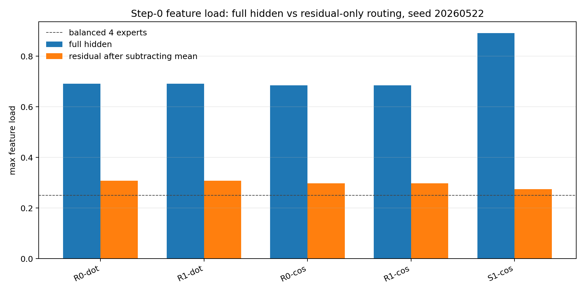
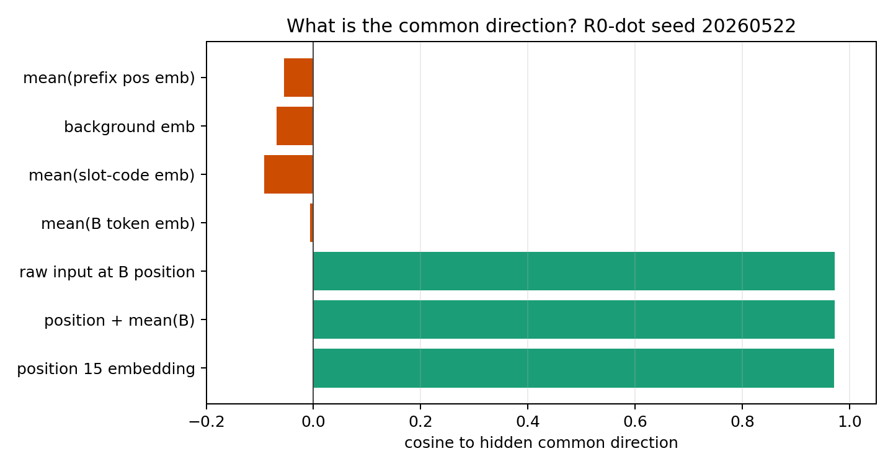
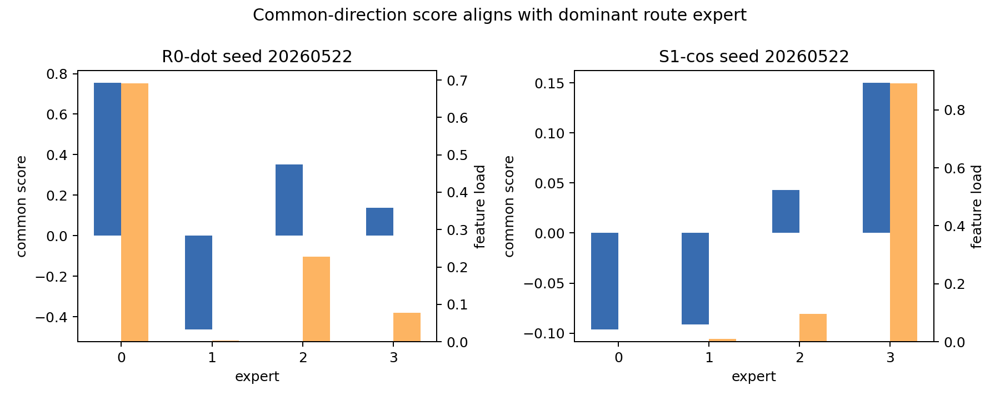
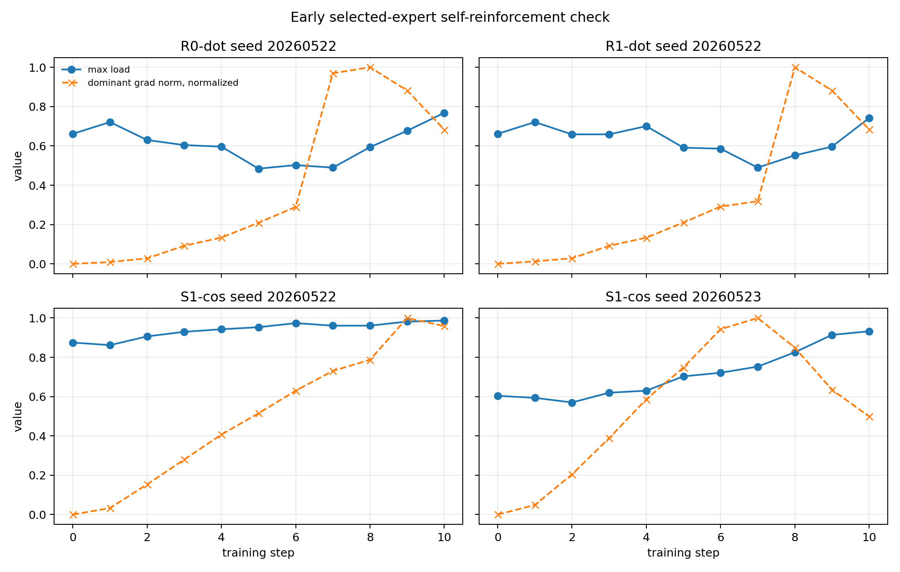

# Uniform MoE Collapse Audit Report

## Executive Verdict

| Item | Verdict | Concrete Meaning |
|---|---|---|
| data_uniformity | PASS with boundary | Intended feature `slot` is exactly uniform in train and eval. Exact `(slot,B)` is finite-sample noisy in the training fixed set, but exactly uniform in feature-variant eval. |
| sequence_randomization | PASS | Train rows are shuffled, and training batches are sampled with replacement from shuffled rows. Batch slot entropy stays near 1. |
| seed_reproducibility | PASS with boundary | Seeds are set before model creation and data sampling; hashes are recorded. This audit did not run a second byte-identical rerun. |
| model_initialization | PASS | The audited model follows the same creation order as training: seed, audit model, real model. |
| router_gating_initialization | PASS with distinction | `R*` uses PyTorch default random `Linear(..., bias=False)`. `S*` intentionally overwrites router rows with slot-centroid initialization and must not be treated as random-init evidence. |
| hidden_common_direction_sources | PASS | A large hidden common component exists at step 0, and it aligns mainly with the fixed routed position/template component, not with feature frequency. |
| conclusion | no bug found | Collapse is better explained by representation common direction + random row projection + top-1 self-reinforcement than by non-uniform slot frequency or bad random initialization. |

## Evidence Table

| Item | Verdict | File:Line | Evidence | Why It Matters |
|---|---|---|---|---|
| Dataset builder | PASS | `Projects/from-attention-to-search/XingyuD/Attention_Search_Experiments/active/synthetic_data_understanding/scripts/run_h0605a_true_token_conditioned_inhibition_replay.py:144-178` | `generate_slot_data` loops over every `slot`, writes slot code, writes `B_i` at `b_position`, sets `target_token(slot,b_idx)`, then shuffles rows. | Confirms the audited data path is the original uniform setting, not a new dataset. |
| Feature eval grid | PASS | same runner `193-238` | `generate_feature_variant_data` loops over every `slot`, every `b_idx`, and every variant. | Step-0 feature-eval evidence is exactly balanced over `(slot,B)`. |
| Training sample order | PASS | same runner `1194-1197` | Each step samples `batch_idx = [indices[rng.randrange(len(indices))] ...]` from fixed train rows. | Training uses randomized sampling with replacement, not sorted feature blocks. |
| Step 0 semantics | PASS | same runner `1188-1192`, `1194-1195` | `collect_trajectory(0)` and `collect_feature_eval(0)` happen before `model.train()` and before the training loop. | Step-0 collapse is before any optimizer update. |
| Seed placement | PASS | same runner `1089-1094`, `1103-1111` | `random.seed(seed)` and `torch.manual_seed(seed+1009)` are set before model creation; train data uses the same seed path. | Rules out an obvious "seed set after init" bug. |
| Router form | PASS | `Projects/from-attention-to-search/XingyuD/Attention_Search_Experiments/active/synthetic_data_understanding/src/synthetic_data_understanding/tiny_moe.py:82-99` | Router is `nn.Linear(d_model, num_experts, bias=False)`; selected expert is `router_probs.max`. | There is no router bias term that could directly create a fixed expert preference. |
| Hidden input form | PASS | same model `133-170` | Hidden states use token embedding + position embedding, attention, LayerNorm, then MoE input. | Fixed position embedding is a plausible hidden common source. |
| Audit script model creation | PASS | `daily_research_reports/0607/uniform_collapse_audit/scripts/audit_uniform_data_init_geometry.py:111-127` | The script reproduces training creation semantics: seed, audit model, real model, then optional slot-centroid overwrite. | Prevents auditing the wrong random router weights. |
| Hidden common definition | PASS | same script `332-349` | Exact feature centroids are averaged as `c = h_feat.mean(dim=0)`; residual is `h_feat - c`. | Defines the common direction as a representation mean, not a frequency count. |
| Full vs residual score test | PASS | same script `361-379` | Full centroids and residual-only centroids are routed separately. | Directly tests whether the shared component drives step-0 load concentration. |
| Source alignment test | PASS | same script `412-458` | Hidden common direction is compared to `b_position_embedding`, mean `B` embedding, background, prefix position, and slot-code means. | Locates the physical source of the common direction. |
| Random geometry baseline | PASS | same script `486-506` | 5000 isotropic random assignments estimate expected max load for 1024 features and 4 experts. | Shows observed full-hidden collapse is far beyond random bucket fluctuation. |

## Quantitative Checks

### 1. Data Uniformity

Source table: `tables/data_uniformity_counts.csv`.

Key results:

| Split | Example | Slot Counts | `(slot,B)` Counts | Interpretation |
|---|---|---:|---:|---|
| train fixed dataset | `R0-dot/20260522` | each slot = 5000 | min 7, max 35, entropy norm 0.996 | Slot is exactly uniform; atomic pair has finite-sample noise. |
| training sampled with replacement | `R0-dot/20260522` | min 153286, max 153888 over 614400 samples | min 209, max 1071, entropy norm 0.996 | Slot remains near-uniform through batch sampling. |
| feature-variant eval | `R0-dot/20260522` | each slot = 4096 | each `(slot,B)` = 16 | Evaluation grid is exactly uniform over exact feature keys. |

Batch order check:

`tables/batch_order_entropy.csv` shows early batch slot entropy mostly
`0.993-0.999`; for example `R0-dot/20260522` step 1 has slot entropy `0.993`,
and step 10 has `0.997`.

Conclusion:

The intended operational feature `slot` is uniform. If the feature is defined
as exact `(slot,B)`, train data is finite-sample approximate, but the diagnostic
feature grid is exact. Since step-0 concentration appears on the exact grid,
frequency imbalance is not a necessary explanation.

### 2. Router Initialization

Source table: `tables/initialization_parameter_stats.csv`.

Examples:

| Condition | Seed | Init Type | Router Shape | Bias | Row Norms | Pairwise Cos Mean |
|---|---:|---|---|---:|---|---:|
| `R0-dot` | 20260522 | PyTorch default random | `4x128` | 0 | `0.589 0.542 0.562 0.577` | -0.0002 |
| `R0-cos` | 20260522 | PyTorch default random | `4x128` | 0 | `0.589 0.542 0.562 0.577` | -0.0002 |
| `S1-cos` | 20260522 | slot-centroid overwrite | `4x128` | 0 | `4.000 4.000 4.000 4.000` | -0.3329 |

Conclusion:

The random-init `R*` gating matrix is correctly random and bias-free. `S*`
conditions are a separate intentional intervention, not random initialization.

### 3. Step-0 Hidden Common Geometry

Source table: `tables/step0_hidden_common_geometry.csv`.

For `R0-dot/20260522`:

- exact features = 1024;
- variants per feature = 16;
- common ratio = `0.743`;
- full hidden max feature load = `0.691`;
- residual-only max feature load after subtracting mean = `0.308`.

For `S1-cos/20260522`:

- full hidden max feature load = `0.892`;
- residual-only max feature load = `0.274`.



解析：去掉 feature centroid 的均值后，seed `20260522` 的 step-0 max load 从约 `0.69-0.89` 降到约 `0.27-0.31`，说明主要不平衡来自共同 hidden 分量，而不是 feature-specific residual。

### 4. Common Direction Source

Source table: `tables/common_direction_source_alignment.csv`.

For `R0-dot/20260522`, hidden common direction cosine:

| Source | Cosine |
|---|---:|
| raw input at B position | 0.973 |
| position 15 embedding | 0.971 |
| position + mean(B) | 0.973 |
| mean(B token embedding) | -0.006 |
| background embedding | -0.068 |
| mean(slot-code embedding) | -0.092 |



解析：hidden common direction 主要对齐固定 routed position 15 / B-position template，而不是对齐 `B` token 平均、slot-code 平均或背景 token。

### 5. Common Score vs Route Load

Source table: `tables/router_score_decomposition.csv`.



解析：在 `R0-dot/20260522` 和 `S1-cos/20260522` 中，common-direction score 最大的 expert 同时获得最大 feature load。

### 6. Random Geometry Baseline

Source table: `tables/random_geometry_baseline.csv`.

For 1024 features and 4 experts, isotropic random assignment gives:

- random max-load mean: about `0.266`;
- random max-load p99: about `0.288`.

Observed full-hidden max load:

- `R0-dot/20260522`: `0.691`, random baseline p-value `0.0` over 5000 trials;
- `R0-cos/20260522`: `0.686`, p-value `0.0`;
- `S1-cos/20260522`: `0.892`, p-value `0.0`.

Residual-only max load:

- mostly near the random range, especially for `S1-cos/20260522`: `0.274`,
  random baseline p-value `0.161`.

Conclusion:

Full-hidden routing is far too concentrated to be explained by random bucket
fluctuation. After common subtraction, load becomes much closer to the
load-matched random baseline.

### 7. Early Gradient Self-Reinforcement

Source table: `tables/early_gradient_self_reinforcement.csv`.



解析：早期 selected expert 的 load 和 router-row gradient 会互相放大，但 `S1-cos/20260523` 说明早期 spike 不是充分条件，后续是否恢复仍取决于训练动态。

## Minimal Reproduction Commands

Run from repository root:

```bash
python daily_research_reports/0607/uniform_collapse_audit/scripts/audit_uniform_data_init_geometry.py
python -m py_compile daily_research_reports/0607/uniform_collapse_audit/scripts/audit_uniform_data_init_geometry.py
```

This audit was run on CPU in the local workspace. The device choice affects
speed, but the step-0 code/data/init checks and generated table logic do not
depend on GPU-only behavior.

## Risks / Ambiguities

1. Exact byte-identical rerun reproducibility was not separately checked twice;
   the audit records deterministic seed paths and hashes.
2. The early 10-step gradient diagnostic is a same-config local replay, not an
   original 4-GPU checkpoint.
3. Target leakage was checked by code path: target is `target_token(slot,b)`.
   A separate classifier baseline from nuisance/order variables was not run.
4. The audit does not prove common direction is the only cause. It shows common
   direction is sufficient to explain the observed step-0 concentration pattern
   better than frequency imbalance or random bucket noise.
5. Forced-routing utility was not recomputed here, so this report does not
   claim router-chosen expert is utility-wrong.

## Recommended Minimal Fix Or Next Audit

The next decisive test should be small and anchor-linked to `05_01`:

1. subtract or center the feature/common hidden direction before the router;
2. initialize router rows so $w_e^\top c$ is matched across experts at step 0;
3. add a short load-balancing/router-warmup phase before hard top-1 lock-in.

Decision metric:

Use the original uniform setting and ask whether step-0 to step-50 max load and
dominant-expert persistence are reduced without lowering target accuracy.
