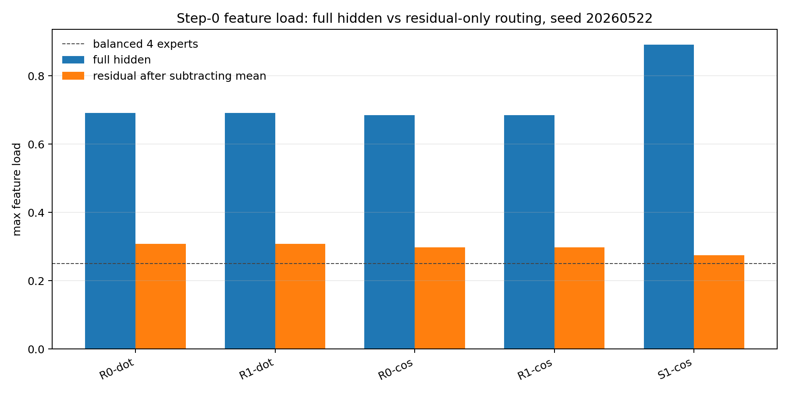
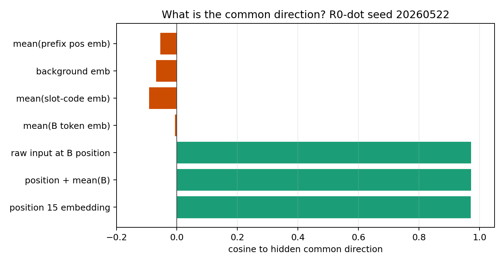
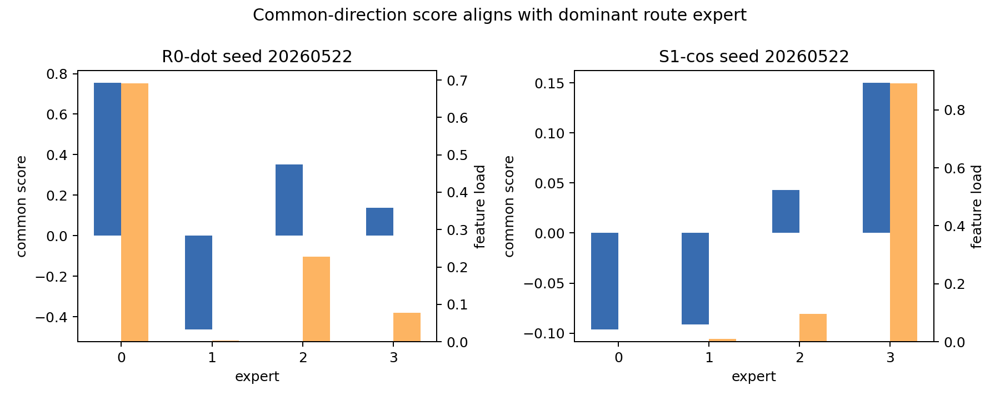
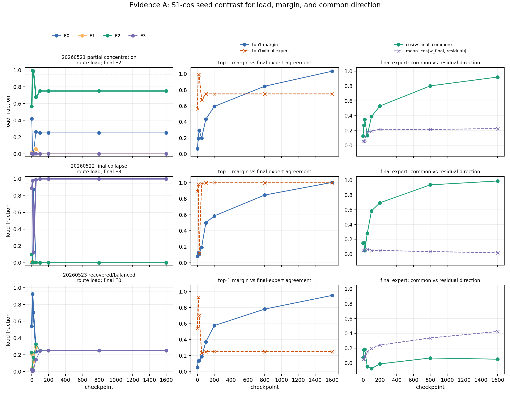
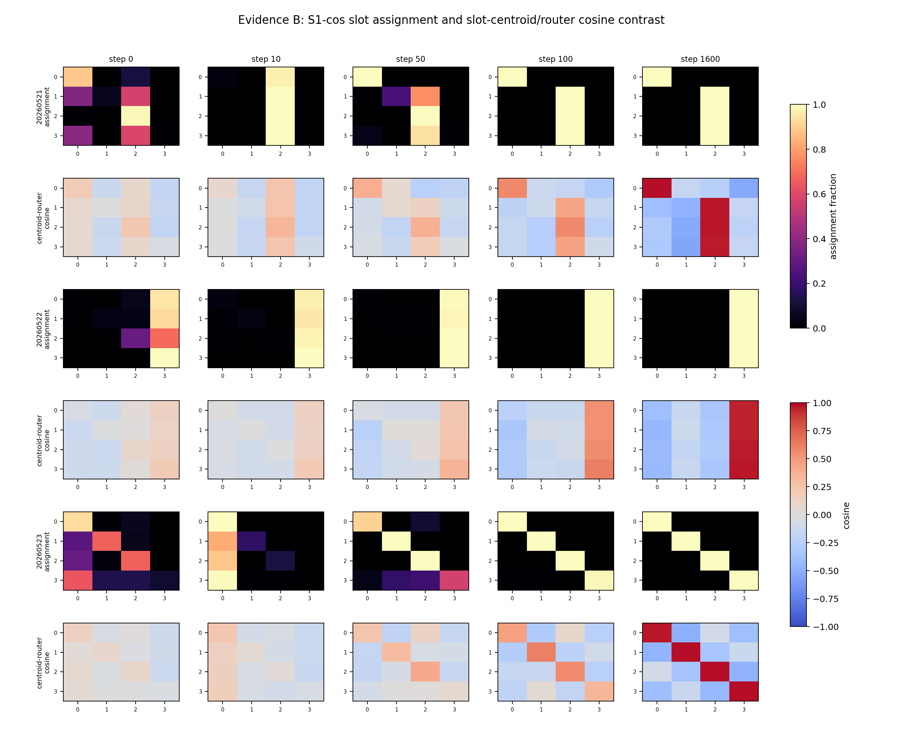
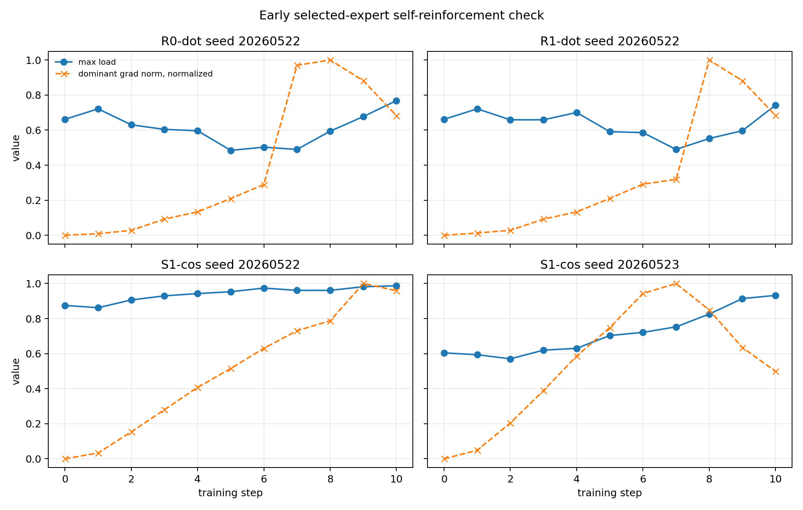

# 0607 Meeting Brief: Uniform Feature Collapse Audit

## 结论先行

这次审计没有发现 slot 频率不均匀或 `R*` 随机 gating 初始化错误。

更自洽的解释是：

> feature 是均匀的，但 routed position 的 hidden state 不是零均值的。所有
> feature 在 pre-target 位置共享一个很强的 position/template 共同方向；随机
> router rows 会给这个共同方向不同分数，于是某个 expert 在 step 0 获得大量
> feature。top-1 训练随后可能把这个早期 winner 放大成 collapse。

因此，这里的 common direction 不是“频率产生的 common”，而是“hidden
representation 里的共同方向”。

## 关键术语

Feature:

本轮主要把 `slot` 当作我们认知中的 feature，同时用 exact `(slot,B)` 做更严格的
feature-key 诊断。

Common direction:

对每个 feature 的 routed-position hidden centroid 取均值，再归一化：

$$
c(t)=\frac{\frac{1}{F}\sum_f h_f(t)}
{\left\|\frac{1}{F}\sum_f h_f(t)\right\|}
$$

它是 hidden space 里的共同方向，不是 feature 频率向量。

Collapse:

大量 feature 或 token 被 top-1 router 分到同一个 expert，表现为 max load 很高、
active experts 很少。

## 一个问题对应一个回答

### Q1. 我们的 feature 是否均匀？

回答：

如果 feature 指 `slot`，是精确均匀的。训练固定集里每个 slot 都有 5000 个样本；
feature-variant eval 里每个 slot 都有 4096 个样本。

如果 feature 指 exact `(slot,B)`，训练固定集不是精确均匀，而是有限采样噪声；
但是 feature-variant eval 是精确均匀的，每个 `(slot,B)` 有 16 个 variants。

关键解释：

step-0 routing concentration 出现在精确均匀的 feature-variant eval 网格上，所以
collapse 不能只归因于训练数据里的 feature 频率不均匀。

### Q2. Gating 矩阵是否正确随机初始化？

回答：

`R*` 条件是正确的 PyTorch 默认随机初始化，且 router 没有 bias。

代码形式是：

```text
Linear(d_model, num_experts, bias=False)
```

例子：`R0-dot/20260522` 的 router row norms 是
`0.589 0.542 0.562 0.577`，row-wise pairwise cosine mean 是 `-0.0002`。

重要边界：

`S*` 条件不是随机初始化。它们会覆盖为 slot-centroid 初始化，row norm 约为 `4.0`，
pairwise cosine mean 约为 `-0.333`。所以不能用 `S*` 来论证“随机初始化本身”的性质。

### Q3. 随机初始化 + feature 均匀，为什么仍然 collapse？

回答：

因为均匀频率不等于 hidden state 零均值。设：

$$
h_f=c+u_f
$$

其中 $c$ 是所有 feature 共享的 hidden 方向，$u_f$ 是 feature-specific residual。
dot-product router 的分数是：

$$
z_{e,f}=w_e^\top h_f=w_e^\top c+w_e^\top u_f
$$

即使 $P(f)$ 均匀，只要某个 expert 的 $w_e^\top c$ 最大，它就会对很多 feature
拥有共同加分。top-1 argmax 会把这些 feature 分到同一个 expert。

这说明随机初始化不是软件意义上的“不好”，而是普通随机 row 对一个强共同方向
不是中性的。

### Q4. Collapse 时 gating 到底学成什么？

回答：

坏 seed 中，gating 不是把所有 router vectors 学成同一个方向，而是让早期被选中的
expert vector 逐渐成为 shared hidden direction 的吸引方向。

更直接地说：

一个 expert 因为 step-0 对共同 hidden 方向分数高，先拿到大量 token；训练时它持续
接收这些 token 的 selected-path 更新，于是它和共同方向的对齐更强，最后吸收更多
feature。

### Q5. 共同方向到底是什么？代表数据 common 吗？

回答：

它代表 hidden representation 中所有 feature centroid 的共同分量。它不是 feature
频率，也不是 `B` token 平均。

本次审计里，`R0-dot/20260522` 的 common direction 与 source 的 cosine 是：

| Source | Cosine |
|---|---:|
| raw input at B position | 0.973 |
| position 15 embedding | 0.971 |
| position + mean(B) | 0.973 |
| mean(B token embedding) | -0.006 |
| background embedding | -0.068 |
| mean(slot-code embedding) | -0.092 |

所以更准确的物理解释是：

> 所有 routed tokens 都处在同一个 pre-target 位置，这个位置/模板角色本身形成了很强
> 的 hidden 共同方向。router 先看到的是“这是预测目标前的位置”这个共同角色，
> 而不是已经分离好的 slot feature。

## 核心证据

### Figure 1. Step-0 full hidden vs residual-only routing



解析：对 seed `20260522`，用 full hidden routing 时 max load 达到 `0.69-0.89`；
减掉 feature-centroid 均值后，max load 降到约 `0.27-0.31`，接近 4 experts 的随机负载范围。

### Figure 2. Common direction source



解析：hidden common direction 主要对齐 position 15 / B-position template，而不是
`B` token 平均、slot-code 平均或 background token。

### Figure 3. Common score and selected expert load



解析：common-direction score 最大的 expert 同时获得最大 feature load，说明共同方向给了该 expert 一个跨 feature 的固定优势。

### Figure 4. Seed-level collapse vs recovery contrast



解析：`S1-cos/20260522` 是 hard-collapse seed，step 10 后持续锁定；`S1-cos/20260523`
有 early spike 但后续恢复，说明早期高 load 是风险因素，不是充分条件。

### Figure 5. Assignment and cosine contrast



解析：collapsed seed 中所有 slots 映射到同一个 expert；recovered seed 中 slot-to-expert
结构重新分化，说明 collapse 同时体现在 route assignment 和 hidden-router cosine 几何中。

### Figure 6. Early self-reinforcement



解析：selected expert 的 load 和 router-row gradient 在前 10 步会互相放大，但存在恢复 seed，
所以训练放大是机制线索，不是单独充分条件。

## 论文直觉

相关 MoE 文献的共同直觉是：top-1 或 sparse routing 通常不会天然负载均衡，需要额外稳定机制。

| Paper | 对本问题的启发 |
|---|---|
| Shazeer et al., 2017, "Outrageously Large Neural Networks" https://arxiv.org/abs/1701.06538 | sparse MoE 很早就使用 noisy gating 和 load-balancing loss，说明专家负载集中是已知风险。 |
| Lepikhin et al., 2020, "GShard" https://arxiv.org/abs/2006.16668 | 大规模 MoE 需要辅助负载均衡损失，避免少数专家被过度使用。 |
| Fedus et al., 2021, "Switch Transformers" https://arxiv.org/abs/2101.03961 | Switch 使用 top-1 routing，但仍保留 load-balancing loss，说明简单 top-1 本身不保证均衡。 |
| Lewis et al., 2021, "BASE Layers" https://arxiv.org/abs/2103.16716 | 将 routing 改成平衡分配问题，直接约束 expert load。 |
| Zhou et al., 2022, "Expert Choice Routing" https://arxiv.org/abs/2202.09368 | 让 expert 在容量约束下选择 token，是另一种避免 token-choice collapse 的方向。 |
| Zoph et al., 2022, "ST-MoE" https://arxiv.org/abs/2202.08906 | router 稳定化和正则项是 sparse expert training 的核心问题。 |

## 当前 Claim

可以说：

> 原始 uniform feature setting 中的 collapse 不是由 slot 频率不均匀或 `R*`
> router 初始化 bug 解释。更可信的机制是：fixed routed position 产生强 hidden
> common direction，随机 router rows 对这个方向给出不同初始分数，top-1 training
> 将早期 winner 放大成 lock-in。

不能说：

- common direction 已被证明是唯一因果原因；
- collapse 已经解决；
- router-chosen expert 与 utility-best expert 错配，因为本次没有重做 forced-routing utility；
- `S*` 结果代表随机初始化。

## 下一步决策

最小下一步应该直接测试这个机制：

1. router 输入去共同方向：route on $h-\bar h$；
2. 初始化时消掉共同分数偏置：让各 expert 的 $w_e^\top c$ 在 step 0 相等；
3. 短 warmup：先用 load balancing / soft top-1，再进入 hard top-1。

优先建议：

先做 `router input centering`，因为它直接干预本次审计定位到的共同方向。如果它能降低
step-0 到 step-50 的 max load，同时保持 target accuracy，就能把 common-direction
机制从“解释性证据”推进到“因果干预证据”。
