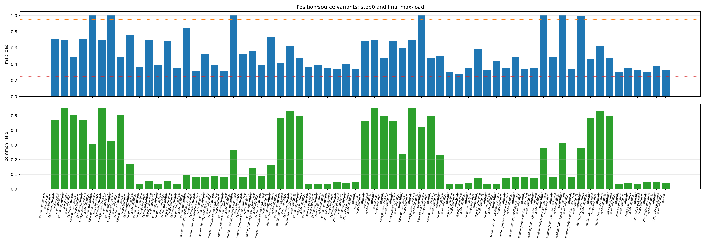
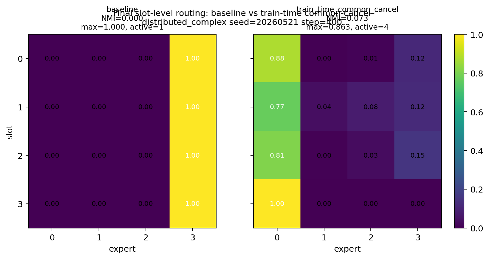
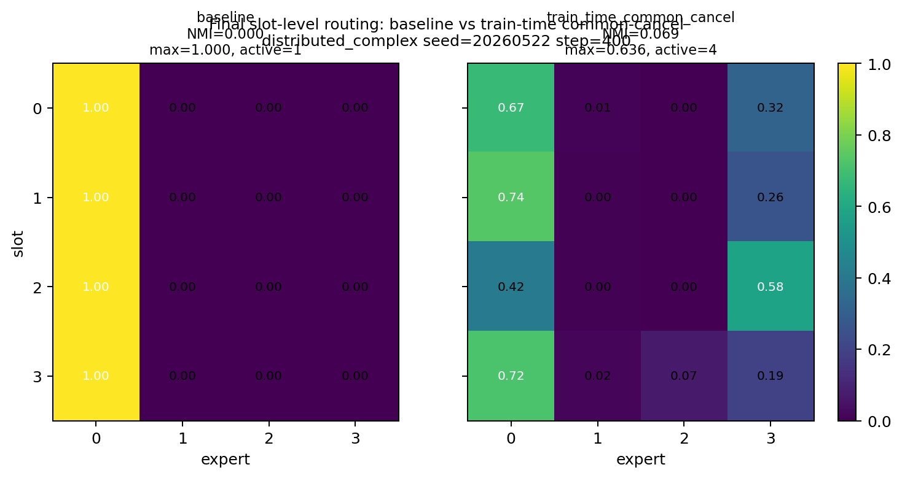
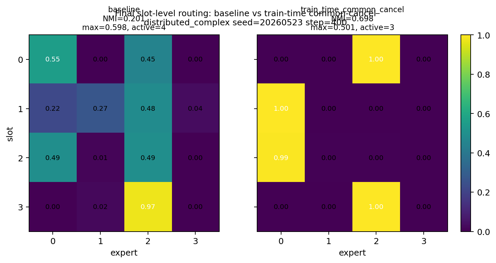
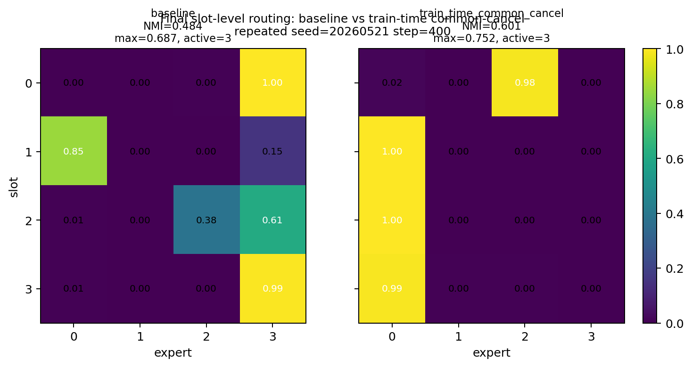
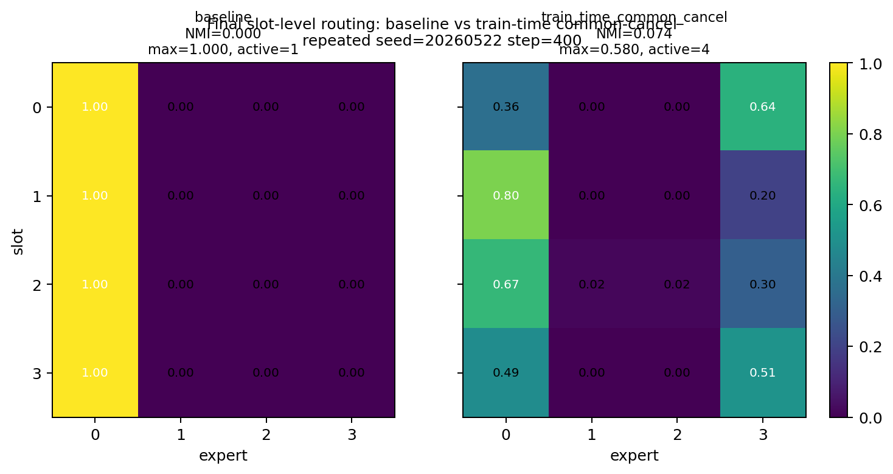
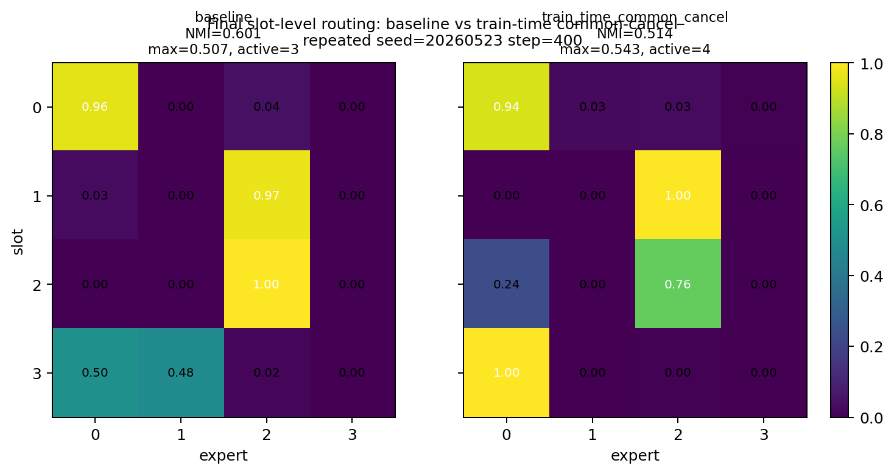

# Meeting Brief

## Meeting Summary

我们要解决的问题是：
在构造的feature均匀分布，Gating矩阵random uniform初始化（$w_{ij} \sim U(-1/\sqrt{d_{model}}, 1/\sqrt{d_{model}})$）的情形下，为什么MoE还是发生了路由坍缩？

我们的核心数学模型：

$$
h_f = c + r_f
$$

$$
z_{f,e} = w_e^T h_f = w_e^T c + w_e^T r_f
$$

### Conclusion

uniform collapse 的 step-0 主要来自 routed position / positional embedding 造成的 common offset；但训练最终产生的 collapse 不是仅靠去 position embedding 就能完全解决。

在之前的uniform数据分布setting下：

1. 构建数据的时候，我们fix了路由表征在sequence中的位置，因此该表征会存在一个common的positional embedding 成分。positional embedding 是这个 common component 的主要因果来源之一，但是去除了 position embedding（或者构造features出现在sequence中的不同位置），虽然改善了最后的路由坍缩，但是还是没有办法产生feature level的specialization.
    1. 只 zero routed position embedding 后，common_ratio 从约 0.51 降到约 0.045，step-0 max-load 从约 0.62 降到约 0.33-0.36。
    2. zero all position embedding 的效果相近，说明主要来源集中在 routed token 的固定绝对位置。
    3. 去除 position embedding 可以降低 collapse，但不能自动产生 slot-level specialization。max-load 低只说明 load balance 更好；slot-level specialization 需要看 slot-expert NMI 和 slot-expert heatmap。
        - 数据一实验repeated pattern: **r - AAAA B_i - y_{A,B_i} - r**
            final max-load 从 baseline 约 0.70 降到约 0.43。
        - 数据二实验distributed_complex pattern: **r - ABCDE B_i - y_{ABCDE,B_i} - r**
            final max-load 从 baseline 约 0.92 降到约 0.74。

### Next decision

1. 从 collapse转入 slot-level specialization audit。
下一轮需要在排除position embedding的前提下，观察routing的分化轨迹。首先初始化让features初始化到不同expert上，然后观察什么时候坍缩到其他专家上。

### Evidence

P1/P2: common-score \(w_e^\top c\) 预测 step-0 dominant expert，agreement 接近 1.0。
baseline 是 0.25。full hidden step-0 max-load 约 0.62-0.64；
在logit上减去common component部分贡献后后降到约 0.28-0.29。

P7 position/source ablation:

- baseline_pos: common_ratio 约 0.51，step-0 max-load 约 0.62。
- zero_routed_pos_step0: common_ratio 降到约 0.045，step-0 max-load 降到约 0.33-0.36。
- zero_all_pos_step0: common_ratio 约 0.035，step-0 max-load 约 0.33-0.36。
- random_feature_position_eval_only: common_ratio 降到约 0.081-0.082，step-0 max-load 降到约 0.39-0.41。
- no_pos_frozen_train: accuracy 约 0.998，final max-load 降低，但没有完全消除 final collapse。

**分析**：fixed routed position / positional embedding 是 step-0 common component 的主要因果来源；random feature position 能削弱 early common，但不能可靠解决 final collapse。

P3/P5: 在logit上减去common component部分贡献降低 collapse，accuracy 保持，但 final max-load 仍偏高，专家分得的feature不均匀。
P4: common-aware init 修复 step-0，但 final mixed。

**分析**：所以 offset control 不等于 solve final collapse。

### Visual Evidence And Experiment Meaning

#### Experiment A: position/source ablation

**这个实验在做什么？**  
它直接测试 common component 是否来自 fixed routed position / positional embedding。做法是在 step 0 分别保留 position embedding、zero all position embedding、只 zero routed position embedding、shuffle position vectors、randomize logical feature position。

**解析**：zero routed position embedding 和 zero all position embedding 都把 step-0 common_ratio 从约 0.51 降到约 0.04，并把 step-0 max-load 从约 0.62 降到约 0.33-0.36；这说明 routed position embedding 是 early common-offset 的主要因果来源之一。

#### Experiment B: train-time common-cancel, final slot-level routing

**这个实验在做什么？**  
它在训练过程中对 router logits 去掉 common score：

$$
z'_{f,e} = w_e^T h_f - w_e^T c
$$

然后看 final checkpoint 时 slot 和 expert 是否形成稳定对应关系。下面每张图的 row 是 slot，column 是 expert，cell 是 $P(expert \mid slot)$。如果形成 slot-level specialization，应该看到不同 slot 稳定对应不同 expert。注意：这组 common-cancel 图来自已有 A05_03 P5B 结果，final checkpoint 是 step 400；它不是最新 1600-step position P7 run。

**distributed_complex, seed 20260521**

**解析**：P5B NMI=0.073，max-load=0.863；仍然是 weak/no slot structure。

**distributed_complex, seed 20260522**

**解析**：P5B NMI=0.069，max-load=0.636；load 有改善，但 slot-expert 对齐仍弱。

**distributed_complex, seed 20260523**

**解析**：P5B NMI=0.698，max-load=0.501；这个 seed 出现 partial slot structure，但不是跨 seed 稳定结果。

**repeated, seed 20260521**

**解析**：P5B NMI=0.601，max-load=0.752；有 partial slot structure，但 load 仍偏集中。

**repeated, seed 20260522**

**解析**：P5B NMI=0.074，max-load=0.580；没有形成清晰 slot-level specialization。

**repeated, seed 20260523**

**解析**：P5B NMI=0.514，max-load=0.543；有 partial slot structure，但仍不是稳定强 specialization。

**结论**：train-time common-cancel 可以降低 early common-offset 和部分 collapse，但 final slot-level specialization 不稳定；它不是一个稳定产生 slot-specialized experts 的机制。

## Meeting Preparation

**Question:**
在 uniform feature frequency 和 bias-free random linear gate 下，为什么 step-0 routing 已经偏向某个 expert，并最终形成 collapse？

**Why this matters?**
如果 uniform baseline 的 route consistency 本身来自 common-offset seeded collapse，那么后续 feature specialization / route consistency 的解释都会被污染。

**Hypothesis:**
routed hidden state 可分解为 \(h_f=c+r_f\)。common component \(c\) 通过 \(w_e^\top c\) 产生 expert-specific effective bias，决定 step-0 dominant expert；final collapse 还需要 top-1 training amplification。

**Evidence:**
1. P1/P2: \(w_e^\top c\) predicts step-0 dominant expert; cancellation lowers step-0 max-load to near random/balanced range.
2. P3/P5/P4: offset control improves early geometry and hard collapse but final max-load remains high.
3. P7 position/source ablation: zeroing only the routed position embedding sharply reduces common_ratio and step-0 max-load.
4. Slot-level heatmaps: train-time common-cancel gives partial slot structure in some seeds, but not stable slot-level specialization.

**Can claim now:**
fixed routed position / positional embedding is a major causal source of the step-0 common component.

**Cannot claim yet:**
position embedding is the only source;
position ablation solves final collapse;
load balance means feature specialization;
the result transfers beyond this toy setting.

**Next Decision:**
Use the position/source result to set the 05_03 claim boundary, then decide whether the next experiment should target remaining training-time collapse or return to slot-level specialization.

**每个实验具体说明了什么**

| Protocol | 它问的问题                                                   | 结果说明                                                                                         |
| -------- | ------------------------------------------------------- | -------------------------------------------------------------------------------------------- |
| **P1**   | common score (w_e^\top c) 能不能预测 step-0 dominant expert？ | 能。说明 step-0 偏向不是普通 random split，而是 common offset 在起作用。                                       |
| **P2**   | 这个预测跨 seed 是否稳定？                                        | 稳定。common-score agreement 接近 1.0，强于 random baseline。                                         |
| **P3**   | 训练时取消 common offset，collapse 会不会下降？                     | hard collapse 下降，但 final max-load 仍偏高。说明 common 是 early driver，但不是全部。                        |
| **P4**   | common-aware initialization 能不能修复 step-0 偏置？            | 能显著降低 step-0 load，但 final 结果 mixed。说明 init 通过 common score 影响 early routing，但 init alone 不够。 |
| **P5**   | 哪种 common subtraction 更稳定？                              | logit-level cancellation 最稳；SVD / low-rank residual 不稳定。                                     |
| **P5B slot heatmap** | 训练中去 common offset 后，final 是否形成 slot-level specialization？ | 不稳定。部分 seed 有 partial slot structure，但跨 seed 不稳定；说明 common-cancel 不是稳定产生 slot-specialized experts 的机制。 |
| **P6**   | anti-lockin warmup 能不能控制 final collapse？                | 暂时不作为今天主结论。它可以降低 load collapse，但 load balance 不等于 slot-level specialization。             |
| **P7** | position/template source 是不是 common shift 的因果来源？ | 是。zero routed position embedding 将 common_ratio 从约 0.51 降到约 0.045，并将 step-0 max-load 从约 0.62 降到约 0.33-0.36；但 final collapse 没有完全解决。 |
