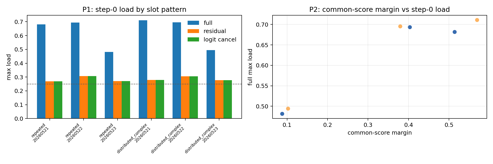
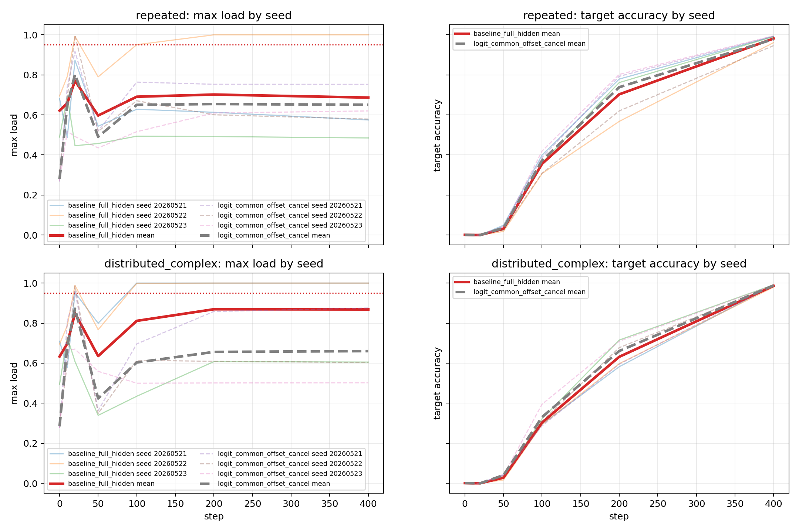
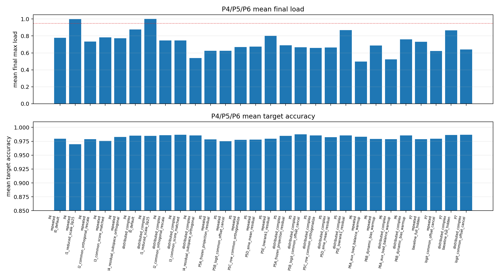
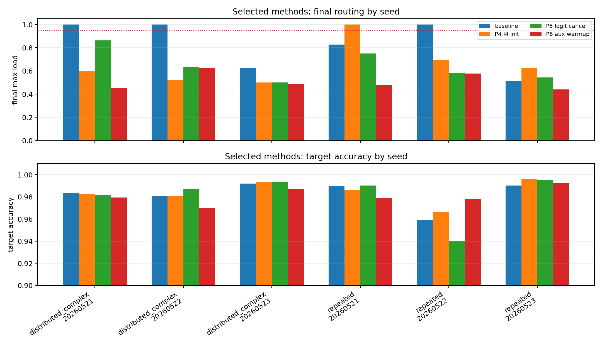
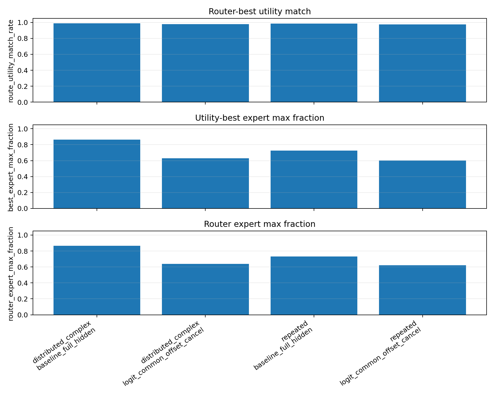

# Report Card: Uniform Collapse Common-Offset Mechanism

## Source Files

Anchor:
`05_03_uniform_collapse_common_offset_anchor.md`

Summary:
`summary.md`

Detailed:
`detailed.md`

Supporting boundary:
`supporting/05_01_geometric_inhibition_anchor.md`
`supporting/05_02_feature_assumption_relaxation_anchor.md`

Figures / Tables:
`figures/`
`tables/`

## 0. Executive Summary

Goal:

Explain why ordinary top-1 MoE routing collapses in the original uniform feature setting even when feature frequency and random router initialization have been audited.

Minimal mechanism audit:

Decompose the routed hidden centroid as $h_f=c+r_f$ and test whether the shared component $c$ creates an expert-specific common score $w_e^T c$ that predicts step-0 routing concentration.

Clear hypothesis:

If $w_e^T c$ is the early driver, then the expert with the largest common score should be the step-0 dominant expert, and canceling this offset should reduce step-0 max-load without destroying target learning.

Key finding:

The common-score argmax predicts the step-0 dominant expert with agreement 1.0 across repeated and distributed-complex patterns, versus a random baseline of 0.25. Dot-product common-offset cancellation reduces step-0 max-load from about 0.62-0.63 to about 0.28-0.29.

Current conclusion:

The best current mechanism statement is: shared hidden component -> expert common score -> early dominant expert -> top-1 amplified lock-in. P6A auxiliary load-balance warmup is the strongest tested anti-lock-in control in shortened runs.

Claim boundary:

This does not solve collapse, does not prove feature-level specialization, does not prove selected experts are utility-wrong, and is not yet full 4-card verification.

Next step:

Run full 4-card verification comparing `baseline_full_hidden`, `P5B_logit_common_offset_cancel`, `P4_I4_residual_subspace_orthogonal`, and `P6A_aux_load_balance_warmup`.

## 1. Research Process Update

| item | content |
|---|---|
| Previous mainline | 05_01 and 05_02 showed that target accuracy and route consistency can be contaminated by collapse. |
| New probe | A05_03 tests whether common hidden direction creates an effective router bias and whether anti-lock-in control reduces final concentration. |
| New evidence | Common-score prediction is perfect in the tested step-0 setting; offset cancellation reduces early load; P6A gives the lowest final max-load among tested controls. |
| Knowledge update | Step-0 collapse is strongly explained by common-offset geometry, while final collapse still needs training-amplified lock-in. |
| Next decision | Verify P6A against baseline/P5B/P4-I4 in a full 4-card run before returning to feature-structure or utility claims. |

## 2. Terms Used Here

- `top-1 routing`: the router sends each routed token to exactly one selected expert.
- `max-load`: the largest fraction of routed tokens assigned to any single expert; this is the primary validity metric because one expert absorbing most tokens makes route structure uninterpretable.
- `common hidden component`: the feature-shared part of routed hidden states, written as $c$ in $h_f=c+r_f$.
- `common score`: $w_e^T c$, the contribution of the shared component to expert $e$'s router logit.
- `anti-lock-in`: a training control that prevents the early dominant expert from becoming permanently selected by top-1 feedback.
- `forced-routing utility`: a diagnostic that forces each feature through each expert after training and checks which expert gives the best target loss.

## 3. Key Figures

### Figure 1: Step-0 Common-Score Prediction

What to see:

Full-hidden routing has high step-0 max-load, while residual or logit common-offset cancellation pushes dot-product routing close to balanced load.

Supports:

$w_e^T c$ is a strong step-0 mechanism for dominant expert selection.

Cannot prove:

It does not prove final training collapse is solved by common-offset cancellation.

### Figure 2: P3 Seed-Level Training Load And Accuracy

What to see:

Common-offset cancellation reduces hard collapse in the shortened training runs, but final load remains seed-dependent.

Supports:

Offset control is useful but insufficient as a full anti-collapse solution.

Cannot prove:

It cannot establish full-run robustness because P3 was CPU-shortened.

### Figure 3: P4-P6 Variant Summary

What to see:

P6A auxiliary load-balance warmup has collapse rate 0.0 and lower final max-load than the offset-only controls in both slot patterns.

Supports:

Training-time anti-lock-in pressure is currently the strongest tested intervention class.

Cannot prove:

It does not show that the resulting expert allocation is feature-specialized.

### Figure 4: Selected Methods By Seed

What to see:

The seed-level plot shows why averages are not enough: the most collapsed baseline seeds are improved by P6A, while target accuracy remains high.

Supports:

The next verification should be seed-level and load-first, not only mean-accuracy based.

Cannot prove:

It does not identify the exact gradient-level path of lock-in.

### Figure 5: Forced-Routing Utility Aggregate

What to see:

Post-training router choice and forced-routing best expert are highly aligned, with route-utility match around 0.98-0.99.

Supports:

The report should not claim that final selected experts are obviously utility-wrong.

Cannot prove:

It cannot decide whether early route assignments were utility-correct before experts co-adapted.

## 4. Current Claim

In the tested uniform toy setting, common-offset is the best current explanation for step-0 dominant expert selection. Final collapse is better explained as common-offset seeded top-1 lock-in, and P6A is the strongest tested anti-lock-in control in shortened runs.

## 5. Claim Boundary

Can claim:

- Common-score argmax predicts step-0 dominant expert selection in the tested patterns and seeds.
- Common-offset cancellation reduces early load concentration while preserving target learning.
- Offset-only controls reduce hard collapse but do not fully settle final training dynamics.
- P6A is the best tested shortened-run control.
- P7 prevents a post-training utility-mismatch overclaim.

Cannot claim:

- Collapse is solved.
- Full 4-card verification is complete.
- Lower expert load means feature-level specialization.
- Selected experts are utility-wrong after training.
- The result transfers directly to compositional features or real language data.

## 6. Next Step

Run the full 4-card verification with four conditions: `baseline_full_hidden`, `P5B_logit_common_offset_cancel`, `P4_I4_residual_subspace_orthogonal`, and `P6A_aux_load_balance_warmup`. The primary decision metrics should be final max-load and collapse rate; target accuracy should be a validity guard.
