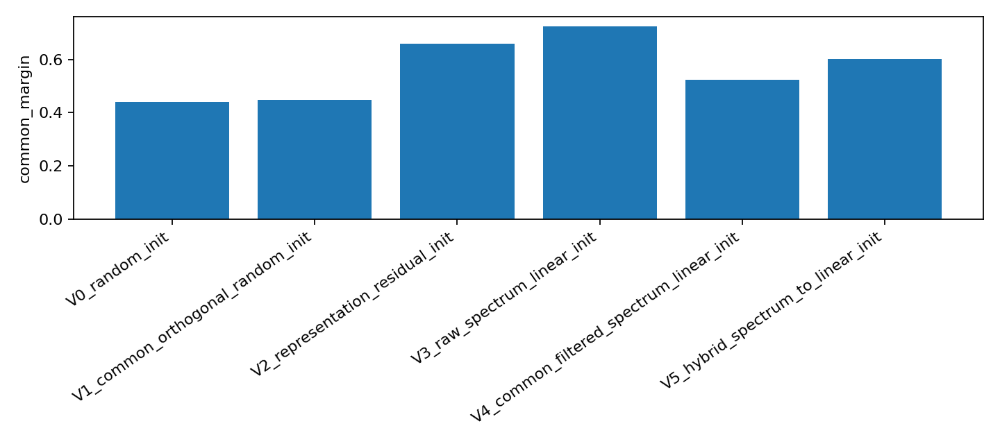
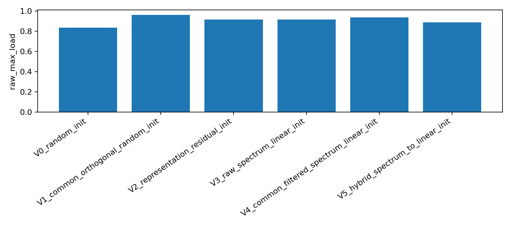
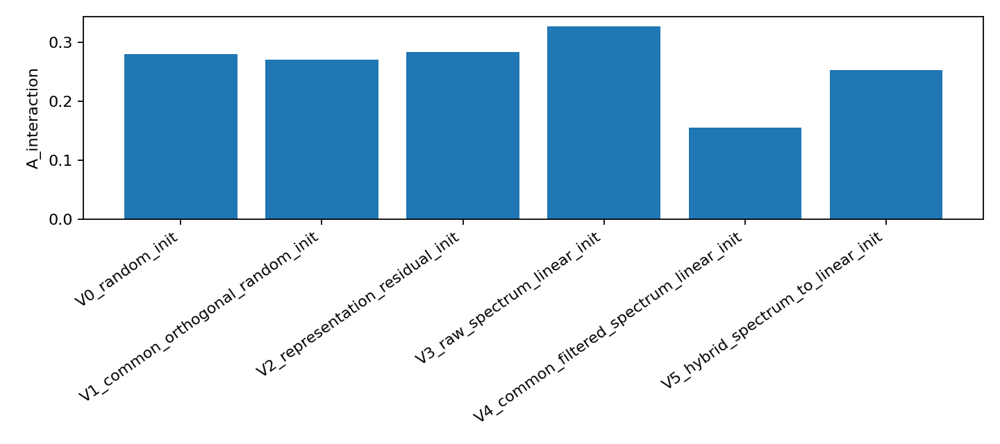

# A06_01 Summary: Common-Filtered Expert-Spectrum Router Initialization

## Purpose

Test whether the advisor-style idea, initializing the router from expert high-gain directions, becomes useful when common directions in the initial router-input representation are removed or isolated.

## Conclusion

The method is **not supported as a directly useful router initialization in this setting**. Common-filtered spectrum initialization does reduce the replay interaction term, especially in layer 5, but it does not reduce the step-10 common-margin spike or top-1 load concentration relative to random initialization.

The most informative result is therefore diagnostic rather than positive: common filtering can remove direct common-row alignment, but the early top-1 MoE training path still collapses through hidden-state drift and load concentration.

## Primary Metrics

Primary judgment metric:
`common_margin_delta` from step 0 to step 10 on layers 3--5, because A06_02 showed that early common-logit amplification is the mechanism-facing signal.

Secondary metrics:
`A_interaction` from cross-checkpoint replay, step-10 `raw_max_load`, step-10 effective experts, forced-routing utility correlation, and step-300 LM loss.

## Key Result

Late layers are layers 3--5, averaged over seeds 0, 1, and 2.

| variant | cm delta | step10 load | eff. experts | A interaction | step300 loss | residual utility rho |
|---|---:|---:|---:|---:|---:|---:|
| V0 random | 0.3878 | 0.8344 | 1.5636 | 0.2795 | 7.0007 | 0.0952 |
| V3 raw spectrum | 0.6970 | 0.9144 | 1.3197 | 0.3268 | 7.0172 | 0.2328 |
| V4 common-filtered spectrum | 0.5203 | 0.9374 | 1.2177 | 0.1543 | 7.0049 | 0.1164 |
| V5 hybrid spectrum-to-linear | 0.5971 | 0.8872 | 1.3932 | 0.2529 | 7.0204 | 0.0608 |

Interpretation:
V4 is the best variant on `A_interaction`, but worse than random on step-10 `common_margin_delta`, `raw_max_load`, and effective experts. V3 has the strongest residual-spectrum utility signal, but it also has the worst early common-margin amplification.

## Key Figures

This figure shows that common-filtered spectrum does not beat random initialization on step-10 common-margin.

This figure shows that common-filtered spectrum has stronger top-1 load concentration than random at step 10.

This figure shows the main partial win: V4 lowers the late-layer replay interaction term.

## What Worked

The computation was implementable as a full 4-GPU ACP run:

- expert input-side energy matrix: $G_e = W_{gate,e}^\top W_{gate,e} + W_{up,e}^\top W_{up,e}$;
- common basis estimated from initial router inputs;
- raw, common-orthogonal, representation-residual, raw-spectrum, common-filtered spectrum, and hybrid spectrum-to-linear variants;
- 18 full 0--300 step runs;
- full cross-checkpoint replay and forced-utility audit.

The V4 result suggests that common filtering changes the replay mechanism: layer-5 `A_interaction` drops from 0.5773 in V0 to 0.2564 in V4.

## What Failed

The failure is not simply that common filtering is impossible. The failure is that the filtered linear router still enters an early concentrated top-1 path:

- V4 `common_margin_delta`: 0.5203, worse than V0 at 0.3878.
- V4 step-10 `raw_max_load`: 0.9374, worse than V0 at 0.8344.
- V4 step-10 effective experts: 1.2177, worse than V0 at 1.5636.
- V4 residual utility correlation: 0.1164, weaker than V3 at 0.2328.

The oracle residual-spectrum assignment is balanced, but the residual-oracle-to-linear agreement remains low. V4 reaches only 0.2157 agreement, so a linear top-1 router is a poor compression of the quadratic subspace score.

## Token-Frequency Audit

A post-hoc step-0 audit tested whether the initial route distribution changes when high-frequency tokens are isolated or removed. High-frequency tokens were defined from the init split as the top 1% of observed token types; these 508 token ids account for 61.45% of init-token mass.

Late-layer step-0 `max_load` is nearly unchanged after removing high-frequency tokens:

| variant | all tokens | high-frequency only | without high-frequency | high-minus-without |
|---|---:|---:|---:|---:|
| V0 random | 0.2010 | 0.2018 | 0.1998 | 0.0020 |
| V3 raw spectrum | 0.1681 | 0.1687 | 0.1673 | 0.0014 |
| V4 common-filtered spectrum | 0.1393 | 0.1406 | 0.1397 | 0.0009 |
| V5 hybrid | 0.1622 | 0.1628 | 0.1617 | 0.0010 |

Interpretation:
The step-0 route distribution differences across initialization variants are not driven by a small set of high-frequency tokens. Removing high-frequency token ids preserves the same qualitative ordering of variants.

The more decision-relevant rank distribution is the sorted expert-load shape after removing the top 1% high-frequency token ids. Late layers are layers 3--5, averaged over seeds and layers.

| variant | step | rank-1 expert | rank-2 expert | rank-3--8 experts |
|---|---:|---:|---:|---:|
| V0 random | 0 | 19.98% | 16.81% | 63.21% |
| V0 random | 10 | 83.16% | 13.48% | 3.36% |
| V3 raw spectrum | 0 | 16.73% | 14.95% | 68.32% |
| V3 raw spectrum | 10 | 91.33% | 7.55% | 1.12% |
| V4 common-filtered spectrum | 0 | 13.97% | 13.31% | 72.72% |
| V4 common-filtered spectrum | 10 | 93.51% | 6.04% | 0.45% |
| V5 hybrid | 0 | 16.17% | 15.02% | 68.81% |
| V5 hybrid | 10 | 88.64% | 10.39% | 0.97% |

Interpretation:
Common-filtered initialization does reduce initial route imbalance after high-frequency tokens are removed: V4's rank-1 expert is near 14%, much closer to uniform than V0's 20%. But this does not slow the early amplification path. By step 10, V4 concentrates 93.51% of non-high-frequency tokens in the top expert, worse than V0 at 83.16%.

## Claim Update

Supported:
Expert spectrum contains a weak residual utility signal, because V3 has the highest residual utility correlation and top-1 residual utility match.

Weakened:
Raw spectrum and common-filtered spectrum are not sufficient as linear router initializations. Raw spectrum worsens common amplification, and common filtering only partially reduces interaction while failing on the primary early-training metrics.

Boundary:
This result covers random-initialized, small Qwen-style top-1 MoE on DCLM, 6 layers, 8 experts, no load-balance loss, and steps 0--300. The implementation audits exact gate inputs with maximum router-logit reconstruction error 0.0. One implementation caveat is that the minimal MoE source still includes a shared expert path even though the protocol intended `use_shared_expert=false`.

## Next Decision

Do not present common-filtered expert-spectrum linear initialization as a successful method. The sharper next question is whether the failure is in the **computation** or in the **linear-router implementation bridge**:

Run only a minimal follow-up if needed: compare a residual-spectrum oracle gate or a fitted classifier bridge against the current linear row-mean bridge for the first 10 steps. If the oracle also fails, expert-spectrum routing should be parked for this setting.
