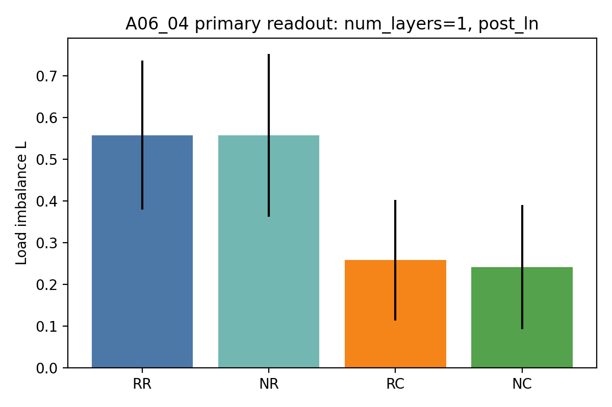
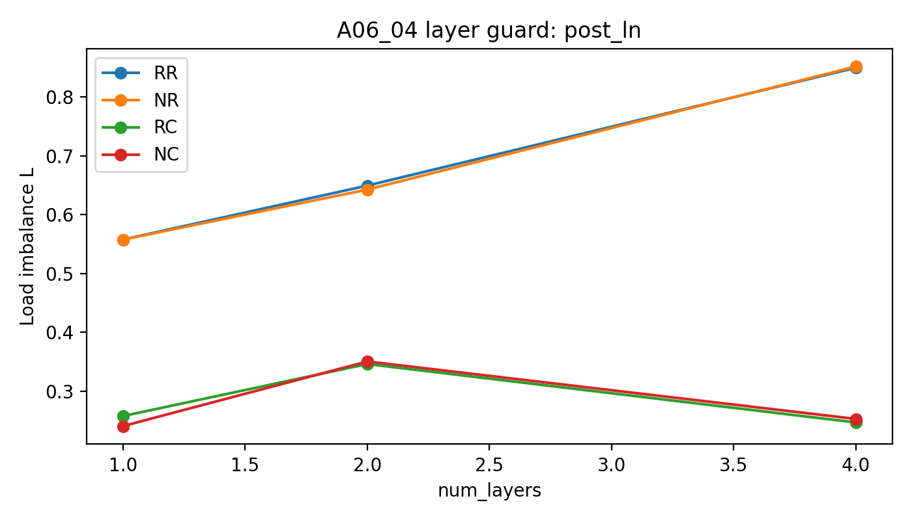

# Meeting Brief: A06_04 Synthetic Hidden-State Common Component Audit

Use this as a short advisor / group-meeting reading surface. It is not a replacement for the project `summary.md` or `detailed.md`.

## Question

Core question:

在 4 个 `(slot,target)` pairs 完全均匀采样时，初始化的 dot-product top-1 gate 为什么仍会把 token 不均匀地分给 4 个 experts？

Why it matters to the mainline:

如果第 0 步路由已经有负载偏置，后面讨论 expert specialization、训练 collapse、或 router 方法时，必须先知道这个偏置来自哪里。否则可能把一个初始化 hidden-state 几何问题误读成训练后的语义分工。

Current subproblem:

把初始化路由分数写成：

$$
z_{i,e}=w_e^\top h_i=\rho_e u_e^\top(c+r_i)
$$

这里 $w_e$ 是第 $e$ 个 expert 的 router row，$\rho_e$ 是它的 norm，$h_i$ 是 token 的 router-input hidden state，$c$ 是 hidden states 的均值成分，也就是 hidden common component，$r_i$ 是去均值后的 residual component。

本实验比较四个 score replay 条件：

| Condition | Concrete meaning | Tested object |
| --- | --- | --- |
| `RR` | raw router row + raw hidden state | uncontrolled baseline |
| `NR` | row-norm-normalized router row + raw hidden state | router row norm $\rho_e$ |
| `RC` | raw router row + common-centered hidden state | hidden common component $c$ |
| `NC` | row-norm-normalized router row + common-centered hidden state | joint control / residual geometry |

Primary metric:

负载不均衡 $L=m\max_e |p_e-1/m|$。这里 $p_e$ 是 expert $e$ 的 top-1 load fraction。$L$ 越低，expert load 越接近均匀。

## Updated Judgment

One-sentence update:

这次结果把判断从“row norm、common component、interaction 都可能解释 synthetic hidden-state step-0 imbalance”更新为：**hidden common component 是当前 synthetic hidden-state 设置中的主导 tested source；row norm 不是主因；interaction 不稳定；common-centering 后仍有 residual load 需要继续拆。**

Three-point conclusion:

1. **均匀 symbolic pair 不保证均匀 initialized routing。**  
   4 个 pair 严格均匀，但 raw replay 的 mean $L=0.5578$，说明 hidden-state formation 已经引入非均匀几何。

2. **common-centering 是主要有效控制。**  
   primary readout 中 $L$ 从 `RR=0.5578` 降到 `RC=0.2578`，`NC=0.2407`；common effect 在 8 个 seeds 中全部为正。

3. **row norm 不是这个 hidden-state setting 的主解释。**  
   `NR=0.5577`，几乎等于 `RR=0.5578`；norm effect 均值约 `0.0001`，并且 8 个 seeds 中有 3 个为负。

## Setup

Only include setup details needed to judge the evidence.

Data / task:

- `seq_len=32` synthetic sequences。
- 4 个 `(SLOT_s,TARGET_s)` pairs，4 个 experts。
- 每个 pair 每个 seed/depth 有 4096 samples，所以每个 condition 是 16,384 samples。
- pair distribution 严格均匀。
- pair start 随机。
- background tokens 与 pair id 独立，并且不复用旧的 `SLOT_s B_CONST Y_s` 格式。

Model / router:

- initialized dot-product top-1 synthetic Transformer-MoE。
- no training；只看 step 0。
- route position 是 slot 的最后一个位置；当前一 token slot 下就是 `pair_start`。

Guard sweeps:

- `num_layers=1,2,4`。
- `router_input_norm=post_ln,pre_ln_replay`。
- 8 个 seeds：`20260521..20260528`。

## Key Evidence

### Evidence 1: Common-centering halves the primary load imbalance

What was tested:

在 primary readout，也就是 `num_layers=1` 且 `post_ln` 的实际 final-router input 上，比较 `RR/NR/RC/NC` 四个 replay 条件。

Result:

| Condition | Mean $L$ | Mean max load | Interpretation |
| --- | ---: | ---: | --- |
| `RR` | 0.5578 | 0.3739 | raw initialized routing is imbalanced |
| `NR` | 0.5577 | 0.3755 | row-norm normalization does not help |
| `RC` | 0.2578 | 0.3113 | common-centering gives the main reduction |
| `NC` | 0.2407 | 0.3084 | joint replay is slightly lower |

Interpretation:

如果 row norm 是主因，`NR` 应该显著低于 `RR`；实际没有。相反，去掉 hidden common component 后，负载不均衡明显下降。

Figure:



### Evidence 2: The common effect is seed-stable, the norm effect is not

What was tested:

同一批 hidden states 和 router rows 下，读取 paired effect：

$$
E_{norm}=L^{RR}-L^{NR},\quad E_{common}=L^{RR}-L^{RC},\quad E_{joint}=L^{RR}-L^{NC}
$$

Result:

| Effect | Mean value | Direction across 8 seeds | Judgment |
| --- | ---: | --- | --- |
| $E_{norm}$ | 0.0001 | 5 positive, 3 negative | unstable / near zero |
| $E_{common}$ | 0.3000 | 8 positive, 0 negative | stable support |
| $E_{joint}$ | 0.3170 | 8 positive, 0 negative | stable, mostly common |
| $E_{interaction}$ | 0.0169 | 5 positive, 3 negative | not stable |

Interpretation:

这说明 common component 不是单个 seed 的偶然现象；row norm 和 interaction 不足以承担主结论。

### Evidence 3: Layer and LayerNorm guards keep the same main ordering

What was tested:

把同样的 replay 放到 `num_layers=1,2,4`，并比较 `post_ln` 与 `pre_ln_replay`。

Result:

| Layers | Readout | `RR` | `NR` | `RC` | `NC` |
| ---: | --- | ---: | ---: | ---: | ---: |
| 1 | `post_ln` | 0.5578 | 0.5577 | 0.2578 | 0.2407 |
| 1 | `pre_ln_replay` | 0.5691 | 0.5606 | 0.2492 | 0.2442 |
| 2 | `post_ln` | 0.6494 | 0.6427 | 0.3462 | 0.3505 |
| 2 | `pre_ln_replay` | 0.6476 | 0.6421 | 0.3439 | 0.3520 |
| 4 | `post_ln` | 0.8498 | 0.8519 | 0.2469 | 0.2528 |
| 4 | `pre_ln_replay` | 0.8495 | 0.8509 | 0.2481 | 0.2482 |

Interpretation:

common-centering 的降低不是一层模型或某个 LayerNorm readout 的偶然结果。LayerNorm sweep 只是边界检查，不是架构结论。

Figure:



### Evidence 4: Data and replay validity checks passed

What was tested:

检查数据构造和 replay 是否真的符合 protocol。

Result:

- 每个 pair count 都是 4096。
- hidden state tensor 是 `16384x128`。
- final-router row 是 `4x128`。
- replay audit 标记 hidden states unchanged、model state unchanged。
- no fixed `B_CONST` contamination。

Interpretation:

这个结果可以作为机制证据读取；不是由 pair 不均匀、读错位置、读错 router、或 replay 改变模型状态造成的。

## Integrated Interpretation

这次结果把 06_03 和 06_04 的关系讲清楚了：

```text
06_03 gate-only uniform high-dimensional setting:
row-norm variation can causally create extra fixed load floor.

06_04 synthetic hidden-state setting:
after the initialized transformer maps uniform symbolic pairs into hidden states,
hidden common component dominates the tested load imbalance.
```

所以不能把 06_03 的 row-norm 结论直接搬到 hidden-state setting。更准确的主线判断是：

```text
gate-only geometry has a row-norm failure mode,
but once real model hidden states enter,
common hidden component can become the larger step-0 routing bias.
```

Remaining uncertainty:

common-centering 没有把 load 完全变均匀。`RC/NC` 后 mean max load 仍在约 0.30--0.34，而均匀值是 0.25。因此 residual load 还需要解释。

可能残留来源：

- residual hidden anisotropy；
- router-direction cell geometry；
- random-context structure；
- pair-position effects；
- finite-sample effects。

## Boundary

Can claim:

- 在这个 synthetic initialized hidden-state audit 中，hidden common component 是最强 tested explanation。
- row norm 在这个 hidden-state setting 中不是主因。
- interaction 不稳定，不能作为主结论。
- 均匀 symbolic pair distribution 不等于均匀 initialized routing。

Cannot claim:

- 真实文本 routing 一定同样由 common component 主导。
- 训练 collapse 已经被解释。
- semantic expert specialization 已经发生。
- route assignment 与 expert utility 已绑定。
- 已经得到 final router method。
- LayerNorm 应该被加入或移除。

## Meeting Decision Needed

会中希望确认的下一步决策：

是否把下一轮问题从“norm / common / interaction 三选一”转为更窄的 residual diagnostic：

```text
在 common-centering 作为 baseline control 后，
剩余 load imbalance 主要来自 hidden anisotropy、
router-direction cell geometry、
random-context / position structure，
还是 finite-sample effects？
```

建议下一步最小实验：

固定 A06_04 的数据和 replay 框架，不引入训练或方法设计。把 `RC/NC` 后的 residual load 拆成：

1. residual hidden covariance / anisotropy readout；
2. router direction cell imbalance on centered hidden states；
3. random-context and position controls；
4. larger sample-count guard to quantify finite-sample floor。

## Source Map

Anchor:
`Projects/from-attention-to-search/main/problem_anchors/06_04_real_hidden_state_gate_geometry_decomposition_anchor.md`

Protocol:
`Projects/from-attention-to-search/main/experiments/A06_04_real_hidden_state_gate_geometry_decomposition/protocol.md`

Summary:
`Projects/from-attention-to-search/main/experiments/A06_04_real_hidden_state_gate_geometry_decomposition/summary.md`

Detailed:
`Projects/from-attention-to-search/main/experiments/A06_04_real_hidden_state_gate_geometry_decomposition/detailed.md`

Figures copied for meeting:

- `figures/load_imbalance_by_condition.png`
- `figures/load_imbalance_by_layer_post_ln.png`
