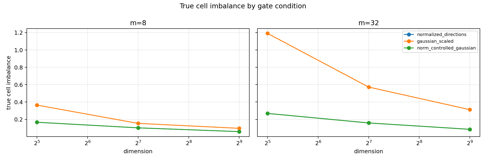
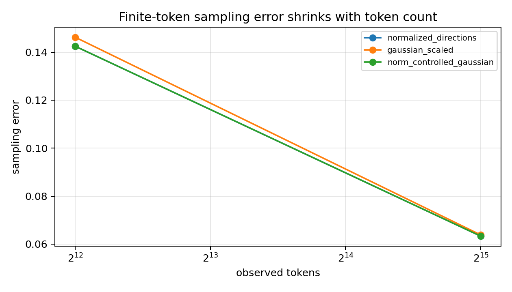

# Meeting Brief: High-Dimensional Gaussian Gate Load Imbalance

## 0. One-Sentence Update

这次工作把我的判断从“标准 Gaussian top-1 gate 的初始负载不均可能只是 token sampling noise 或随机方向 cell imbalance”更新为：在纯 gate-only 高维均匀输入下，Gaussian初始化造成的 row-norm variation 是额外 fixed load floor 的一个可因果隔离的来源。

## 1. Problem

主问题：
如果希望 MoE 的 gate 初始化阶段不要过早制造 expert load imbalance，那么即使 hidden states 在高维空间里近似均匀分布，标准 dot-product top-1 gate 为什么仍然可能把 token 非均匀地分到 experts？

为什么这个问题重要：
早期负载不均会给后续训练动力学提供一个初始偏置。后面如果观察到 trained router collapse 或 expert specialization，需要先排除一个更基础的问题：是不是 gate 初始化本身已经有几何负载不均。

当前子问题：
把高维 gate-only load imbalance 分成三类来源：

1. token sampling variance：有限 token 数带来的观测噪声；
2. normalized random-direction cell imbalance：随机方向形成的真实 top-1 决策区域不均；
3. row-norm variation：Gaussian gate row 的模长差异带来的额外胜率差异。

决策问题：
只移除 row-norm variation，是否会把 standard Gaussian-scaled gate 的 true cell imbalance 降到 normalized-direction baseline 附近？

## 2. Updated Judgment

主要结论：

1. token 数增加确实会降低 sampling error，但不能解释固定 gate 的 true decision-cell floor。
2. normalized random directions 在高维下会变得更均匀，说明“随机方向 cell imbalance”随维度升高会减弱。
3. standard Gaussian-scaled gate 比 normalized directions 多出的 fixed imbalance 主要来自 row-norm variation；本地 norm-control 实验已经把这个项因果隔离出来。

不再安全的说法：

- “高维输入近似均匀，所以随机初始化 top-1 gate 初始负载自然会均匀。”
- “Gaussian gate 的额外 load imbalance 只是有限 token sampling noise。”
- “只看 observed load imbalance 就足够判断 gate 几何是否平衡。”

更准确的说法：

在纯 gate-only、均匀高维输入、随机初始化条件下，observed load imbalance 应该分解为 finite-token sampling error 和 fixed gate-cell geometry；而 standard Gaussian dot-product gate 的 fixed geometry 又包含 direction cell imbalance 和 row-norm variation 两部分。

## 3. Evidence Supporting The Update

### Evidence 1: Row-norm control removes the extra Gaussian fixed floor

What was tested:
对同一组 Gaussian row directions 比较三种 gate：`normalized_directions`、`gaussian_scaled`、`norm_controlled_gaussian`。其中 `norm_controlled_gaussian` 保留方向但把所有 row norm 设成相同值。

Result:
全部 6 个 `(d,m)` 组合中，`gaussian_scaled` 的 true cell imbalance 都高于 `norm_controlled_gaussian`，而 `norm_controlled_gaussian` 与 `normalized_directions` 重合。

Key numbers:

| d | m | gaussian_scaled | norm_controlled | normalized |
|---:|---:|---:|---:|---:|
| 32 | 32 | 1.1910 | 0.2686 | 0.2686 |
| 128 | 32 | 0.5725 | 0.1588 | 0.1588 |
| 512 | 32 | 0.3120 | 0.0854 | 0.0854 |

What this rules out:
它削弱了“Gaussian-scaled 和 normalized-direction 的差异主要来自 direction geometry”的解释，因为方向相同、只去掉 norm variation 后，额外 imbalance 被明显移除。

What this supports:
row-norm variation 是 standard Gaussian dot-product gate 额外 fixed load floor 的 causal contributor。

Figure:



### Evidence 2: Token count separates sampling noise from fixed gate geometry

What was tested:
在同一 gate 下比较不同 observed token count 的 sampling error。

Result:
observed tokens 从 4,096 增加到 32,768 后，sampling error 明显下降。

What this rules out:
它说明有限 token 噪声可以被 token 数压低，不能把高 token 数下仍存在的 floor 解释成 sampling error。

What this supports:
主判断应该看 true cell imbalance，也就是固定 gate 几何本身，而不是只看 finite-token observed load。

Figure:



### Evidence 3: The physical model matches the intervention

What was tested:
把 gate row 写成 $w_e=\rho_e u_e$，score 写成 $z_e=\rho_e u_e^\top x$。实验只改变 $\rho_e$ 是否相同，不改变 $u_e$。

Result:
当 $\rho_e$ 被统一后，top-1 cell imbalance 降到 normalized-direction 水平。

What this rules out:
它避免了一个常见混淆：不是换了一个新的 router 方法，也不是改了训练或数据，只是测试 dot-product score 里的 norm scale term 是否影响 top-1 winning probability。

What this supports:
这个实验不是方法设计，而是 mechanism decomposition：它把 row norm 从 direction geometry 中拆出来。

## 4. Integrated Interpretation

这次结果把问题从“随机 top-1 gate 为什么不平衡”收窄成一个更可操作的分解：

```text
observed load error
= fixed gate-cell imbalance
+ finite-token sampling error

fixed gate-cell imbalance
= normalized direction cell imbalance
+ Gaussian row-norm variation effect
```

对主线的影响：
以后讨论 trained-router load imbalance 或 early routing collapse 前，应该先检查初始化 gate 是否已经包含 row-norm-driven imbalance。否则可能把一个初始化几何偏置误解释成训练后语义分化或数据驱动 specialization。

仍然存在的 rival explanation：
这个结果还没有说明 trained hidden states、attention/residual dynamics、expert updates 或真实文本分布会如何放大或抵消这个初始化偏置。

## 5. Boundary

Can claim:
在纯 gate-only、高维均匀输入、top-1 dot-product routing 的设置下，row-norm variation 是 standard Gaussian-scaled gate 额外 fixed true cell imbalance 的因果来源之一。

Cannot claim:
不能直接声称 trained MoE collapse 来自 row-norm variation；不能声称 semantic specialization 已经被解释；也不能声称已经得到 final router method。

## 6. Next Decision

希望组会确认的决策：
是否把 row-norm variation 作为后续解释 trained-router load imbalance 前的必要 diagnostic baseline。

下一步最小行动：
在真实 hidden-state router audit 里加入 norm-controlled 或 norm-normalized gate baseline，判断 trained setting 中的 early load concentration 有多少仍能由初始化 row-norm effect 解释。

## 7. Source Map

Anchor:
`Projects/from-attention-to-search/main/problem_anchors/06_geometry_proxy_preservation/06_03_high_dimensional_gaussian_gate_norm_variation_anchor.md`

Protocol:
`Projects/from-attention-to-search/main/experiments/A06_03_high_dimensional_gaussian_gate_norm_variation/protocol.md`

Summary:
`Projects/from-attention-to-search/main/experiments/A06_03_high_dimensional_gaussian_gate_norm_variation/summary.md`

Detailed:
`Projects/from-attention-to-search/main/experiments/A06_03_high_dimensional_gaussian_gate_norm_variation/detailed.md`

Figures copied for meeting:
`figures/true_cell_imbalance_by_condition.png`
`figures/sampling_error_by_tokens.png`
