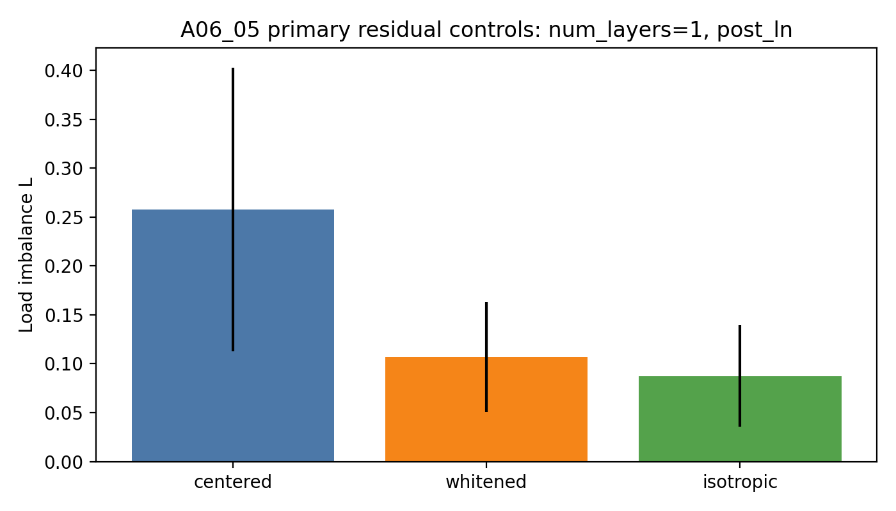
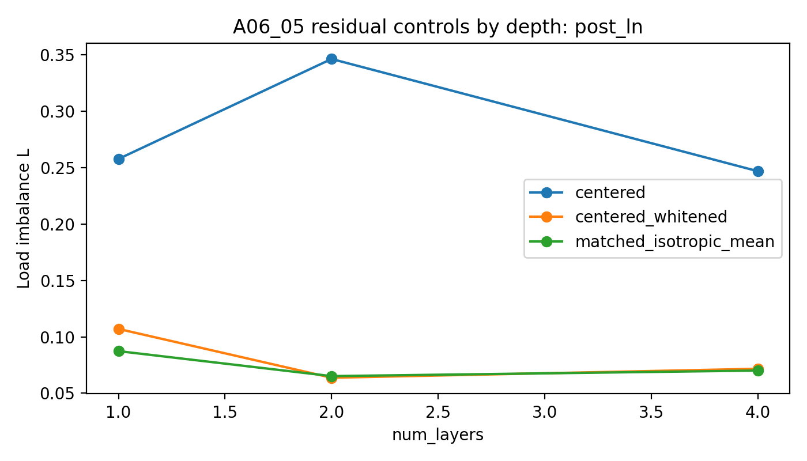
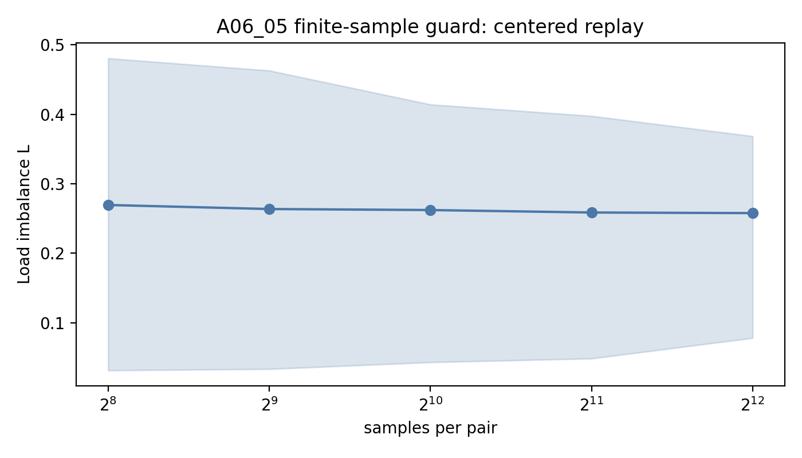
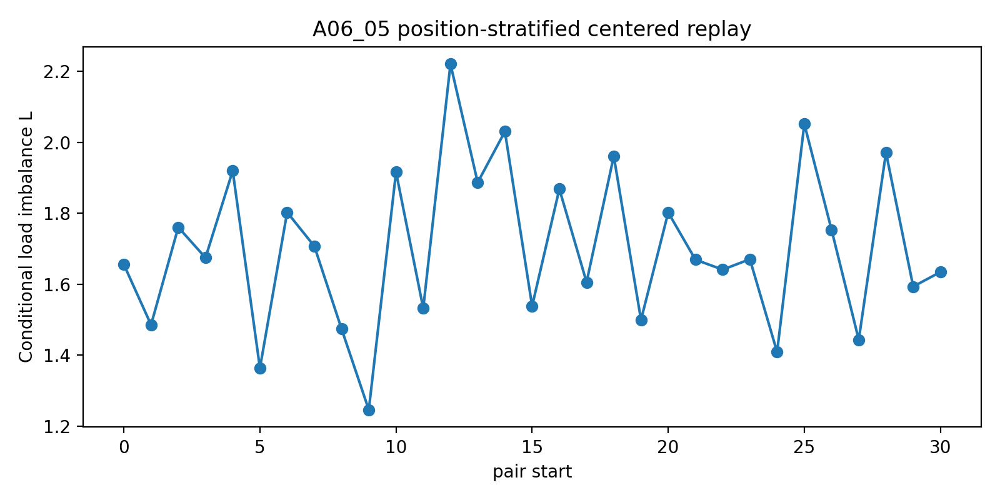

# Meeting Brief: A06_05 Common-Centered Residual Geometry

Use this as a short advisor / group-meeting reading surface. It is not a replacement for the project `summary.md` or `detailed.md`.

## Problem Being Solved

主问题：

4 个 `(slot,target)` pairs 严格均匀采样时，初始化 dot-product top-1 gate 为什么仍然会有 expert load imbalance？

上一轮 A06_04 的结论：

hidden common component 是 synthetic initialized hidden-state setting 中最强 tested source。也就是说，把 hidden state 写成：

$$
h_i=c+r_i
$$

以后，公共成分 $c$ 给所有 token 带来的 shared bias 是 raw load imbalance 的主因。

本轮 A06_05 的问题：

去掉 $c$ 后，common-centered residual replay 仍有负载不均衡。A06_05 诊断这个 residual load 是来自：

- residual covariance anisotropy，也就是去均值 hidden residual 的协方差方向不均匀；
- router-cell geometry，也就是同一组 router rows 在各向同性输入上仍有非均匀 cell；
- context / position structure，也就是位置或上下文改变 residual geometry；
- finite-sample noise，也就是样本有限造成的测量噪声。

Primary metric:

负载不均衡 $L=m\max_e |p_e-1/m|$。这里 $p_e$ 是 expert $e$ 的 top-1 load fraction，$m=4$。$L$ 越低，expert load 越接近均匀。

## Updated Judgment

One-sentence update:

**A06_05 支持 residual covariance / structured residual geometry 是 common-centering 后剩余 load 的主要来源；finite-sample noise 不是主解释。**

What changed from A06_04:

```text
A06_04:
raw hidden-state imbalance mainly comes from hidden common component.

A06_05:
after removing the common component, the remaining load is still structured;
whitening and matched isotropic controls sharply reduce it.
```

Decision implication:

下一步不应直接宣称 common-centering 已解决初始化问题。A06_06 应该作为 oracle positive control，测试 feature-level initialization 能否压过 residual geometry。

## Setup

Data / model:

- synthetic sequence length 32；
- 4 个 `(slot,target)` pairs，4 个 experts；
- 每个 pair 每个 seed/depth 有 4096 samples；
- pair distribution 严格均匀；
- pair start 随机；
- background tokens 与 pair id 独立；
- route position 是 slot 的最后一个位置；
- initialized Transformer-MoE；no training。

Full run:

- seeds: `20260521..20260528`；
- depths: `num_layers=1,2,4`；
- readouts: `post_ln`, `pre_ln_replay`；
- controls: centered replay, whitening replay, matched isotropic replay, sample-count guard, position / context stratification。

## Key Evidence

### Evidence 1: Whitening sharply reduces residual load

What was tested:

在 A06_04 同一个 hidden-state replay surface 上，先做 common-centering，再比较：

| Condition | Concrete meaning |
| --- | --- |
| `centered_replay` | replay $w_e^\top(h_i-c)$ |
| `centered_whitened_replay` | whiten $r_i=h_i-c$ by empirical covariance, then replay |
| `matched_isotropic_replay` | same router rows on isotropic samples matched by dimension, count, and residual norm scale |

Primary result (`num_layers=1`, `post_ln`):

| Condition | Mean $L$ | Interpretation |
| --- | ---: | --- |
| `centered_replay` | 0.2577 | residual load to explain |
| `centered_whitened_replay` | 0.1071 | covariance control removes most of the load |
| `matched_isotropic_replay` | 0.0874 | router-cell / sampling floor is lower than real residual |

Interpretation:

如果 residual load 只是 router-cell geometry 或有限样本噪声，whitening 不应该把 $L$ 从 0.2577 降到接近 isotropic floor。这个结果支持 residual covariance / real residual geometry 是主来源。

Figure:



### Evidence 2: The effect is stable across depth and readout

What was tested:

把同样的 residual controls 放到 `num_layers=1,2,4`，并检查 `post_ln` 和 `pre_ln_replay`。

Result:

| Depth | Readout | Centered | Whitened | Isotropic |
| ---: | --- | ---: | ---: | ---: |
| 1 | `post_ln` | 0.2577 | 0.1071 | 0.0874 |
| 1 | `pre_ln_replay` | 0.2491 | 0.1104 | 0.0878 |
| 2 | `post_ln` | 0.3463 | 0.0638 | 0.0652 |
| 2 | `pre_ln_replay` | 0.3440 | 0.0571 | 0.0660 |
| 4 | `post_ln` | 0.2469 | 0.0717 | 0.0702 |
| 4 | `pre_ln_replay` | 0.2480 | 0.0723 | 0.0703 |

Interpretation:

这个 pattern 不是单一 depth 或 LayerNorm readout 的偶然现象。A06_06 必须把 residual geometry 当成真实边界，而不是把它忽略为 A06_04 的尾部噪声。

Figure:



### Evidence 3: Finite-sample noise is weakened

What was tested:

对 centered residual assignments 做 balanced sample-count guard，从每 pair 256 samples 增加到 4096 samples。

Primary result (`num_layers=1`, `post_ln`):

| Samples per pair | Mean $L$ |
| ---: | ---: |
| 256 | 0.2694 |
| 512 | 0.2636 |
| 1024 | 0.2621 |
| 2048 | 0.2586 |
| 4096 | 0.2577 |

Interpretation:

如果主要是有限样本噪声，样本数增加时 $L$ 应明显向 0 收缩。实际基本稳定，所以 finite-sample noise 不是主解释。

Figure:



### Evidence 4: Position-conditioned residual structure is large

What was tested:

按 pair start position 分层读取 centered residual load。

Result:

在 `num_layers=1`, `post_ln` 下，position-conditioned $L$ 的均值约为 `1.70`，远高于 aggregate centered $L=0.2577`。

Interpretation:

residual hidden distribution 有强 position-conditioned structure。这个结果不证明 position 单独导致 aggregate imbalance，但它说明 label-free 方法如果只看 global common component，可能会漏掉很强的上下文结构。

Figure:



## Integrated Interpretation

当前三段逻辑是：

```text
06_03:
pure gate-only high-dimensional setup 中，router row norm variation 可以制造 load floor。

06_04:
一旦进入 initialized transformer hidden states，hidden common component 是 raw imbalance 的主因。

06_05:
去掉 hidden common component 后，剩余 load 主要来自 residual covariance / structured residual geometry，而不是 finite-sample noise。
```

所以现在更准确的 mainline 判断是：

```text
uniform symbolic feature distribution does not imply uniform initialized routing;
the hidden-state geometry creates both a common bias and a residual anisotropic structure.
```

## Can Claim / Cannot Claim

Can claim:

- A06_05 在 initialized synthetic hidden-state replay 中支持 residual covariance / structured residual geometry 是 common-centered residual load 的主要 tested source。
- finite-sample noise 在当前样本规模下不是主解释。
- matched isotropic replay 给出更低但非零的 router-cell / sampling floor。

Cannot claim:

- 这还不是 trained collapse 的解释。
- 这还不是 real-text / DCLM 结论。
- whitening 不是 final router method。
- position-conditioned high load 不等于 position 单独因果解释 aggregate imbalance。
- 这还没有证明 semantic expert specialization 或 expert utility。

## Meeting Decision Needed

Recommended next decision:

Proceed with A06_06 as an oracle feature-level initialization positive control.

The concrete question for A06_06:

在 A06_05 确认 residual geometry 仍然很强的情况下，如果给 router 一个 feature-level oracle initialization，它能不能稳定降低 step-0 load imbalance / improve route-feature structure？

Decision rule:

- If A06_06 passes, A06_07 can ask whether a label-free common/residual control can approximate the oracle.
- If A06_06 fails, label-free method construction should be weakened or reframed as a failure decomposition.

## Source Map

Project anchor:
`Projects/from-attention-to-search/main/problem_anchors/06_geometry_proxy_preservation/06_05_common_centered_residual_geometry_diagnostic_anchor.md`

Protocol:
`Projects/from-attention-to-search/main/experiments/A06/A06_05_common_centered_residual_geometry_diagnostic/protocol.md`

Summary:
`Projects/from-attention-to-search/main/experiments/A06/A06_05_common_centered_residual_geometry_diagnostic/summary.md`

Detailed:
`Projects/from-attention-to-search/main/experiments/A06/A06_05_common_centered_residual_geometry_diagnostic/detailed.md`

Code workspace:
`Projects/from-attention-to-search/XingyuD/Attention_Search_Experiments/active/synthetic_data_understanding/`

Runner:
`scripts/run_a06_05_common_centered_residual_geometry_diagnostic.py`

Config:
`configs/a06_05_common_centered_residual_geometry_diagnostic.json`

Raw result dir:
`results/a06_05_common_centered_residual_geometry_diagnostic/a06_05_full_20260621_1/`
