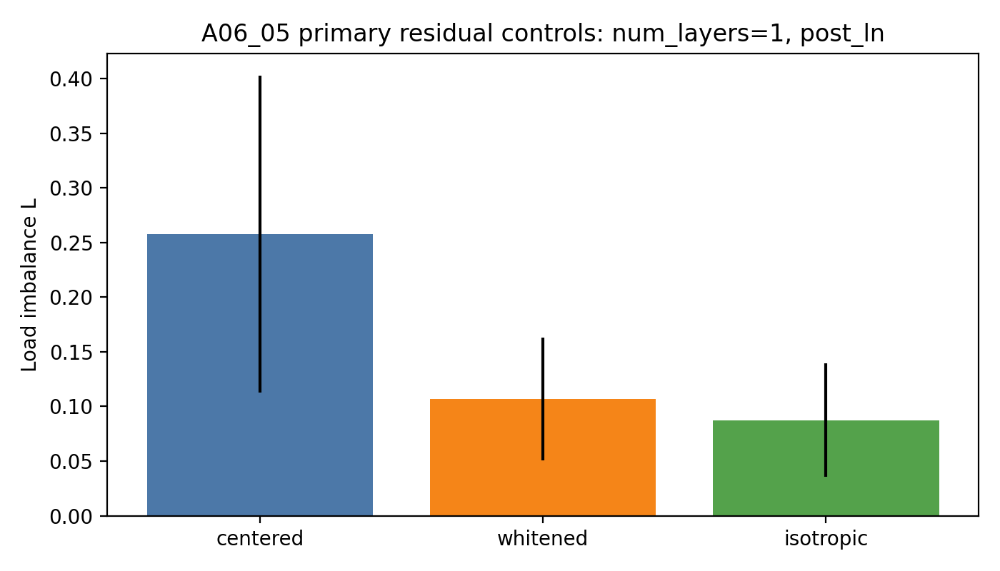
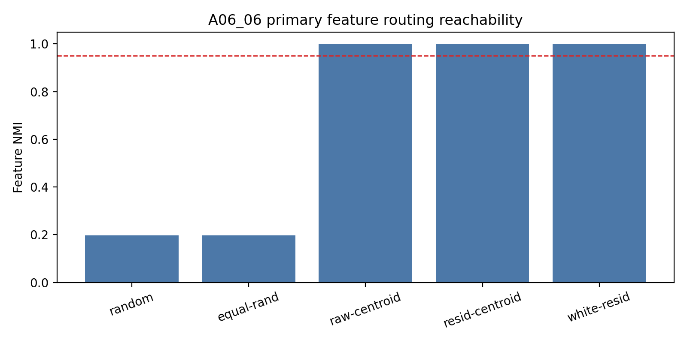
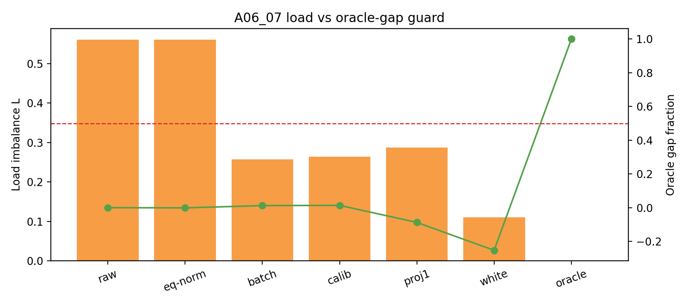

# Meeting Brief: A06_05 to A06_07 Initialization Geometry Sequence

## Shared Problem

The sequence asks why uniform symbolic features still fail to produce clean feature-level MoE routing at initialization, and whether the mechanism diagnosis can become a method.

The three-anchor chain:

```text
A06_05:
After A06_04 common-centering, what residual geometry remains?

A06_06:
If oracle feature labels are allowed, is the target feature partition reachable?

A06_07:
Can simple label-free common / residual controls approximate that oracle partition?
```

## Higher-Level Judgment Update

**The feature partition is reachable, but simple global label-free common/residual controls are not enough.**

The mechanism story is now sharper:

```text
1. Hidden common component creates major random-init load bias.
2. Residual covariance / structured residual geometry remains after common-centering.
3. Oracle feature centroids can perfectly route features.
4. Label-free global common/residual controls mostly improve load, not feature NMI.
```

## Evidence Module 1: A06_05 Residual Geometry

Question:
After common-centering, is residual load just noise or a real geometric source?

Primary evidence (`num_layers=1`, `post_ln`):

| Condition | Load $L$ |
| --- | ---: |
| centered residual replay | 0.2577 |
| centered + whitened replay | 0.1071 |
| matched isotropic replay | 0.0874 |

Sample-count guard:
as samples per pair increase from 256 to 4096, $L$ stays near `0.2694 -> 0.2577`.

Judgment:
Residual covariance / structured residual geometry is real; finite-sample noise is not the main explanation.

Figure:



Source:
`Projects/from-attention-to-search/main/experiments/A06_05_common_centered_residual_geometry_diagnostic/summary.md`

## Evidence Module 2: A06_06 Oracle Reachability

Question:
If feature labels are allowed for centroid construction, is clean routing reachable?

Primary evidence (`num_layers=1`, `post_ln`):

| Condition | NMI | Load $L$ | Margin p05 |
| --- | ---: | ---: | ---: |
| random Gaussian | 0.1978 | 0.5610 | 0.0289 |
| raw feature centroid | 1.0000 | 0.0000 | 3.2198 |
| common-centered centroid | 1.0000 | 0.0000 | 3.8216 |
| whitened residual centroid | 1.0000 | 0.0000 | 1.2040 |

Judgment:
The target feature partition is geometrically reachable at initialization under oracle labels.

Boundary:
Raw centroid also succeeds, so common-centering is not necessary for oracle reachability in this simplified setting.

Figure:



Source:
`Projects/from-attention-to-search/main/experiments/A06_06_feature_level_initialization_positive_control/summary.md`

## Evidence Module 3: A06_07 Label-Free Control

Question:
Can label-free common/residual control recover the oracle partition from random router rows?

Full-sweep mean:

| Condition | NMI | Load $L$ |
| --- | ---: | ---: |
| baseline raw | 0.2302 | 0.6867 |
| calibration mean | 0.2353 | 0.2837 |
| heldout batch mean | 0.2350 | 0.2828 |
| whitened residual | 0.0150 | 0.0860 |
| oracle centroid | 1.0000 | 0.0000 |

Pass count:
`0/336` label-free rows pass the step-0 gate.

Judgment:
Simple label-free global common/residual controls are load controls, not feature-specialization methods.

Figure:



Source:
`Projects/from-attention-to-search/main/experiments/A06_07_label_free_common_residual_control_router/summary.md`

## Cross-Result Interpretation

A06_05 and A06_07 together prevent a wrong method conclusion:

```text
common/residual controls can reduce load,
but reducing load does not imply recovering feature-level routing.
```

A06_06 prevents an overly negative conclusion:

```text
the feature partition is not impossible;
the tested label-free global controls are insufficient.
```

## Can Claim

- Uniform pair frequency does not imply uniform or feature-aligned initialized routing.
- Hidden common component and residual geometry are both real routing-bias sources.
- Oracle feature-centroid initialization can achieve perfect held-out feature routing in this synthetic hidden-state setting.
- Simple global label-free common-centering / projection / whitening should not be promoted as the next method.

## Cannot Claim

- Real DCLM behavior has been tested.
- Training stability has been solved.
- Expert utility or semantic specialization has been shown.
- All label-free methods fail.
- Load balance is enough for specialization.

## Next Decision

Recommended next method direction:

1. Feature discovery before routing:
   label-free clustering, dictionary learning, or contrastive feature estimation on residual hidden states.

2. Anti-lockin after a good partition:
   use oracle / pseudo-oracle initialization to test when top-1 training destroys a known-good partition.

3. Real DCLM gate:
   only after defining a real-data feature/proxy metric. A DCLM run should not use load as the primary success metric.

## Source Map

A06_05:
`Projects/from-attention-to-search/main/experiments/A06_05_common_centered_residual_geometry_diagnostic/summary.md`

A06_06:
`Projects/from-attention-to-search/main/experiments/A06_06_feature_level_initialization_positive_control/summary.md`

A06_07:
`Projects/from-attention-to-search/main/experiments/A06_07_label_free_common_residual_control_router/summary.md`

Anchors:

- `Projects/from-attention-to-search/main/problem_anchors/06_geometry_proxy_preservation/06_05_common_centered_residual_geometry_diagnostic_anchor.md`
- `Projects/from-attention-to-search/main/problem_anchors/06_geometry_proxy_preservation/06_06_feature_level_initialization_positive_control_anchor.md`
- `Projects/from-attention-to-search/main/problem_anchors/06_geometry_proxy_preservation/06_07_label_free_common_residual_control_router_anchor.md`
