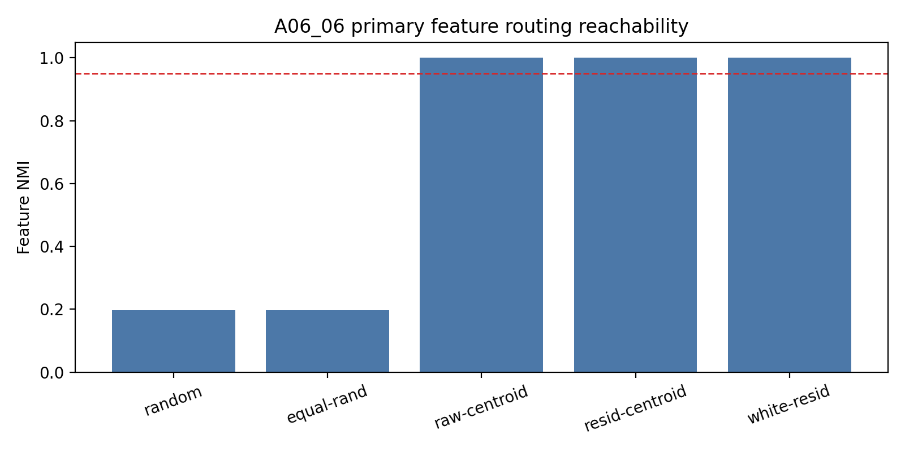
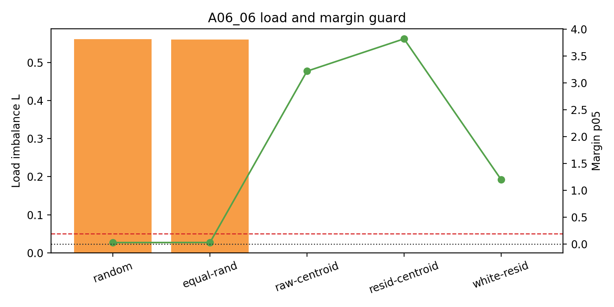
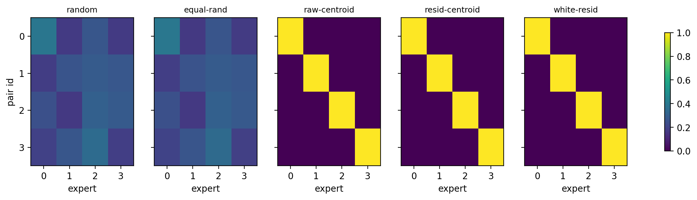

# Meeting Brief: A06_06 Oracle Feature-Level Initialization

## Problem

A06_05 showed that common-centering leaves real residual geometry. A06_06 asks a different question:

在 synthetic initialized hidden states 中，如果允许使用 oracle feature labels 构造 router centers，feature-level routing specialization 是否可达？

Feature identity:
the four uniform `(slot,target)` pair ids.

Primary metric:
feature normalized mutual information (`feature_NMI`) between held-out `pair_id` and routed expert, read with load imbalance $L$ and margin.

Pass threshold:
`feature_NMI >= 0.95`, `L <= 0.05`, and `margin_p05 > 0`.

## Updated Judgment

**The positive control succeeds.** Feature-level routing is reachable at initialization under oracle centroid construction.

Important nuance:
raw centroids also succeed, so this run does not prove common-centering is necessary for oracle reachability. It proves the target partition exists.

## Setup

- Same synthetic hidden-state replay surface as A06_04/A06_05.
- 4 uniform pair features, 4 experts.
- 4096 samples per pair.
- Held-out split: 2048 calibration + 2048 evaluation samples per pair.
- Seeds: `20260521..20260528`.
- Depths: `1,2,4`.
- Readouts: `post_ln`, `pre_ln_replay`.
- No training; step-0 replay only.

## Key Evidence

### Evidence 1: Oracle centroid conditions reach perfect NMI

Primary readout (`num_layers=1`, `post_ln`):

| Condition | Feature NMI | Load $L$ | Margin p05 |
| --- | ---: | ---: | ---: |
| random Gaussian | 0.1978 | 0.5610 | 0.0289 |
| equal-norm random | 0.1964 | 0.5610 | 0.0303 |
| raw feature centroid | 1.0000 | 0.0000 | 3.2198 |
| common-centered feature centroid | 1.0000 | 0.0000 | 3.8216 |
| whitened residual centroid | 1.0000 | 0.0000 | 1.2040 |

Figure:



### Evidence 2: The pass is stable across the full sweep

Across all 48 seed-depth-readout cells:

| Oracle condition | NMI min | Max $L$ | Min margin p05 | Pass all cells |
| --- | ---: | ---: | ---: | --- |
| raw centroid | 1.0000 | 0.0000 | 2.4437 | yes |
| common-centered centroid | 1.0000 | 0.0000 | 3.2882 | yes |
| whitened residual centroid | 1.0000 | 0.0000 | 1.1283 | yes |

Random baselines fail:
mean NMI is about `0.23`, mean $L$ is about `0.68`.

Figure:



### Evidence 3: Heatmaps show true one-feature-one-expert routing

The centroid conditions are not only high-NMI numerically; their route heatmaps are one-hot feature-to-expert maps.

Figure:



## Interpretation

What A06_06 adds after A06_05:

```text
A06_05:
residual geometry remains a real obstacle for random initialized routing.

A06_06:
despite that obstacle, the feature partition is geometrically reachable
if oracle feature labels are allowed.
```

Therefore the next uncertainty is not whether the target partition exists. It is whether a label-free method can recover it.

## Can Claim / Cannot Claim

Can claim:

- Oracle feature-centroid initialization can produce perfect held-out feature routing at step 0.
- The result is load-balanced and has positive margins.
- Random and equal-norm random routers fail in the same setup.

Cannot claim:

- label-free initialization;
- training stability;
- expert utility;
- real-text or DCLM generalization;
- common-centering is necessary for oracle reachability.

## Meeting Decision Needed

Proceed to A06_07.

A06_07 should be framed as:

Can label-free common/residual-control initialization approximate the A06_06 oracle partition without using `pair_id` labels, while respecting A06_05's residual-geometry boundary?

## Source Map

Anchor:
`Projects/from-attention-to-search/main/problem_anchors/06_geometry_proxy_preservation/06_06_feature_level_initialization_positive_control_anchor.md`

Protocol:
`Projects/from-attention-to-search/main/experiments/A06_06_feature_level_initialization_positive_control/protocol.md`

Summary:
`Projects/from-attention-to-search/main/experiments/A06_06_feature_level_initialization_positive_control/summary.md`

Detailed:
`Projects/from-attention-to-search/main/experiments/A06_06_feature_level_initialization_positive_control/detailed.md`

Runner:
`Projects/from-attention-to-search/XingyuD/Attention_Search_Experiments/active/synthetic_data_understanding/scripts/run_a06_06_feature_level_initialization_positive_control.py`

Raw result dir:
`results/a06_06_feature_level_initialization_positive_control/a06_06_full_20260621_1/`
