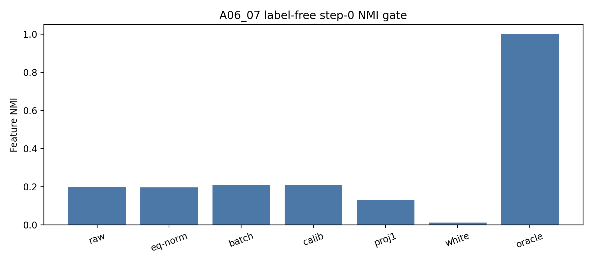
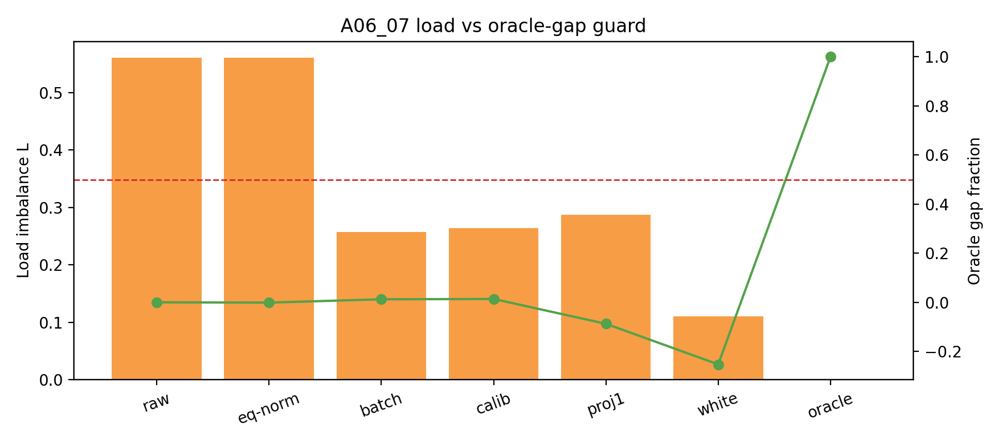

# Meeting Brief: A06_07 Label-Free Common / Residual Control

## Problem

A06_06 proved that the feature partition is reachable with oracle feature centroids. A06_07 asks:

不用 `pair_id` labels，只做 label-free common / residual router-input control，能否从 random router rows 接近 oracle feature partition？

Primary metric:
held-out feature_NMI between `pair_id` and routed expert.

Pass gate:
label-free condition must improve NMI by at least `+0.25` over baseline and close at least `50%` of oracle gap.

## Updated Judgment

**Simple label-free common / residual controls fail as method candidates.**

They improve load strongly, but do not recover feature specialization.

## Setup

- Same A06 synthetic hidden-state replay surface.
- 4 uniform pair features, 4 experts.
- 8 seeds, depths `1,2,4`, readouts `post_ln`, `pre_ln_replay`.
- Step-0 replay only, no training.
- Oracle feature centroid included only as a non-label-free upper bound.

## Key Evidence

Full-sweep mean:

| Condition | NMI | NMI delta | Oracle gap | Load $L$ |
| --- | ---: | ---: | ---: | ---: |
| baseline raw | 0.2302 | 0.0000 | 0.0000 | 0.6867 |
| calibration mean | 0.2353 | 0.0051 | 0.0053 | 0.2837 |
| heldout batch mean | 0.2350 | 0.0048 | 0.0048 | 0.2828 |
| projection top-1 | 0.1628 | -0.0674 | -0.0937 | 0.2881 |
| whitened residual | 0.0150 | -0.2152 | -0.2949 | 0.0860 |
| oracle centroid | 1.0000 | 0.7698 | 1.0000 | 0.0000 |

Pass count:
`0/336` label-free rows pass.

Figure:



## Interpretation

Common-centering solves part of the load problem identified in A06_04/A06_05, but it does not create feature-aligned router directions.

The clearest warning is whitening:

```text
whitened residual router:
load L = 0.0860, but NMI = 0.0150
```

So load balance can actively mislead the specialization claim.

Figure:



## Can Claim / Cannot Claim

Can claim:

- Tested global label-free common/residual controls fail the step-0 specialization gate.
- Load-only improvement is not enough.
- Oracle target remains reachable, so the failure is method-specific.

Cannot claim:

- all label-free methods fail;
- training anti-lockin cannot help;
- DCLM / real-model behavior is known;
- whitening is always bad.

## Meeting Decision Needed

Do not promote simple global common-centering, top-PC removal, or whitening as the method.

Next method class should be:

- label-free feature discovery, such as clustering / dictionary / contrastive feature estimation; or
- anti-lockin training initialized from an oracle or pseudo-oracle partition.

For real DCLM:
do not use load balance as the main success metric. A real-model test must include a feature/proxy-specialization metric or a clear route-feature audit.

## Source Map

Anchor:
`Projects/from-attention-to-search/main/problem_anchors/06_geometry_proxy_preservation/06_07_label_free_common_residual_control_router_anchor.md`

Protocol:
`Projects/from-attention-to-search/main/experiments/A06_07_label_free_common_residual_control_router/protocol.md`

Summary:
`Projects/from-attention-to-search/main/experiments/A06_07_label_free_common_residual_control_router/summary.md`

Detailed:
`Projects/from-attention-to-search/main/experiments/A06_07_label_free_common_residual_control_router/detailed.md`

Runner:
`Projects/from-attention-to-search/XingyuD/Attention_Search_Experiments/active/synthetic_data_understanding/scripts/run_a06_07_label_free_common_residual_control_router.py`

Raw result dir:
`results/a06_07_label_free_common_residual_control_router/a06_07_full_20260621_1/`
