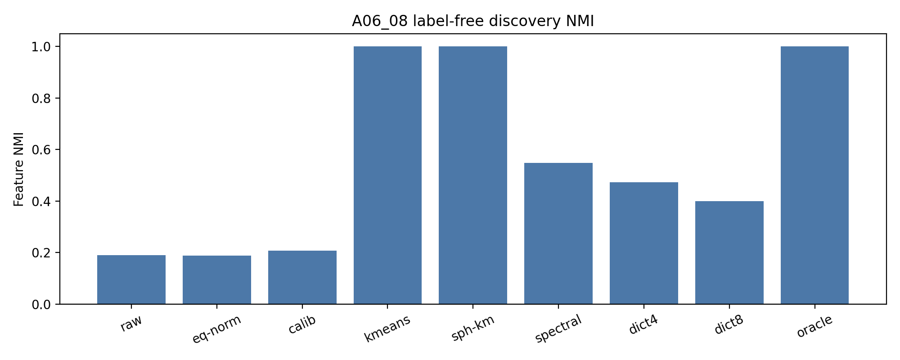
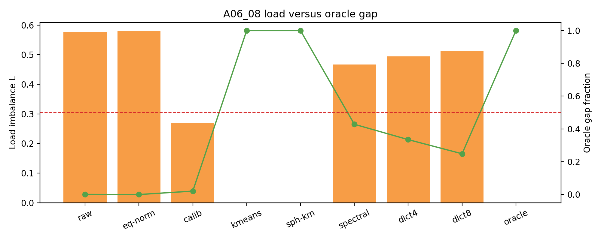
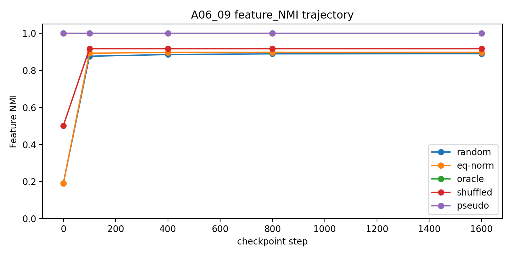
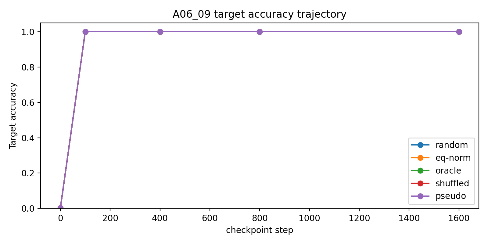
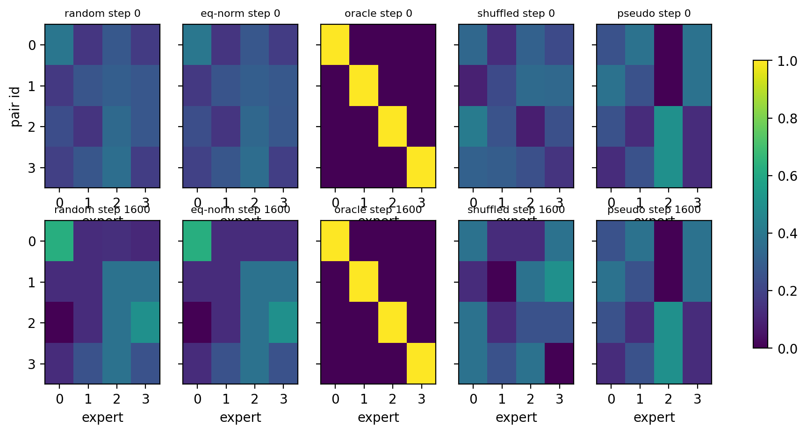

# Meeting Brief: A06_08 to A06_09 Discovery And Training-Basin Update

## One-Sentence Conclusion

现在主线判断是：在严格均匀的 synthetic feature 设置里，我们已经从“为什么随机 router 不自然 specialization”推进到“无标签 residual clustering 可以找到 feature partition，并且这个 partition 作为初始化后能在当前训练目标下保持住”。因此下一步应该继续削弱 feature proxy 和训练假设，而不是立刻把主线转成 anti-lockin。

## Terms First

**Feature 是什么？**

这里的 feature 不是自然语言语义，而是 4 个人工构造的 `(slot_token, target_token)` pair。每个样本有一个真实 `pair_id`，一共有 4 类。

**Feature-level specialization 是什么？**

指同一种 `pair_id` 被稳定分到同一个 expert，不同 `pair_id` 分到不同 expert。它不是“每个 expert 收到一样多样本”。

**Load 是什么？**

Load 是每个 expert 收到多少样本。4 个 expert 完全均匀时，每个 expert 收到 25%。本线用

$$
L = m \max_e |p_e - 1/m|
$$

衡量负载不均匀。$L=0$ 表示完全均匀。

**Feature NMI 是什么？**

Feature NMI 衡量 router 分出来的 expert id 和真实 `pair_id` 是否对齐。它回答“有没有 feature specialization”。所以本线的核心判断不能只看 load，也不能只看 accuracy。

**Residual clustering 是什么？**

先从 hidden state 中去掉共同平均方向，再在剩下的 residual hidden states 上做无标签聚类。直观说，就是不告诉模型真实 `pair_id`，只看 hidden states 自己能不能分成 4 个稳定簇。

**Training basin 是什么？**

如果一个初始化已经把 feature 分好了，训练之后这个分法仍然不变，就说明这个初始化落在了一个稳定区域。这里把这个稳定区域叫 training basin。

## Whole Decision Line

父问题：

```text
严格均匀的 feature 数据下，随机 dot-product top-1 MoE 为什么不会自然形成 feature-level specialization？
```

研究线：

```text
A06_03:
先在最干净的高维 Gaussian gate-only 世界里分离 row-norm bias。

A06_04:
进入 initialized hidden states 后发现，主导偏置不是 row norm，而是 hidden common component。

A06_05:
去掉 common 后，剩余 load 不是有限样本噪声，而是 residual geometry。

A06_06:
如果给 oracle feature labels，feature partition 可以完美读出来。

A06_07:
只做全局去均值、投影、白化，可以改善 load，但不能恢复 feature_NMI。

A06_08:
更强的无标签 discovery，特别是 residual k-means，可以恢复 feature partition。

A06_09:
把 A06_08 找到的 pseudo center 用作初始化，训练后 partition 保持住。
```

这条线到现在裁掉了两个错误方向：

1. 只修 load balance 不够，因为 load balance 不等于 feature specialization。
2. 一开始就做 anti-lockin 还太早，因为在当前合成训练面上，好初始化没有 collapse。

## What A06_08 Adds

问题：

不用真实 `pair_id` label，只看 route-position residual hidden states，能不能找到 pseudo-feature centers？

设置简述：

- 4 个严格均匀 feature pair；
- `slot_token_len=4`；
- route 位置是 slot span 的最后一个 token；
- calibration / evaluation split；
- calibration 用来估计聚类中心，evaluation 只用来评估；
- 方法族包括 clustering、spectral、dictionary；
- 主要指标是 held-out `feature_NMI`。

结果：

| Method | Full-grid pass | Mean feature NMI | Mean load $L$ |
| --- | ---: | ---: | ---: |
| residual k-means K4 | 48/48 | 1.0000 | 0.0000 |
| spherical residual k-means K4 | 48/48 | 1.0000 | 0.0000 |
| spectral residual K4 | 13/48 | 0.5763 | 0.4138 |
| dictionary residual K4 | 8/48 | 0.5503 | 0.4358 |

判断：

无标签 feature discovery 在这个合成 hidden-state 表面上成立，但成立的是 residual clustering 家族，不是所有无标签方法。Spectral 和 dictionary 是支线证据，不应写成主线方法。

图：



这张图回答：
不同无标签方法是否真的提高 feature_NMI。

读法：
越接近 1，越接近 oracle feature partition。

结论：
k-means 和 spherical k-means 达到 oracle 水平。

图：



这张图回答：
方法是不是只是改善 load，而没有恢复 feature partition。

结论：
calibration mean 能改善 load 但几乎不关掉 oracle gap；k-means 同时关掉 NMI gap 和 load gap。

## What A06_09 Adds

问题：

如果 step 0 已经有 feature-aligned routing，普通 top-1 MoE 训练会不会把它破坏？

设置简述：

- 继承 A06_08 的 `slot_token_len=4`；
- route 位置仍然是最后一个 slot token；
- 训练目标是 route-position target prediction，也就是从最后一个 slot token 预测紧跟的 `TARGET_s`；
- 8 个 seeds；
- depths `{1,2,4}`;
- conditions 包括 random、equal-norm random、oracle centroid、label-shuffled guard、A06_08 pseudo center；
- A06_08 pseudo method 选中 `route_kmeans_residual_K4`。

为什么不用完整 next-token loss 做主指标：

背景 token 是随机采样的，本来就不可学习。完整 next-token loss 会把问题变成“预测随机背景 token”，不是本 anchor 要问的“feature partition 会不会被训练保持”。

结果：

| Condition | Step-0 NMI | Final NMI | Target acc. | Load $L$ | Supported cells |
| --- | ---: | ---: | ---: | ---: | ---: |
| A06_08 pseudo center | 1.0000 | 1.0000 | 1.0000 | 0.0000 | 24/24 |
| oracle centroid | 1.0000 | 1.0000 | 1.0000 | 0.0000 | 24/24 |
| random Gaussian | 0.2399 | 0.8100 | 1.0000 | 1.1277 | 0/24 |
| equal-norm random | 0.2394 | 0.8027 | 1.0000 | 1.1667 | 0/24 |
| label-shuffled centroid guard | 0.4969 | 0.8409 | 1.0000 | 1.0000 | 0/24 |

判断：

oracle 和 A06_08 pseudo init 都进入了稳定 basin：训练后 `feature_NMI=1.0`，accuracy `1.0`，load $L=0.0$。随机初始化也能学会 target，但路由结构不干净，所以不能用 accuracy 替代 specialization。

图：



这张图回答：
feature partition 是否从 step 0 保持到训练结束。

结论：
oracle 和 A06_08 pseudo center 从头到尾保持 `feature_NMI=1.0`。

图：



这张图回答：
高 NMI 是否以牺牲任务学习为代价。

结论：
不是。所有条件都能到 accuracy `1.0`，所以 accuracy 不是决定指标。

图：



这张图回答：
是不是一个 feature 对一个 expert，而不是多个 feature 混到一起。

结论：
oracle 和 pseudo init 保持清晰的一对一路由。

## Research Lead Judgment

已经知道：

1. Uniform feature frequency 不保证 uniform routing，更不保证 feature specialization。
2. Hidden common component 是 initialized hidden-state router bias 的主要来源之一。
3. Common-centering 后 residual geometry 仍然有结构。
4. Oracle feature partition 可达。
5. 简单全局无标签控制只能修 load，不能恢复 feature_NMI。
6. Residual k-means 可以无标签恢复 pseudo-feature centers。
7. 在当前 route-position target 训练中，oracle 和 pseudo-feature 初始化都能保持 partition。

还不知道：

1. 更弱 feature proxy 下，residual clustering 是否仍然能找到有意义的 feature。
2. 非均匀、混合、噪声 feature setting 下，pseudo center 是否稳定。
3. 更接近真实语言建模的目标下，训练是否仍然保持 partition。
4. 真实 DCLM 中 feature 应该如何定义和评估。
5. 这个 routing specialization 是否带来 expert function 或下游 utility。

## Claim Boundary

可以说：

- 在当前 synthetic uniform `slot_token_len=4` 设置下，label-free residual clustering 可以恢复 feature partition。
- A06_08 pseudo centers 可以作为 router 初始化进入稳定 training basin。
- 当前证据支持继续走“feature discovery before routing”的路线。

不能说：

- 真实 DCLM 已经成立。
- semantic feature 已经发现。
- 完整 next-token training 已经稳定。
- anti-lockin 已经解决。
- 所有 label-free 方法都有效。
- load balance 可以替代 feature_NMI。

## Next Decision

最自然的下一轮不是继续只修 load，也不是立刻主攻 anti-lockin。

下一轮应该选择一个受控假设来削弱：

1. 削弱 feature proxy：
   从干净 pair feature 转向更弱、更噪声的 proxy feature。

2. 削弱数据分布：
   从严格均匀 feature 转向非均匀、混合 feature 或更长 slot/context。

3. 削弱训练目标：
   从 route-position target prediction 转向更接近完整 next-token training 的目标，但必须避免随机背景 token 把指标污染。

4. 准备 DCLM 前置定义：
   先定义真实数据上的 feature/proxy specialization metric，不能只看 load。

当前建议：

先继续初始化路线，做更弱 feature proxy 或更真实 objective 的 bridge experiment。Anti-lockin 作为备用分支保留：只有当一个已知好的 partition 在更难训练设置下 collapse，才把 anti-lockin 提升为主线。

## Source Map

A06_08 anchor:
`Projects/from-attention-to-search/main/problem_anchors/06_geometry_proxy_preservation/06_08_label_free_feature_discovery_initialization_anchor.md`

A06_08 protocol:
`Projects/from-attention-to-search/main/experiments/A06_08_label_free_feature_discovery_initialization/protocol.md`

A06_08 summary:
`Projects/from-attention-to-search/main/experiments/A06_08_label_free_feature_discovery_initialization/summary.md`

A06_08 detailed:
`Projects/from-attention-to-search/main/experiments/A06_08_label_free_feature_discovery_initialization/detailed.md`

A06_09 anchor:
`Projects/from-attention-to-search/main/problem_anchors/06_geometry_proxy_preservation/06_09_training_basin_preservation_anchor.md`

A06_09 protocol:
`Projects/from-attention-to-search/main/experiments/A06_09_training_basin_preservation/protocol.md`

A06_09 summary:
`Projects/from-attention-to-search/main/experiments/A06_09_training_basin_preservation/summary.md`

A06_09 detailed:
`Projects/from-attention-to-search/main/experiments/A06_09_training_basin_preservation/detailed.md`

ACP job:
`pt-epdfv6pd`

Run name:
`a06_09_training_basin_full_20260622_2`
