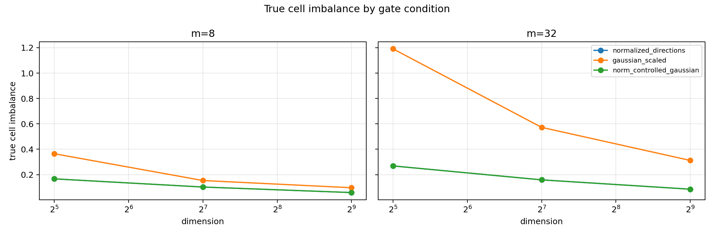
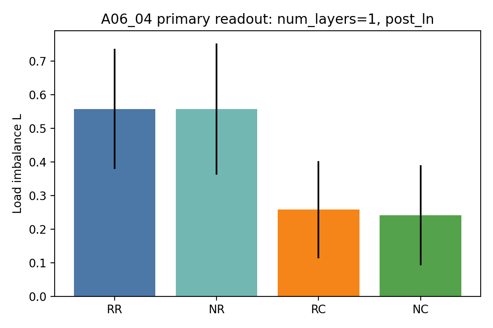
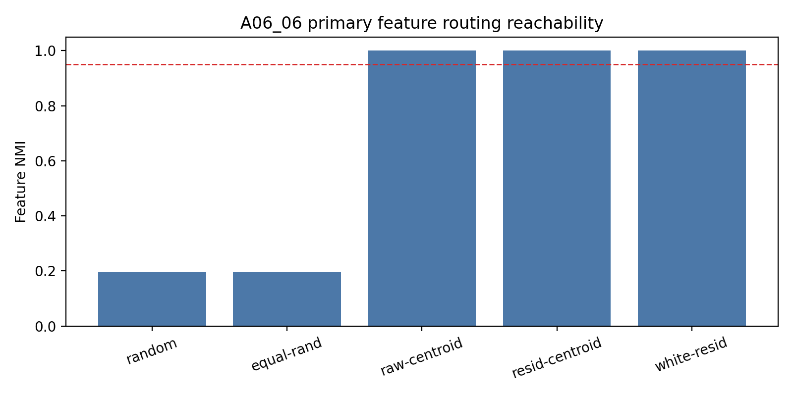
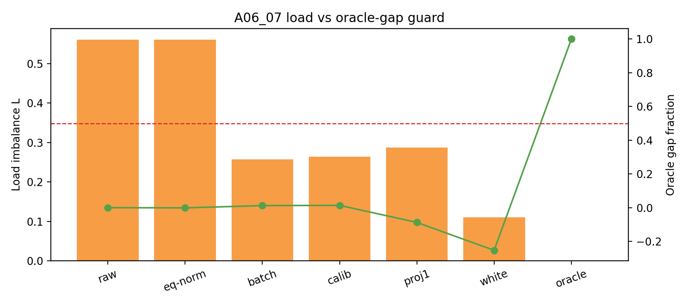
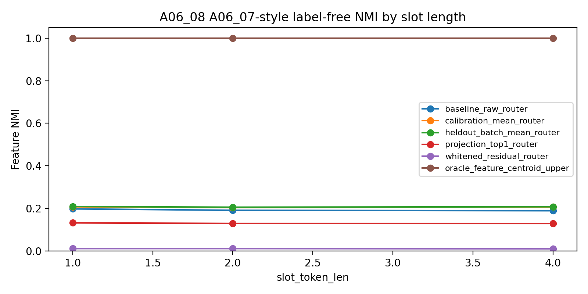
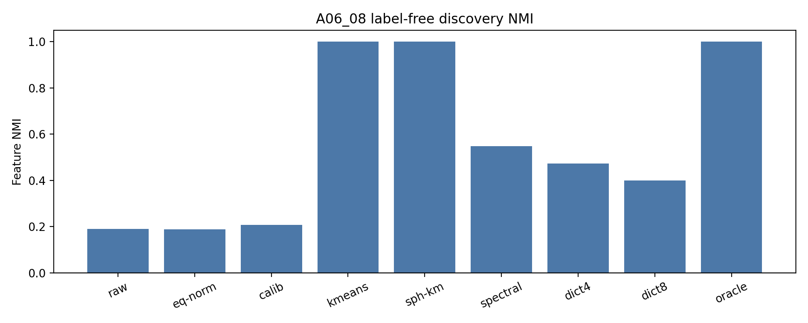
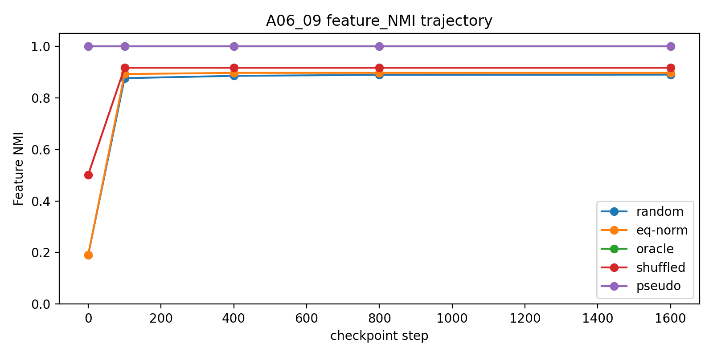
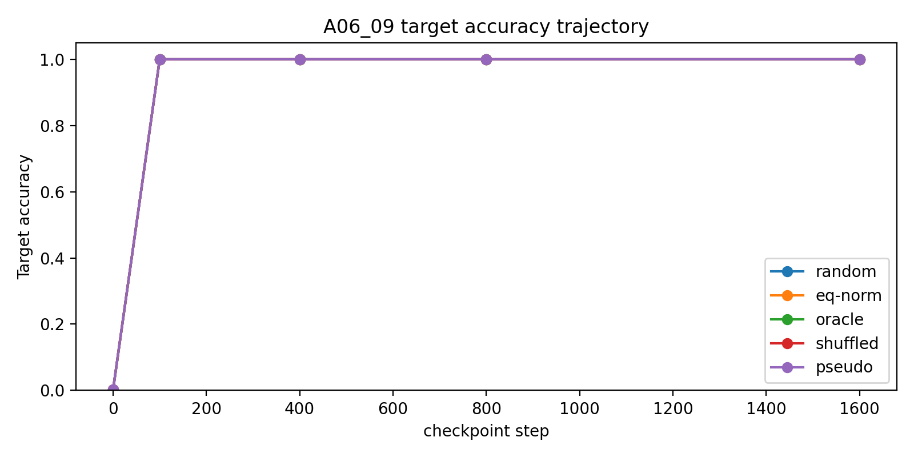

# 组会 Brief: A06_03 到 A06_09 的 MoE 初始化几何主线

## 0. 核心结论

我们现在可以做一个明确判断：

在严格均匀的 synthetic feature 设置里，随机 dot-product top-1 MoE 不会自然形成干净的 feature-level specialization。主要原因不是单一的 router row norm，而是 initialized hidden states 里存在 common component 和 residual geometry。简单全局去均值、投影、白化只能改善 load，不能恢复 feature partition；但无标签 residual k-means 可以找到 pseudo-feature centers，并且这个 pseudo 初始化在当前 synthetic 训练目标下能保持住。

下一步应该继续做 feature discovery 的真实化，而不是继续做只优化 load 的 router repair。Anti-lockin 暂时保留为备用分支：只有当一个已知好的 partition 在更难训练设置下 collapse，才把它提升为主线。

## 1. 这条线解决的问题

父问题：

```text
如果 feature 本身是均匀出现的，为什么随机初始化的 top-1 MoE router 仍然不能自然形成稳定、可解释的 feature-to-expert specialization？
```

这里的核心不是“能不能让 load 均匀”，而是：

```text
同一种 feature 是否被稳定分到同一个 expert？
不同 feature 是否被分到不同 expert？
这个分法训练后是否还能保持？
```

## 2. 必要术语

**Feature**

本轮 synthetic 实验里的 feature 是人工构造的 4 个 `(slot_token, target_token)` pair。每条样本有一个真实 `pair_id`。这不是自然语言语义。

**Router**

Router 决定一个样本送到哪个 expert。这里主要看 top-1 router，即每个样本只选一个 expert。

**Load**

Load 是每个 expert 收到多少样本。4 个 expert 完全均匀时，每个 expert 收到 25%。我们用

$$
L=m\max_e |p_e-1/m|
$$

衡量负载不均匀。$L=0$ 表示完全均匀。

**Feature NMI**

Feature NMI 衡量 router 分出来的 expert id 和真实 `pair_id` 是否对齐。它回答“有没有 feature-level specialization”。Load 只能说明数量是否均匀，不能说明 feature 是否被正确分开。

**Common component**

一批 hidden states 的平均方向：

$$
c=\frac{1}{N}\sum_i h_i
$$

如果 router 用 $w_e^\top h_i$ 打分，那么 $w_e^\top c$ 会变成每个 expert 的固定偏置，让某些 expert 天生更容易赢。

**Residual geometry**

去掉 common component 后剩下的部分：

$$
r_i=h_i-c
$$

Residual geometry 指这些 residual hidden states 的空间结构。它可能仍然带有 feature、position 或 context 结构。

**Pseudo-feature center**

不用真实 `pair_id` label，只从 hidden states 自己的分布里发现出来的疑似 feature 中心。如果这些中心真的对应 feature，就可以拿它们初始化 router rows。

## 3. 总体判断链

```text
A06_03:
纯 gate-only 世界里，row norm variation 会制造 load imbalance。

A06_04:
进入 initialized hidden states 后，row norm 不再是主因；hidden common component 是主导 tested source。

A06_05:
去掉 common 后，剩余 load 不是有限样本噪声，而是 residual geometry。

A06_06:
如果给真实 feature label，oracle centroid 可以完美恢复 feature partition。

A06_07:
不用 label，只做全局去均值、投影、白化，可以改善 load，但不能恢复 Feature NMI。

A06_08 slot-length replay:
上述结论不是 one-token slot artifact；slot length 1、2、4 下稳定。

A06_08 feature discovery:
无标签 residual k-means 可以找到 pseudo-feature centers。

A06_09:
用 pseudo centers 初始化后，当前 synthetic 训练目标下 feature partition 保持住。
```

## 4. 关键证据

### A06_03: row norm 是 gate-only 偏置，但不是后续主因

问题：
在纯高维均匀输入里，随机 dot-product gate 为什么还有 load imbalance？

判断更新：
Gaussian row norm variation 是纯 gate-only 世界里的真实偏置来源。

关键数值：

| Setting | Gaussian scaled | Norm-controlled |
| --- | ---: | ---: |
| `d=32,m=32` | 1.1910 | 0.2686 |
| `d=512,m=32` | 0.3120 | 0.0854 |

边界：
这只说明纯随机 gate 的几何偏置，不说明 initialized hidden states 或训练后的 specialization。



### A06_04: hidden common component 是 synthetic hidden-state setting 的主导偏置

问题：
当均匀 feature 经过 embedding / Transformer hidden-state formation 后，load imbalance 还是 row norm 主导吗？

判断更新：
不是。进入 hidden states 后，hidden common component 才是主导 tested source。

关键数值：

| Condition | Load $L$ |
| --- | ---: |
| raw router + raw hidden | 0.5578 |
| norm-controlled router + raw hidden | 0.5577 |
| raw router + centered hidden | 0.2578 |
| norm-controlled router + centered hidden | 0.2407 |

边界：
Common-centering 明显改善 load，但还没有证明 feature-level specialization。



### A06_05: common-centering 后仍有 residual geometry

问题：
去掉 common component 后，剩下的 load 是不是只是有限样本噪声？

判断更新：
不是。Residual hidden states 仍有真实几何结构。

关键数值：

| Condition | Load $L$ |
| --- | ---: |
| centered residual replay | 0.2577 |
| centered + whitened replay | 0.1071 |
| matched isotropic replay | 0.0874 |

边界：
Whitening 在这里是诊断工具，不是最终 router 方法。

### A06_06: oracle feature partition 可达

问题：
如果允许使用真实 `pair_id` label 来估计 feature centroid，router 能不能形成 feature-level routing？

判断更新：
能。目标 feature partition 本身存在。

关键数值：

| Condition | Feature NMI | Load $L$ |
| --- | ---: | ---: |
| random Gaussian | about 0.23 | about 0.68 |
| raw feature centroid | 1.0000 | 0.0000 |
| common-centered centroid | 1.0000 | 0.0000 |
| whitened centroid | 1.0000 | 0.0000 |

边界：
A06_06 用了真实 label，所以它是 positive control，不是可部署的无标签方法。



### A06_07: load balance 不等于 feature specialization

问题：
不用真实 label，只做全局去均值、投影、白化，能不能接近 oracle partition？

判断更新：
不能。它们主要改善 load，不恢复 Feature NMI。

关键数值：

| Condition | Feature NMI | Load $L$ |
| --- | ---: | ---: |
| baseline raw | 0.2302 | 0.6867 |
| calibration mean | 0.2353 | 0.2837 |
| heldout batch mean | 0.2350 | 0.2828 |
| whitened residual | 0.0150 | 0.0860 |
| oracle centroid | 1.0000 | 0.0000 |

结论：
以后不能把 load 当作 specialization 的主指标。Feature NMI 或真实 feature proxy 必须是主指标。



### A06_08 slot-length replay: 不是短 slot artifact

问题：
A06_04-A06_07 的结论是否只是 `slot_token_len=1` 的 artifact？

判断更新：
不是。Repeated slot length 1、2、4 下结论稳定。

关键数值：

| Slot len | Baseline NMI | Calibration mean NMI | Oracle NMI |
| ---: | ---: | ---: | ---: |
| 1 | 0.1981 | 0.2079 | 1.0000 |
| 2 | 0.1913 | 0.2040 | 1.0000 |
| 4 | 0.1894 | 0.2072 | 1.0000 |

边界：
这里只测试 repeated same-slot token，不测试真实语言里的多 token phrase 或 distributed semantic feature。



### A06_08 feature discovery: residual k-means 找到了 pseudo-feature centers

问题：
不用真实 label，只在 route-position residual hidden states 上做发现，能不能找到 pseudo-feature centers？

判断更新：
能。Residual k-means 和 spherical k-means 成功；spectral 和 dictionary 不稳定，不能作为主线方法。

关键设置：

- `slot_token_len=4`；
- route position 是最后一个 slot token；
- 每个 pair 4096 个样本，2048 calibration / 2048 evaluation；
- 聚类对象是 calibration split 的 route-position residual hidden states；
- `pair_id` 只用于 evaluation，不参与聚类。

关键数值：

| Method | Feature NMI | Load $L$ | Full-grid pass |
| --- | ---: | ---: | ---: |
| calibration mean | 0.2072 | 0.2691 | 0/48 |
| residual k-means K4 | 1.0000 | 0.0000 | 48/48 |
| spherical residual k-means K4 | 1.0000 | 0.0000 | 48/48 |
| spectral residual K4 | 0.5763 mean | 0.4138 mean | 13/48 |
| dictionary residual K4 | 0.5503 mean | 0.4358 mean | 8/48 |

边界：
A06_08 是 step-0 discovery，不是训练实验。它证明 synthetic route-position residuals 里有可恢复的 4-cluster feature structure；不证明真实语言语义 feature 可以这样发现。



### A06_09: pseudo 初始化在当前训练目标下保持住

问题：
如果 step 0 已经有 feature-aligned routing，训练会不会破坏它？

判断更新：
在当前 synthetic route-position target prediction 目标下，没有破坏。A06_08 pseudo init 和 oracle init 都保持 perfect routing。

关键设置：

- 训练目标：从最后一个 slot token 预测紧跟的 `TARGET_s`；
- 不是完整真实文本 next-token training；
- random background tokens 不可学习，所以不能把完整 next-token loss 当主指标；
- A06_09 读取 A06_08 的结果，选择 `route_kmeans_residual_K4`，但在每个 training run 的 calibration batch 上重新做 residual k-means。

关键数值：

| Condition | Step-0 NMI | Final NMI | Target accuracy | Load $L$ | Supported |
| --- | ---: | ---: | ---: | ---: | ---: |
| A06_08 pseudo center | 1.0000 | 1.0000 | 1.0000 | 0.0000 | 24/24 |
| oracle centroid | 1.0000 | 1.0000 | 1.0000 | 0.0000 | 24/24 |
| random Gaussian | 0.2399 | 0.8100 | 1.0000 | 1.1277 | 0/24 |
| equal-norm random | 0.2394 | 0.8027 | 1.0000 | 1.1667 | 0/24 |

结论：
Accuracy 不能替代 Feature NMI。随机初始化也能学会 target，但 routing partition 不干净；pseudo init 同时做到 NMI 1.0、accuracy 1.0、load 0。





## 5. A06_08 / A06_09 的边界必须说清楚

### A06_08 的边界

A06_08 能 claim：

- 在当前 synthetic initialized hidden-state setting 中，route-position residual k-means 可以无标签恢复 4 个 pseudo-feature centers。
- 它不是 load-only success，因为 Feature NMI 达到 1.0，load 也为 0。

A06_08 不能 claim：

- 真实语言里也能直接聚出语义 feature。
- 任意 hidden state 位置都能聚出来。
- 整条序列所有 token 的 hidden states 都参与了聚类。
- spectral / dictionary 是可靠主方法。
- 训练后一定稳定。

### A06_09 的边界

A06_09 能 claim：

- 在当前 synthetic `slot_token_len=4`、route-position target prediction 训练目标下，A06_08 pseudo init 能进入稳定 training basin。
- 它在这个设置里不需要额外 anti-lockin 才能保持 feature routing。

A06_09 不能 claim：

- 完整 language-model next-token training 下也稳定。
- 真实 DCLM 上也稳定。
- 真实语义 expert 已经形成。
- expert 有 causal utility。
- anti-lockin 已经被解决。
- 随机初始化已经足够，因为随机初始化虽然 accuracy 高，但 Feature NMI 和 load 都不干净。

## 6. 和 real language data 的区别

这点是组会上最容易被误解的地方。

当前 synthetic setting：

- feature 是已知的 4 个人工 `(slot,target)` pair；
- feature frequency 严格均匀；
- background tokens 与 `pair_id` 独立；
- route position 是人为指定的最后一个 slot token；
- target 紧跟 slot span；
- Feature NMI 可以直接用真实 `pair_id` 评估；
- 训练目标是 route-position target prediction。

Real language data：

- feature 没有现成的真实 label；
- feature 可能是语义、句法、实体、任务、topic 或组合结构，边界不清楚；
- feature frequency 高度非均匀；
- token 之间强相关，background 不再是独立噪声；
- route position 不一定唯一；
- full next-token objective 同时混合许多预测因素；
- 高 Feature NMI 的 proxy 还需要定义；
- expert 是否有功能作用需要 causal utility 测试。

因此，A06_08/A06_09 是从 synthetic setting 得到的机制和方法线索，不是 real language 结论。它告诉我们下一步应该如何进入 real data：先定义可评估的 feature proxy，再测试 pseudo discovery 和 training preservation。

## 7. 当前可以 claim 什么

可以 claim：

1. 均匀 feature frequency 不保证 feature-level specialization。
2. Hidden common component 和 residual geometry 是 initialized hidden-state routing 偏置的重要来源。
3. Load balance 不是 specialization 的可靠 proxy。
4. Oracle feature partition 在 synthetic hidden state 中可达。
5. Simple global label-free controls 失败，不该作为主方法推进。
6. Residual k-means 是当前 synthetic setting 中有效的 label-free pseudo-feature discovery 方法。
7. A06_08 pseudo init 在当前 synthetic training objective 下保持住了 feature partition。

## 8. 当前不能 claim 什么

不能 claim：

1. 真实 DCLM 已经验证。
2. 真实语义 feature 已经被发现。
3. 完整 next-token training 下一定稳定。
4. Expert 已经有 causal utility。
5. Anti-lockin 已经解决。
6. Load balance 可以替代 Feature NMI。
7. 所有 label-free discovery 方法都有效。

## 9. 下一步决策

推荐下一步：

```text
继续 feature discovery before routing。
把 A06_08/A06_09 从干净 synthetic setting 推向更弱、更真实的 feature proxy。
```

最自然的三个方向：

1. 更弱 feature proxy：
   不再使用干净 4-pair label，改用更噪声、更接近真实语言的 proxy feature。

2. 更真实训练目标：
   从 route-position target prediction 过渡到更接近 next-token training 的目标，但必须避免随机背景 token 污染主指标。

3. 真实数据前置定义：
   先定义 real language data 上的 feature/proxy specialization metric，再做 DCLM 实验。不能只看 load。

组会需要确认的决策：

```text
下一轮是否把主线定位为：
synthetic pseudo-feature discovery -> weaker proxy feature -> real-language proxy metric
```

如果确认，这条线下一步就不是继续修 load，而是构造可评估的 real-data feature proxy。

## 10. Source Map

- A06_03 anchor: `Projects/from-attention-to-search/main/problem_anchors/06_geometry_proxy_preservation/06_03_high_dimensional_gaussian_gate_norm_variation_anchor.md`
- A06_04 anchor: `Projects/from-attention-to-search/main/problem_anchors/06_geometry_proxy_preservation/06_04_real_hidden_state_gate_geometry_decomposition_anchor.md`
- A06_05 anchor: `Projects/from-attention-to-search/main/problem_anchors/06_geometry_proxy_preservation/06_05_common_centered_residual_geometry_diagnostic_anchor.md`
- A06_06 anchor: `Projects/from-attention-to-search/main/problem_anchors/06_geometry_proxy_preservation/06_06_feature_level_initialization_positive_control_anchor.md`
- A06_07 anchor: `Projects/from-attention-to-search/main/problem_anchors/06_geometry_proxy_preservation/06_07_label_free_common_residual_control_router_anchor.md`
- A06_08 discovery anchor: `Projects/from-attention-to-search/main/problem_anchors/06_geometry_proxy_preservation/06_08_label_free_feature_discovery_initialization_anchor.md`
- A06_09 anchor: `Projects/from-attention-to-search/main/problem_anchors/06_geometry_proxy_preservation/06_09_training_basin_preservation_anchor.md`
- Slot-length robustness anchor: `Projects/from-attention-to-search/main/problem_anchors/06_geometry_proxy_preservation/06_08_slot_length_robustness_replay_anchor.md`
- A06_08 discovery summary: `Projects/from-attention-to-search/main/experiments/A06_08_label_free_feature_discovery_initialization/summary.md`
- A06_09 summary: `Projects/from-attention-to-search/main/experiments/A06_09_training_basin_preservation/summary.md`
