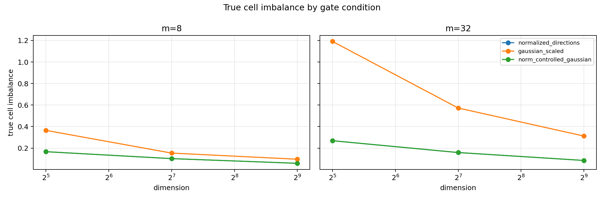
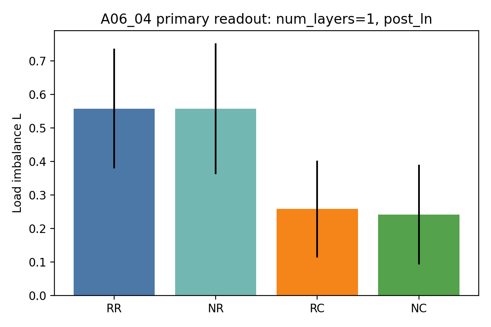
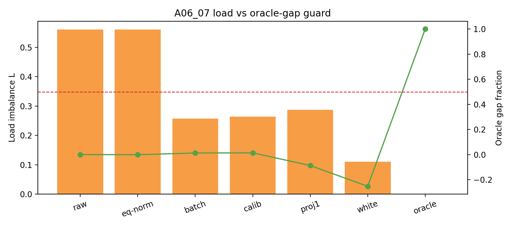
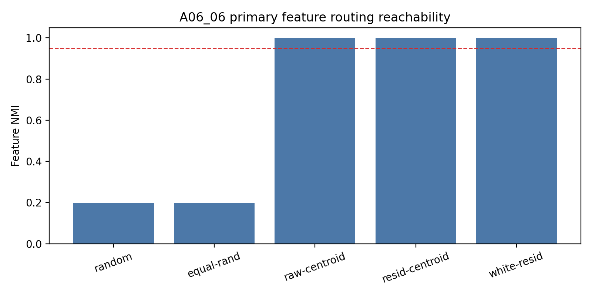
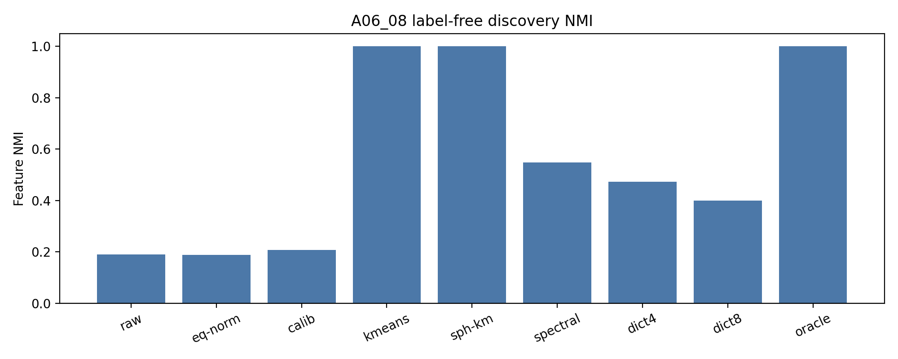
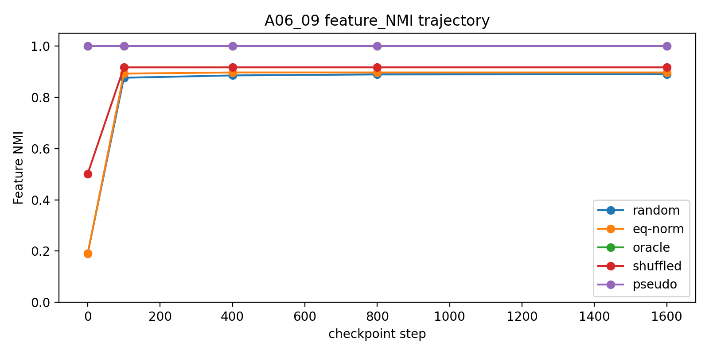
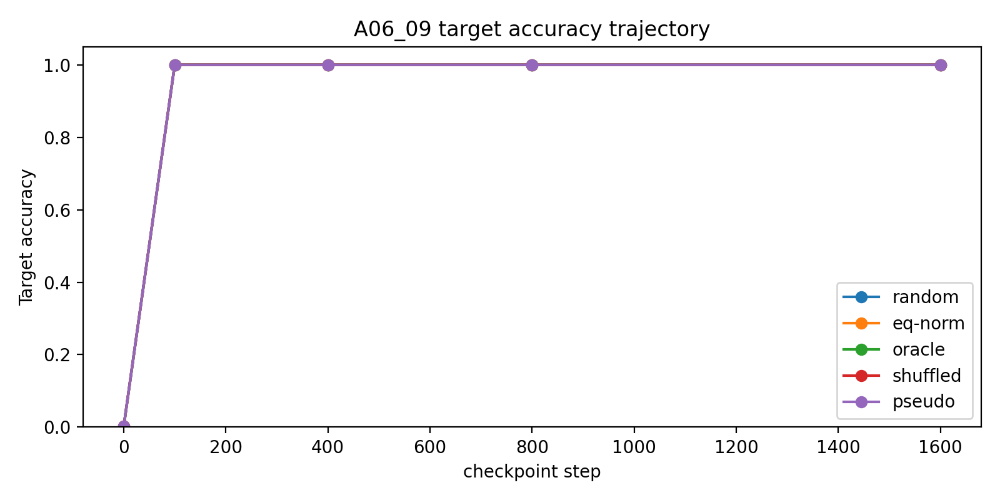
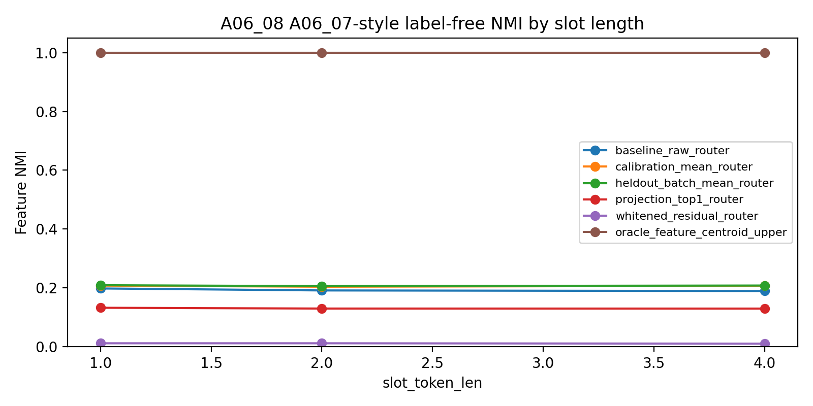

# Meeting Brief：Anchor06_03 到 Anchor06_09 的 MoE 初始化路由主线

## 0. Summary

### 问题

在features严格均匀出现时，随机初始化的内积式 top-1 MoE 路由器，为什么不能自然形成稳定的“特征到专家”分配？

这里的“特征到专家”分配指：同一种特征稳定进入同一个专家，不同特征尽量进入不同专家，并且训练后这个分配仍然保持。

### 结论

1. **若token的hidden state在空间中均匀分布，很容易做到初始化时完全均匀分发。但是均匀features不等于features在空间中均匀分布。**  
   特征数量虽然均匀，但模型初始化后的隐藏状态不是均匀几何。隐藏状态中的公共方向和剩余几何会让随机路由器一开始就偏向某些专家。

2. **通过全局去均值、投影、白化等操作，可以让experts初始化负载更均匀，但是负载均匀不等于特征分工。**  
   全局去均值、投影、白化可以让专家收到的样本数更均匀，但不能把 4 个特征分开。判断特征分工必须看“特征一致性分数NMI”，也就是路由结果和真实特征编号是否一致。

3. **在特征均匀分布的合成数据实验中，当前最有效的做法是先发现特征中心，再初始化路由器/专家。这种初始化在合成数据实验中能够保持features均匀分发，并且不会随着训练进行发生专家坍缩**  
   在当前合成任务中，只使用“路由位置”的剩余隐藏状态做无标签聚类，可以恢复 4 个伪特征中心；用这些中心初始化后，在当前目标预测训练中可以保持干净的特征分配。该方法可以进一步推广到真实数据集上进行诊断，但是问题在于怎么定义feature并且过滤掉噪声，通过聚类（或者可能可以试试SAE、inhibition）找到features的几何中心。

### 下一步

下一步继续推进：

```text
先发现特征中心，再初始化路由器。
```

具体下一步：把当前干净的 4 类合成特征，推进到更弱、更接近真实语言的特征代理，并检查无标签特征发现和初始化后训练保持是否仍然成立。

---

## 1. 推理顺序图

```text
父问题：
均匀特征下，随机初始化的 MoE 路由器为什么不能自然形成特征分工？

↓

A06_03：先看最干净的 gate-only 情况
发现：普通 Gaussian gate 的 row norm 会造成额外负载偏置。
作用：建立初始化几何的基线。

↓

A06_04：把输入换成初始化模型产生的隐藏状态
发现：row norm 不是主因，隐藏状态公共方向是更强的早期偏置。
作用：主机制从 gate row norm 转到 hidden-state geometry。

↓

A06_05：去掉公共方向后继续看剩余部分
发现：剩余隐藏状态仍有非均匀几何，不是有限样本噪声。
作用：说明 common-centering 没有解决全部问题。

↓

A06_06：用真实特征标签做 oracle positive control
发现：如果知道真实特征中心，可以完美得到特征分工。
作用：证明目标 partition 是存在的。

↓

A06_07：不用标签，只做全局去均值 / 投影 / 白化
发现：负载改善，但特征一致性不改善。
作用：证明 load balance 不是 specialization。

↓

A06_08：只用路由位置的剩余隐藏状态做无标签特征发现
发现：k-means / spherical k-means 可以恢复伪特征中心。
作用：找到 oracle 和无标签方法之间的桥。

↓

A06_09：用伪特征中心初始化并训练
发现：在当前合成目标预测训练中，特征分配保持住。
作用：说明这种初始化在当前 setting 中进入了稳定 basin。

↓

下一步：
把“特征发现 → 路由初始化”的路线推向更弱特征代理和更真实训练目标。
```

---

## 2. 当前实验 setting

- 数据是人工构造的 4 个 `(slot_token, target_token)` pair。
- 每个 pair 严格均匀出现。
- 有 4 个专家。
- 路由位置是最后一个 slot token。
- A06_08 / A06_09 使用 `slot_token_len=4`。
- A06_08 只在**路由位置的隐藏状态**上做聚类，不包括整条序列所有位置的隐藏状态。
- A06_09 的训练目标是：在最后一个 slot token 位置预测后面的 `TARGET_s`。
- 当前结果不是真实语言数据，也不是完整语言模型 next-token training。

---

## 3. 主结论 1：均匀特征不等于均匀路由

### 现象

4 个特征严格均匀出现，但随机初始化的路由器仍可能把样本不均匀地分给专家。

### 机制判断

在纯 gate-only 情况下，普通 Gaussian gate 的 row norm 会制造额外负载偏置。但进入初始化模型产生的隐藏状态后，row norm 不是主因；隐藏状态公共方向和剩余几何更重要。

A06_04 的四个条件说明这一点：

| 条件 | 含义 | 负载不均衡 L |
|---|---|---:|
| RR | 原始 router + 原始 hidden | 0.5578 |
| NR | norm-controlled router + 原始 hidden | 0.5577 |
| RC | 原始 router + 去公共方向 hidden | 0.2578 |
| NC | norm-controlled router + 去公共方向 hidden | 0.2407 |

判断：

- 如果 row norm 是主因，NR 应该明显低于 RR；实际几乎不变。
- 去掉隐藏状态公共方向后，负载不均衡明显下降。
- 去掉公共方向后仍有剩余不均衡，说明剩余隐藏状态几何也有作用。

**Figure: A06_03 gate-only norm effect**



**Figure: A06_04 common component audit**



---

## 4. 主结论 2：负载均匀不等于特征分工

### 现象

全局去均值、投影、白化可以显著改善负载，但不能恢复特征到专家的一一对应。

A06_05 表明，去掉公共方向后，剩余隐藏状态仍有真实几何结构：

| 条件 | 负载不均衡 L |
|---|---:|
| 去公共方向 replay | 0.2577 |
| 去公共方向 + 白化 replay | 0.1071 |
| 匹配各向同性 replay | 0.0874 |

A06_07 进一步说明：只改善负载不能说明形成了特征分工。

| 条件 | 特征一致性分数 | 负载不均衡 L |
|---|---:|---:|
| baseline raw | 0.2302 | 0.6867 |
| calibration mean | 0.2353 | 0.2837 |
| heldout batch mean | 0.2350 | 0.2828 |
| whitened residual | 0.0150 | 0.0860 |
| oracle centroid | 1.0000 | 0.0000 |

### 结论

以后不能把“负载更均匀”当成“特征分工更好”。主指标必须是特征一致性分数；负载只能作为辅助约束。

**Figure: A06_07 load vs oracle-gap guard**



---

## 5. 主结论 3：先发现特征中心，再初始化路由器，是当前最清晰的方向

### 5.1 Oracle 说明目标分配存在

A06_06 使用真实特征标签构造特征中心。结果：raw centroid、common-centered centroid、whitened centroid 都达到：

```text
特征一致性分数 = 1.0
负载不均衡 L = 0.0
margin 为正
```

这说明目标分配本身存在。如果无标签方法失败，失败原因不是目标分配不存在，而是方法没有找到它。

**Figure: A06_06 oracle reachability**



### 5.2 无标签特征发现成功，但边界很窄

A06_08 只使用 calibration split 中**路由位置的剩余隐藏状态**，不使用真实特征标签来聚类。真实标签只用于最后评估。

关键结果：

| 方法 | 特征一致性分数 | 负载不均衡 L | 通过数 |
|---|---:|---:|---:|
| calibration mean | 0.2072 | 0.2691 | 0/48 |
| residual k-means K4 | 1.0000 | 0.0000 | 48/48 |
| spherical residual k-means K4 | 1.0000 | 0.0000 | 48/48 |
| spectral residual K4 | 约 0.55 | 约 0.47 | 13/48 |
| dictionary residual K4 | 约 0.47-0.55 | 约 0.44-0.49 | 8/48 |

判断：

- 当前合成任务的路由位置隐藏状态中有可恢复的 4 类特征结构。
- 可靠的是 residual k-means / spherical k-means。
- spectral 和 dictionary 不稳定，不能作为主线方法。

**Figure: A06_08 label-free discovery NMI**



### 5.3 伪特征中心初始化后，在当前训练目标下保持住

A06_09 检查：如果 step 0 已经有特征对齐的路由，训练是否会破坏它。

结果：

| 条件 | Step-0 一致性 | Final 一致性 | 目标准确率 | 负载不均衡 L | 通过数 |
|---|---:|---:|---:|---:|---:|
| A06_08 伪特征中心 | 1.0000 | 1.0000 | 1.0000 | 0.0000 | 24/24 |
| oracle centroid | 1.0000 | 1.0000 | 1.0000 | 0.0000 | 24/24 |
| random Gaussian | 0.2399 | 0.8100 | 1.0000 | 1.1277 | 0/24 |
| equal-norm random | 0.2394 | 0.8027 | 1.0000 | 1.1667 | 0/24 |
| label-shuffled guard | 0.4969 | 0.8409 | 1.0000 | 1.0000 | 0/24 |

判断：

- 目标准确率不能替代特征一致性。
- 随机初始化也能学会 target，但路由分配不干净。
- 伪特征中心初始化同时做到：一致性 1.0、准确率 1.0、负载均匀。

**Figure: A06_09 feature_NMI trajectory**



**Figure: A06_09 target accuracy trajectory**



---

## 6. Slot-length guard

A06_08 检查了结论是否只是 `slot_token_len=1` 的 artifact。结果在 repeated slot length 1、2、4 下稳定。

| Slot len | Baseline 一致性 | Calibration mean 一致性 | Oracle 一致性 |
|---:|---:|---:|---:|
| 1 | 0.1981 | 0.2079 | 1.0000 |
| 2 | 0.1913 | 0.2040 | 1.0000 |
| 4 | 0.1894 | 0.2072 | 1.0000 |

边界：这里只测试 repeated same-slot token，不说明真实语言中的多 token phrase 或 distributed semantic feature。

**Figure: slot length guard**



---

## 7. 当前能说什么，不能说什么

### 能说

1. 在当前合成任务中，均匀特征出现不保证特征级分工。
2. 初始化隐藏状态中的公共方向和剩余几何，是早期路由偏置的重要来源。
3. 负载均匀不能替代特征一致性。
4. 如果给真实特征中心，目标特征分配可达。
5. 简单全局去均值、投影、白化不是有效的特征分工方法。
6. 只使用路由位置的剩余隐藏状态，residual k-means / spherical k-means 可以无标签恢复伪特征中心。
7. 伪特征中心初始化在当前 route-position target prediction 训练中可以保持特征分配。

### 不能说

1. 真实 DCLM 已经验证。
2. 真实语言语义特征已经被发现。
3. 整条序列所有位置的隐藏状态都能这样聚类。
4. 完整语言模型 next-token training 下也一定稳定。
5. 专家已经有因果功能分工。
6. anti-lockin 已经解决。
7. spectral / dictionary discovery 是可靠主方法。

---

## 8. 下一步决策

我希望组会确认：下一轮是否继续推进这条线：

```text
从合成任务中的伪特征发现
-> 更弱、更噪声的特征代理
-> 更真实的训练目标
-> 最后再进入真实语言数据。
```

建议下一步只做一个最小动作：

```text
构造比当前 4-pair synthetic 更弱、更接近真实语言的特征代理，
然后测试 residual k-means / pseudo-center initialization 是否仍能恢复特征路由，
并且训练后是否保持。
```

我想请导师判断：

```text
这个推进顺序是否合理？
还是应该先转向完整 next-token training 下的保持性测试？
```

---

## 9. Source Map

Anchors:

- `Projects/from-attention-to-search/main/problem_anchors/06_geometry_proxy_preservation/06_03_high_dimensional_gaussian_gate_norm_variation_anchor.md`
- `Projects/from-attention-to-search/main/problem_anchors/06_geometry_proxy_preservation/06_04_real_hidden_state_gate_geometry_decomposition_anchor.md`
- `Projects/from-attention-to-search/main/problem_anchors/06_geometry_proxy_preservation/06_05_common_centered_residual_geometry_diagnostic_anchor.md`
- `Projects/from-attention-to-search/main/problem_anchors/06_geometry_proxy_preservation/06_06_feature_level_initialization_positive_control_anchor.md`
- `Projects/from-attention-to-search/main/problem_anchors/06_geometry_proxy_preservation/06_07_label_free_common_residual_control_router_anchor.md`
- `Projects/from-attention-to-search/main/problem_anchors/06_geometry_proxy_preservation/06_08_label_free_feature_discovery_initialization_anchor.md`
- `Projects/from-attention-to-search/main/problem_anchors/06_geometry_proxy_preservation/06_09_training_basin_preservation_anchor.md`
- `Projects/from-attention-to-search/main/problem_anchors/06_geometry_proxy_preservation/06_08_slot_length_robustness_replay_anchor.md`

Summaries / detailed records:

- `Projects/from-attention-to-search/main/experiments/A06/A06_08_label_free_feature_discovery_initialization/summary.md`
- `Projects/from-attention-to-search/main/experiments/A06/A06_08_label_free_feature_discovery_initialization/detailed.md`
- `Projects/from-attention-to-search/main/experiments/A06/A06_09_training_basin_preservation/summary.md`
- `Projects/from-attention-to-search/main/experiments/A06/A06_09_training_basin_preservation/detailed.md`

Figures included in this brief:

- `figures/a06_03_true_cell_imbalance_by_condition.png`: A06_03 gate-only norm effect
- `figures/a06_04_load_imbalance_by_condition.png`: A06_04 common component audit
- `figures/a06_06_feature_nmi_by_condition.png`: A06_06 oracle reachability
- `figures/a06_07_load_oracle_gap_by_condition.png`: A06_07 load vs specialization guard
- `figures/a06_08_slot_length_nmi_by_slot_len.png`: slot-length robustness guard
- `figures/a06_08_nmi_by_method.png`: A06_08 label-free discovery NMI
- `figures/a06_09_nmi_trajectory.png`: A06_09 Feature NMI trajectory
- `figures/a06_09_accuracy_trajectory.png`: A06_09 target accuracy trajectory
