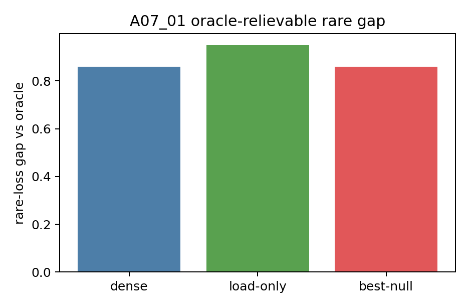

# Detailed: A07_01 Common / Rare Conflict Metric Audit

## Conclusion

D07 is valid for the next controlled method test. The oracle gate reduces rare loss beyond the best null, and the shortcut, leakage, comparability, and readability guards pass.

## Setup

Run name: `a07_common_rare_conflict_full_20260623_1`

Run date: 2026-06-23.

Seeds: `20260623,20260624,20260625,20260626,20260627,20260628,20260629,20260630`.

Runner: `Projects/from-attention-to-search/XingyuD/Attention_Search_Experiments/active/synthetic_data_understanding/scripts/run_a07_common_rare_conflict.py`

Config: `Projects/from-attention-to-search/XingyuD/Attention_Search_Experiments/active/synthetic_data_understanding/configs/a07_common_rare_conflict_full.json`

Execution type: local full synthetic audit, 4 logical shards. ACP submit script dry-run was recorded; no external ACP job id was created.

## Method

The run constructs a controlled D07 hidden-state surface with four conflict groups, common/rare imbalance in train, balanced evaluation, dense null, load-only null, and oracle conflict-group routing.

The oracle may use only conflict group. It does not use target, loss, future token, rare flag, or eval metadata.

## Primary Metric

`Delta_vs_best_null = min(L_rare(dense), L_rare(load_only)) - L_rare(oracle_feature_gate)`.

Observed: `0.8601 +/- 0.0008`.

This decides whether the surface has oracle-relievable rare conflict.

## Evidence Ledger

| Condition | Rare loss | Common loss | Total loss |
| --- | ---: | ---: | ---: |
| dense | `1.4399` | `0.8800` | `1.1599` |
| load-only | `1.5300` | `1.0483` | `1.2892` |
| oracle feature gate | `0.5798` | `0.5800` | `0.5799` |
| common-control | `0.5798` | `0.5800` | `0.5799` |

Guard results:

| Guard | Result |
| --- | ---: |
| raw hidden conflict readout | `1.0000` |
| phi conflict readout | `1.0000` |
| position shortcut | `0.2523` |
| nuisance shortcut | `0.2546` |
| rare-flag shortcut | `0.5000` |
| parent shortcut | `0.5000` |
| forbidden oracle variables | `0` |

## Visualization Results



Purpose: show rare-loss improvement of oracle routing over nulls.

How to read: each bar is a rare-loss gap versus oracle; positive means oracle is better.

Observed result: `Delta_vs_best_null = 0.8601`.

Take-home: the surface has a strong oracle-relievable conflict.

What it does not prove: common-control, learned routing, real-language transfer, or expert utility.

## Artifact Map

Raw result dir: `/data/250010109/Research_System/Projects/from-attention-to-search/XingyuD/Attention_Search_Experiments/active/synthetic_data_understanding/results/a07_common_rare_conflict/a07_common_rare_conflict_full_20260623_1`

Curated tables:

- `tables/d07_metric_audit.csv`
- `tables/null_comparability.csv`
- `tables/oracle_audit.csv`
- `tables/router_input_readability.csv`
- `tables/shortcut_audit.csv`

Curated figure: `figures/oracle_rare_gap.png`

Repro command:

```bash
python scripts/run_a07_common_rare_conflict.py --config configs/a07_common_rare_conflict_full.json --run-name a07_common_rare_conflict_full_20260623_1 --run-stage full --seeds 20260623,20260624,20260625,20260626,20260627,20260628,20260629,20260630 --aggregate-only --device cpu
```

## Boundary

This is a controlled synthetic audit. It is not a neural end-to-end training result and not a real-data transfer result.
