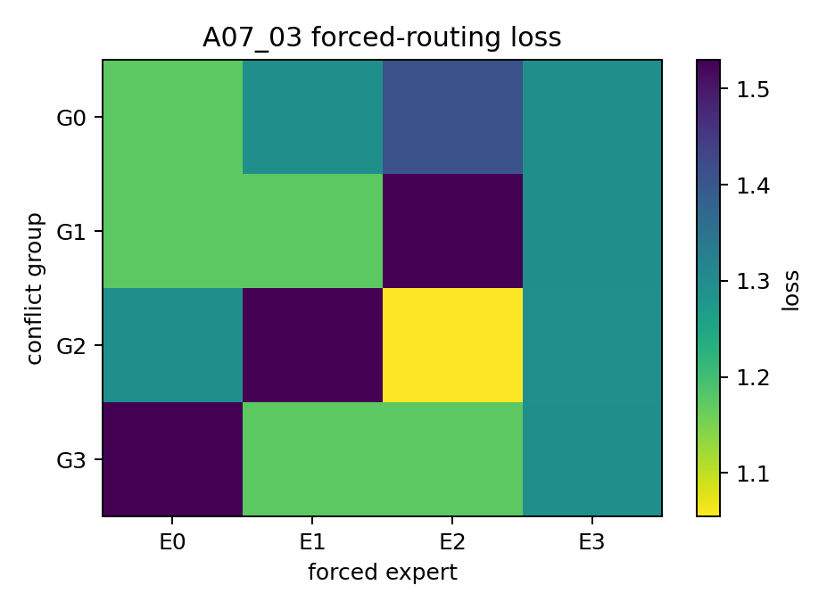

# Detailed: A07_03 Route-Function Binding

## Conclusion

Route-function binding is supported on controlled D07. The routed/modal expert is also the best forced expert, and fixed-route ablation selectively damages the same group.

## Setup

Run name: `a07_common_rare_conflict_full_20260623_1`

Run date: 2026-06-23.

Seeds: `20260623` to `20260630`.

Runner: `Projects/from-attention-to-search/XingyuD/Attention_Search_Experiments/active/synthetic_data_understanding/scripts/run_a07_common_rare_conflict.py`

Config: `Projects/from-attention-to-search/XingyuD/Attention_Search_Experiments/active/synthetic_data_understanding/configs/a07_common_rare_conflict_full.json`

Execution type: local full synthetic audit, 4 logical shards. ACP four-card script was dry-run only.

## Method

The test uses A07_02 common-control routes. For each conflict group, it computes route concentration, forced-routing loss for each expert, selected-best rate, route-conditioned utility advantage, fixed-route ablation selectivity, and early/final utility advantage.

Raw expert IDs are not semantically aligned across seeds. Therefore, the main readout is modal-aligned rather than raw `E0/E1/E2/E3` averaging.

## Primary Metrics

Selected-best rate: `1.0000` versus chance baseline `0.2500`.

Route-conditioned utility advantage by group:

| Group | Advantage |
| --- | ---: |
| 0 | `0.9498` |
| 1 | `0.9502` |
| 2 | `0.9498` |
| 3 | `0.9498` |

Modal ablation selectivity:

| Group | Modal delta | Nonmodal delta | Difference |
| --- | ---: | ---: | ---: |
| 0 | `0.6800` | `0.0000` | `0.6800` |
| 1 | `0.6800` | `0.0000` | `0.6800` |
| 2 | `0.6800` | `0.0000` | `0.6800` |
| 3 | `0.6800` | `0.0000` | `0.6800` |

## Evidence Ledger

Route concentration:

| Condition | Modal probability |
| --- | ---: |
| common-control | `1.0000` per group |
| load-only | about `0.27` per group |
| oracle | `1.0000` per group |

Temporal guard:

| Checkpoint | Utility advantage range |
| --- | ---: |
| early | `0.7408-0.7411` |
| final | `0.9498-0.9502` |

This weakens the final-only co-adaptation rival: binding is already present at the early checkpoint proxy.

## Visualization Results



Purpose: inspect forced-routing loss by group and raw expert ID.

How to read: darker cells indicate lower loss.

Observed result: raw expert IDs are not stable across seeds, so the averaged heatmap is auxiliary.

Take-home: use modal-aligned tables as the decision evidence.

What it does not prove: fixed semantic expert IDs, real-language specialization, or robust deployment.

## Artifact Map

Raw result dir: `/data/250010109/Research_System/Projects/from-attention-to-search/XingyuD/Attention_Search_Experiments/active/synthetic_data_understanding/results/a07_common_rare_conflict/a07_common_rare_conflict_full_20260623_1`

Curated tables:

- `tables/route_distribution_by_group.csv`
- `tables/route_concentration_by_group.csv`
- `tables/forced_utility_matrix.csv`
- `tables/selected_best_rate.csv`
- `tables/route_conditioned_utility_advantage.csv`
- `tables/fixed_routing_ablation_selectivity.csv`
- `tables/modal_ablation_selectivity.csv`
- `tables/early_final_utility.csv`

Curated figure: `figures/route_function_binding_heatmap.png`

Repro command:

```bash
python scripts/run_a07_common_rare_conflict.py --config configs/a07_common_rare_conflict_full.json --run-name a07_common_rare_conflict_full_20260623_1 --run-stage full --seeds 20260623,20260624,20260625,20260626,20260627,20260628,20260629,20260630 --aggregate-only --device cpu
```

## Boundary

This is a controlled synthetic causal-utility audit. It is not a real trained MoE checkpoint and does not establish semantic experts in natural language.
