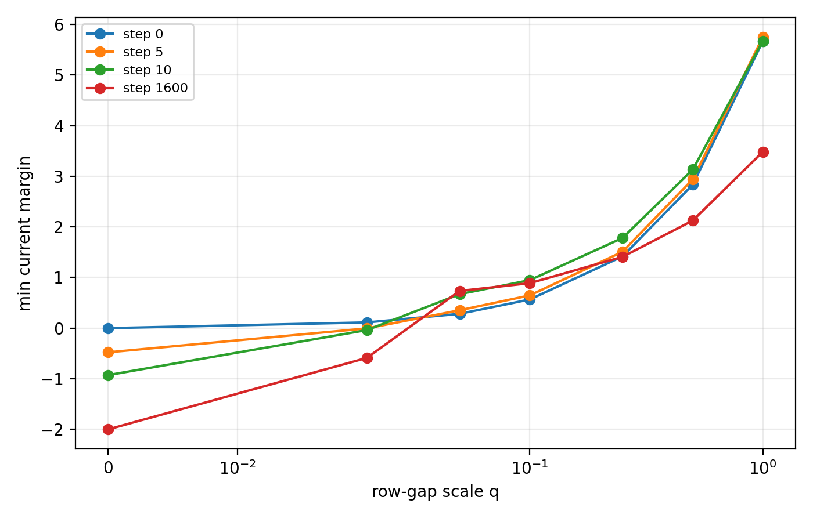
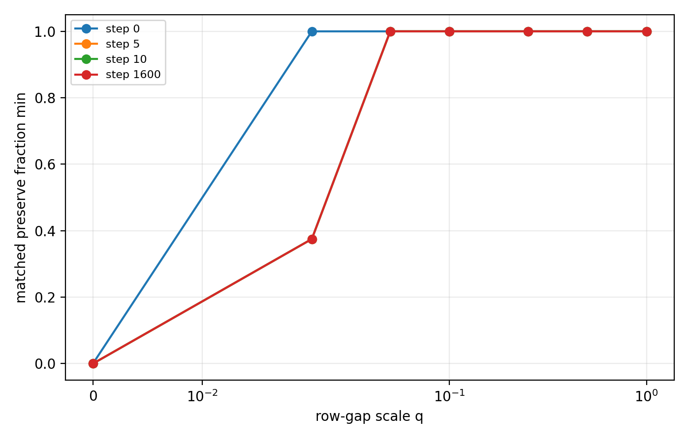
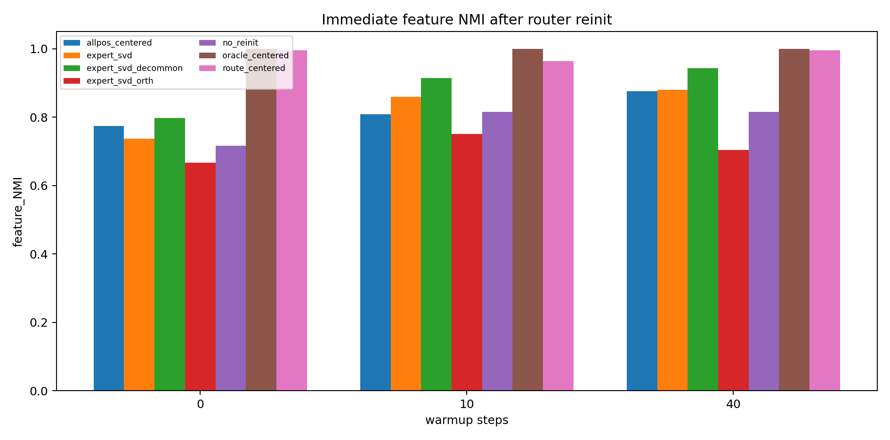
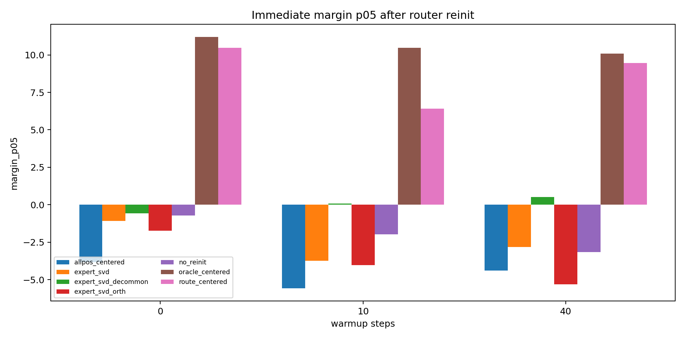
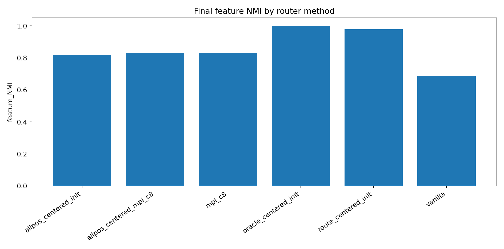
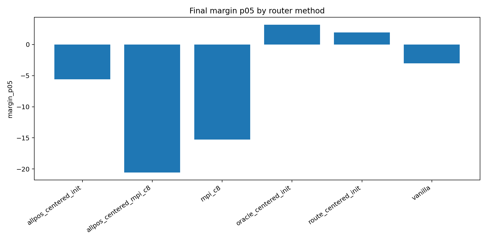

# 会议简报：均匀特征如何稳定分发到不同专家

## 0. 执行摘要

**研究问题：** 四个出现频率相同的合成特征，能否在不使用语义标签的情况下，稳定进入不同 experts？

**当前结论：** 问题已经从“能否分开”推进到“如何形成可路由、可保持的特征表征”。仅靠 common subtraction、全位置聚类、expert 主谱方向或 MPI，都还不是完整方法。

**三条主要结论：**

1. 任务位置中心可以把均匀 features 干净分到不同 experts；保持成功的关键不是第 0 步分对，而是训练后仍有正 margin。
2. warmup 会让均匀 feature centers 在 L2 距离上明显拉开，即使它们的方向相似性可能增强；因此 delayed reinit 有利于把 feature 分开并初始化 gating rows，但仍不能替代 route-relevant state selection。
3. MPI-c8 能提高 feature NMI，但 margin 低尾强负；all-position 初始化加 MPI-c8 也不能纠正到稳定 specialization。因此 MPI 是 spectral baseline，不是当前均匀 feature 分发方法。

**最小下一步：** 建立 nested-learning 对齐的新 anchor：用多词元/长时距目标塑造 route-relevant hidden state，再检验 delayed router reinit 是否同时提高 feature NMI、margin p05 和保持率。

## 1. 术语解释

| 术语 | 中文含义 | 具体对象或计算方式 | 单位或公式 | 为什么影响判断 | 不能证明什么 |
|---|---|---|---|---|---|
| 均匀特征 | 四个 feature 出现频率相同 | feature ids `0--3`，每类概率 `0.25` | 概率 | 排除频率不均匀造成的专家占用差异 | 真实语言语义 |
| 路由器 | 决定 token 进入哪个 expert 的打分模块 | expert $e$ 分数 $z_e=w_e^\top h$ | logit | 直接决定 feature-expert 分配 | expert 是否有功能价值 |
| 任务位置 | 合成任务中最应该读 feature 的 token 位置 | repeated feature slot 的最后一个 token | 序列位置 | route-position center 是正控 | 真实任务中已知路由位置 |
| 全位置样本池 | 所有 token 位置的 hidden states | 背景、slot 内、任务位置一起聚类 | 向量集合 | 检验是否能不选位置地找中心 | 一定能找到 feature center |
| route center | 只用任务位置 hidden states 得到的中心 | 对 route-position hidden states 聚类或求 label center | 向量 | 判断 feature geometry 是否存在的正控 | label-free 方法已解决 |
| expert 主谱方向 | expert 第一层权重的最大输入侧奇异方向 | $A_e=U\Sigma V^\top$ 中 $V[:,1]$ | 单位向量 | 检查 expert 参数能否反过来指导 router | expert 已有语义功能 |
| MPI-c8 | MPI router 的 $C'=8$ 缩放版本 | $\hat r_e=8N^{-1/2}r_eW_eW_e^\top/\|r_eW_eW_e^\top\|$ | router row | 强化 expert-spectrum 对 router 的影响 | 稳定 feature 分发 |
| feature NMI | feature id 与 routed expert 的一致性 | NMI(feature id, route) | `0--1` | 判断 feature 是否分到不同 experts | 分配是否稳定 |
| margin p05 | 最弱 5% 样本的路由安全距离 | 匹配 expert 分数减最强竞争 expert 分数的第 5 百分位 | logit 差 | 判断是否有稳定保持空间 | 任务 loss 最优 |
| nested learning | 用更长时距监督把未来信息写入较早表征 | 多词元/长时距预测目标 | 训练目标 | 给 route-relevant state formation 提供方法方向 | 当前实验已验证真实长程语义 |

## 2. 机制解释与建模

路由器给 hidden state $h$ 打分：

$$
z_e=w_e^\top h.
$$

若 feature $f$ 当前匹配 expert $a(f)$，相对竞争 expert $e$ 的 margin 为：

$$
\gamma_{f,e}(t)=\bigl(w_{a(f)}(t)-w_e(t)\bigr)^\top\mu_f(t).
$$

$\gamma_{f,e}(t)>0$ 表示 feature center 仍在匹配 expert 一侧；$\gamma_{f,e}(t)\le 0$ 表示边界已经跨过。margin p05 是所有样本 margin 的第 5 百分位，所以它读的是最脆弱 5% 样本是否仍稳定。

训练后 margin 的变化可分解为：

$$
\gamma(t)-\gamma(0)
=
\Delta u(t)^\top\mu(0)
+u(0)^\top\Delta\mu(t)
+\Delta u(t)^\top\Delta\mu(t),
\qquad
u=w_{a(f)}-w_e.
$$

三项分别是 router 边界移动、feature center 漂移、二者共同移动。A06_23 的作用是把判据从“第 0 步分对”提高为“训练漂移后仍有正 margin”。

warmup 和 spectral/MPI 相关实验使用的机制模型是：

$$
h_{i,p}^{(k)}=c_{\rho(p)}^{(k)}+r_{f_i,p}^{(k)}+\eta_{i,p}^{(k)}.
$$

$c_{\rho(p)}$ 是位置/背景公共成分，$r_{f_i,p}$ 是 feature 成分，$\eta$ 是噪声。全位置聚类失败的核心风险是把多个 $p$ 的状态混在一起；MPI 的核心风险是增强 expert-spectrum 对齐，但没有直接选择 route-relevant hidden-state population。

nested-learning 方向对应的目标是让较早 hidden state 同时承受多个未来 token 的误差信号：

$$
\mathcal L_{\mathrm{MT}}
=
\sum_i\sum_{k=1}^{H}w_k\,\mathrm{CE}(p_{i,k},x_{i+k}),
$$

$$
\nabla_{h_i}\mathcal L_{\mathrm{MT}}
=
\sum_{k=1}^{H}w_k W_k^\top(p_{i,k}-e_{x_{i+k}}).
$$

它要检验的是：能否把未来 feature 信息提前写进可路由 hidden state，而不是事后靠更强 router 对齐来补救。

## 3. 主要结果

**一句话总结：** 当前主线不是缺一个更硬的 router，而是缺一个 label-free、route-relevant、positive-margin 的 feature state。

### 结果 1：均匀 feature 分发可达，但保持依赖正 margin。

**证据来源：** A06_08/A06_17/A06_23。

**结果：** route-position center 可以实现干净分发；A06_23 显示 margin 太薄时，即使第 0 步分对，训练后也会翻转。

**关键数值：** row-gap scaling 中，$q\ge 0.05$ 时 final preserve fraction 为 `1.000`、sign-flip rate 为 `0.000`；$q=0.02$ 时 final preserve fraction 降到 `0.375`，final margin 为 `-0.588`。

**边界：** `q=0.05` 是当前合成桥阈值，不是真实模型通用阈值。

### 结果 2：warmup 有帮助，但全位置聚类仍不是完整解法。

**证据来源：** A06_25 full local two-GPU run。

**结果：** warmup 后全位置 hidden states 更 feature-aware，但仍弱于任务位置中心。

**关键数值：** immediate feature NMI 中，全位置聚类从 warmup 0 的 `0.774` 升到 warmup 40 的 `0.876`；route-position 聚类在 warmup 40 达到 `0.996`。slot-start NMI 最大均值 `0.0166`，没有明显位置 shortcut。

**表征结论：** warmup 后，均匀 feature centers 的方向可以更靠近，但它们在 L2 度量下明显变远。全位置 centered feature-center 的平均两两 L2 从 `1.4852` 增加到 `2.5624`；按 slot length 看，长度 `1/2/4/8` 的 0 到 40 步增量分别为 `+0.4736/+0.9168/+1.3780/+1.5407`。这说明 warmup 确实把 feature center 在欧氏空间中拉开，有利于 k-means 分开 feature，并用这些中心重初始化 gating rows。

如果减去的是同一个全局均值 $c$，两两距离本身不会改变：

$$
\|(\mu_i-c)-(\mu_j-c)\|_2=\|\mu_i-\mu_j\|_2.
$$

因此，这个 L2 增长不是“减均值制造出来的距离”，而是 feature centers 随训练真实拉开。方向更靠近同时提示公共方向也在增强，所以 warmup reinit 是有利 source construction，但仍必须继续检查 common alignment 和 margin p05。

**边界：** 这不证明全位置聚类永远失败；只说明“先训几步再全位置聚类”还不足以替代 route-relevant state selection。

### 结果 3：expert spectrum 和 MPI 有弱信号，但不能稳定完成均匀 feature 分发。

**证据来源：** A06_25 expert SVD decomposition、A06_26 MPI full run、A06_26 all-position + MPI extension。

**结果：** expert spectral directions 不是完全无用；但 raw SVD、common-projected SVD、MPI-c8 都没有达到 route center 的稳定 margin。MPI-c8 尤其说明：更强 expert-spectrum 对齐可以提高 NMI，但不能保证正 margin。

**关键数值：**

| 方法 | feature NMI | margin p05 | 读法 |
|---|---:|---:|---|
| common-projected expert SVD, warmup 40 immediate | `0.943` | `0.514` | 最强 spectral source，但 margin 远薄于 route center |
| MPI-c8 final | `0.832` | `-15.258` | NMI 提高，但最弱样本不稳定 |
| all-position init final | `0.818` | `-5.602` | 全位置源有弱 feature 信号但不稳 |
| all-position init + MPI-c8 final | `0.830` | `-20.579` | 几乎不纠正 NMI，并显著恶化 margin |
| route-centered init final | `0.979` | `1.953` | 正控：高 NMI 且 margin 为正 |

**机制解释：** MPI-c8 把 router row 拉向 expert 主谱方向，并放大打分尺度；但如果初始 hidden-state source 混入了非任务状态，MPI 不会自动知道哪个 state population 是 route-relevant。结果是 feature NMI 有小幅提升，但 lower-tail margin 更负。

**边界：** 这不是否定 Redesign/MPI 论文在大模型预训练中的结论；它只说明在当前均匀 feature 分发桥上，MPI 不是把 feature 均匀稳定分到 different experts 的方法。

## 4. 执行动作

**下一步动作：** 建立 nested-learning-shaped route-state anchor。

**要回答的问题：** 多词元/长时距辅助目标能否让 route-relevant hidden state 更早变得 feature-aware，并形成正 margin？

**实验完成判据：**

| 判据 | 需要看到什么 |
|---|---|
| feature separation | feature NMI 明显接近 route-centered control |
| stability | margin p05 从负转正，matched preserve fraction 高 |
| nuisance guard | slot-start NMI 仍接近 0 |
| task guard | target loss / accuracy 不恶化 |
| source diagnosis | all-position、route-position、expert spectrum、MPI baseline 同时报告 |

## 5. 证据索引

| 结果 | 证据 | 主要指标或图 | 支持什么 | 不能证明什么 | 来源 |
|---|---|---|---|---|---|
| 结果 1 | A06_23 row-gap scaling | `a06_23_q_threshold_margin.png`, `a06_23_q_threshold_preserve.png` | 保持需要有限正 margin | 真实模型通用阈值 | A06_23 summary |
| 结果 2 | A06_25 warmup all-position vs route-position | `a06_25_reinit_feature_nmi_by_method_warmup.png` | warmup 有帮助但不解决 state selection | 全位置聚类永远失败 | A06_25 summary/detailed |
| 结果 3 | A06_25 SVD + A06_26 MPI | `a06_25_reinit_margin_p05_by_method_warmup.png`, `a06_26_allpos_mpi_final_margin_p05_by_method.png` | spectrum/MPI 是 baseline，不是当前方法 | MPI 大模型设定失败 | A06_25/A06_26 summaries |

## 6. 来源索引

**Anchor：**

- `Projects/from-attention-to-search/main/problem_anchors/06_geometry_proxy_preservation/06_25_warmup_spectral_router_reinit_anchor.md`
- `Projects/from-attention-to-search/main/problem_anchors/06_geometry_proxy_preservation/06_26_mpi_uniform_feature_router_anchor.md`

**Protocol：**

- `Projects/from-attention-to-search/main/experiments/A06/A06_25_warmup_spectral_router_reinit/protocol.md`
- `Projects/from-attention-to-search/main/experiments/A06/A06_26_mpi_uniform_feature_router/protocol.md`
- `Projects/from-attention-to-search/main/experiments/A06/A06_26_mpi_uniform_feature_router/extensions/allpos_mpi/protocol.md`

**Summary：**

- `Projects/from-attention-to-search/main/experiments/A06/A06_25_warmup_spectral_router_reinit/summary.md`
- `Projects/from-attention-to-search/main/experiments/A06/A06_26_mpi_uniform_feature_router/summary.md`
- `Projects/from-attention-to-search/main/experiments/A06/A06_26_mpi_uniform_feature_router/extensions/allpos_mpi/summary.md`
- `Projects/from-attention-to-search/main/experiments/A06/A06_23_top1_lockin_margin_threshold/summary.md`
- `daily_research_reports/0703/docs/MTP_中文翻译.md`
- `daily_research_reports/0703/docs/moe_0703.md`

**Detailed：**

- `Projects/from-attention-to-search/main/experiments/A06/A06_25_warmup_spectral_router_reinit/detailed.md`
- `Projects/from-attention-to-search/main/experiments/A06/A06_26_mpi_uniform_feature_router/detailed.md`
- `Projects/from-attention-to-search/main/experiments/A06/A06_26_mpi_uniform_feature_router/extensions/allpos_mpi/detailed.md`

**Figures：**

- `figures/a06_23_q_threshold_margin.png`
- `figures/a06_23_q_threshold_preserve.png`
- `figures/a06_25_reinit_feature_nmi_by_method_warmup.png`
- `figures/a06_25_reinit_margin_p05_by_method_warmup.png`
- `figures/a06_25_diagnostic_common_alignment_by_method_warmup.png`
- `figures/a06_26_allpos_mpi_final_feature_nmi_by_method.png`
- `figures/a06_26_allpos_mpi_final_margin_p05_by_method.png`

## 7. 补充材料

### 数据构造

所有关键合成实验使用同一 no-position slot bridge。序列长度为 `32`；neutral tokens 为 `0--31`；feature tokens 为 `32--35`；target tokens 为 `36--39`。四个 feature 均匀采样；slot start 为 `2/10/18`；slot length 为 `1/2/4/8`；任务位置为 repeated feature slot 的最后一个 token。模型没有显式位置编码，因此 slot-start NMI 是必要 guard。

### 控制方法含义

| 方法 | 具体做法 | 检验什么 | 当前判断 |
|---|---|---|---|
| route-position centered | 只聚类任务位置 hidden states | feature geometry 是否存在 | 正控通过 |
| all-position centered | 聚类所有位置 hidden states | 是否能不选位置直接找 feature center | 部分改善但不完整 |
| raw expert SVD | 用 expert 主奇异方向初始化 router | expert 参数谱是否 feature-aware | 有弱信号但 margin 不稳 |
| common-projected expert SVD | 去掉公共方向后的 expert SVD | common alignment 是否压住 feature | 最强 spectral source，但非最终方法 |
| MPI-c8 | 动态把 router row 拉向 expert 主谱方向 | expert-spectrum 对齐是否足够 | NMI 提升，margin 强负 |
| all-position + MPI-c8 | 全位置初始化后使用 MPI-c8 | MPI 是否能纠正混合 source | 不能纠正，margin 更差 |

### 表征中心距离补充

如果所有 feature centers 都减去同一个全局均值，两两 L2 距离不变。因此，下表等价于查看 all-position centered clustering 所使用的几何对象中的 feature-center 分离程度。

| warmup | mean L2 | std | min | max |
|---:|---:|---:|---:|---:|
| 0 | `1.4852` | `0.9307` | `0.4383` | `3.3801` |
| 10 | `1.8648` | `1.1264` | `0.4836` | `4.2867` |
| 40 | `2.5624` | `1.3458` | `0.6172` | `5.3315` |

| slot length | step 0 | step 10 | step 40 | 0 到 40 增量 |
|---:|---:|---:|---:|---:|
| 1 | `0.5660` | `0.6839` | `1.0395` | `+0.4736` |
| 2 | `0.8703` | `1.1542` | `1.7871` | `+0.9168` |
| 4 | `1.5576` | `2.0523` | `2.9356` | `+1.3780` |
| 8 | `2.9468` | `3.5690` | `4.4875` | `+1.5407` |

读法：warmup 让 feature centers 在欧氏空间中更分开，因此有利于通过聚类得到更好的 gating-row 初始化；但方向相似性增强说明公共方向也可能同步增强，所以不能只看 L2，必须同时看 margin p05 和 common alignment。

### 当前主线判断

当前不应继续把“更强 router 对齐”作为唯一方向。更合理的下一步是塑造 hidden state 本身：让任务相关 feature 信息在可路由位置更早、更清晰、更有 margin 地出现。nested-learning 目标正好提供这个干预入口。
