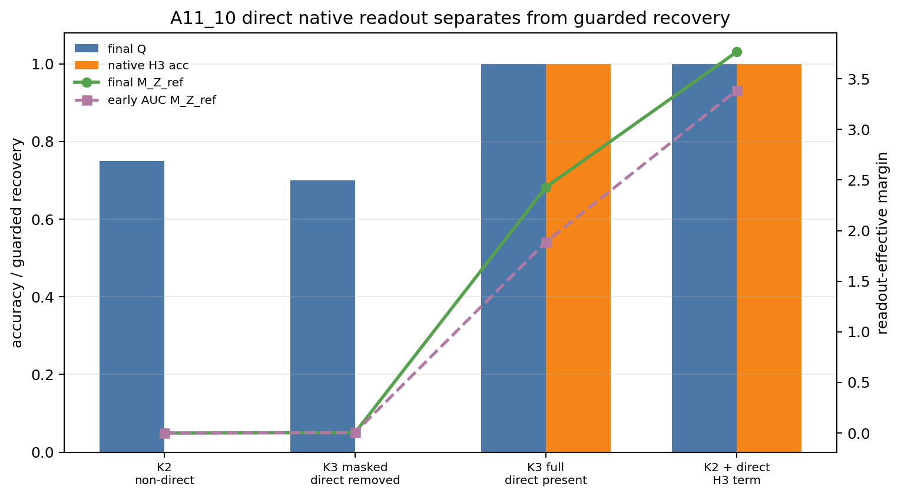

# 全位置训练中的可读性与原生直接读出分离

## 0. 执行摘要

**研究问题：** 在干净的长程语义构造中，全位置训练让早期变量 $Z$ 变得可读时，这是否等同于当前隐藏状态 $h_T$ 学会了原生的 $h_T\rightarrow S_Z$ 直接预测。

**机制解释：**

1. 直接语义监督指当前决策前缀隐藏状态 $h_T$ 自己预测第一个包含 $Z$ 的未来词 $S_Z$。

$$
L_{\mathrm{direct}}
=\lambda_3\operatorname{CE}(q_3(\cdot\mid h_T),S_Z).
$$

2. 全位置训练还会通过共享参数把其他位置的损失间接写回重新计算出的 $h_T$，这会让 $Z$ 可读，但不必然形成模型自身的第三步预测。

$$
\dot h_T^{(s)}
=-J_TJ_s^\top\nabla_{h_s}\ell_s,
\qquad
J_T=\frac{\partial h_T}{\partial\theta},\quad
J_s=\frac{\partial h_s}{\partial\theta}.
$$

3. 因此必须同时看“是否可读”和“是否被模型原生读出”。可读性用保守恢复分数 $Q$；原生直接读出用模型自身第三步预测和读出有效语义边距 $M_Z^{ref}$。

$$
Q=\min\{A_{\mathrm{decoder}},A_{\mathrm{probe}},C_{\mathrm{swap}}\},
$$

$$
M_Z^{ref}
=\frac1m\sum_z (u^0_{S_z}-\bar u^0)^\top h_z.
$$

**主要结果：**

1. 直接第三步监督是当前受控设置中可靠产生原生 $h_T\rightarrow S_Z$ 读出的路径。
2. 非直接的全位置训练也能让 $Z$ 可读，但这种恢复不能作为直接监督证据。
3. 直接读出优势不是由初始泄漏或局部目标损坏解释的。

**证据说明：**

1. 对结果 1，含直接第三步监督的两个条件都达到模型自身第三步预测 `1.00`，且 $M_Z^{ref}$ 很大。
   - 完整 K3 条件：最终 $Q=1.00$，原生第三步预测 `1.00`，最终 $M_Z^{ref}=2.430$。
   - K2 加直接第三步监督：最终 $Q=1.00$，原生第三步预测 `1.00`，最终 $M_Z^{ref}=3.766$。
2. 对结果 2，非直接条件保留非平凡 $Q$，但原生第三步预测为 `0.00`，$M_Z^{ref}$ 近似为 `0`。
   - K2 条件：最终 $Q=0.75$，原生第三步预测 `0.00`，最终 $M_Z^{ref}=0.000$。
   - K3 去掉决策前缀直接第三步监督：最终 $Q=0.70$，原生第三步预测 `0.00`，最终 $M_Z^{ref}=0.004$。
3. 对结果 3，所有条件第 0 步 $Q=0.25$、原生第三步预测为 `0`、$M_Z^{ref}$ 近似为 `0`；训练结束时所有条件的近端目标 $Y_1/Y_2$ 准确率都是 `1.00`。

**结论边界：** 当前结论只适用于受控干净 $\tau=3$ 全位置训练；不能推出自然语言中多步预测一定更好，也不能推出 MoE 路由保持或专家效用。

**执行动作：** 下一步应把 A11 收束到理论闭环：在什么优化假设下，正的一阶语义速度能推出更小的语义边距达到时间或更高的早期恢复曲线平均值；完成判据是给出可陈述的定理条件或明确的不可证明边界。

## 1. 术语解释

| 术语 | 中文含义 | 具体对象或计算方式 | 单位或公式 | 为什么影响当前判断 | 不能证明什么 |
|---|---|---|---|---|---|
| 全位置训练 | 序列中每个可预测位置都参与 loss | 对每个位置 $t$ 和未来偏移 $j$ 求交叉熵 | $L_K^{all}=\sum_t\sum_{j=1}^{K}\lambda_j\operatorname{CE}(q_j(\cdot\mid h_t),X_{t+j})$ | 会产生直接项和间接项混合 | 直接监督来源 |
| 早期变量 $Z$ | 前缀里出现、第三个未来词才需要的信息 | 数据中的分支身份 | 离散变量 | 代表长程语义依赖 | 自然语言全部语义 |
| 当前隐藏状态 $h_T$ | 读完决策前缀后的状态 | $h_T=f_\theta(X_{\le T})$ | 向量 | 判断 $Z$ 是否被写入的对象 | 后续所有状态是否含 $Z$ |
| 第一个有信息未来位置 $\tau$ | 第一个新增 $Z$ 信息的未来位置 | 干净构造中 $\tau=3$ | 未来偏移 | 决定直接语义监督出现在哪里 | 真实文本只有一个固定 $\tau$ |
| 直接第三步监督 | 当前 $h_T$ 自己预测 $S_Z$ | $\lambda_3\operatorname{CE}(q_3(\cdot\mid h_T),S_Z)$ | 交叉熵 | 检验短信用分配路径 | 唯一恢复路径 |
| 间接迁移 | 其他位置 loss 通过共享参数让重新计算出的 $h_T$ 也含 $Z$ | $\dot h_T^{(s)}=-J_TJ_s^\top\nabla_{h_s}\ell_s$ | 梯度方向 | 解释非直接条件的 $Q$ 恢复 | 原生第三步预测 |
| 保守恢复分数 $Q$ | 三种读出检查的最小值 | 解码器、探针、分支交换一致性的最小值 | $Q=\min\{A_{\mathrm{decoder}},A_{\mathrm{probe}},C_{\mathrm{swap}}\}$ | 判断 $Z$ 是否可读 | 直接监督来源 |
| 原生第三步预测 | 模型自己的第三步 head 是否从 $h_T$ 预测 $S_Z$ | $\Pr[\arg\max q_3(\cdot\mid h_T)=S_Z]$ | 准确率 | 判断模型是否学成直接读出 | 下游效用 |
| 读出有效语义边距 $M_Z^{ref}$ | $h_T$ 是否沿正确 $S_Z$ 输出方向分开 | 固定初始输出方向上的投影 | $M_Z^{ref}=\frac1m\sum_z(u^0_{S_z}-\bar u^0)^\top h_z$ | 判断 direct readout 几何是否形成 | 最终语言质量 |
| K2 条件 | 只预测前两个共享未来目标 | 激活 horizon 1 和 2 | 条件标签 | 非覆盖对照 | K2 不能通过间接迁移学到 $Z$ |
| 完整 K3 条件 | 预测前三个未来目标 | 激活 horizon 1、2、3 | 条件标签 | 同时包含直接项和间接项 | 直接项的唯一作用 |
| K3 去掉直接第三步监督 | 保留 K3 全位置训练，但删除 $h_T\rightarrow S_Z$ | mask decision-prefix H3 | 条件标签 | 检验直接项必要性 | 删除所有间接路径 |
| K2 加直接第三步监督 | K2 额外加入 $h_T\rightarrow S_Z$ | extra decision-prefix H3 | 条件标签 | 检验直接项充分性 | 完整 K3 全部作用 |
| 达到率 | 多个 seed 中达到 $Q\ge0.9$ 的比例 | 5 个 seed 的比例 | 0 到 1 | 衡量恢复稳定性 | 直接读出来源 |
| 早期恢复曲线平均值 | 训练早期一段窗口内 $Q$ 的平均水平 | 对 $Q(t)$ 在早期窗口取平均 | early AUC Q | 衡量是否更早、更稳定恢复 | 梯度来源 |
| 语义边距达到时间 | 语义边距第一次达到指定阈值的训练步数 | 记作 hitting time | step | 理论闭环要解释的效率指标 | 自然语言收益 |
| 局部守卫 | 近端共享目标是否仍被学好 | $Y_1/Y_2$ 准确率与 loss | 准确率 / 交叉熵 | 排除牺牲局部学习换语义恢复 | 全局语言质量 |

## 2. 机制解释与建模

**核心模型：**

1. 数据构造把“近处未来词不含 $Z$、第三个未来词才含 $Z$”隔离出来。

$$
X=(\operatorname{BR}_z,F_{00},\ldots,F_{15},U_{00},U_{01},U_{02},U_{03},A,C,S_z,\operatorname{STOP}),
$$

$$
Y_1=A,\qquad Y_2=C,\qquad Y_3=S_z.
$$

2. 全位置训练的总目标同时包含当前决策前缀上的直接项和其他位置上的间接项。

$$
L_K^{all}
=\sum_t\sum_{j=1}^{K}\lambda_j\operatorname{CE}(q_j(\cdot\mid h_t),X_{t+j}).
$$

3. 直接第三步监督是当前 $h_T$ 上的 $S_Z$ loss。

$$
L_{\mathrm{direct}}
=\lambda_3\operatorname{CE}(q_3(\cdot\mid h_T),S_Z).
$$

4. 其他位置的 loss 可以通过共享参数更新影响重新计算出的 $h_T$。

$$
\theta^+=\theta-\eta\nabla_\theta L_K^{all},
\qquad
h_T^+=f_{\theta^+}(X_{\le T}).
$$

5. 局部线性化下，位置 $s$ 的 loss 对 $h_T$ 的一阶影响由跨位置参数核描述。

$$
\dot h_T^{(s)}
=-J_TJ_s^\top\nabla_{h_s}\ell_s.
$$

6. 直接读出几何用固定输出方向上的 margin 判断。

$$
M_Z^{ref}
=\frac1m\sum_z (u^0_{S_z}-\bar u^0)^\top h_z.
$$

**符号含义：**

- $Z$：早期分支变量，也就是受控长程语义变量。
- $S_Z$：由 $Z$ 一一决定的第三个未来词。
- $h_T$：决策前缀后的当前隐藏状态。
- $q_3$：模型自己的第三步预测 head。
- $u^0_{S_z}$：初始第三步输出头中 $S_z$ 的输出方向。
- $J_T,J_s$：隐藏状态对共享参数 $\theta$ 的雅可比矩阵。

**机制链条：**

1. 如果训练目标包含 $L_{\mathrm{direct}}$，$h_T$ 会直接收到预测 $S_Z$ 的梯度，模型原生第三步预测和 $M_Z^{ref}$ 应该上升。
2. 如果训练目标不包含 $L_{\mathrm{direct}}$，其他位置 loss 仍可能通过共享参数让 $Z$ 在重新计算出的 $h_T$ 中可读，因此 $Q$ 可以高于 chance。
3. 因此本问题不能只看 $Q$；必须把 $Q$ 与原生第三步预测、$M_Z^{ref}$ 分开。

**当前问题分解：**

- 需要判定的机制环节：direct decision-prefix H3 是否解释原生读出和大 margin。
- 最危险的替代解释：非直接条件的 $Q$ 也恢复，因此可能误以为 direct path 不重要。
- 当前实验能区分：外部读出可恢复性与模型原生直接读出。
- 当前实验不能区分：自然语言中的 MTP 收益、MoE 路由保持、专家效用。

## 3. 主要结果

**一句话总结：** 在干净 $\tau=3$ 全位置训练中，直接第三步监督可靠地产生模型原生 $h_T\rightarrow S_Z$ 读出；非直接训练可以让 $Z$ 可读，但不能作为 direct supervision 证据。

### 结果 1：直接第三步监督可靠地产生原生读出和大的语义边距。

**机制对应：** 该结果对应第 2 节中的 $L_{\mathrm{direct}}$。如果这个项是真正的 direct path，那么加入它应当提高原生第三步预测和 $M_Z^{ref}$。

**指标或条件定义：** 原生第三步预测是模型自己的第三步 head 从 $h_T$ 预测 $S_Z$ 的准确率；$M_Z^{ref}$ 是 $h_T$ 沿初始 $S_Z$ 输出方向的读出有效边距。

**证据说明：**

- 完整 K3 条件达到最终 $Q=1.00$，原生第三步预测 `1.00`，最终 $M_Z^{ref}=2.430$。
- K2 加直接第三步监督达到最终 $Q=1.00$，原生第三步预测 `1.00`，最终 $M_Z^{ref}=3.766$。
- 相对 K2 baseline，K2 加直接第三步监督的原生第三步预测提升 `+1.00`，最终 $M_Z^{ref}$ 提升 `+3.766`，达到率提升 `+0.40`。

**解释：** 直接监督不仅让 $Z$ 可被外部读出，还让模型自己的第三步预测 head 能从当前 $h_T$ 直接预测 $S_Z$。这说明直接项改变的是读出有效几何，而不是只改善 probe 指标。

**边界：** 该证据不证明 direct supervision 是唯一可能路径；只说明它是当前受控设置中可靠产生 native readout 的路径。

**来源：** `Projects/from-attention-to-search/main/experiments/A11/A11_10_all_position_indirect_transfer_dynamics/summary.md`；`tables/condition_summary.csv`。

### 结果 2：非直接全位置训练可以恢复 $Q$，但没有形成原生直接读出。

**机制对应：** 该结果对应第 2 节的间接迁移项。其他位置 loss 可以通过共享参数让重新计算出的 $h_T$ 包含 $Z$，但它不必然训练 $q_3(\cdot\mid h_T)$。

**指标或条件定义：** $Q$ 是可读性指标；原生第三步预测和 $M_Z^{ref}$ 是直接读出指标。若 $Q$ 高但原生第三步预测和 $M_Z^{ref}$ 低，说明是外部读出可恢复，而不是模型原生直接读出。

**证据说明：**

- K2 条件最终 $Q=0.75$，但原生第三步预测 `0.00`，最终 $M_Z^{ref}=0.000$。
- K3 去掉决策前缀直接第三步监督后，最终 $Q=0.70$，但原生第三步预测 `0.00`，最终 $M_Z^{ref}=0.004$。
- 相对完整 K3，去掉直接项后原生第三步预测下降 `-1.00`，最终 $M_Z^{ref}$ 下降约 `-2.425`。

**解释：** 这说明全位置训练里的可读性有两种来源：直接项训练出来的 native readout，和共享参数带来的 indirect readable signal。二者在 $Q$ 上可能都表现为恢复，但在原生第三步预测和 margin 上不同。

**边界：** 该证据不说明间接迁移无用；它说明间接迁移不能被当作 direct supervision 证据。

**来源：** `Projects/from-attention-to-search/main/experiments/A11/A11_10_all_position_indirect_transfer_dynamics/detailed.md`；`tables/condition_summary.csv`。

### 结果 3：直接读出优势不是由泄漏或局部目标损坏解释的。

**机制对应：** 该结果对应实验守卫：如果 step 0 已有泄漏，或局部目标被破坏，则 direct readout 差异不能解释为目标机制。

**指标或条件定义：** 第 0 步守卫检查训练前 $Q$、原生第三步预测和 $M_Z^{ref}$ 是否为 chance / 近零；局部守卫检查最终 $Y_1/Y_2$ 是否仍学好。

**证据说明：**

- 所有条件第 0 步 $Q=0.25$，原生第三步预测 `0.00`，$M_Z^{ref}$ 近似为 `0`。
- 所有条件最终 $Y_1$ 准确率为 `1.00`，最终 $Y_2$ 准确率为 `1.00`。
- 4 个条件、5 个 seed、共 20 个训练任务完成；run name 为 `a11_10_all_position_indirect_transfer_full_20260709_164227`。

**解释：** 第 0 步没有可读性泄漏，训练结束也没有牺牲近端共享目标。因此 direct 条件的优势更合理地归因于 $h_T\rightarrow S_Z$ 直接项，而不是初始化或局部目标崩塌。

**边界：** 局部守卫只说明 $Y_1/Y_2$ 没坏；它不证明真实语言建模质量或 MoE 专家效用。

**来源：** `Projects/from-attention-to-search/main/experiments/A11/A11_10_all_position_indirect_transfer_dynamics/detailed.md`；`tables/local_loss_guard_summary.csv`；`run_manifest.json`。



这张图检验 $Q$、原生第三步预测和 $M_Z^{ref}$ 是否是同一个信号。蓝柱是最终 $Q$，橙柱是原生第三步预测，折线是读出边距。非直接条件有非平凡 $Q$，但原生第三步预测为 `0` 且 margin 近 `0`；直接条件同时有高 $Q$、高原生第三步预测和大 margin。

## 4. 执行动作

**下一步动作：** 开 A11_11 理论闭环，把“直接项给正的一阶语义速度”推进到“有限步学习效率”的可证明条件。

**目的：** 当前实验已经区分了可读性和原生直接读出；下一步需要回答正的一阶语义速度是否能推出更小语义边距达到时间或更高早期恢复曲线平均值。

**完成判据：** 给出一个明确 theorem boundary：要么在显式优化假设下证明 margin 增长或 hitting-time 上界，要么说明缺少哪些假设导致该命题不能成立。

## 5. 证据索引

| 结果 | 证据 | 主要指标或图 | 支持什么 | 不能证明什么 | 来源 |
|---|---|---|---|---|---|
| 结果 1 | 直接条件均达到原生第三步预测 `1.00` 和大 $M_Z^{ref}$ | 原生第三步预测，$M_Z^{ref}$，直接条件差值 | 直接第三步监督足以产生原生读出 | 直接监督是唯一恢复路径 | `summary.md`，`condition_summary.csv` |
| 结果 2 | 非直接条件有非平凡 $Q$，但原生第三步预测为 `0.00` 且 $M_Z^{ref}$ 近 `0` | $Q$，原生第三步预测，$M_Z^{ref}$ | 只看 $Q$ 不是直接监督证据 | 间接迁移无用 | `detailed.md`，`condition_summary.csv` |
| 结果 3 | step 0 无泄漏，最终 $Y_1/Y_2$ 均为 `1.00` | step0 指标，local guard | 排除初始化泄漏和局部目标损坏 | 真实语言建模质量 | `run_manifest.json`，`local_loss_guard_summary.csv` |

## 6. 来源索引

**Anchor：**

```text
Projects/from-attention-to-search/main/problem_anchors/11_long_horizon_mtp_objective/11_10_all_position_indirect_transfer_dynamics_anchor.md
```

**Protocol：**

```text
Projects/from-attention-to-search/main/experiments/A11/A11_10_all_position_indirect_transfer_dynamics/protocol.md
```

**Summary：**

```text
Projects/from-attention-to-search/main/experiments/A11/A11_10_all_position_indirect_transfer_dynamics/summary.md
```

**Detailed：**

```text
Projects/from-attention-to-search/main/experiments/A11/A11_10_all_position_indirect_transfer_dynamics/detailed.md
```

**Tables：**

```text
Projects/from-attention-to-search/main/experiments/A11/A11_10_all_position_indirect_transfer_dynamics/tables/condition_summary.csv
Projects/from-attention-to-search/main/experiments/A11/A11_10_all_position_indirect_transfer_dynamics/tables/local_loss_guard_summary.csv
Projects/from-attention-to-search/main/experiments/A11/A11_10_all_position_indirect_transfer_dynamics/tables/one_step_summary.csv
```

**Figure：**

```text
daily_research_reports/0709/meetings/figures/mtp_a11_10_direct_native_margin_split.png
```

## 7. 补充材料

完整运行确认：

```text
run name: a11_10_all_position_indirect_transfer_full_20260709_164227
conditions: K2_active, K3_active, K3_mask_decision_prefix_L3, K2_plus_decision_prefix_L3
seeds: 971, 972, 973, 974, 975
steps: 15000
eval interval: 250
shards: 4 completed
total training tasks: 20
```

核心结果表：

| 条件 | 作用 | 达到率 | 早期 AUC Q | 最终 Q | 原生第三步预测 | 最终 $M_Z^{ref}$ |
|---|---|---:|---:|---:|---:|---:|
| K2 | 非覆盖对照 | 0.60 | 0.773 | 0.75 | 0.00 | 0.000 |
| K3 去掉直接第三步监督 | 间接 K3 对照 | 0.60 | 0.773 | 0.70 | 0.00 | 0.004 |
| 完整 K3 | 直接 + 间接 | 1.00 | 0.965 | 1.00 | 1.00 | 2.430 |
| K2 加直接第三步监督 | 直接项充分性 | 1.00 | 0.965 | 1.00 | 1.00 | 3.766 |
