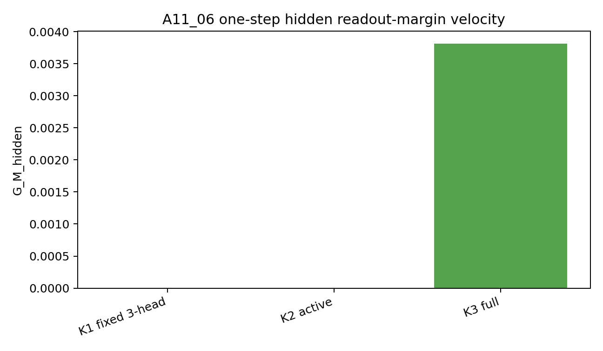
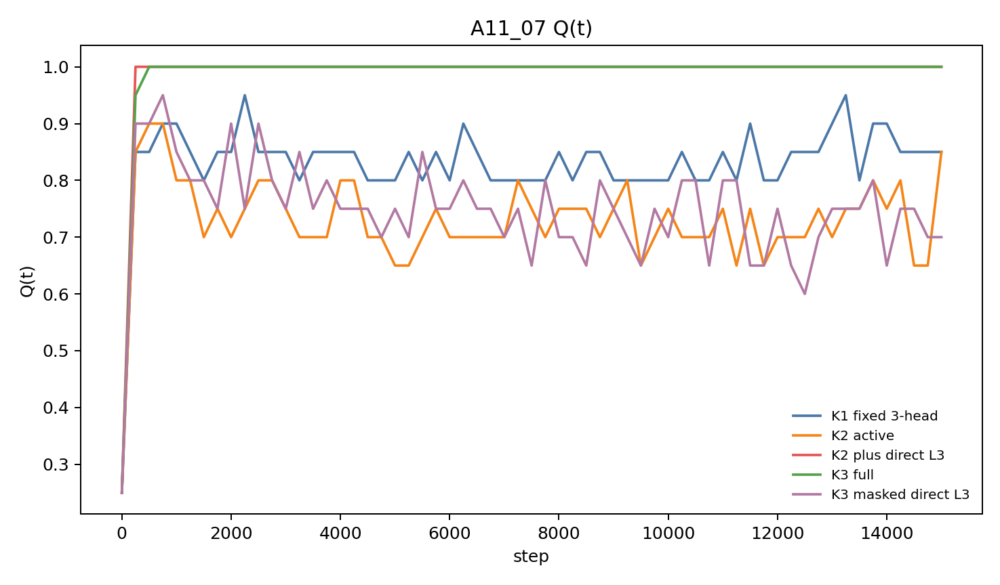
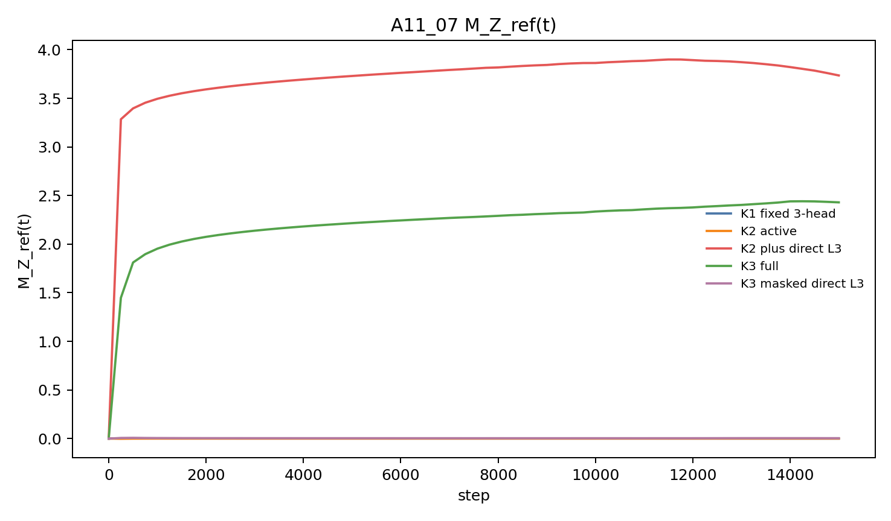
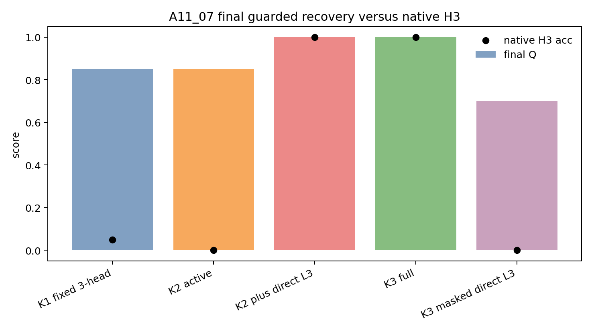

# MTP 长程语义学习：从表示保证到效率机制

## 0. 执行摘要

**研究问题：** 多步预测目标是否能比只预测下一词的目标更直接、更高效地让当前隐藏状态保留未来才会用到的语义变量。

**机制解释：**

1. 数据构造把“近处未来词不需要 $Z$、远处未来词需要 $Z$”隔离出来。

$$
Y_1=A_{\mathrm{shared}},\qquad
Y_2=C_{\mathrm{shared}},\qquad
Y_3=S_Z.
$$

2. 第一个有信息未来位置由条件互信息定义；只有当 $K$ 覆盖该位置时，当前 $h_T$ 才收到直接语义监督。

$$
\tau=\min\{j:I(Z;Y_j\mid Y_{<j})>0\},\qquad K\ge\tau.
$$

3. 目标函数差别在于：K1/K2 只预测共享目标，K3 第一次把 $S_Z$ 放进当前 $h_T$ 的训练目标。

$$
L_1=\operatorname{CE}(q_1(\cdot\mid h_T),A),
$$

$$
L_2=L_1+\lambda_2\operatorname{CE}(q_2(\cdot\mid h_T),C),
$$

$$
L_3=L_2+\lambda_3\operatorname{CE}(q_3(\cdot\mid h_T),S_Z).
$$

4. 表示保证说明：低有信息未来词损失会强迫 $h_T$ 含有 $Z$。

$$
\mathbb E[-\log q_\tau(S_Z\mid h_T)]\le\varepsilon
\quad\Rightarrow\quad
I(h_T;Z)\ge H(Z)-\varepsilon.
$$

5. margin 的目标是检查 $h_T$ 是否朝“模型自己能用来预测 $S_Z$”的方向移动，而不只是被外部探针读出来。

$$
M_Z=\frac1m\sum_z(u_{S_z}-\bar u)^\top h_z.
$$

如果 $M_Z$ 增大，说明第 $z$ 个分支的当前状态 $h_z$ 正朝正确未来词 $S_z$ 的输出方向移动；这比普通 hidden separation 更重要，因为它直接对应模型自身读出。

6. 效率机制说明：在干净 $\tau=3$ 的一阶模型中，K3 让这个 margin 严格增加，K1/K2 没有这个一阶方向。

$$
G_1^{margin}=0,\qquad
G_2^{margin}=0,\qquad
G_3^{margin}=\frac{\lambda_3}{m^2}\sum_z\|u_z-\bar u\|^2>0.
$$

7. 全位置训练中的间接迁移是共享参数更新，不是 $h_{T+1}$ 信息回流到 $h_T$。

$$
\theta^+=\theta-\eta\nabla_\theta L_K^{all},
\qquad
h_T^+=f_{\theta^+}(X_{\le T}).
$$

**主要结果：**

1. 如果 $K$ 覆盖第一个含 $Z$ 的未来词，且该未来词是一一编码 $S_Z$，那么低未来词损失会推出当前隐藏状态 $h_T$ 含有 $Z$。
2. 在干净 $\tau=3$ 构造中，K3 对读出有效语义边距有严格正的一阶增长，K1/K2 在分支折叠初始化下为 $0$。
3. 在全位置训练中，直接 $h_T\rightarrow S_Z$ 监督让模型自身预测和语义边距更强；K1/K2 的 $Q$ 恢复应解释为共享参数训练后的间接可读性，而不是 $h_{T+1}$ 的信息回流到 $h_T$。

**证据说明：**

1. 对结果 1，理论证据是互信息下界；实验补充是 A11_04 决策前缀训练中 K3 覆盖 $\tau=3$ 后超过 K1/K2。
   - K1/K2 最终 $Q=0.25$、达到率 `0.00`。
   - K3 在分支相同初始化下 AUC $Q=0.665$、最终 $Q=0.800$、达到率 `0.60`。
2. 对结果 2，A11_06 的一阶读出边距速度直接检验机制方向。
   - K1 的 $G_M^{hidden}=7.28\times10^{-12}$，K2 的 $G_M^{hidden}=-1.16\times10^{-11}$。
   - K3 的 $G_M^{hidden}=0.003816$。
3. 对结果 3，A11_07 同时看 $Q$、模型自身第三步预测和 $M_Z$，用来区分“可读出 $Z$”和“当前 $h_T$ 受到直接 $S_Z$ 监督”。
   - K2 加直接第三步监督后，达到率从 `0.60` 到 `1.00`，模型自身第三步预测从 `0.00` 到 `1.00`。
   - K3 去掉直接第三步监督后，最终 $M_Z$ 从 `2.430` 降到 `0.004`。
   - K1/K2 的最终 $Q$ 可到 `0.85`，但模型自身第三步预测仍接近 `0`；这说明其他位置的 loss 可能通过共享参数让重新计算出的 $h_T$ 可读出 $Z$，但没有形成原生 $h_T\rightarrow S_Z$ 预测。

**结论边界：** 当前不能声称自然语言中 MTP 已经优于 NTP，不能声称 K 越大越好，也不能声称非覆盖 K 在全位置训练中不能学到 $Z$。

**执行动作：** A11 当前应收束为“受控直接语义状态形成机制”；若连接 MoE 主线，下一步只做最小路由相关性桥接判定卡，完成判据是语义边距或模型自身预测变化能否带来路由边距或路由边界翻转变化。

## 1. 术语解释

| 术语 | 中文含义 | 具体对象或计算方式 | 单位或公式 | 为什么影响当前判断 | 不能证明什么 |
|---|---|---|---|---|---|
| 多步预测目标（MTP） | 同一个当前隐藏状态预测多个未来词 | 从 $h_T$ 同时预测 $Y_1,\ldots,Y_K$ | $L_K(h_T)=\sum_{j=1}^{K}\lambda_j\operatorname{CE}(q_j(\cdot\mid h_T),Y_j)$ | 判断远处语义目标是否提前监督当前状态 | K 越大一定越好 |
| 下一词预测目标（NTP） | 当前隐藏状态只预测下一个词 | K1 条件，只预测 $Y_1$ | $L_1(h_T)=\operatorname{CE}(q_1(\cdot\mid h_T),Y_1)$ | 作为非覆盖对照 | NTP 永远学不到长程信息 |
| 早期语义变量 $Z$ | 前缀中出现、未来才需要的信息 | 受控实验中是 branch 身份 | 离散变量 | 代表长程语义依赖 | 自然语言全部语义 |
| 当前隐藏状态 $h_T$ | 模型读完决策前缀后的状态 | $h_T=f_\theta(X_{\le T})$ | 向量 | 判断 $Z$ 是否被写入的对象 | 所有后续状态都含 $Z$ |
| 第一个有信息未来位置 $\tau$ | 第一个新增 $Z$ 信息的未来位置 | $\tau=\min\{j:I(Z;Y_j\mid Y_{<j})>0\}$ | 未来位置偏移 | 决定 K 是否覆盖有效监督 | 真实文本有固定单一 $\tau$ |
| 干净 $\tau=3$ 构造 | 第三个未来词才第一次包含 $Z$ 的受控数据 | $Y_1=A_{\mathrm{shared}},Y_2=C_{\mathrm{shared}},Y_3=S_Z$ | 未来位置偏移 | 隔离“覆盖 $\tau$”这个变量 | 自然语言也遵循该固定构造 |
| K1 | 只预测下一词的对照 | 只激活 $Y_1$ loss | 条件标签 | 对照 NTP | K1 不能通过间接迁移恢复 $Z$ |
| K2 | 不覆盖 $\tau=3$ 的两步预测对照 | 激活 $Y_1,Y_2$ loss | 条件标签 | 检查多预测一个共享目标是否足够 | K2 在全位置训练中不能恢复 $Z$ |
| K3 | 覆盖 $\tau=3$ 的三步预测条件 | 激活 $Y_1,Y_2,Y_3$ loss | 条件标签 | 检查直接覆盖 $S_Z$ 的效果 | K 越大一定越好 |
| K2 加直接第三步监督 | 在 K2 上只加 $h_T\rightarrow S_Z$ 监督 | K2 loss + $\lambda_3\operatorname{CE}(q_3(\cdot\mid h_T),S_Z)$ | 条件标签 | 检验直接项是否足够产生 K3 式效果 | 完整 K3 的全部作用 |
| K3 去掉直接第三步监督 | 删除 K3 中 $h_T\rightarrow S_Z$ 这一项 | 保留其他全位置 K3 loss | 条件标签 | 检验直接项在 K3 内是否必要 | 所有间接路径都被删除 |
| 直接语义监督 | 当前 $h_T$ 直接预测含 $Z$ 的未来词 | $\operatorname{CE}(q_\tau(\cdot\mid h_T),S_Z)$ | 交叉熵 | 是 MTP 的核心机制项 | 唯一恢复路径 |
| 表示保证 | 低损失强迫 $h_T$ 含有 $Z$ | 从未来词预测损失推出互信息下界 | $I(h_T;Z)\ge H(Z)-\varepsilon$ | 回答“是否必须含有长程信息” | 学习速度 |
| 读出有效语义边距 $M_Z$ | $h_T$ 是否朝正确未来词输出方向移动 | 固定输出方向上的投影 | $M_Z=\frac1m\sum_z(u^0_{S_z}-\bar u^0)^\top h_z$ | 回答“梯度是否朝有用语义方向走” | 多步收敛必然更快 |
| 一阶读出边距速度 $G_M^{hidden}$ | 当前损失对 $M_Z$ 的瞬时推动 | 隐藏状态梯度在正确输出方向上的投影 | $G_M^{hidden}=\frac1m\sum_z(u^0_{S_z}-\bar u^0)^\top(-\nabla_{h_z}L_K)$ | 检验效率理论的核心量 | 参数空间样本效率 |
| 语义恢复分数 $Q$ | 三个恢复检测的保守最小值 | 解码器准确率、线性探针准确率、分支交换一致性的最小值 | $Q(t)=\min\{A(t),P(t),S(t)\}$ | 判断 $Z$ 是否稳定可读 | 直接监督来源 |
| 曲线下面积（AUC） | 一段训练窗口内指标的平均水平 | 对 $Q(t)$ 等曲线在指定窗口取平均 | score | 衡量早期是否更快、更稳定恢复 | 梯度因果来源 |
| 模型自身第三步预测 | 模型原生从 $h_T$ 预测 $S_Z$ | 第 3 预测头的最高概率词准确率 | $\Pr[\arg\max q_3(\cdot\mid h_T)=S_Z]$ | 区分直接预测和探针可读 | 下游效用 |
| 间接迁移 | 其他位置 loss 更新同一套参数，使重新计算出的 $h_T$ 也可能含 $Z$ | 例如 $h_{T+1}$ 或 $h_{T+2}$ 上的 $S_Z$ 监督更新共享 Transformer 参数 $\theta$，之后 $h_T=f_{\theta}(X_{\le T})$ 也变得可读 | 现象判断 | 解释 K1/K2 也能恢复 $Q$ | $h_T$ 在该位置受到直接 $S_Z$ 监督 |
| 局部守卫 | 近端共享目标是否被破坏 | $Y_1/Y_2$ loss 和准确率 | 交叉熵 / 准确率 | 排除牺牲本地学习换长程恢复 | 全局语言质量 |

## 2. 机制解释与建模

**核心模型：**

1. 数据构造把“最近词不需要 $Z$、远处词需要 $Z$”写成可检验对象。

$$
X=(\operatorname{BR}_Z,F_1,\ldots,F_L,U,A,C,S_Z),
\qquad
Y_1=A,\quad Y_2=C,\quad Y_3=S_Z.
$$

2. 第一个有信息未来位置由条件互信息定义；在干净 $\tau=3$ 中，只有第三个未来词新增 $Z$ 信息。

$$
\tau=\min\{j:I(Z;Y_j\mid Y_{<j})>0\},
$$

$$
I(Z;Y_1)=0,\qquad I(Z;Y_2\mid Y_1)=0,\qquad I(Z;Y_3\mid Y_1,Y_2)=H(Z).
$$

3. 多步预测目标覆盖 $\tau$ 时，当前状态 $h_T$ 直接承受含 $Z$ 的未来词损失。

$$
L_K(h_T)=\sum_{j=1}^{K}\lambda_j\operatorname{CE}(q_j(\cdot\mid h_T),Y_j).
$$

4. 旧表示定理说明：如果有信息未来词预测损失足够低，则 $h_T$ 必须含有 $Z$。

$$
\mathbb E[-\log q_\tau(S_Z\mid h_T)]\le\varepsilon
\quad\Rightarrow\quad
I(h_T;Z)\ge H(Z)-\varepsilon.
$$

5. 新效率定理说明：在分支折叠初始化下，K3 有正的一阶语义更新，K1/K2 没有。

$$
G_1^{margin}(\theta_0)=0,\qquad
G_2^{margin}(\theta_0)=0,
$$

$$
G_3^{margin}(\theta_0)=\frac{\lambda_3}{m^2}\sum_{z=1}^{m}\|u_z-\bar u\|^2>0.
$$

6. 全位置训练需要拆开直接项和共享参数间接项，否则 $Q$ 的来源会混在一起。

$$
L_K^{all}=L_{\mathrm{direct}}(h_T\rightarrow S_Z)+L_{\mathrm{shifted}}+L_{\mathrm{shared}},
$$

$$
L_{\mathrm{direct}}=\lambda_3\operatorname{CE}(q_3(\cdot\mid h_T),S_Z).
$$

间接项不是一次前向传播中的信息回流，而是训练更新共享参数：

$$
\theta^+=\theta-\eta\nabla_\theta L_K^{all},
\qquad
h_T^+=f_{\theta^+}(X_{\le T}).
$$

**符号含义：**

- $Z$：早期分支变量，也就是受控长程语义变量。
- $h_T$：决策前缀后的当前隐藏状态。
- $Y_j$：当前状态之后第 $j$ 个未来目标。
- $S_Z$：由 $Z$ 一一决定的未来 token。
- $K$：多步预测覆盖的未来位置数量。
- $u_z$：第 3 预测头中 $S_z$ 的输出方向。
- $\bar u$：所有 $S_z$ 输出方向的均值。

**机制链条：**

1. 如果 $K<\tau$，当前 $h_T$ 的训练目标只包含共享未来词，分支折叠状态仍可把局部 loss 降低。
2. 如果 $K\ge\tau$，loss 中出现 $h_T\rightarrow S_Z$，低 loss 会排除不含 $Z$ 的 $h_T$。
3. 在优化早期，K3 的 $S_Z$ loss 给 $h_T$ 一个沿正确输出方向移动的正一阶速度，K1/K2 的共享目标只给公共更新。
4. 在全位置训练中，其他位置 loss 可以通过共享参数让重新计算出的 $h_T$ 可读 $Z$；这不是 $h_{T+1}$ 到 $h_T$ 的前向信息回流，所以 direct path 必须用模型自身第三步预测和 $M_Z$ 来保护，不能只看 $Q$。

**当前问题分解：**

- 已回答：覆盖 $\tau$ 的低损失是否强迫 $h_T$ 含 $Z$。
- 新回答：覆盖 $\tau$ 是否给 $h_T$ 一个一阶语义更新方向。
- 仍未回答：该机制在自然语言、MoE 路由保持或专家效用中是否成立。

## 3. 主要结果

**一句话总结：** A11 当前已经从“MTP 让 $h_T$ 必须含有长程变量”推进到“覆盖有信息未来词会给 $h_T$ 更直接的一阶语义更新”，但全位置训练中的共享参数间接迁移要求更保守地解释 $Q$。

### 结果 1：低有信息未来词损失会推出 $h_T$ 含有早期变量 $Z$，这是当前最稳的表示保证。

**机制对应：** 对应第 2 节公式 2 到公式 4：$Y_\tau=S_Z$ 一一编码 $Z$，如果当前状态能低损失预测 $S_Z$，它就不能对 $Z$ 盲。

**指标或条件定义：** 这里的“低损失”指 $\mathbb E[-\log q_\tau(S_Z\mid h_T)]\le\varepsilon$；“含有 $Z$”用互信息下界 $I(h_T;Z)\ge H(Z)-\varepsilon$ 表达。

**证据说明：**

- 理论证据：若 $S_Z$ 是 $Z$ 的一一编码，低第 $\tau$ 未来词损失等价于能从 $h_T$ 预测 $S_Z$，因此 $h_T$ 必须保留几乎全部 $Z$ 信息。
- K=2 最小构造证据：$Y_1=A$ 共享、$Y_2=S_B$ 含分支，K2 排除不区分分支的状态，NTP 不需要这样做。
- K=3 推广证据：A11_04 只在决策前缀训练时，K1/K2 不覆盖 $\tau=3$，最终 $Q=0.25$、达到率 `0.00`；K3 覆盖 $\tau=3$，分支相同初始化下 AUC $Q=0.665$、最终 $Q=0.800$、达到率 `0.60`。

**解释：** 这条结果回答“是否含有长程信息”。它说明 MTP 的确定优势不是“预测更多词”本身，而是当新增未来词第一次包含 $Z$ 时，低 loss 会直接约束当前 $h_T$。

**边界：** 表示保证不等于训练更快；它也不说明 all-position 中 K1/K2 不会通过其他位置学到 $Z$。

**来源：** `Projects/from-attention-to-search/main/stories/11_long_horizon_mtp_objective/story_cn.md`，`Projects/from-attention-to-search/main/problem_anchors/11_long_horizon_mtp_objective/11_04_k3_first_informative_horizon_anchor.md`，`Projects/from-attention-to-search/main/experiments/A11/A11_04_k3_first_informative_horizon/summary.md`。

### 结果 2：在干净 $\tau=3$ 的一阶模型中，K3 给 $h_T$ 正的语义更新方向，K1/K2 没有这个方向。

**机制对应：** 对应第 2 节公式 5：K1/K2 只看到共享目标 $A,C$，产生公共更新；K3 看到 $S_Z$，不同分支朝各自正确输出方向移动。

**指标或条件定义：** 读出有效语义边距 $M_Z$ 衡量 $h_T$ 是否朝正确 $S_Z$ 输出方向分开；$G_M^{hidden}$ 衡量当前 loss 对 $M_Z$ 的一阶推动。

**证据说明：**

- 理论结果：分支折叠初始化下，$G_1^{margin}=0$、$G_2^{margin}=0$，而 $G_3^{margin}=\frac{\lambda_3}{m^2}\sum_z\|u_z-\bar u\|^2>0$。
- A11_06 一步诊断：K1 的 $G_M^{hidden}=7.28\times10^{-12}$，K2 的 $G_M^{hidden}=-1.16\times10^{-11}$，K3 的 $G_M^{hidden}=0.003816$。
- A11_06 泄漏守卫通过：step 0 时 $Q=0.25$，$M_Z\approx0$，$E_Z=0$，模型自身第三步预测为 $0$。



**解释：** 这条结果把“低 loss 会迫使表示含 $Z$”推进到“优化一开始就朝正确语义方向推”。这里的 margin 不是普通隐藏状态距离，而是沿 $S_Z$ 输出方向的读出有效边距；它增大意味着模型自身的预测头更容易从 $h_T$ 使用 $Z$，所以比单纯 final Q 或外部探针更接近学习效率机制。

**边界：** 这仍是一阶局部结论，不自动推出任意训练设置下 $T_{0.9}$ 更小，也不证明自然语言收益。

**来源：** `Projects/from-attention-to-search/main/problem_anchors/11_long_horizon_mtp_objective/11_06_readout_effective_margin_efficiency_anchor.md`，`Projects/from-attention-to-search/main/experiments/A11/A11_06_readout_effective_margin_efficiency/summary.md`，`Projects/from-attention-to-search/main/experiments/A11/A11_06_readout_effective_margin_efficiency/detailed.md`。

### 结果 3：在无泄漏全位置训练中，直接 $h_T\rightarrow S_Z$ 监督更强；非覆盖条件的 $Q$ 恢复来自共享参数间接可读性，不能当作直接监督。

**机制对应：** 对应第 2 节公式 6：全位置 loss 包含当前 $h_T\rightarrow S_Z$ 直接项，也包含其他位置的 $S_Z$ 相关项；后者通过共享参数 $\theta$ 改变重新计算出的 $h_T$，不是在同一次前向传播中把 $h_{T+1}$ 的信息传回 $h_T$。

**指标或条件定义：** $Q$ 判断 $Z$ 是否稳定可读；模型自身第三步预测和 $M_Z$ 判断是否真的学成当前 $h_T\rightarrow S_Z$ 路径；达到率判断多个随机种子中有多少稳定达到 $Q\ge0.9$。

**证据说明：**

- A11_07 泄漏守卫通过：所有条件第 0 步都有 $Q=0.25$、$M_Z\approx0$、$E_Z=0$、模型自身第三步预测为 $0$。
- 直接项充分性：K2 的达到率为 `0.60`、早期 AUC Q 为 `0.771`、模型自身第三步预测为 `0.00`；K2 加直接第三步监督提升到达到率 `1.00`、早期 AUC Q `0.969`、模型自身第三步预测 `1.00`。
- 直接项必要性对照：K3 的达到率为 `1.00`、最终 $Q=1.00$、模型自身第三步预测 `1.00`、最终 $M_Z=2.430$；K3 去掉直接第三步监督降到达到率 `0.60`、最终 $Q=0.70$、模型自身第三步预测 `0.00`、最终 $M_Z=0.004$。
- 间接迁移边界：K1/K2 的最终 $Q$ 都可到 `0.85`，但模型自身第三步预测分别只有 `0.05` 和 `0.00`。合理解释是：全位置训练中其他位置的 $S_Z$ 相关 loss 更新了共享参数，使重新计算出的 $h_T$ 也可被探针读出 $Z$；但它没有学成原生 $h_T\rightarrow S_Z$ 预测。







**解释：** 直接第三步监督同时提升 $Q$、模型自身第三步预测和 $M_Z$，说明它不是普通辅助损失或预测头数量差异。非直接条件能恢复部分 $Q$，说明全位置训练会通过共享参数产生间接可读性；因此当前结论必须是“直接项更强、更稳定”，不是“只有 K3 能学 $Z$”。

**边界：** 这不否定 NTP 或 K2 在全位置训练中最终学到 $Z$ 的可能性，也不说明可被探针读出的表示没有用；它只限制了证据解释：$Q$ 高说明 $h_T$ 可读，不说明该位置受到了直接 $S_Z$ 监督。

**来源：** `Projects/from-attention-to-search/main/problem_anchors/11_long_horizon_mtp_objective/11_07_no_leakage_all_position_efficiency_anchor.md`，`Projects/from-attention-to-search/main/experiments/A11/A11_07_no_leakage_all_position_efficiency/summary.md`，`Projects/from-attention-to-search/main/experiments/A11/A11_07_no_leakage_all_position_efficiency/detailed.md`。

## 4. 执行动作

**下一步动作：** 停止继续扩 K 或重复只看 $Q$ 的全位置曲线；先写一个最小 MoE 路由相关性桥接判定卡。

**目的：** 判断 MTP 写入的长程语义状态是否会改变主线真正关心的路由几何，例如路由边距、路由边界翻转、稀有特征边距。

**完成判据：** 新判定卡必须同时包含语义状态证据和路由结果证据；语义状态证据至少使用 $M_Z$ 或模型自身第三步预测，路由结果证据至少使用路由边距或边界翻转，并保留局部语言建模守卫。

## 5. 证据索引

| 结果 | 证据 | 主要指标或图 | 支持什么 | 不能证明什么 | 来源 |
|---|---|---|---|---|---|
| 结果 1 | 低有信息位置损失推出互信息下界；A11_04 决策前缀训练中 K3 超过 K1/K2 | $I(h_T;Z)\ge H(Z)-\varepsilon$；AUC Q；最终 Q；达到率 | 覆盖 $\tau$ 给 $h_T$ 表示约束 | 学习速度、自然语言收益 | story_cn；11_04 anchor；A11_04 summary |
| 结果 2 | A11_06 一阶读出边距诊断 | $G_M^{hidden}$；一步隐藏边距图 | K3 有直接语义更新方向，K1/K2 近零 | 多步训练必然更快 | 11_06 anchor；A11_06 summary/detailed |
| 结果 3 | A11_07 直接项与共享参数间接项对照 | $Q$；早期 AUC；模型自身第三步预测；$M_Z$；最终 Q 对模型自身预测图 | 直接项更强；$Q$ 单独不足 | 非覆盖 K 不能学习 $Z$ | 11_07 anchor；A11_07 summary/detailed |

## 6. 来源索引

**Anchor：**

- `Projects/from-attention-to-search/main/problem_anchors/11_long_horizon_mtp_objective/11_04_k3_first_informative_horizon_anchor.md`
- `Projects/from-attention-to-search/main/problem_anchors/11_long_horizon_mtp_objective/11_06_readout_effective_margin_efficiency_anchor.md`
- `Projects/from-attention-to-search/main/problem_anchors/11_long_horizon_mtp_objective/11_07_no_leakage_all_position_efficiency_anchor.md`

**Story：**

- `Projects/from-attention-to-search/main/stories/11_long_horizon_mtp_objective/story_cn.md`

**Protocol：**

- `Projects/from-attention-to-search/main/experiments/A11/A11_04_k3_first_informative_horizon/protocol.md`
- `Projects/from-attention-to-search/main/experiments/A11/A11_06_readout_effective_margin_efficiency/protocol.md`
- `Projects/from-attention-to-search/main/experiments/A11/A11_07_no_leakage_all_position_efficiency/protocol.md`

**Summary：**

- `Projects/from-attention-to-search/main/experiments/A11/A11_04_k3_first_informative_horizon/summary.md`
- `Projects/from-attention-to-search/main/experiments/A11/A11_06_readout_effective_margin_efficiency/summary.md`
- `Projects/from-attention-to-search/main/experiments/A11/A11_07_no_leakage_all_position_efficiency/summary.md`

**Detailed：**

- `Projects/from-attention-to-search/main/experiments/A11/A11_04_k3_first_informative_horizon/detailed.md`
- `Projects/from-attention-to-search/main/experiments/A11/A11_06_readout_effective_margin_efficiency/detailed.md`
- `Projects/from-attention-to-search/main/experiments/A11/A11_07_no_leakage_all_position_efficiency/detailed.md`

**Figures：**

- `figures/mtp_a11_06_one_step_hidden_margin.png`
- `figures/mtp_a11_07_q_curves.png`
- `figures/mtp_a11_07_margin_curves.png`
- `figures/mtp_a11_07_final_q_vs_native_h3.png`

**Tables：**

- `Projects/from-attention-to-search/main/experiments/A11/A11_04_k3_first_informative_horizon/tables/condition_summary.csv`
- `Projects/from-attention-to-search/main/experiments/A11/A11_06_readout_effective_margin_efficiency/tables/one_step_summary.csv`
- `Projects/from-attention-to-search/main/experiments/A11/A11_07_no_leakage_all_position_efficiency/tables/condition_summary.csv`

## 7. 补充材料

当前最稳妥 claim：

```text
在受控长程语义构造中，MTP 的确定优势是当 K 覆盖第一个有信息未来位置时，低未来词损失会强迫 h_T 含有 Z；在干净 tau=3 的一阶模型中，这个覆盖还会给 h_T 一个正的读出有效语义更新方向；在全位置训练中，直接项更强，但非覆盖条件也可能通过共享参数间接迁移让 h_T 可读。
```

当前最危险 overclaim：

```text
MTP 已经证明在自然语言中比 NTP 更高效，或者非覆盖 K 在全位置训练中不能学习 Z。
```

可被追问的边界：

- A11_06 的 $G_M^{hidden}$ 是一阶局部量，不是完整收敛证明。
- A11_07 的 $Q$ 必须和模型自身第三步预测、$M_Z$ 联合解释；$Q$ 高只能说明 $h_T$ 可读，不能说明是当前 $h_T$ 位置的直接监督。
- MoE 路由保持、专家效用、自然语言收益还没有被 A11 证明。
