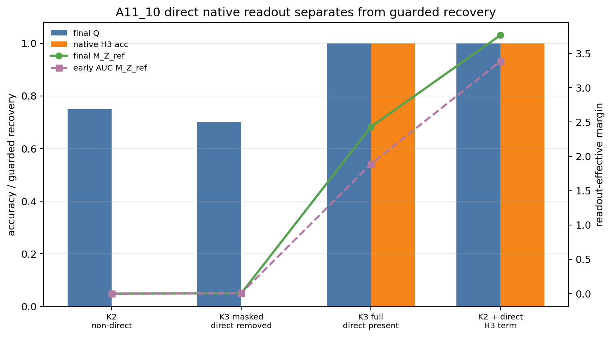

# MTP 如何更高效地学习长程语义：从表示保证到参数传递

## 0. 执行摘要

**研究问题：** 多词元预测目标（MTP）能否比只预测下一词的目标（NTP）更直接、更高效地让当前隐藏状态保留长程语义信息。这里，$K$ 表示同一个当前状态同时预测的未来词数量；“长程语义”特指已经出现在前缀中、最近的未来词暂时不需要、较远的未来词才必须使用的变量 $Z$。

**机制解释：**

1. 数据序列先给出代表分支的词 $\mathrm{BR}_Z$，再加入不提供新分支信息的填充词 $F_i$ 和各分支完全相同的局部上下文词 $C_i$；模型到达决策位置后，才开始预测未来词 $Y_1,\ldots,Y_K$。

$$
X_Z=
\bigl[
\mathrm{BR}_Z,\,
F_1,\ldots,F_L,\,
C_1,\ldots,C_r,\,
Y_1,\ldots,Y_K
\bigr].
$$

最小的 $K=2$ 构造把两种监督路径分开：下一词 $Y_1$ 对所有分支相同，第二词 $Y_2$ 才一一编码 $Z$。

$$
Y_1=A,\qquad Y_2=S_Z.
$$

2. 令 $\tau$ 表示第一个新增 $Z$ 信息的未来位置。只要 $K\ge\tau$，该位置就进入当前状态的训练目标；如果模型在这个位置上的预测损失足够低，当前隐藏状态 $h_T$ 就必须保留 $Z$。

$$
\tau=\min\{j:I(Z;Y_j\mid Y_{<j})>0\},\qquad
\mathbb E[-\log q_\tau(S_Z\mid h_T)]\le\varepsilon
\Rightarrow I(h_T;Z)\ge H(Z)-\varepsilon.
$$

其中，$q_\tau(S_Z\mid h_T)$ 是模型根据当前状态给正确语义词分配的概率，$I$ 表示互信息，$H(Z)$ 表示变量 $Z$ 的信息量。

3. “一阶语义速度”只看当前状态上的一次无穷小或单步梯度，回答“这一步把隐藏状态往哪里推”。设共有 $m$ 个分支，$u_z$ 是语义词 $S_z$ 的输出向量，$\bar u$ 是这些向量的平均值。在各分支隐藏状态完全相同的起点，也就是“分支折叠点”，NTP 没有区分分支的一阶方向，而 MTP 的第二位置损失给出严格正方向。

$$
G_1^{margin}=0,\qquad
G_2^{margin}
=\frac{\lambda_2}{m^2}\sum_z\|u_z-\bar u\|^2>0.
$$

4. 一阶方向本身不等于完整训练更快。只有当正方向在达到阈值前持续存在时，才能把它累积成有限步结论。把第 $t$ 步的语义间隔记为 $M_K(t)$，该步的一阶语义速度记为 $G_K^{hidden}(t)$；令 $\eta$ 为学习率，$\gamma$ 为目标语义间隔，$g_K$ 为达到该间隔前的最小语义速度，$T_\gamma(K)$ 为第一次达到 $\gamma$ 的训练步数，则：

$$
M_K(t+1)-M_K(t)=\eta G_K^{hidden}(t),\qquad
T_\gamma(K)\le
\left\lceil\frac{\gamma-M_K(0)}{\eta g_K}\right\rceil
$$

5. Transformer 实际更新的是编码器参数，而不是直接修改隐藏状态。把所有被覆盖有信息位置的语义方向合并为 $v$；令 $J$ 表示参数变化到隐藏状态变化的局部映射，$\Theta=JJ^\top$ 表示编码器传递语义方向的能力；$c$ 表示各分支共有的更新，$L_{\mathrm{bg}}$ 表示其他位置和其他目标产生的背景损失，则参数训练中的语义速度分为“直接语义传递”和“背景干扰”两部分。

$$
\frac{dM_K}{dt}
=\frac1{m^2}v^\top\Theta v
-\frac1m v^\top\Theta(c+\nabla_HL_{\mathrm{bg}}).
$$

**主要结果：**

1. 在一一编码的受控数据中，预测范围覆盖第一个携带 $Z$ 的未来词后，低该位置损失会强迫当前隐藏状态保留 $Z$。
2. 在固定语义读出方向、直接优化隐藏状态的模型中，MTP 先获得 NTP 没有的正一阶语义方向；当这个方向持续存在时，已经可以证明有限步语义恢复。
3. 一般情况下，MTP 的效果不由 $K$ 的大小单独决定，而由新增未来词是否含有 $Z$、不同未来位置的语义方向是否相互对齐，以及编码器能否把该方向传入参数更新共同决定。

**证据说明：**

1. 对结果 1：$K=2$ 最小构造和第一个有信息位置为 3 的构造都满足覆盖律；低有信息位置交叉熵推出当前状态与 $Z$ 的互信息下界。
2. 对结果 2：
   - 当第 3 个未来位置首次携带 $Z$ 时，预测 1 个或 2 个未来词的语义速度近 0，预测 3 个未来词时为 $0.003816$。
   - 有限步审计中，所有包含当前前缀直接语义目标的条件都在 5 个种子的早期窗口保持正语义速度。
   - 在全位置训练中，包含当前前缀第三位置直接监督的条件，最终模型自身第三位置预测准确率和保守恢复分数都达到 $1.0$；移除该直接监督后，$Z$ 仍可被外部读出，但模型自身第三位置预测准确率为 0。
3. 对结果 3：
   - 固定为预测 4 个未来词，并固定其中两个位置携带 $Z$，仅改变它们的输出方向时，对齐条件的语义速度为 $0.015262$，低对齐或冲突条件为 $0.000954$。
   - 新增共享未来词没有直接增量；新增对齐的信息词增强速度；新增冲突的信息词削弱速度。
   - 扣除参数更新中的非线性二阶变化后，目前能够保证的每步增量经常非正或过松，因此尚未得到可用的 Transformer 有限步上界。

**结论边界：** 当前结论只适用于受控数据和明确假设下的目标函数、隐藏状态与参数传递机制；不能推出自然语言中 MTP 已优于 NTP，不能推出 NTP 学不到 $Z$，不能推出 $K$ 越大越好，也不能声称已经实验证明更省样本。

**执行动作：** 下一步只研究 $K=2$ 的参数传递：固定数据、输出方向和损失权重，检验直接语义信号是否按照 $v^\top\Theta v$ 传入参数更新，并分别测量背景干扰与非线性余项。

## 1. 术语解释

| 术语 | 中文含义 | 具体对象或计算方式 | 为什么影响当前判断 | 不能证明什么 |
|---|---|---|---|---|
| 多词元预测目标（MTP） | 同一个当前隐藏状态预测多个未来词 | $L_K=\sum_{j=1}^K\lambda_j\operatorname{CE}(q_j(\cdot\mid h_T),Y_j)$ | 可能把更远处的语义目标直接监督到 $h_T$ | $K$ 越大一定越好 |
| 下一词预测目标（NTP） | 当前隐藏状态只预测下一词 | $L_1=\operatorname{CE}(q_1(\cdot\mid h_T),Y_1)$ | 当前前缀上的非覆盖对照 | NTP 在全位置训练中学不到 $Z$ |
| 预测范围 $K$ | 同一个当前状态需要预测多少个未来词 | $K=1$ 是 NTP，$K>1$ 是 MTP | 决定训练目标是否覆盖第一个有信息位置 | 更大的 $K$ 必然更好 |
| 长程语义变量 $Z$ | 前缀中已有、最近未来词不需要、更远未来词才使用的信息 | 受控实验中的分支身份 | 是需要保留到 $h_T$ 的对象 | 自然语言全部语义 |
| 第一个有信息未来位置 $\tau$ | 第一个新增 $Z$ 信息的未来偏移 | $\tau=\min\{j:I(Z;Y_j\mid Y_{<j})>0\}$ | 决定预测范围是否含直接语义目标 | 真实文本只有一个固定距离 |
| 直接语义监督 | 当前 $h_T$ 直接预测编码 $Z$ 的未来词 | $\operatorname{CE}(q_\tau(\cdot\mid h_T),S_Z)$ | 给当前状态最短的语义监督路径 | 唯一可能的学习路径 |
| 间接迁移 | 其他位置的损失通过共享参数改变 $h_T$ | 全位置训练中的背景参数更新 | 解释非覆盖条件也可能读出 $Z$ | 模型自身会使用该信息 |
| 语义输出方向 $u_z-\bar u$ | 模型为了区分语义词 $S_z$ 所使用的输出向量方向 | $u_z$ 是 $S_z$ 的输出向量，$\bar u=m^{-1}\sum_z u_z$ | 决定一步梯度是否沿模型可用方向区分分支 | 下游任务价值 |
| 语义间隔 $M_K$ | $h_T$ 沿模型可用语义方向的分离程度 | $M_K=m^{-1}\sum_zv_z^{(K)\top}h_z$ | 有限步效率的目标量 | 自然语言质量 |
| 一阶隐藏状态语义速度 $G_K^{hidden}$ | 当前参数点的一次无穷小或单步梯度把 $h_T$ 推向语义方向的瞬时变化率 | $m^{-1}\sum_zv_z^{(K)\top}(-\nabla_{h_z}L_K)$ | 判断目标是否立即提供正确方向 | 多步训练必然更快、最终性能更好 |
| 模型自身第三位置预测准确率 | 模型的第三未来位置预测头能否直接从 $h_T$ 预测 $S_Z$ | 选择概率最高类别后的准确率 | 区分模型自身使用与外部工具可读 | 下游任务收益 |
| 保守恢复分数 $Q$ | 三项检测中最弱的一项：直接解码、另行训练的线性分类器，以及替换分支词后预测是否随之改变 | $Q=\min\{A_{\mathrm{decoder}},A_{\mathrm{probe}},C_{\mathrm{swap}}\}$ | 防止单个检测产生假阳性 | 语义信息来自直接监督还是间接迁移 |
| 语义切向核 $\Theta$ | 编码器参数沿某个方向变化时，能在多大程度上改变隐藏状态的语义方向 | $\Theta=JJ^\top$，$J=\partial H/\partial\theta$ | 连接隐藏状态定理与 Transformer 参数训练 | 非线性长期收敛 |

## 2. 机制解释与建模

### 2.1 数据构造：把直接监督单独暴露出来

每条序列首先给出分支词 $\mathrm{BR}_Z$，它告诉模型当前属于哪个分支。随后出现一段填充词 $F_1,\ldots,F_L$ 和一段共享局部上下文 $C_1,\ldots,C_r$；这些词在不同分支中完全相同，不会再次提示 $Z$。模型读完这个前缀后得到当前隐藏状态 $h_T$，再从该状态预测未来后缀：

$$
X_Z=
\bigl[
\mathrm{BR}_Z,\,
F_1,\ldots,F_L,\,
C_1,\ldots,C_r,\,
Y_1,\ldots,Y_K
\bigr].
$$

最小的 $K=2$ 后缀为：

$$
Y_1=A,\qquad Y_2=S_Z,\qquad Z\mapsto S_Z\text{ 为一一映射}.
$$

这里，所有分支的下一词都是 $A$，只有第二个未来词 $S_Z$ 随分支变化。因此，NTP 在当前前缀只需预测共享词 $A$；预测两个未来词的 MTP 还必须从同一个 $h_T$ 预测 $S_Z$。这比较的是两种目标在当前前缀上提供的监督路径，而不是比较模型最终能记住多少信息。

为了检验同一机制是否随距离后移，我们还使用第 3 个未来位置才首次携带 $Z$ 的构造：

$$
Y_1=A,\qquad Y_2=C,\qquad Y_3=S_Z,
$$

其中 $A$ 和 $C$ 对所有分支相同。此时，预测 1 个或 2 个未来词都没有覆盖 $S_Z$；预测 3 个未来词才包含当前前缀上的直接语义监督。

### 2.2 表示保证：低损失为什么迫使 $h_T$ 含有 $Z$

如果预测范围覆盖 $Y_\tau=S_Z$，预测器只能依据 $h_T$ 还原 $S_Z$。由于 $S_Z$ 与 $Z$ 一一对应，低交叉熵给出：

$$
\mathbb E[-\log q_\tau(S_Z\mid h_T)]\le\varepsilon
\Rightarrow
I(h_T;Z)\ge H(Z)-\varepsilon.
$$

这个定理回答“当有信息位置损失已经足够低时，当前表示必须含有什么”。它不涉及优化轨迹，因此单独不能回答“模型需要多少步才能学到 $Z$”。

### 2.3 一阶机制：当前这一步是否朝正确方向更新

“一阶”指不追踪后续完整训练轨迹，只在当前状态计算一次无穷小或单步梯度造成的变化。它回答“目标此刻把状态往哪里推、推多快”，不能单独回答“经过许多步后是否更早恢复”。

设共有 $m$ 个分支，$u_z$ 是语义词 $S_z$ 的输出向量，$\bar u=m^{-1}\sum_z u_z$ 是所有分支输出向量的平均值。在各分支隐藏状态完全相同的分支折叠点，NTP 只预测共享词 $A$，各分支获得相同更新，减去共同部分后完全抵消；MTP 增加 $Y_2=S_Z$，得到：

$$
G_1^{margin}=0,
\qquad
G_2^{margin}
=\frac{\lambda_2}{m^2}\sum_z\|u_z-\bar u\|^2>0.
$$

这一步证明了一个严格的局部差异：在当前受控状态上，MTP 立即提供区分 $Z$ 的方向，NTP 没有这项直接方向。但它仍然没有保证该方向在后续训练中持续存在。

### 2.4 有限步累积：一阶方向何时能推出更早达到阈值

令 $\mathcal I_K$ 表示预测范围内所有携带新 $Z$ 信息的位置。在位置 $j$ 上，$u_{j,z}$ 表示语义词 $S_z$ 的输出向量，$\bar u_j$ 表示该位置所有分支输出向量的平均值。对分支 $z$，把这些位置的中心化输出方向按损失权重相加：

$$
v_z^{(K)}=\sum_{j\in\mathcal I_K}\lambda_j(u_{j,z}-\bar u_j).
$$

记 $h_z(t)$ 为第 $t$ 步时分支 $z$ 的当前隐藏状态。语义间隔 $M_K(t)$ 衡量这些状态是否沿模型自身可用的方向分开；语义速度 $G_K^{hidden}(t)$ 衡量当前一步会让这个间隔增加多少：

$$
M_K(t)=\frac1m\sum_zv_z^{(K)\top}h_z(t),
$$

$$
G_K^{hidden}(t)=\frac1m\sum_zv_z^{(K)\top}
\left(-\nabla_{h_z}L_K\right).
$$

当隐藏状态本身是优化变量，且用于定义语义间隔的方向 $v_z^{(K)}$ 固定时，学习率为 $\eta$ 的每一步都满足精确恒等式：

$$
M_K(t+1)-M_K(t)=\eta G_K^{hidden}(t).
$$

令 $\gamma$ 为需要达到的语义间隔，$T_\gamma(K)$ 为第一次达到该间隔的训练步数。如果达到阈值前始终有 $G_K^{hidden}(t)\ge g_K>0$，就得到：

$$
T_\gamma(K)\le
\left\lceil\frac{\gamma-M_K(0)}{\eta g_K}\right\rceil.
$$

这个上界仍把“正速度持续存在”作为条件。在更强的可解模型中，如果所有语义输出向量长度相同、彼此夹角相同，形成对称的规则单纯形，并且共享目标的梯度在分支语义方向上的投影为 0，就能进一步证明：$K=2$ 的 MTP 在有限步内把模型自身的语义预测提高到任意高于随机水平的阈值；$K=1$ 的 NTP 在同一个固定语义读出下保持随机水平。

### 2.5 一般 K：为什么不是预测得越远越好

固定输出头的一步语义速度为：

$$
G_K=\frac1{m^2}\sum_z\|v_z^{(K)}\|^2.
$$

令 $a_{r,z}=\lambda_r(u_{r,z}-\bar u_r)$ 表示新增有信息位置 $r$ 的语义方向。加入该位置后，一阶语义速度的变化为：

$$
G_{K\cup r}-G_K
=\frac1{m^2}\sum_z
\left(2v_z^{(K)\top}a_{r,z}+\|a_{r,z}\|^2\right).
$$

因此，新增一个各分支共享的未来词不会带来直接语义增量；新增与已有方向对齐的信息词会增强速度；新增方向冲突的信息词可能削弱速度。真正决定效果的是“新增位置是否含有 $Z$，以及它与已有语义方向如何组合”，而不是 $K$ 这个整数本身。

### 2.6 参数空间边界：隐藏状态定理为何不能直接推广

Transformer 实际更新的是编码器参数 $\theta$，隐藏状态只是参数变化后的结果，记为 $H=H(\theta)$。令 $J=\partial H/\partial\theta$ 表示参数变化到隐藏状态变化的局部映射，$\Theta=JJ^\top$ 表示编码器沿隐藏状态方向传递更新的能力。把所有分支的语义方向堆叠为 $v$，把各分支共有的更新记为 $c$，把其他位置和其他目标的损失记为 $L_{\mathrm{bg}}$，则参数梯度流中的语义间隔速度分解为：

$$
\frac{dM_K}{dt}
=\frac1{m^2}v^\top\Theta v
-\frac1m v^\top\Theta(c+\nabla_HL_{\mathrm{bg}}).
$$

第一项表示直接语义方向经过编码器后还剩下多大强度；第二项表示共享目标和其他位置损失在同一方向上造成的帮助或抵消。真实训练采用离散参数更新，还会产生线性近似之外的非线性余项。当前尚未同时得到足够紧的直接传递下界、背景干扰上界和非线性余项上界。

### 2.7 当前推进到哪一步

1. **表示保证已经证明：** 低有信息位置损失推出 $h_T$ 含有 $Z$。
2. **一阶隐藏状态机制已经证明：** 覆盖有信息位置产生正语义速度；非覆盖共享目标在分支折叠点没有该方向。
3. **受控隐藏状态的有限步结论已经证明：** 固定读出方向时有精确累积式；规则单纯形的 $K=2$ 模型有显式恢复步数上界。
4. **受控 Transformer 实验已经支持这条机制：** 直接语义速度在早期持续，并对应更强的模型自身远期预测；但外部可读性也可能来自间接迁移。
5. **参数空间理论尚未完成：** 还缺编码器语义传递下界、背景干扰界和非线性余项界；自然语言样本效率更没有得到证明。

## 3. 主要结果

**一句话总结：** MTP 在受控模型中的可证明优势，是把更远处首次出现的语义目标直接作用到当前隐藏状态；这条优势已经在隐藏状态空间形成有限步定理，但尚未完整提升为 Transformer 参数空间效率定理。

### 结果 1：覆盖第一个有信息未来词，会给当前隐藏状态带来表示保证。

**机制对应：** 第 2.1 至 2.2 节的数据构造和覆盖律。

**指标或条件定义：** $Y_\tau=S_Z$ 一一编码 $Z$；有信息位置损失为 $\mathbb E[-\log q_\tau(S_Z\mid h_T)]$。

**证据说明：**

- 理论上，低该位置损失推出 $I(h_T;Z)\ge H(Z)-\varepsilon$。
- 在 $K=2$ 构造中，MTP 需要从当前状态直接预测 $S_Z$，NTP 在同一前缀只需预测共享词 $A$。
- 当第一个有信息位置为 3 时，只有预测范围达到 $K=3$ 才包含当前前缀上的直接语义目标。

**解释：** 该结论说明 MTP 改变了当前表示必须满足的约束，而不只是增加一个总损失项。

**边界：** 它不说明 NTP 在其他位置监督下最终学不到 $Z$，也不说明 MTP 已经更省样本。

**来源：** [A11 主故事](../../../Projects/from-attention-to-search/main/stories/11_long_horizon_mtp_objective/story_cn.md)；[第一个有信息位置实验摘要](../../../Projects/from-attention-to-search/main/experiments/A11/A11_04_k3_first_informative_horizon/summary.md)。

### 结果 2：直接有信息目标先产生严格正的一阶语义速度，再在明确条件下累积为有限步恢复。

**机制对应：** 第 2.3 节的一阶方向和第 2.4 节的有限步累积。

**指标或条件定义：** $G_K^{hidden}$ 测量一步梯度在语义方向上的投影；模型自身第三位置预测准确率测量模型能否直接用自己的未来位置预测头读出 $Z$；保守恢复分数 $Q$ 是解码器、线性探针和分支交换一致性三项检测中的最小值，只表示 $Z$ 是否稳定可读。

**证据说明：**

- 当第 3 个未来位置首次携带 $Z$ 时，$K=1$ 的语义速度为 $7.28\times10^{-12}$，$K=2$ 为 $-1.16\times10^{-11}$，两者都可视为 0；$K=3$ 覆盖 $S_Z$ 后，语义速度为 $0.003816$。
- 有限步审计中，所有包含当前前缀直接语义目标的条件都在 5 个种子的早期窗口保持正语义速度。
- 在全位置训练中，包含直接第三位置监督的条件最终模型自身第三位置预测准确率和 $Q$ 都为 $1.0$；不包含该直接监督的条件仍有 $Q=0.75/0.70$，但模型自身第三位置预测准确率为 0，语义间隔接近 0。
- 所有条件最终对最近两个共享目标的预测准确率均为 $1.0$，说明直接语义恢复没有以牺牲局部预测为代价。

图中比较三件事：$Z$ 是否可被外部检测稳定读出、模型自身能否从当前状态预测第三个未来词、隐藏状态是否沿模型可用的语义方向分开。不含当前前缀直接第三位置监督的条件也能让 $Z$ 对外部工具可读，但只有包含该直接监督的条件同时获得满分的模型自身预测和较大的语义间隔。该图不能证明自然语言收益。

**解释：** K=2 闭式公式先证明当前点上的局部方向；精确更新式再把持续的正方向累积成有限步结论。实验支持这条正方向在早期没有立即消失，并说明外部可读与模型自身直接使用不是同一件事。

**边界：** 将隐藏状态结论换算到参数训练后，扣除非线性二阶变化得到的每步保证经常非正或极松，因此还不能把该隐藏状态定理写成可用的 Transformer 训练步数上界。

**来源：** [有限步语义效率实验摘要](../../../Projects/from-attention-to-search/main/experiments/A11/A11_10_finite_step_semantic_efficiency/summary.md)；[全位置间接迁移实验摘要](../../../Projects/from-attention-to-search/main/experiments/A11/A11_10_all_position_indirect_transfer_dynamics/summary.md)。

### 结果 3：一般 K 的效率由有信息位置的方向和决定，而参数传递是当前唯一尚未完成的理论环节。

**机制对应：** 第 2.5 节的向量增量公式和第 2.6 节的参数空间分解。

**指标或条件定义：** $G_K$ 测输出方向合成后的直接语义速度；$v^\top\Theta v$ 测编码器能否把该方向传入参数更新。

**证据说明：**

- 固定为预测 4 个未来词，并固定其中两个位置携带 $Z$ 时，对齐条件的语义速度为 $0.015262$，低对齐或冲突条件为 $0.000954$，5 个种子的比较方向一致。
- 逐步扩大预测范围时，$K=2$ 尚未覆盖第一个有信息位置，语义速度近 0；$K=3$ 覆盖该位置后速度变为正值。继续加入各分支共享的第 4 个未来词没有直接增量；加入方向对齐的信息词会增强速度，加入方向冲突的信息词会削弱速度。
- 冻结输出头时方向规律在早期训练仍成立；输出头可训练时方向会漂移，因此多步解释必须记录当前输出几何。

**解释：** 这些结果排除了“只要增加预测位置就会更好”的说法，并把下一步收束到编码器对语义方向的传递能力，而不是继续扩大 K。

**边界：** 真实文本中有信息位置和输出方向尚未识别，参数空间传递下界也尚未证明。

**来源：** [A11 主故事](../../../Projects/from-attention-to-search/main/stories/11_long_horizon_mtp_objective/story_cn.md)；[一般 K 输出方向实验摘要](../../../Projects/from-attention-to-search/main/experiments/A11/A11_08_general_k_readout_margin_dynamics/summary.md)；[逐步扩大预测范围实验摘要](../../../Projects/from-attention-to-search/main/experiments/A11/A11_09_next_k_inclusion_law/summary.md)。

## 4. 执行动作

**下一步动作：** 正式化 $K=2$ 的参数传递问题：固定数据、输出头和损失权重，只改变编码器参数对分支语义方向的局部传递强度。

**目的：** 判断隐藏状态上的直接语义优势能否按照 $v^\top\Theta v$ 传入参数更新，并区分三种失败来源：编码器几乎不能传递该方向、其他损失抵消该方向，或者离散参数更新偏离局部线性预测。

**完成判据：** 一步真实参数更新后的语义间隔变化，能够由直接传递项、背景干扰项和非线性余项共同解释；若不能，必须明确是哪一项导致解释失败。

## 5. 证据索引

| 结果 | 主要证据 | 关键指标 | 支持什么 | 不能证明什么 | 来源 |
|---|---|---|---|---|---|
| 结果 1 | 覆盖律与低损失表示定理 | $I(h_T;Z)$ 下界 | 覆盖有信息位置带来表示约束 | 训练速度与自然语言收益 | 主故事；第一个有信息位置实验 |
| 结果 2 | 初始状态无语义泄漏、早期正速度持续、直接监督加减控制 | 一阶语义速度、模型自身第三位置预测准确率、保守恢复分数、语义间隔 | 直接监督形成正语义速度和模型自身读出 | 可用的 Transformer 训练步数上界 | 一阶速度实验；两组有限步实验 |
| 结果 3 | 固定预测范围的方向比较与逐步扩大预测范围的增量审计 | $G_K$、方向对齐、$v^\top\Theta v$ | $K$ 的效果取决于信息与方向 | 真实文本方向天然对齐 | 一般 K 实验；逐步扩大预测范围实验 |

## 6. 来源索引

**主故事：**

- [A11 长程语义效率主故事](../../../Projects/from-attention-to-search/main/stories/11_long_horizon_mtp_objective/story_cn.md)

**整合简报：**

- [隐藏状态到参数空间简报](mtp_long_horizon_semantic_efficiency_hidden_to_parameter_meeting_brief_cn.md)

**当前判定卡：**

- [11_10 有限步语义效率](../../../Projects/from-attention-to-search/main/problem_anchors/11_long_horizon_mtp_objective/11_10_finite_step_semantic_efficiency_anchor.md)

**实验方案：**

- [有限步语义效率实验方案](../../../Projects/from-attention-to-search/main/experiments/A11/A11_10_finite_step_semantic_efficiency/protocol.md)

**结果摘要：**

- [第一个有信息位置实验摘要](../../../Projects/from-attention-to-search/main/experiments/A11/A11_04_k3_first_informative_horizon/summary.md)
- [一阶读出有效语义速度实验摘要](../../../Projects/from-attention-to-search/main/experiments/A11/A11_06_readout_effective_margin_efficiency/summary.md)
- [有限步语义效率实验摘要](../../../Projects/from-attention-to-search/main/experiments/A11/A11_10_finite_step_semantic_efficiency/summary.md)
- [全位置间接迁移实验摘要](../../../Projects/from-attention-to-search/main/experiments/A11/A11_10_all_position_indirect_transfer_dynamics/summary.md)
- [一般 K 输出方向实验摘要](../../../Projects/from-attention-to-search/main/experiments/A11/A11_08_general_k_readout_margin_dynamics/summary.md)
- [逐步扩大预测范围实验摘要](../../../Projects/from-attention-to-search/main/experiments/A11/A11_09_next_k_inclusion_law/summary.md)

**完整实验记录：**

- [有限步语义效率完整记录](../../../Projects/from-attention-to-search/main/experiments/A11/A11_10_finite_step_semantic_efficiency/detailed.md)
- [全位置间接迁移完整记录](../../../Projects/from-attention-to-search/main/experiments/A11/A11_10_all_position_indirect_transfer_dynamics/detailed.md)

**中心图：**

- `daily_research_reports/0710/meetings/figures/mtp_a11_10_direct_native_margin_split.png`
