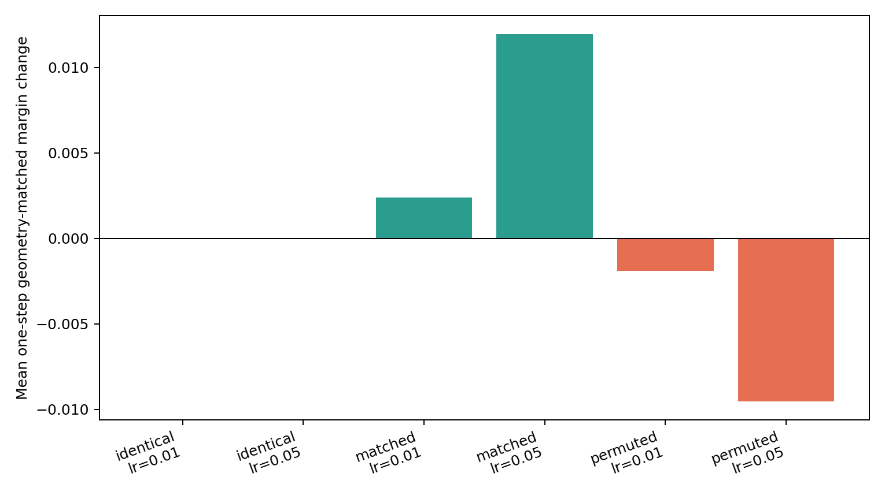
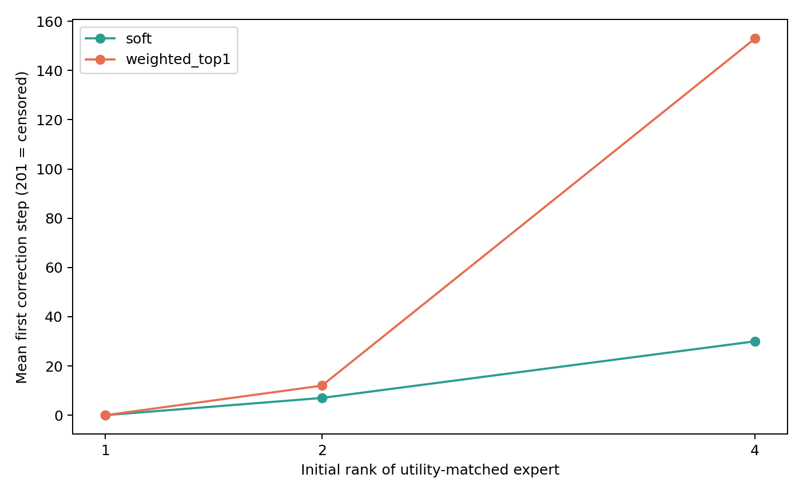
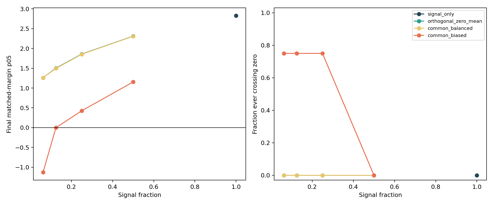
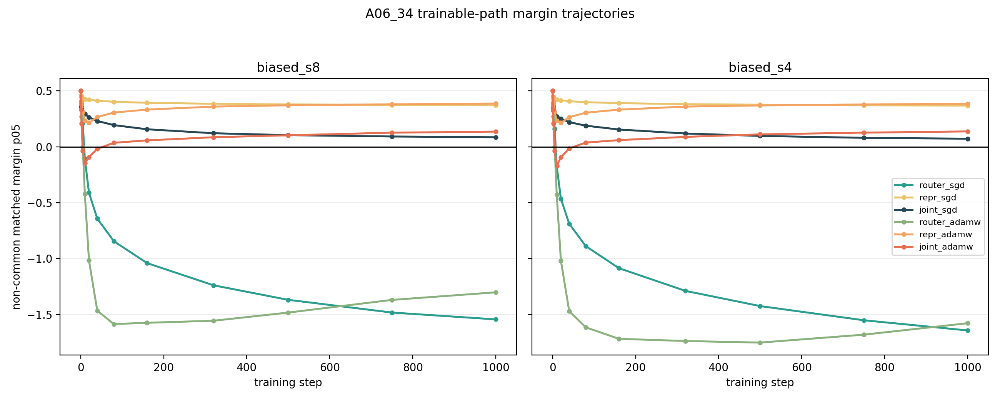
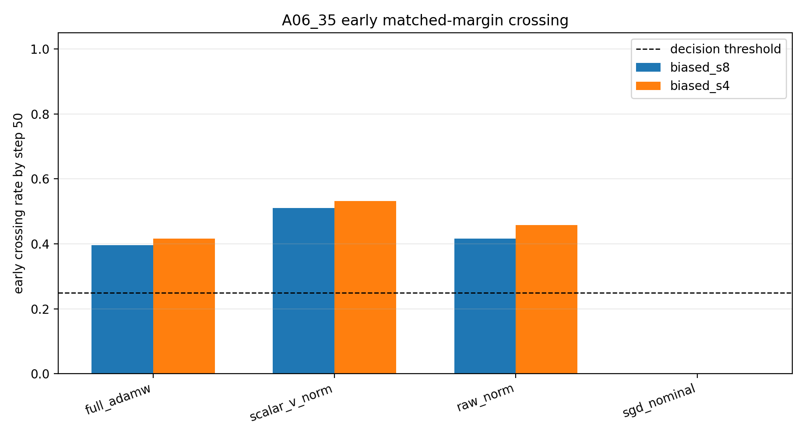
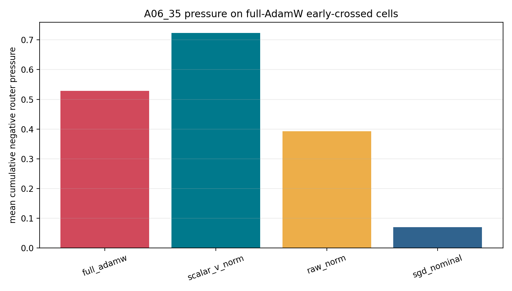
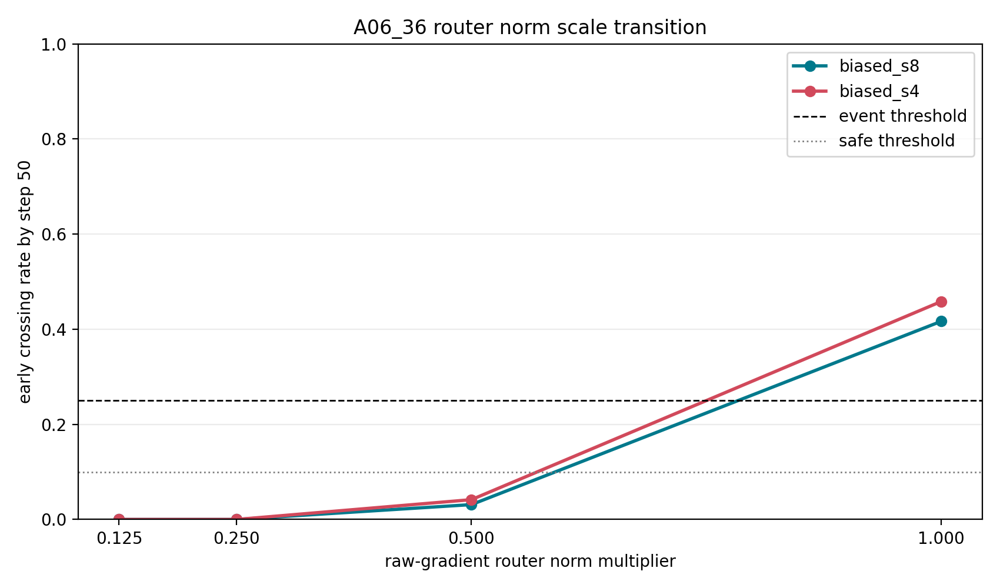
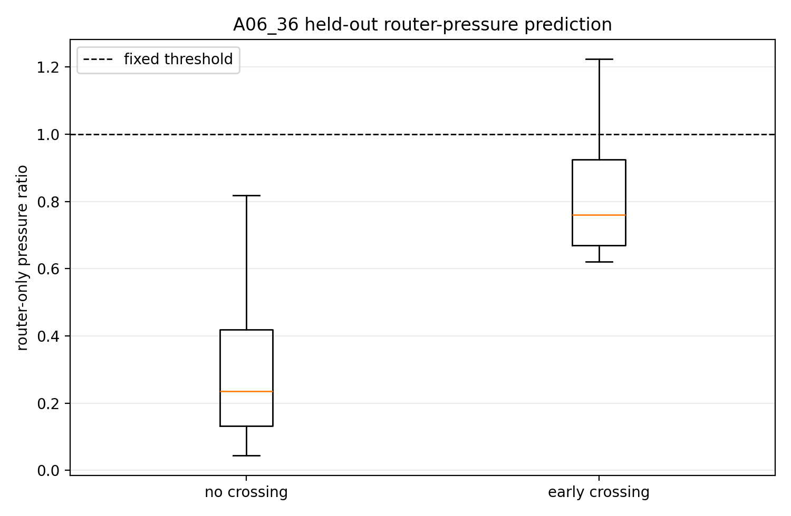

# Specialization（专家专门化）：理想初始化之后，路由为何失守又如何恢复

## 0. 执行摘要

**研究问题：** 语言模型中的特征如何稳定进入对它真正有用的专家，以及这种“特征—专家功能绑定”为什么会在训练中被破坏或恢复？这里的专家专门化是指：一个可操作化特征稳定进入能降低其任务损失的专家。

**版本过渡：** 前一阶段解决“能否在不知道路由相关位置时找到特征中心并初始化路由器”。受控实验已经可以用全序列损失的梯度信号找到中心，但理想初始化仍会在后续训练中失守。因此，当前版本不再把中心发现当作终点，而是研究路由器边界、上游表征和优化器如何共同决定绑定的保持与恢复。

**机制解释：**

1. 专家对当前特征越有助于降低损失，允许所有专家连续参与的软路由中，对应的路由向量越会沿该特征方向移动。$h$ 是路由器输入，$E_e(h)$ 是专家输出，$p_e$ 是专家权重，$A_e$ 是提高该专家权重带来的一阶损失收益。

$$
A_e=-\left\langle\nabla_{\hat y}\ell,E_e(h)-\hat y\right\rangle,
\qquad
\Delta w_e=\frac{\eta}{\tau}p_eA_eh.
$$

2. 路由是否失守取决于“移动的路由边界”和“移动的特征中心”共同决定的匹配间隔。$w_a,w_b$ 是目标专家和竞争专家的路由向量，$\mu_f$ 是特征中心；$m_{f,a,b}\le0$ 表示目标专家不再领先。

$$
m_{f,a,b}=(w_a-w_b)^\top\mu_f,
$$

$$
\Delta m
=(\Delta w_a-\Delta w_b)^\top\mu_f
+(w_a-w_b)^\top\Delta\mu_f
+(\Delta w_a-\Delta w_b)^\top\Delta\mu_f.
$$

3. AdamW 是一种用历史梯度均值和逐坐标平方梯度缩放更新的优化器。它不直接使用当前原始梯度，而会改变路由器的实际更新方向与速度；$\hat m_t,\hat v_t$ 分别是偏差校正后的一阶矩和二阶矩。

$$
\Delta w_t
=-\eta\frac{\hat m_t}{\sqrt{\hat v_t}+\epsilon}
-\eta\lambda w_t.
$$

4. 只统计路由器边界移动所造成的累计负压力，并除以初始正间隔，可得到路由器压力比 $\rho_i(T)$。它可以排序越界风险，但固定阈值会漏掉特征中心移动与有限步交互造成的消耗。

$$
B_i(T)=\sum_{t=1}^{T}[-b_i(t)]_+,
\qquad
\rho_i(T)=\frac{B_i(T)}{m_i(0)}.
$$

**主要结果：**

1. 正确的初始聚类几何不会自动产生 specialization；真正决定局部路由更新方向的是专家对该特征的功能收益，而加权最高分路由只能按当前分数排名逐步寻找未选专家。
2. 背景位置多并不必然破坏路由；只有对决策边界具有稳定负投影的背景更新才会消耗有限间隔，而且首次越界与最终失败是两个不同事件。
3. 在可训练的一层自注意力表征模块（Transformer）与一层混合专家模型（mixture of experts，MoE）中，早期越界存在明确的路由器更新尺度转折，但只使用路由器压力的阈值不能单独预测越界；表征直接项参与早期匹配间隔消耗，其恢复收益更可能通过改变未来路由器梯度间接产生。

**证据说明：**

1. 当专家功能与特征匹配时，局部间隔更新方向全部正确；专家功能相同则更新为零；功能映射置换会把几何正确的绑定推向错误专家。加权最高分路由从第 4 名纠正到正确专家需要 153 步，而可比较全部专家功能的软路由只需 30 步。
2. 保持背景数量不变时，边界正交背景和类别平衡背景都不造成越界；只有类别 0 方向偏置背景造成非公共特征越界。较高信号比例下，越界后的特征仍能恢复正间隔。
3. 冻结干预表明路由器移动是越界必要通道，表征共同训练补回 62/78 个恢复事件；方向干预排除了 AdamW 特定动量方向。固定原始梯度后，完整范数的越界率为 41.67--45.83%，减半后为 3.13--4.17%。路由器压力排序的受试者工作特征曲线下面积（area under the curve，AUC）为 0.978，但固定阈值只识别出 20% 的真实越界样本；精确预算显示表征直接项在越界时额外消耗约 0.29 个初始间隔。

**结论边界：** 当前结论只覆盖固定功能专家、重复词元（token）的全序列语言建模数据、一层可训练注意力和当前学习率，不能直接推出自然语言专家、真实下游收益或可部署路由器。

**下一机制问题：** 表征训练帮助恢复，是因为特征中心直接移回正确区域，还是因为它改变后续隐藏状态，从而改变未来路由器梯度？

**执行动作：** 下一步从同一个首次越界状态克隆联合继续、冻结表征和冻结路由器三个分支；完成标准是直接几何项、配对重新进入率和未来梯度变化给出一致因果分类。

## 1. 术语解释

| 术语 | 中文含义 | 具体对象或计算方式 | 单位或公式 | 为什么影响当前判断 | 不能证明什么 |
|---|---|---|---|---|---|
| 专门化（specialization） | 一个可操作化特征稳定进入对它有功能收益的专家 | 同时检查路由身份、正间隔和专家相对收益 | 三项联合条件 | 避免把负载均衡或聚类纯度当成专门化 | 自然语言语义专家已经存在 |
| 路由器（Router） | 根据隐藏状态为专家打分的模块 | 专家 $e$ 的分数为 $s_e(h)=w_e^\top h$ | 无量纲路由分数 | 决定词元进入哪个专家 | 被选专家一定有用 |
| 软路由 | 所有专家以连续权重同时参与输出 | $\hat y=\sum_ep_eE_e(h)$ | 专家权重和为 1 | 能直接比较各专家的一阶功能收益 | 稀疏路由有相同梯度 |
| 加权最高分路由 | 只执行当前得分最高的专家，但保留其路由概率权重 | $\hat y=p_rE_r(h)$ | 单专家输出 | 表示当前受控稀疏纠错机制 | 标准单专家稀疏路由的所有实现 |
| 特征中心 | 同类特征在路由器输入空间中的平均隐藏状态 | $\mu_f=\mathbb E[h\mid f]$ | 隐藏向量 | 表示当前特征几何位置 | 所有样本都位于中心附近 |
| 匹配间隔 | 目标专家相对竞争专家的打分领先量 | $m_{f,a,b}=(w_a-w_b)^\top\mu_f$ | 路由分数差 | 非正表示该绑定越过边界 | 真实任务收益 |
| 首次越界 | 匹配间隔第一次变为非正 | $T_{cross}=\min\{t:m_f(t)\le0\}$ | 训练步 | 检测绑定首次失守 | 永久坍塌 |
| 重新进入 | 越界后匹配间隔再次变正 | 第一个 $t>T_{cross}$ 且 $m_f(t)>0$ | 训练步 | 检测纠偏 | 下游能力完全恢复 |
| 冻结必要性比例 | 联合训练发生事件时，冻结某条路径后事件消失的比例 | $N_k(E)$ | 比例 $[0,1]$ | 判断某路径是否为必要组成 | 该路径单独充分 |
| 表征路径 | 路由器输入隐藏状态随上游参数更新而移动 | $\Delta\mu_f$ | 隐藏向量位移 | 可以相对边界移动特征 | 表征移动必然有害 |
| 逐坐标二阶矩 | AdamW 对每个参数方向累计的平方梯度 | $\hat v_t$ | 梯度平方尺度 | 改变不同方向的实际步长 | 已经是越界根因 |
| 随机梯度下降（stochastic gradient descent，SGD） | 直接按当前批次梯度更新参数的优化方法 | $\Delta w_t=-\eta g_t$ | 参数更新 | 提供不含 AdamW 动量缩放的对照 | 优化器名称本身决定实际步长 |
| 实际路由器更新范数 | 一步路由器参数真实移动的总大小 | $\|\Delta W_t\|_F$ | 参数范数 | 区分名义学习率与实际步长 | 单独决定更新方向 |
| 配对复现比例 | 完整 AdamW 越界单元中，干预条件也越界的比例 | $R_q=\Pr(C^q=1\mid C^{full}=1)$ | $[0,1]$ | 判断被删除的优化器组成是否必要 | 模型外充分性 |
| 归一化互信息（normalized mutual information，NMI） | 特征标签与专家身份的一一对应程度 | 比较特征分组与专家分组共享的信息 | $[0,1]$ | 检查最终分发是否仍清晰 | 专家具有功能差异 |
| 风险排序面积 | 随机抽取一个越界和一个未越界单元时，风险分数把前者排得更高的概率 | 受试者工作特征曲线下面积（AUC） | $[0,1]$ | 判断压力比分离风险的能力 | 固定阈值已经可用 |

## 2. 机制解释与建模

**核心模型：**

1. 专家功能收益把任务损失连接到路由向量更新。

$$
A_e=-\left\langle\nabla_{\hat y}\ell,E_e(h)-\hat y\right\rangle,
\qquad
\Delta w_e=\frac{\eta}{\tau}p_eA_eh.
$$

这里 $A_e>0$ 表示提高专家 $e$ 的权重会一阶降低损失。初始化中心只给出几何位置，$A_e$ 才给出训练要把边界推向哪里的功能信号。

2. 加权最高分路由虽然会更新未选路由向量，但这些更新不包含未选专家自己的功能信息。

$$
\hat y=p_rE_r(h),
$$

$$
\Delta w_j
=\frac{\eta}{\tau}p_r\bigl(\mathbf 1[j=r]-p_j\bigr)B_rh.
$$

其中 $r$ 是当前被选专家，$B_r$ 只描述当前专家的收益。错误专家可以被否定，但哪个未选专家最好仍要按当前分数排名搜索。

3. 可训练路由间隔同时由路由向量和特征中心移动。

$$
\begin{aligned}
\Delta m_{f,a,b}
&=(\Delta w_a-\Delta w_b)^\top\mu_f \\
&\quad +(w_a-w_b)^\top\Delta\mu_f \\
&\quad +(\Delta w_a-\Delta w_b)^\top\Delta\mu_f.
\end{aligned}
$$

第一项是路由边界移动，第二项是特征中心移动，第三项是有限步交互。该分解是代数恒等式；只有冻结干预才能判断因果。

4. 冻结必要性比例把“联合训练中的事件”与“删除某路径后的事件”逐种子配对。

$$
N_k(E)
=\Pr\bigl(E_{joint}=1,E_{freeze(k)}=0\mid E_{joint}=1\bigr).
$$

当前判据要求联合事件率至少为 0.25，且 $N_k(E)\ge0.75$，才把路径 $k$ 判断为必要。

5. 仅使用路由器项的压力比描述边界更新耗掉多少初始缓冲，但不包含表征与交互项。

$$
b_i(t)=\left\langle\Delta w_a(t)-\Delta w_b(t),\mu_f(t)\right\rangle,
$$

$$
B_i(T)=\sum_{t=1}^{T}[-b_i(t)]_+,
\qquad
\rho_i(T)=\frac{B_i(T)}{m_i(0)}.
$$

$\rho$ 在未参与阈值构造的留出种子上，风险排序面积为 0.978，但固定阈值 1 只识别出 20% 的真实越界样本，因此不能直接用作控制器。

**符号含义：**

- $h$：路由器实际读取的隐藏状态。
- $w_e$：专家 $e$ 的路由打分向量。
- $\mu_f$：特征 $f$ 的平均路由输入。
- $a,b$：目标专家与竞争专家。
- $A_e$：专家 $e$ 对当前损失的一阶功能收益。
- $\hat m_t,\hat v_t$：AdamW 的偏差校正一阶矩和二阶矩。
- $B_i(T)$：单元 $i$ 在前 $T$ 步累计受到的负路由器边界压力。
- $\rho_i(T)$：累计负压力相对该单元初始正间隔的比例。

**机制链条：**

1. 初始特征中心给出可达分区，但专家功能收益决定路由更新是否强化该分区。
2. 全序列背景损失若对某条边界有稳定负投影，就会持续消耗正间隔。
3. 只训练路由器时，非公共特征全部越界；允许表征共同训练后，多数绑定能够恢复。
4. AdamW 的特定动量方向不是早期越界的必要条件；保持原始梯度方向时，仅缩小实际路由器更新范数就能跨过越界转折。
5. 表征中心的直接运动在越界和重新进入时都消耗匹配间隔，因此表征训练的整体恢复作用不能解释为“中心直接移回去”。

**当前问题分解：**

- 已裁定：AdamW 下，路由向量移动是首次越界的必要通道。
- 已裁定：联合表征学习补回只训练路由器时缺失的大多数恢复事件。
- 已裁定：AdamW 特定的一阶矩或逐坐标二阶矩方向不是越界必要条件；实际路由器更新尺度控制越界是否可达。
- 未裁定：表征训练是否通过改变未来隐藏状态和路由器梯度，间接促成重新进入。
- 最危险的替代解释：冻结表征改变了越界后的优化轨迹，但并未删除一种真正的恢复机制；只有从完全相同的首次越界状态开始分支，才能排除该解释。

## 3. 主要结果

**一句话总结：** specialization 的当前瓶颈已经从“如何找到初始中心”收紧为“优化器如何把背景与任务梯度传给移动的路由边界，以及表征如何纠偏”。

### 结果 1：专家功能收益决定局部绑定方向，而加权最高分路由的纠错受当前排名限制

**机制对应：** 对应第 2 节的专家功能收益公式和加权最高分路由更新式。

**指标或条件定义：** “功能匹配”表示专家 $f$ 对特征 $f$ 的损失最低；“功能置换”保持相同特征中心和路由行，但交换专家功能身份；纠正时间是错误初始化后恢复目标专家为最高分所需步数。

**证据说明：**

- 功能匹配时，32 个随机种子的局部正间隔比例为 1.000；专家功能相同时更新为零；功能置换后，原本几何正确的间隔转为负方向。
- 正确专家初始排名第 4 时，软路由中位纠正时间为 30 步；加权最高分路由为 153 步，并经历 142 次边界变化。

**解释：** 特征中心只能指定初始区域。训练能否保持绑定取决于专家是否对该特征有正收益；最高分稀疏路由缺少未选专家各自的功能比较，所以纠错表现为排名搜索。

**边界：** 专家在这些实验中固定且功能差异已知，不能推出真实训练会自动形成这种功能分工。

**来源：** 专门化研究线的功能干预与稀疏纠错结果记录，见第 6 节来源索引。

### 结果 2：有符号的边界投影而非背景数量消耗间隔，且越界不等于永久失败

**机制对应：** 对应第 2 节间隔公式中的累计负更新。

**指标或条件定义：** “边界投影”是一次更新对 $m_{f,a,b}$ 的有符号改变量；“信号比例”是每批 32 条完整序列中特征序列所占比例。

**证据说明：**

- 背景数量相同的边界正交对照与类别平衡对照不造成系统越界，只有类别 0 方向偏置背景使特征 1--3 越界。
- 信号比例为 0.25 时，非公共特征曾越界但最终全部重新进入；更低信号比例下则不能完全恢复。

**解释：** 共同成分本身不是破坏机制。只有对具体决策边界具有稳定方向的训练更新才会消耗间隔；恢复取决于正向纠错是否能在负向偏置继续积累前完成。

**边界：** 该结论来自受控背景算子，不能直接把真实文本中的高频状态称为有害公共特征。

**来源：** 背景边界预算结果记录，见第 6 节来源索引。

### 结果 3：路由器更新尺度控制越界可达性，但表征通过直接与间接两条路径改变恢复

**机制对应：** 对应第 2 节有限步间隔分解、冻结必要性比例和 AdamW 更新式。

**指标或条件定义：** 主判断使用特征 1--3，共有 $32\times3\times2=192$ 个“特征—随机种子—背景强度”单元。冻结干预定位路由器与表征路径；方向干预在匹配完整 AdamW 更新范数时，分别删除逐坐标二阶矩或全部 AdamW 动量方向。

**证据说明：**

- 联合 AdamW 越界率为 40.625%，中位第 7 步；联合 SGD 越界率为 1.04%，中位第 516 步。事件率相差 39.58 个百分点，时间相差 73.71 倍。
- 只训练路由器时，两种优化器下的非公共特征均 100% 越界；只训练表征时均 0% 越界。
- 联合 AdamW 的 78 个越界全部恢复。冻结路由器删除全部越界；冻结表征不删除越界，但使 62/78 个联合恢复事件无法复现。
- 二阶矩改成标量后复现 75/78 个参考越界，配对复现比例为 96.15%；当前原始梯度在相同范数下复现 69/78，比例为 88.46%。因此 AdamW 特定方向不是必要原因。
- 名义 SGD 复现 0/78。完整 AdamW 前 50 步的实际路由器更新范数均值是名义 SGD 的 9.73 倍，累计负路由器边界压力高 7.52 倍。
- 固定原始梯度方向后，完整范数在两种背景下的越界率为 41.67%/45.83%，半范数降至 3.13%/4.17%，四分之一和八分之一范数均为 0%。
- 仅使用路由器项的压力比在留出种子上的风险排序面积为 0.978，但固定阈值 1 只识别出 20% 的真实越界样本。越界时路由器、表征和交互分别消耗 0.748、0.290 和 0.007 个初始间隔。

图中横线 0 是路由边界。只训练路由器的曲线持续为负；只训练表征始终为正；联合 AdamW 先越界后恢复。

删除逐坐标二阶矩后越界没有下降；原始梯度在相同范数下仍保持相近越界率；只有实际更新更小的名义 SGD 为 0%。

名义 SGD 的累计负边界压力比完整 AdamW 低 86.69%。标量二阶矩压力更大，原始梯度压力较小但恢复更快，说明尺度决定是否容易触界，方向影响瞬态形状。

完整范数到半范数在两种背景比例下都跨过预注册的事件区与安全区，说明实际更新尺度具有因果作用。

越界与不越界风险排序清晰，但多数越界样本低于物理阈值 1；缺失预算来自表征与交互项，不能通过事后调阈值直接写成控制器。

**解释：** 较大的早期路由器更新是越界的尺度条件，但不是完整预算。表征中心直接运动在首次越界时同样消耗匹配间隔；重新进入时直接表征项仍未转正，恢复来自路由器累计项反向修复。结合冻结干预，表征的总保护作用更可能通过改变后续隐藏状态和路由器梯度间接发生。

**边界：** 当前只建立了受控合成数据上的临界区间，仅使用路由器项的固定阈值已经被证伪。半范数终点损失相对高 7.42%，但两者都约为 $4\times10^{-6}$ 且准确率为 1.0，不能声称存在实质学习效率损失。

**来源：** 当前共同动力学与优化器边界压力的锚点、实验协议、结果概览、完整证据记录和主图，见第 6 节。

## 4. 执行动作

**下一步动作：** 在每个首次越界事件处克隆完全相同的模型和优化器状态，运行联合继续、越界后冻结表征、越界后冻结路由器三个分支。

**目的：** 区分表征中心直接移动与表征对未来路由器梯度的间接塑形，解释为何直接表征项有害但表征训练整体有助于恢复。

**完成判据：** 从同一越界状态出发，三分支的重新进入比例和时间可区分；直接匹配间隔分解与未来路由器梯度变化对同一分类给出一致解释。

## 5. 证据索引

| 结果 | 证据 | 主要指标或图 | 支持什么 | 不能证明什么 | 来源 |
|---|---|---|---|---|---|
| 结果 1 | 功能匹配、相同、置换干预；正确专家排名干预 | 正间隔比例；纠正步数 | 功能收益决定方向；最高分稀疏路由按排名纠错 | 学习专家会自然分化 | 功能干预和稀疏纠错结果概览 |
| 结果 2 | 正交、平衡、类别 0 偏置背景 | 首次越界、重新进入、间隔轨迹 | 有符号边界偏置消耗有限间隔 | 真实公共成分的身份 | 背景边界预算结果概览 |
| 结果 3 | 路径冻结；方向干预；四个范数倍数；成对间隔预算 | 41.67--45.83% 到 3.13--4.17% 的尺度转折；风险排序面积 0.978、真实越界样本识别率 0.20；表征消耗 0.290 | 路由器尺度具有因果作用；表征恢复可能来自间接梯度塑形 | 可用阈值与真实模型控制 | 三轮共同动力学结果概览与完整记录 |

## 6. 来源索引

**锚点：**

- [专家功能收益与软路由间隔动力学](../../../Projects/from-attention-to-search/main/problem_anchors/06_geometry_proxy_preservation/06_31_soft_router_advantage_margin_dynamics_anchor.md)
- [加权最高分路由的反事实纠错动力学](../../../Projects/from-attention-to-search/main/problem_anchors/06_geometry_proxy_preservation/06_32_top1_counterfactual_correction_dynamics_anchor.md)
- [背景偏置与间隔预算](../../../Projects/from-attention-to-search/main/problem_anchors/06_geometry_proxy_preservation/06_33_background_bias_margin_budget_anchor.md)
- [表征—路由器—优化器共同动力学](../../../Projects/from-attention-to-search/main/problem_anchors/06_geometry_proxy_preservation/06_34_representation_router_optimizer_codynamics_anchor_cn.md)
- [优化器预条件下的 Router 边界压力](../../../Projects/from-attention-to-search/main/problem_anchors/06_geometry_proxy_preservation/06_35_optimizer_preconditioned_router_boundary_pressure_anchor_cn.md)
- [Router 更新范数与间隔预算](../../../Projects/from-attention-to-search/main/problem_anchors/06_geometry_proxy_preservation/06_36_router_update_norm_margin_budget_anchor_cn.md)

**实验协议：**

- [共同动力学实验协议](../../../Projects/from-attention-to-search/main/experiments/A06/A06_34_representation_router_optimizer_codynamics/protocol_cn.md)
- [Router 优化器边界压力实验协议](../../../Projects/from-attention-to-search/main/experiments/A06/A06_35_optimizer_preconditioned_router_boundary_pressure/protocol_cn.md)
- [Router 更新范数与间隔预算实验协议](../../../Projects/from-attention-to-search/main/experiments/A06/A06_36_router_update_norm_margin_budget/protocol_cn.md)

**结果概览：**

- [功能收益结果](../../../Projects/from-attention-to-search/main/experiments/A06/A06_31_soft_router_advantage_margin_dynamics/summary.md)
- [最高分稀疏纠错结果](../../../Projects/from-attention-to-search/main/experiments/A06/A06_32_top1_counterfactual_correction_dynamics/summary.md)
- [背景间隔预算结果](../../../Projects/from-attention-to-search/main/experiments/A06/A06_33_background_bias_margin_budget/summary.md)
- [共同动力学结果](../../../Projects/from-attention-to-search/main/experiments/A06/A06_34_representation_router_optimizer_codynamics/summary.md)
- [Router 优化器边界压力结果](../../../Projects/from-attention-to-search/main/experiments/A06/A06_35_optimizer_preconditioned_router_boundary_pressure/summary.md)
- [Router 更新范数与间隔预算结果](../../../Projects/from-attention-to-search/main/experiments/A06/A06_36_router_update_norm_margin_budget/summary.md)

**完整证据记录：**

- [共同动力学完整证据记录](../../../Projects/from-attention-to-search/main/experiments/A06/A06_34_representation_router_optimizer_codynamics/detailed.md)
- [Router 优化器边界压力完整证据记录](../../../Projects/from-attention-to-search/main/experiments/A06/A06_35_optimizer_preconditioned_router_boundary_pressure/detailed.md)
- [Router 更新范数与间隔预算完整证据记录](../../../Projects/from-attention-to-search/main/experiments/A06/A06_36_router_update_norm_margin_budget/detailed.md)

**图：**

- `figures/specialization_utility_intervention_margin_change.png`
- `figures/specialization_top1_correction_time_by_rank.png`
- `figures/specialization_background_margin_budget_threshold.png`
- `figures/specialization_a06_34_margin_trajectories.png`
- `figures/specialization_a06_35_early_cross_rates.png`
- `figures/specialization_a06_35_boundary_pressure.png`
- `figures/specialization_a06_36_scale_transition.png`
- `figures/specialization_a06_36_budget_prediction.png`

## 7. 补充材料

### 数据与安全对照

- 每批含 32 条完整序列，每条序列有 32 个下一词损失；不使用位置嵌入，也不只在某个路由位置上计算损失。
- 两个关键条件分别含 8/32 和 4/32 条均匀特征序列，其余为类别 0 背景序列。
- 全特征信号与任务已解的路由正交背景在 AdamW 下都出现 7.29% 的短暂越界，但全部快速恢复，最终低尾间隔分别高于 1.86 和 1.75。
- 该守卫结果说明 AdamW 本身能产生少量瞬态；类别偏置背景把它放大到约 40%，但当前证据不能声称所有 AdamW 越界都由背景造成。
- 方向干预轮次中，安全对照的最大前 50 步越界率为 11.46%，低于 25% 判据；全部事件重新进入，最终路由归一化互信息为 1.0。

### 数值有效性

- 32/32 个随机种子完成，共 2,048 条事件记录与 26,624 条轨迹记录。
- 有限步间隔三项分解的最大误差为 $8.32\times10^{-7}$。
- 特征与背景原始梯度相加的最大闭合误差为 $4.77\times10^{-7}$。
- 远程四卡任务 `pt-aoko7u4m` 成功完成。
- 方向干预轮次完成 32/32 个随机种子、2,048 条事件记录、28,672 条轨迹记录和 114,688 条逐步边界记录。
- 手写完整 AdamW 与 PyTorch AdamW 的最大参数误差为 $9.54\times10^{-7}$；范数匹配最大相对误差为 $2.30\times10^{-7}$。
- 第二个远程四卡任务 `pt-fqs0n40o` 成功完成。
- 范数预算轮次完成 32/32 个随机种子、2,048 条事件记录、28,672 条轨迹记录和 307,200 条成对间隔预算记录。
- 范数缩放误差为 $2.15\times10^{-7}$，预算闭合误差为 $6.70\times10^{-7}$，安全对照最大越界率为 4.17%。
- 第三个远程四卡任务 `pt-114g2p4y` 成功完成。

### 与 MTP 和真实下游任务的关系

多词元预测（multi-token prediction，MTP）可在后续作为“塑造路由相关表征”的目标，但当前不应立即接入。现有结果显示表征运动主要帮助恢复，而不是造成越界；在优化器传递尚未闭合时加入 MTP，会把目标变化与路由更新机制混在一起。

真实下游 specialization 仍需满足两个尚未完成的条件：专家分开后确实降低跨特征干扰，以及单位激活计算带来更高任务收益。该问题由后续干扰价值实验和真实任务桥接负责，不能由当前路由纯度或间隔单独证明。
