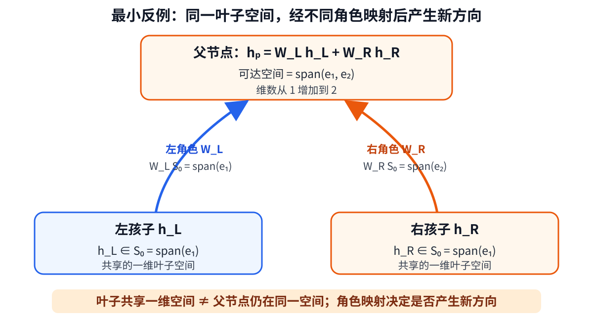

# 树状语言表征：从全局低维到条件低维

> **中心判断：**叶子低维不能推出整棵树全局低维；当前真正成立的是，组合过程新增
> 方向受控时静态树维数受控，而稀疏条件激活时单次计算可以高概率位于局部低维空间。

## 结论一：叶子低维不推出整棵树全局低维

- 叶子可以只占一个方向，但左、右角色映射可把它送入两个独立方向；继续组合还会
  产生更多方向。
- 因此，叶子低维、共享组合规则和有限树深都不是自动保秩条件。
- **不能声称：**短序列低维，所以语言树或 Transformer 表示整体低维。

## 结论二：静态树真正成立的是“累计新增方向核算”

- 全局维数由三件事决定：角色映射压缩多少、同层角色复用多少方向、新层复用多少
  历史方向。
- E07 的 950 条合成记录中，理论维数与独立测量的最大差为 **0 维**。代表性结果
  `128/252 -> 4/24 -> 4/4` 表明：单层低维不等于全局低维，跨层复用才固定全局维数。
- **允许结论：**静态维数核算及其实现成立。
- **不能声称：**E07 没有语言或预训练模型，不能说明真实模型使用这些机制。

## 结论三：更合理的放松是“全局高维、单次条件计算低维”

- E06 控制相同父节点、相同词元和边界方向后，Qwen 为 `+0.0064`、Pythia 约为 `0`；
  当前证据不支持跨模型通用的全局共享线性组合器。
- 对任务相关语义摘要而言，一次输入不必保存整句话的全部信息，可以只激活当前任务
  需要的有限路径。
- **条件定理：**若一次计算最多激活 $s$ 个信息源，每个信息源至多为 $r$ 维，则当前
  模式的可达空间至多为 $sr$ 维；若该稀疏事件高概率成立，维数界也以同样概率成立。
- **两个边界：**不同条件合并后仍可全局高维；激活少也不能保证任务信息被保留。

## 技术附件

- [组会研究理解文档](tree_low_rank_closure_meeting_brief_cn.md)
- [概率性稀疏激活树正式证明](../probabilistic_sparse_activation_tree_theory_proof_cn.md)
- [静态树可达空间正式证明](../tree_low_rank_theory_proof_cn.md)
