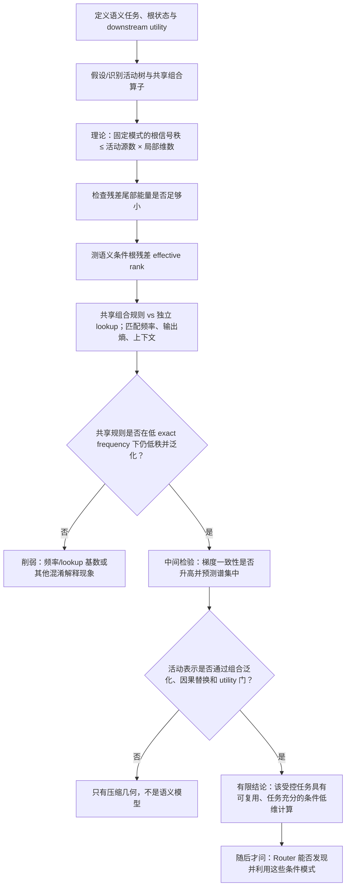

# 语义层级结构与 NTP 条件低秩：简短证明路线

> 状态：组会命题的证明思路，不是已经完成的自然语言定理。  
> 目标：明确“什么可以数学证明、什么必须实验验证、什么结果才允许进入 Router”。

## 一段话认知闭环

我们现在不能直接证明“语义世界天然是一棵长程、层级、低秩的树”。可以证明的较弱命题是：若一次输入—任务只激活少量局部信息源，这些源经共享且受控的组合算子汇总到一个任务根状态，那么固定激活模式下，根表示矩阵的信号部分具有受控秩；若残差能量较小，它也会表现出较低有效秩。但要把这条定理解释为语义模型，还必须另外验证：相同组合规则能跨未见上下文复用、替换中间节点会按预测改变答案、低维活动子树保持 downstream utility。要再推出“NTP 会学出低秩表征”，还需要证明或观察跨上下文规则复用产生一致梯度，并使任务根状态的**语义条件残差**集中到更少方向。树、长程、频率和低秩之间不存在无条件推论；它们只能通过上述可检验中介连接。

## 1. 先定义被证明的对象

对输入 $x$ 和问题/任务 $q$，设模型实际使用的依赖路径形成活动树
$T(x,q)$。根状态为

$$
h_\rho(x,q)\in\mathbb R^d.
$$

对具有相同语义答案 $y$ 或相同活动模式 $m$ 的 held-out 样本，堆叠根状态：

$$
H_\rho^{(m)}
=
[h_\rho(x_1,q_1),\ldots,h_\rho(x_n,q_n)].
$$

为了避免“最终答案类别本身”制造平凡低秩，分解

$$
h_\rho(x,q)=\mu_y+r(x,q),
\qquad
\mu_y=\mathbb E[h_\rho\mid y].
$$

主分析对象是语义条件残差矩阵

$$
R_\rho
=
[r(x_1,q_1),\ldots,r(x_n,q_n)].
$$

它衡量：在答案语义相同后，不同上下文和计算路径还需要多少线性自由度。

经验有效秩定义为

$$
p_i=\frac{\sigma_i^2}{\sum_j\sigma_j^2},
\qquad
r_{\mathrm{eff}}(R_\rho)
=
\exp\left(-\sum_i p_i\log p_i\right).
$$

## 2. 可以严格证明的条件几何结论

假设一次计算只激活集合 $A(m)$ 中的局部源，并且根状态的信号部分可展开为

$$
h_\rho^{\mathrm{sig}}
=
\sum_{u\in A(m)}B_u(m)h_u,
$$

其中每个局部源 $h_u$ 位于至多 $r$ 维空间，$B_u(m)$ 是共享路径算子。若活动源数不超过 $s$，则

$$
\operatorname{rank}
H_{\rho,\mathrm{sig}}^{(m)}
\le sr.
$$

若真实根矩阵满足

$$
H_\rho^{(m)}
=
H_{\rho,\mathrm{sig}}^{(m)}+E,
$$

则最佳 rank-$sr$ 近似的尾部能量满足

$$
\sum_{i>sr}\sigma_i(H_\rho^{(m)})^2
\le
\|E\|_F^2.
$$

因此，只要残差能量占比小，根表示会表现出低尾部能量和较低经验有效秩。

**边界：**这只证明“给定活动模式和算子假设时的容量上界”，不证明真实语义采用该树，也不证明低维表示有用。

## 3. 语义解释必须额外通过三项经验门

### 门 A：组合复用

同一局部规则在未见实体、未见上下文或未见组合中仍然成立。

### 门 B：因果结构

替换或删除一个中间节点，只按树的依赖关系改变根答案；无关节点替换不应产生同样效果。

### 门 C：任务充分性

只保留活动子树后，downstream utility 不显著下降：

$$
R_{\mathrm{sparse}}-R_{\mathrm{full}}\le\varepsilon.
$$

三项没有同时通过时，只能说“存在低维几何”，不能说“它是语义树”。

## 4. 从 NTP 到低有效秩还缺一条学习桥

对同一候选规则 $r$ 在不同上下文中的样本梯度 $g_{r,i}$，定义方向一致性

$$
A_g(r)
=
\frac{\left\|\sum_i g_{r,i}\right\|_2^2}
{n_r\sum_i\|g_{r,i}\|_2^2}.
$$

候选机制是

$$
\text{同一规则跨上下文复用}
\rightarrow
A_g(r)\uparrow
\rightarrow
\text{共享参数模式形成}
\rightarrow
r_{\mathrm{eff}}(R_\rho)\downarrow.
$$

这不是现有定理。它需要同时验证：

1. 复用确实提高梯度一致性；
2. 梯度一致性先于或预测根表示谱集中；
3. 低有效秩不是答案类别坍缩、少量 lookup 表或训练失败造成；
4. 表示仍通过语义一致性和 downstream utility 门。

## 5. 最强竞争解释

低有效秩可能不来自可复用语义规则，而只来自：

> 独立 lookup 规则数量较少，任务本身的函数基数更小。

因此必须构造相同 exact frequency、相同输出熵、相同上下文多样性，但分别由：

- 一个共享可组合规则族；
- 同样数量的独立随机 lookup 规则；

生成的数据，并在答案语义条件化后比较根残差有效秩。

## 6. 证明与证伪流程图

## 7. 允许和禁止的结论

### 允许

- 在明确受控任务中，证明条件活动树的信号秩上界。
- 在任务门通过后，检验共享规则是否对应较低的语义条件根有效秩。
- 用 lookup 数量、exact frequency 和 context diversity 分离竞争解释。

### 禁止

- 从一次合成实验推出自然语言整体是树。
- 从 root effective rank 推出参数矩阵低秩。
- 从低有效秩推出泛化、专家 specialization 或 Router utility。
- 从“长程”或“高频”单独推出低秩。
